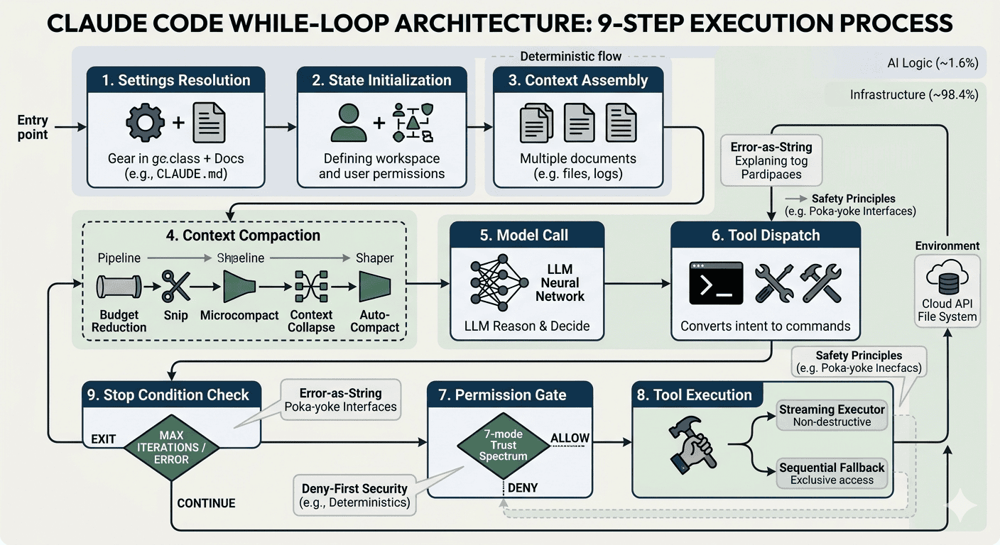

* TOC
{:toc}

# Architecture of Claude Code: The While-Loop Design

## Overview
The "while-loop" architecture of Claude Code is a deterministic orchestration wrapper 
surrounding a ReAct (Reason + Act) agentic framework. Research suggests that only about 
1.6% of the codebase is dedicated to the core AI logic, while the remaining 98.4% is 
infrastructure focused on safety, state management, and reliable tool interaction.



## The Core Execution Loop

The system functions as an `AsyncGenerator`, where each iteration follows a strict 
nine-step sequence:

1. **Settings Resolution**: Loads project-specific configurations (e.g., `CLAUDE.md`).
2. **State Initialization**: Defines the workspace, user permissions, and session constraints.
3. **Context Assembly**: Gathers relevant files, logs, and interaction history.
4. **Context Compaction**: Executes a 5-layer pipeline (Budget Reduction, Snip, Microcompact, Context Collapse, Auto-Compact) to minimize token overhead.
5. **Model Call**: The LLM evaluates state and determines the next action.
6. **Tool Dispatch**: Converts model intent into executable commands.
7. **Permission Gate**: Validates the request against a multi-modal trust spectrum.
8. **Tool Execution**: Runs the command via a `StreamingToolExecutor` or serial execution path.
9. **Stop Condition Check**: Evaluates if the task should terminate or continue to the next iteration.

[Image of a flow chart showing the 9-step while-loop execution process for an AI agent]

## Design Principles

The architecture is governed by specific principles designed to prioritize reliability:

* **Poka-yoke (Mistake-proofing) Interfaces**: Forces strict input formats (e.g., absolute 
file paths) to reduce common model hallucinations or syntax errors.

* **Error-as-String Handling**: Instead of crashing on errors, tools return error messages as 
strings, allowing the agent to "read" the error and attempt a fix in the next iteration of the loop.

* **Deny-First Security**: Permissions are re-validated in every instance of the loop, preventing 
persistent trust escalation.

* **Subagent Isolation**: Delegation triggers the instantiation of a completely new, isolated loop 
instance to prevent context pollution.

## Execution Paths and Termination

The system optimizes performance through two paths:

* **StreamingToolExecutor**: Used for non-destructive, concurrent-safe operations.

* **Fallback/Exclusive Path**: Serializes execution for tools that require exclusive file system 
access to prevent race conditions.

**Termination** is strictly enforced via a "Max Iterations" cap (typically 15-25 turns). If the 
limit is reached, the agent is forced into an "early stopping" pattern, summarizing the current 
state rather than abruptly terminating.

## References

- Liu, J., Zhao, X., Shang, X., & Shen, Z. (2026). *Dive into Claude Code: The Design Space of Today's and Future AI Agent Systems*. arXiv.


# Overview

Claude Code is usually described as "an AI coding assistant." That framing
misses the interesting half of the system. According to a recent source-level
analysis of its public TypeScript build, only **about 1.6% of the codebase is
AI decision logic** — the model and its prompts. The remaining **98.4% is a
deterministic operational harness**: a permission gate, a five-layer
compaction pipeline, four extension mechanisms, a subagent orchestrator, and
an append-only session store ([Liu et al., 2026][paper], §11.1).

That ratio is the thesis of this post. The model is small and stateless. The
*harness* — the systems software around it — is what makes Claude Code
behave like a production tool instead of a chatbot with shell access. This
post walks through how the harness works, traces a single turn end-to-end,
maps the four extension surfaces (hooks, skills, plugins, MCP) by their
context cost, and finishes with the best practices that fall out of the
architecture once you understand it.

> Primary sources used throughout:
> - Liu, Zhao, Shang, Shen. *Dive into Claude Code: The Design Space of
>   Today's and Future AI Agent Systems.* arXiv:[2604.14228v1][paper],
>   April 2026. Source-level analysis of Claude Code v2.1.88. Companion
>   repo: <https://github.com/VILA-Lab/Dive-into-Claude-Code>.
> - Anthropic. *Claude Code documentation.* <https://code.claude.com/docs/>
>   and *How Claude Code works*,
>   <https://code.claude.com/docs/en/how-claude-code-works>.
> - Shanraisshan. *Claude Code Best Practice* (community notes),
>   <https://github.com/shanraisshan/claude-code-best-practice>.

Generated by AI.

---

## 1. The Mental Model: Five Values → Thirteen Principles → Architecture

Before reading any source file, it helps to know what the architecture is
*trying* to do. The paper extracts five human values that the architects
optimised for, then traces them through thirteen design principles to
specific code (§2):

| Value | What it means | Visible behaviour |
|-------|---------------|-------------------|
| **Human Decision Authority** | Humans keep ultimate say. Principal hierarchy: Anthropic → operators → users. | Deny-first prompts, plan mode, the seven permission modes. |
| **Safety, Security, Privacy** | The system protects the human even when the human is inattentive. | ML safety classifier, optional shell sandbox, blanket-deny pre-filter. |
| **Reliable Execution** | The agent does what the user *meant*, stays coherent across long horizons. | The three-phase loop (gather → act → verify), recovery counters, fallback model. |
| **Capability Amplification** | The tool enables *new* workflows, not just faster old ones. | Minimal scaffolding, broad model latitude, up to 54 built-in tools. |
| **Contextual Adaptability** | The system fits *your* project and improves with you. | CLAUDE.md hierarchy, auto-memory, graduated trust spectrum. |

The thirteen principles compress neatly into three meta-commitments that
recur across every subsystem (§11.7):

1. **Graduated layering over monolithic mechanisms.** Where most systems
   pick one safety boundary or one compaction strategy, Claude Code stacks
   *many* independent ones in series. Defense in depth, applied to
   everything.
2. **Append-only designs that favour auditability over query power.**
   Session transcripts are JSONL files you can `cat`. Compaction emits a
   read-time projection, never destructive edits.
3. **Model judgment inside a deterministic harness.** The model picks
   *what* to do; the harness decides *whether and how* it actually runs.

Once these three ideas click, almost every design choice in Claude Code
stops being a puzzle.

---

## 2. The Seven-Component Architecture

At the highest level, Claude Code decomposes into seven components
([Liu et al., 2026][paper], Figure 1). All entry surfaces — interactive
CLI, headless `claude -p`, Agent SDK, IDE plugins — funnel into the same
core loop:

```
                                  ┌──────────────────────┐
                                  │  Permission System   │
                                  │ (rules + ML cls.)    │
                                  └─────────▲────────────┘
                                            │ allow/ask/deny
            ┌──────────┐  request  ┌────────┴────────┐  tool req.  ┌──────┐
   user ─►  │Interfaces│ ────────► │   Agent Loop    │ ──────────► │Tools │
            │ CLI/IDE/ │  progress │  (queryLoop()   │  result     │ 54+  │
            │ SDK/Web  │ ◄──────── │   async gen.)   │ ◄────────── │      │
            └──────────┘           └────┬────────────┘             └──┬───┘
                                        │ load   ▲ persist            │
                                        ▼        │                    ▼
                                  ┌─────────────────────┐    ┌──────────────────┐
                                  │ State & Persistence │    │ Execution Env.   │
                                  │ JSONL transcripts   │    │ Files/Shell/Web/ │
                                  │ history.jsonl       │    │ MCP servers      │
                                  └─────────────────────┘    └──────────────────┘
```

The seven components map directly to source files in the published build
(§3.2):

| Component | Source file | Role |
|-----------|-------------|------|
| **User** | (the human) | Submits prompts, approves permissions. |
| **Interfaces** | `src/entrypoints/` | Interactive CLI, headless CLI, SDK, IDE/Desktop/Browser. All feed the same loop. |
| **Agent loop** | `query.ts` (`queryLoop()`) | Iterative model call → tool dispatch → result collection. An `AsyncGenerator`. |
| **Permission system** | `permissions.ts`, `yoloClassifier.ts`, `types/hooks.ts` | Deny-first rules, the auto-mode ML classifier, hook-based interception. |
| **Tools** | `tools.ts` (`assembleToolPool()`) | Up to 54 built-in tools (19 unconditional + 35 feature-gated) merged with MCP tools. |
| **State & persistence** | `sessionStorage.ts`, `history.ts` | Append-only JSONL transcripts, global prompt history, subagent sidechains. |
| **Execution environment** | `BashTool.tsx`, `src/remote/`, `services/mcp/client.ts` | Shell (optionally sandboxed), filesystem, web fetches, MCP server connections. |

The shape that matters: **the model never talks to the filesystem, the
shell, or the network directly.** It emits `tool_use` blocks; the harness
parses them, runs them through the permission system, dispatches to tool
implementations, and feeds the structured result back. A compromised or
adversarially manipulated model cannot override the harness because *the
model has no other interface to the outside world.*

The same source-level analysis shows the harness exposes the model to a
**five-layer subsystem decomposition** (Figure 3) that adds detail to the
seven-component view:

```
  ┌──────────┐   ┌─────────┐   ┌────────────────────────────┐   ┌──────────┐
  │ Surface  │   │  Core   │   │       Safety / Action      │   │ Backend  │
  │          │   │         │   │                            │   │          │
  │ CLI      │──►│ Agent   │──►│ Permission ─► Built-in     │──►│ Local    │
  │ Headless │   │ Loop    │   │ + classifier   tools       │   │ Cloud    │
  │ SDK      │   │ +       │   │ Hooks  ─►   MCP tools      │   │ Remote   │
  │ IDE/UI   │   │ Compact │   │             Shell sandbox  │   │ External │
  └──────────┘   └─────────┘   │             Subagents      │   └──────────┘
                               └────────────────────────────┘
       └──────────────────── State Layer ──────────────────────┘
       Context assembly | Runtime state | Sessions | CLAUDE.md+mem | Sidechains
```

Surface, Core, Safety/Action, Backend, and a transverse State layer. Every
turn touches each layer.

---

## 3. One Turn End-to-End

Take a concrete user request — *"Fix the failing test in `auth.test.ts`"*
— and watch it propagate. This is the running example the paper uses
throughout §4–§9.

```
   User Prompt
        │
        ▼
   ┌────────────────────────────────────────────────────────────────┐
   │ (1) Context assembly                                           │
   │     getSystemContext() + getUserContext()                      │
   │     System prompt + CLAUDE.md hierarchy + auto-memory          │
   │     + tool schemas + history (post-compact boundary)           │
   └────────────────────────────────────────────────────────────────┘
        │
        ▼
   ┌────────────────────────────────────────────────────────────────┐
   │ (2) Pre-model context shapers   ── runs every turn ──          │
   │     a. Budget reduction      (cap per-tool-result size)        │
   │     b. Snip                  (trim oldest history)             │
   │     c. Microcompact          (fine-grained compression)        │
   │     d. Context collapse      (read-time projection)            │
   │     e. Auto-compact          (full LLM summary as last resort) │
   └────────────────────────────────────────────────────────────────┘
        │
        ▼
   ┌──────────────────────────┐
   │ (3) Model call           │   streams tool_use blocks
   │     deps.callModel()     │   ──────────────────►
   └──────────────────────────┘
        │
        ▼
   ┌────────────────────────────────────────────────────────────────┐
   │ (4) Tool dispatch + permission gate                            │
   │     filterToolsByDenyRules()  ─►  PreToolUse hook              │
   │       ─► rule evaluation     ─►  auto-mode classifier          │
   │       ─► permission handler  ─►  shell sandbox                 │
   │     Allow ─► execute (StreamingToolExecutor, often parallel)   │
   │     Ask   ─► user dialog                                       │
   │     Deny  ─► routing signal: model gets denial reason, retries │
   └────────────────────────────────────────────────────────────────┘
        │
        ▼
   ┌────────────────────────────────────────────────────────────────┐
   │ (5) Collect tool_result, normalize, append to history          │
   │     PostToolUse hook fires (auto-format? lint? scan?)          │
   └────────────────────────────────────────────────────────────────┘
        │
        ▼
   ┌────────────────────────────────────────────────────────────────┐
   │ (6) Loop or stop                                               │
   │     Tool_use in response?  ── yes ── back to (2)               │
   │                            ── no  ── emit text, end turn.      │
   │     Other stop conditions: max turns, prompt_too_long,         │
   │     PostToolUse hook intervention, explicit abort.             │
   └────────────────────────────────────────────────────────────────┘
```

The loop is structurally a **while-true cycle with state** — a single
`State` object stores messages, tool context, compaction tracking, and
recovery counters; seven "continue points" in the loop each overwrite the
*whole* object atomically rather than mutating fields. That whole-object
assignment style is what makes the recovery counters and feature flags
safe under streaming.

A few things to notice that contradict common assumptions:

- **The loop is reactive, not planning-graph based.** Each turn commits
  to one action sequence; there is no backtracking, no tree search. It's
  the ReAct pattern ([Yao et al., 2022]) wrapped in a lot of plumbing.
- **Tools can execute concurrently.** `StreamingToolExecutor` begins
  running tools as they stream in from the model response, with a
  sibling-abort controller that fires when any Bash tool errors —
  immediately terminating the other in-flight subprocesses. Read-only
  tools run in parallel; state-mutating ones serialise.
- **The model never directly stops the loop.** Loop termination is a
  property of the harness: either the model emits no `tool_use` blocks
  (the primary stop), or one of four other conditions trips.

---

## 4. The Permission System: Seven Layers of "Deny First"

Anthropic's auto-mode study found that users approve **about 93% of
permission prompts** ([Hughes, 2026], cited in §5). That number is the
hidden reason the permission system looks the way it does: interactive
confirmation cannot be trusted as a sole safety mechanism once users
habituate. The architectural answer was not to add more warnings — it was
to build *seven independent layers*, any one of which can block an action
(§3.5):

```
   model emits tool_use
            │
            ▼
   ┌──────────────────────────────────┐
   │ 1. Tool pre-filtering            │   blanket-denied tools removed
   │    filterToolsByDenyRules()      │   from the model's view entirely
   └────────────────┬─────────────────┘
                    ▼
   ┌──────────────────────────────────┐
   │ 2. PreToolUse hook               │   hooks may deny, ask, or rewrite
   └────────────────┬─────────────────┘
                    ▼
   ┌──────────────────────────────────┐
   │ 3. Deny-first rule evaluation    │   deny always beats allow:
   │    permissions.ts                │   e.g. deny "Bash" overrides
   │                                  │   allow "Bash(prefix:npm)"
   └────────────────┬─────────────────┘
                    ▼
   ┌──────────────────────────────────┐
   │ 4. Permission mode constraints   │   plan / default / acceptEdits /
   │                                  │   auto / dontAsk / bypassPermissions
   └────────────────┬─────────────────┘
                    ▼
   ┌──────────────────────────────────┐
   │ 5. Auto-mode ML classifier       │   yoloClassifier.ts — 2-stage
   │    (when TRANSCRIPT_CLASSIFIER)  │   fast-filter + CoT evaluation
   └────────────────┬─────────────────┘
                    ▼
   ┌──────────────────────────────────┐
   │ 6. Shell sandbox                 │   shouldUseSandbox.ts — fs/net
   │    (when enabled)                │   isolation, independent of perm
   └────────────────┬─────────────────┘
                    ▼
   ┌──────────────────────────────────┐
   │ 7. Non-restoration on resume     │   --resume rebuilds the perm ctx;
   │                                  │   prior grants do NOT carry over
   └──────────────────────────────────┘
                    │
                    ▼  execute
```

### The seven permission modes

A request that survives the pre-filter is then evaluated against whichever
of the seven modes is active (§5.1):

| Mode | Behaviour |
|------|-----------|
| `plan` | Model must produce a plan; execution only proceeds after user approval. |
| `default` | Standard interactive use; most operations require approval. |
| `acceptEdits` | Edits in working dir and certain filesystem commands (`mkdir`, `mv`, `cp`, `sed` …) auto-approved. |
| `auto` | ML classifier evaluates each request not matched by a fast-path rule. |
| `dontAsk` | No prompting, but deny rules still enforced. |
| `bypassPermissions` | Skip most prompts. Safety-critical and bypass-immune rules remain. |
| `bubble` (internal) | Subagent permission escalation to the parent terminal. |

These modes form a *graduated autonomy spectrum*. Anthropic's longitudinal
data ([McCain et al., 2026]) shows auto-approve rates climb from ~20% at
fewer than 50 sessions to over 40% by 750 sessions — the gradient is
typically navigated by habituation, not by deliberate mode selection.

### Why deny-first, not container-first?

Other systems answer the safety question with different architectures
(§5, §10):

- **SWE-Agent / OpenHands** — Docker container isolation as the primary
  boundary. Strong resource isolation, weaker per-action granularity.
- **Aider** — Git rollback as the safety net. Every change reversible
  through version control.
- **Claude Code** — Per-action deny-first rules + optional sandbox +
  optional version control. Layered.

The trade-off is direct: container-first systems pay setup cost and lose
host integration; Claude Code pays the cost of seven layered checks per
tool invocation, but each layer is independent and can fail without
necessarily exposing the next one.

That "independent" claim is doing work. Security researchers
([Adversa.ai, 2026]) found that Bash commands with **more than 50
subcommands** fall back to a single generic approval prompt because
per-subcommand AST parsing caused UI freezes — a documented case where
defense-in-depth degrades when its layers share a *performance* failure
mode rather than a logical one. And two of four recent CVEs
(CVE-2025-59536 at CVSS 8.7, CVE-2026-21852 at CVSS 5.3) exploited
pre-trust *initialization ordering* — code running during extension
init before the deny-first pipeline is engaged — not the runtime
permission pipeline itself. The other two (CVE-2025-54794, -54795)
exploited path-validation and command-parsing flaws elsewhere. The
lesson: layered safety is only as strong as the layers' *independence*.

---

## 5. Context as the Binding Constraint

The **context window** (200K tokens for older Claude models, 1M for the
Claude 4.6 series) is the real binding resource in Claude Code, not
compute or API budget (§3.1). Every other context-management decision
follows from that.

### The five-layer compaction pipeline

Before *every* model call, five context shapers run in sequence
(`query.ts`:365–453). They are ordered from cheapest/least-disruptive to
most aggressive (§4.3):

```
   ┌─────────────────────────────────────────────────────────────┐
   │ messagesForQuery (the array the model will see)             │
   └──────────────────────────┬──────────────────────────────────┘
                              │
                              ▼
   1.  Budget reduction       (always active)
       applyToolResultBudget()
       → per-message size limits; oversized outputs replaced with content
         references (e.g. "[output truncated, 412 KB elided]")
                              │
                              ▼
   2.  Snip                   (HISTORY_SNIP flag)
       snipCompactIfNeeded()
       → trim oldest history segments wholesale
                              │
                              ▼
   3.  Microcompact           (CACHED_MICROCOMPACT flag)
       → fine-grained compression; cache-aware path uses real
         cache_deleted_input_tokens rather than estimates
                              │
                              ▼
   4.  Context collapse       (CONTEXT_COLLAPSE flag)
       applyCollapsesIfNeeded()
       → "Nothing is yielded; the collapsed view is a read-time
          projection over the REPL's full history" — non-destructive
                              │
                              ▼
   5.  Auto-compact           (default on, user-disable possible)
       compactConversation()
       → full LLM-generated summary; runs only if the four previous
         layers leave context still over the pressure threshold
                              │
                              ▼
   ┌─────────────────────────────────────────────────────────────┐
   │ Model call: deps.callModel(messagesForQuery, …)             │
   └─────────────────────────────────────────────────────────────┘
```

Compare to simpler alternatives:

| Approach | Mechanism | Granularity |
|----------|-----------|-------------|
| Simple truncation | Drop oldest messages | Coarse |
| Sliding window | Fixed-size recent history | Medium |
| RAG | Retrieve relevant snippets | Fine |
| Single summarization | One-pass compress | Coarse |
| **Graduated compaction** | **Multi-layer pipeline** | **Very fine** |

(Table 6 in the paper.) The cost of "very fine" is *complexity*: five
interacting layers, several gated by feature flags, produce behaviour
that's hard to predict from any single configuration file. The benefit is
graceful degradation — the cheapest layer runs first, and the expensive
LLM summarisation only fires when there's no other choice.

### The six-tier context window

Sources that get *into* the context window are themselves stratified
(Figure 6):

```
   ┌──── Context Window ─────────────────────────────────────────┐
   │                                                             │
   │ (1) System Layer        [startup, read-only]                │
   │     • System prompt  • Environment info  • Output styles    │
   │     • Skill descriptions  • MCP tool names                  │
   │                                                             │
   │ (2) Project Config      [startup/lazy, hot-reload]          │
   │     • CLAUDE.md hierarchy (4 levels)                        │
   │     • Path-scoped rules (.claude/rules/*.md)                │
   │                                                             │
   │ (3) Memory              [startup, sys-write]                │
   │     • Auto memory  • Compact summaries (replace long hist.) │
   │                                                             │
   │ (4) Conversation        [carry forward, append]             │
   │     • Conversation history  • Subagent summaries            │
   │                                                             │
   │ (5) Runtime             [carry forward, model-trigger]      │
   │     • Read files  • Command outputs  • Tool results         │
   │                                                             │
   │ (6) On-Demand           [lazy-load]                         │
   │     • Deferred tool definitions (full schemas via ToolSearch)│
   └─────────────────────────────────────────────────────────────┘
```

Mutability increases as you move down. Tier 1 is set at startup and
read-only for the session; tier 6 only loads when the model explicitly
asks via `ToolSearch`. The granularity matters: a long-running session
can drift in tier-4 and tier-5 content even as tiers 1–3 stay pinned, so
"the same CLAUDE.md" produces consistent baseline behaviour even after
many turns.

### Four-level CLAUDE.md hierarchy

`claudemd.ts` defines four memory types, loaded in *reverse order of
priority* (later-loaded files get more attention):

| Type | Path | Scope |
|------|------|-------|
| **Managed memory** | `/etc/claude-code/CLAUDE.md` | OS-level policy for all users |
| **User memory** | `~/.claude/CLAUDE.md` | Private global instructions |
| **Project memory** | `CLAUDE.md` / `.claude/CLAUDE.md` / `.claude/rules/*.md` | Checked into the codebase |
| **Local memory** | `CLAUDE.local.md` | Gitignored, private project-specific |

A key subtlety: **CLAUDE.md content is delivered as a user message, not as
system prompt content.** That means model compliance with CLAUDE.md is
*probabilistic* rather than guaranteed — which is precisely why
deterministic enforcement (permission rules, hooks) is a separate layer.
Treat CLAUDE.md as *guidance*, settings.json as *enforcement*.

---

## 6. Four Extension Mechanisms — by Context Cost

A natural question is why Claude Code has *four* different ways to extend
it (hooks, skills, plugins, MCP) instead of one unified API. The paper's
answer is that each mechanism trades different deployment complexity for
a different *kind* of extensibility, and — critically — for a different
*context cost* (§6, Table 2):

| Mechanism | Unique capability | Context cost | Insertion point |
|-----------|-------------------|--------------|------------------|
| **Hooks** | Lifecycle interception + event-driven automation | **Zero by default** | `execute()`: pre/post tool |
| **Skills** | Domain-specific instructions + meta-tool invocation | Low (descriptions only) | `assemble()`: context injection |
| **Plugins** | Multi-component packaging + distribution | Medium (varies) | All three points |
| **MCP servers** | External service integration (multi-transport) | **High** (tool schemas) | `model()`: tool pool |

The graduated cost ordering means cheap extensions can scale broadly
without exhausting the bounded context window. Expensive ones (MCP) are
reserved for cases that genuinely require new tool surfaces.

```
   one turn of Claude Code's agent loop
   while not stopped:
       ┌─ assemble() ─────── what the model sees
       │   • CLAUDE.md files (loaded at startup; subdirs load on demand)
       │   • Skill descriptions  (advertises skills so the model can call SkillTool)
       │   • MCP resources & prompts
       │   • Output style (replaces response-formatting system block)
       │   • UserPromptSubmit hook  (inject context per user turn)
       │   • SessionStart hook      (one-shot context injection)
       │
       ├─ model() ────────── what the model can reach
       │   • Built-in tools (Read, Edit, Bash, …)  ← always
       │   • MCP tools                              ← MCP servers
       │   • SkillTool         meta-tool that launches a skill by name
       │   • AgentTool         meta-tool that spawns a subagent
       │
       └─ execute() ───────── whether/how an action runs
           • Permission rules        (allow / deny / ask per call)
           • PreToolUse hook         (approve / block / rewrite)
           • PostToolUse hook        (mutate output, inject context)
           • Stop / SubagentStop     (force-continue at model stop)
           • Notification hook       (external side effects)
```

(Adapted from Figure 5 of the paper.)

### Hooks — 27 events, zero context cost

The source defines **27 hook events** across tool authorization
(PreToolUse, PostToolUse, PostToolUseFailure, PermissionRequest,
PermissionDenied), session lifecycle (SessionStart, SessionEnd, Setup,
Stop, StopFailure), user interaction (UserPromptSubmit, Elicitation),
subagent coordination (SubagentStart, SubagentStop, TeammateIdle,
TaskCreated, TaskCompleted), context management (PreCompact, PostCompact,
InstructionsLoaded, ConfigChange), workspace events, and notifications.

Hooks have **zero context cost** because they fire as shell commands
outside the model's view (or as in-process callbacks for SDK use). They're
the right mechanism for deterministic *enforcement* — auto-formatting on
`PostToolUse`, scanning for secrets on `UserPromptSubmit`, vetoing a turn
on `PreCompact`.

### Skills — domain instructions at low cost

A skill is a `SKILL.md` file with YAML frontmatter (15+ supported fields:
description, allowed-tools, argument hints, model overrides, hook
definitions, …). Only the **description** lives in the context window
permanently; the body is injected only when the model calls `SkillTool`
with that skill's name.

This is why skill descriptions are *triggers*, not summaries — they have
to signal when the model should activate the skill, which is the entire
basis of skill discovery.

### Plugins — packaging, not a runtime primitive

Plugins are both a packaging format *and* a distribution mechanism. A
single plugin manifest can declare ten component types: commands, agents,
skills, hooks, MCP servers, LSP servers, output styles, channels,
settings, and user configuration. The plugin loader routes each component
to its respective registry — plugins are the *delivery vehicle*, not a
fifth extension primitive.

### MCP — the heavy mechanism

The Model Context Protocol is the only mechanism that brings *new
external tools* into the model's reach. The MCP client supports stdio,
SSE, HTTP, WebSocket, SDK, and IDE-specific transports
(`services/mcp/client.ts`). MCP donated its specification to the Linux
Foundation's Agentic AI Foundation in 2025, making it the closest thing
to an open standard for agent–tool interop.

The cost is real: each connected server contributes tool definitions
(`MCPTool` objects), and tool *schemas* are what consume the high context
budget. The mitigation is deferred schema loading via `ToolSearch`
(tier 6 of the context window) — when enabled, some tools include only
their names in the initial context, with full schemas loaded only when
the model explicitly searches for them.

---

## 7. Subagents: Isolated Workers with Summary-Only Returns

When a task needs broad exploration that would pollute the main context,
Claude Code can delegate via the `Agent` tool (`AgentTool.tsx`,
`runAgent.ts`). The subagent runs in **its own context window** with its
own tool set, and returns only a summary back to the parent (§8).

```
   ┌────────────────┐          ┌─────────────┐
   │ Main Conv.     │ delegate │   Agent     │     Isolation Sandbox
   │ (parent ctx)   │ ───────► │ (type alias │
   └────────┬───────┘          │  for Task)  │     ┌─────────────────┐
            │ read & write     └──────┬──────┘     │ 1. Rebuilt perm │
            ▼                         │            │    ctx & tools  │
   ┌────────────────┐                 │            │ 2. Perm-mode    │
   │ Main Transcript│ ◄───────────────┼──────────► │    override     │
   │ (file)         │  insert result  │            │ 3. Isolated     │
   └────────────────┘                 │            │    worktree     │
                                      ▼            └─────────────────┘
                                ┌──────────────┐
                                │ Sub-trans-   │  Subagent Report
                                │ cript.jsonl  │  → text + metadata
                                │ + meta.json  │     (only this is
                                │ (sidechain)  │      sent to parent)
                                └──────────────┘
```

### Six built-in subagent types

| Type | Purpose |
|------|---------|
| `Explore` | Read-/search-oriented investigation with write/edit on the deny-list |
| `Plan` | Creates structured plans; execution then proceeds normally |
| `general-purpose` | Broadly capable, used when explicitly requested |
| `Claude Code Guide` | Onboarding & docs assistance; own permission-mode override |
| `Verification` | Runs validation (test suites, linting) |
| `Statusline-setup` | Specialised for terminal status line configuration |

Plus user-defined subagents in `.claude/agents/*.md` and
plugin-contributed ones.

### Three isolation modes

- **Worktree** — temporary git worktree, filesystem-level isolation.
  The default for repo-mutating exploration. Uses Git's built-in
  mechanism rather than introducing container orchestration.
- **Remote** (internal-only) — launches in a remote Claude Code Remote
  environment, always background.
- **In-process** (default) — shares the filesystem with the parent but
  runs in an isolated conversation context.

### The 7× token cost — and why summary-only returns matter

Claude Code's agent teams consume **approximately 7× the tokens of a
standard session in plan mode** ([Anthropic, 2025b], cited in §8.3). The
**summary-only return** policy is the architectural counterweight: the
subagent's full transcript is written to a sidechain file
(`.jsonl + .meta.json`), preserved for auditing, but **only the final
response text and metadata return to the parent's context.**

Conversation-based frameworks (e.g. AutoGen) that share full transcripts
between agents risk context explosion as the number of agents grows.
Claude Code's design says: pay the isolation cost up front, keep parent
context bounded.

A small operational detail that matters for debugging: multi-instance
coordination uses **file-locking on the shared filesystem** rather than a
message broker. Tasks claim entries from a shared list via lock files at
predictable paths. Trade-off: lower throughput but zero-dependency
deployment and full audit transparency — any agent's state is one
`cat` away.

---

## 8. Persistence: Append-Only Transcripts

Three persistence channels operate independently (§9.1):

1. **Session transcripts** — append-only JSONL at a project-specific
   path; one file per session.
2. **Global prompt history** — user prompts only, in `history.jsonl`
   at `~/.claude/`. Drives Up-arrow and Ctrl-R navigation.
3. **Subagent sidechains** — separate `.jsonl + .meta.json` per
   subagent (see §7).

```
        Session ID
   ┌──────────────────┐
   │ Conversation     │ ─────►  Context Window
   │ (live state)     │
   └────────┬─────────┘
            │
            ▼ durable storage
   ┌──────────────────┐         ┌─────────────────────┐
   │ Session          │         │ Compaction flow:    │
   │ Transcript.jsonl │         │ 1. Remove old tool  │
   │ History/sidechain│         │    outputs          │
   │ Checkpoints      │         │ 2. Generate summary │
   └──────────────────┘         │ 3. Mark boundary    │
            │                   └─────────────────────┘
            ▼
   --rewind │ --resume │ --branch
```

### Two design rules embedded in this layer

| Principle | What it does |
|-----------|--------------|
| **Conversations outlive context** | Transcripts record everything; compaction can recycle the live view without ending the session. |
| **Conversations outgrow a single path** | Append-only logs let users rewind, resume, or fork into new branches without losing prior work. |

### Why permissions are NOT restored on resume

`--resume` replays the transcript to rebuild the conversation; `branch`
forks a new session from an existing one (`commands/branch/branch.ts`).
Both **deliberately re-prompt** for permissions even though they could
trivially be restored from the transcript.

The reasoning (§9.2): sessions are treated as **isolated trust domains**.
Restoring previously granted permissions on resume would create a
convenience benefit *but* risk carrying stale trust decisions into a
changed context — perhaps the user is on a different network, or the
repo state has shifted. The architecture trades convenience for the
invariant that "trust is always established in the current session."

This is the kind of design choice you'd only make if you genuinely
believed approval fatigue was a deeper problem than per-action friction —
which, given the 93% approval rate Anthropic measured, it is.

---

## 9. One Point in a Design Space: The OpenClaw Contrast

It's tempting to read Claude Code's architecture as *the* answer to
"how should an AI agent system be built." The paper deflates that read
by comparing it to **OpenClaw**, an independent open-source multi-channel
agent gateway, across six dimensions (Table 3):

| Dimension | Claude Code | OpenClaw |
|-----------|-------------|----------|
| **System scope** | CLI/IDE coding harness, ephemeral per-session process | Persistent WebSocket gateway daemon, multi-channel control plane |
| **Trust model** | Deny-first per-action rule evaluation, ML classifier, 7 modes | Single trusted operator per gateway, DM pairing + allowlists for inbound channels |
| **Agent runtime** | Iterative async generator `queryLoop()` *is* the system | Pi-agent runner embedded inside the gateway RPC dispatch |
| **Extensions** | 4 mechanisms graduated by context cost (MCP, plugins, skills, hooks) | Manifest-first plugin system with 12 capability types and a central registry |
| **Memory & context** | CLAUDE.md 4-level hierarchy + 5-layer compaction; LLM-based memory scan | Workspace bootstrap files + separate memory system + optional hybrid (vector+keyword) search |
| **Multi-agent** | Task-delegating subagents; worktree isolation; summary-only returns | Two concerns separated: multi-agent routing (isolated agents per channel) + sub-agent delegation |

The same recurring design questions surface on both sides — but the
deployment context (coding harness vs. multi-channel personal-assistant
gateway) drives different answers. The two systems can even **compose**:
OpenClaw can host Claude Code as an external coding harness via ACP
(Agent Client Protocol).

The takeaway for users of either system: when you see a feature in
Claude Code, you're seeing one *answer* to a design question. The
question itself is general.

---

## 10. Tensions Worth Knowing

The paper enumerates five structural tensions in the architecture
(Table 4). Knowing them is useful because each one is a place where the
system *will* behave in surprising ways.

| Value pair | Tension | What it looks like in practice |
|------------|---------|--------------------------------|
| **Authority × Safety** | Approval fatigue vs. protection | 93% approval rate makes interactive confirmation behaviourally unreliable; the system has to be safe *without* relying on user attention. |
| **Safety × Capability** | Performance vs. defense depth | The `>50 subcommand` fallback exists because per-subcommand AST parsing was too slow — layers can degrade together when they share performance constraints. |
| **Adaptability × Safety** | Extensibility vs. attack surface | Four extension mechanisms ⇒ richer customisation but more code that runs pre-trust; two of the recent CVEs exploited that initialization window directly. |
| **Capability × Adaptability** | Proactivity vs. disruption | Proactive AI features improve task completion 12–18% but user preference *drops* at high frequencies. |
| **Capability × Reliability** | Velocity vs. coherence | Bounded context prevents full-codebase awareness; subagent isolation limits cross-agent consistency. |

And the paper applies a sixth lens — **long-term human capability
preservation** — that isn't a co-equal value but is empirically real:

- A randomised controlled trial of 16 experienced developers across 246
  tasks ([Becker et al., 2025]) found AI tools made developers **19%
  slower** despite a **perceived 20% improvement**.
- Causal analysis of Cursor adoption across 807 repositories
  ([He et al., 2025]) found code complexity increased **40.7%**
  (p < 0.001), with an initial velocity spike (+281% in month one)
  dissipating to baseline by month three.
- An EEG study of 54 participants ([Kosmyna et al., 2025]) found LLM
  users showed weakened neural connectivity that *persisted after AI
  was removed.*

None of this invalidates Claude Code, but it's an honest read of where
the architecture has room to grow. The paper's open directions (§12)
include cross-session memory substrates, observability/evaluation gap
closure, horizon scaling from sessions to multi-session programs, and
formal verification of permission properties.

---

## 11. Takeaways

Three things to carry away from the architecture:

1. **Claude Code is 98.4% systems software.** The interesting engineering
   is the permission gate, the compaction pipeline, the extension
   mechanisms, the subagent orchestrator, and the append-only persistence
   — not the model. Treating it as a chatbot under-uses it.

2. **Defense in depth via independent layers — when they're actually
   independent.** Seven permission layers; five compaction shapers; four
   extension mechanisms by context cost. Each layer is cheap in isolation
   and expensive only when invoked. Where they share a performance or
   initialisation failure mode, the architecture leaks.

3. **The harness enables the model.** Almost every Claude Code design
   choice — append-only transcripts, summary-only subagent returns,
   non-restored permissions on resume, lazy-loaded path-scoped rules,
   deferred tool schemas — exists to give the model *operating room*
   inside a bounded context window. Best practices that work *with* this
   grain produce dramatically better results than ones that fight it.

The paper closes on a deeper observation worth repeating: *"the space of
interesting harness combinations doesn't shrink as models improve; it
moves."* Treat the architecture documented here as a snapshot of a
co-evolving system, not a fixed optimum.

---

## 12. Best Practices, Grounded in the Architecture

The community best-practice notes and Anthropic's own docs converge on
the same handful of patterns. They're easier to remember once you know
*why* each one works. This section is meant to grow over time as new
patterns prove themselves out.

### 12.1 CLAUDE.md hygiene

- **Keep each file under ~200 lines.** Beyond that, model compliance with
  instructions degrades — and remember that CLAUDE.md is delivered as
  *user-message context*, not system prompt, so its influence is
  probabilistic.
- **Use `.claude/rules/*.md` for lazy-loaded domain rules.** Path-scoped
  rules load only when the agent reads files in matching directories,
  keeping the always-on context smaller.
- **Use `settings.json` for enforcement, CLAUDE.md for guidance.** If you
  need a rule to *always* hold (attribution lines, permission policies,
  hook behaviour), put it in `settings.json` where it's enforced
  deterministically. CLAUDE.md is for advice the model can choose to
  follow.
- **Use `CLAUDE.local.md` for project-specific secrets-adjacent
  guidance.** It's gitignored.

### 12.2 Plan first, execute second

Use `plan` permission mode (or `/plan`) for any non-trivial change. The
mode forces the model to produce a plan that you review before any
tool-use happens, which sidesteps the "model commits to a wrong direction
and burns 30 turns" failure mode. The community notes phrase this as
*"prototype over PRD"* — iterate on plans, not specs.

### 12.3 Watch the context, not the clock

The community notes call out three concrete numbers:

- **~40% context usage** is the *"dumb zone"* — model intelligence
  measurably degrades. Experienced users keep well under 30%.
- **300–400k tokens** is the cliff where intelligence falls off
  noticeably even on the 1M-context models.
- **Rewind instead of correcting.** Use checkpointing (`--rewind`) to
  undo a bad attempt rather than letting the failure pollute the
  transcript with corrections that take up further space.

These numbers map cleanly to the compaction pipeline: at ~40% the layers
are still running cheap operations; deeper in, auto-compact starts
firing and you're paying full LLM-summarisation cost on every turn.

### 12.4 Pick the right extension mechanism

When deciding *how* to extend Claude Code, the context-cost ordering from
§6 is your guide:

| You want to… | Use | Why |
|--------------|-----|-----|
| Block / rewrite tool calls | **Hook** (PreToolUse) | Zero context cost, deterministic, runs every call |
| Auto-format / lint after edits | **Hook** (PostToolUse) | Zero context cost; CI parity |
| Package a repeatable workflow | **Skill** | Description sits in context; body injected only when invoked |
| Distribute a set of skills + commands + hooks | **Plugin** | Single manifest, multi-registry routing |
| Bring an external service (Jira, Grafana, internal API) | **MCP server** | The only path for genuinely new tools; pay the schema cost |

The wrong choice has visible costs: shoving 30 always-loaded tools as an
MCP server when they should be skills will blow the context budget; using
a skill where a hook belongs means the model has to *choose* to invoke a
check that ought to be unconditional.

### 12.5 Subagents for context hygiene

Spawn a subagent (use the `Explore` type for read-only investigation)
whenever an open-ended search would dump dozens of files into your main
context. You pay the 7× token cost in the subagent's isolated window,
but only the summary returns — your parent context stays clean.

The community heuristic: *"feature-specific subagents with targeted
context beat generic 'QA engineer' or 'backend engineer' roles."* Custom
agent definitions live in `.claude/agents/*.md` and can pin specific
tool sets, permission modes, hooks, and even model overrides.

### 12.6 Hooks for deterministic enforcement

Three pragmatic hook patterns from the docs and community:

- **PostToolUse → formatter.** Run `prettier`, `gofmt`, `rustfmt` on
  every file write. Prevents the *"CI fails on a style issue"* loop that
  burns turns.
- **PreToolUse → secret scanner.** Block any tool call whose input
  contains an API key shape.
- **Stop → "are you done?" nudge.** Force the model to verify its work
  rather than declaring success on a turn boundary.

### 12.7 New task ⇒ new session

Sessions accumulate state. The append-only transcript is great for
auditing, but bad if you switch to an unrelated task — the prior context
will still bias the model. Start a new session for genuinely different
work; reuse sessions only for tasks that need shared context.

### 12.8 Don't fight the loop

The model's `tool_use` → result → `tool_use` cycle is the unit of
progress. Resist the temptation to micromanage:

- Paste a bug report and say *"fix"* rather than dictating implementation
  details.
- After a mediocre solution: *"knowing what you know now, implement the
  elegant approach."* — the second pass often produces a clear win.
- Ask the model to *"grill me on these changes"* or *"prove this works"*
  before accepting a non-trivial diff.

The architecture is designed around *model judgment inside a deterministic
harness* (paper §11.1). Working with that grain rather than against it
is the single biggest behavioural lever.

---

## 13. Workflows from the Community

Section 12 lists single habits. This section collects whole workflows
built from skills.

### 13.1 The delivery chain: Grilling → Spec → Tickets → Implement → Code Review

Source: [mattpocock/skills][mp-skills] ("Skills For Real Engineers").

**Idea in one line:** do not give an Epic to `/implement`. Delivery is
not one command. It is a chain of **exit conditions**.

One sentence like *"support Billing Correction"* hides five different
unknowns. Each one is cheapest to fix at a different stage:

```
 what do we      where is       how to move      build one       right?
 want?           the edge?      safely?          ticket          good?
 #1 Grilling ──▶ #2 Spec ─────▶ #3 Tickets ────▶ #4 Implement ─▶ #5 Code Review
      ▲              ▲               ▲                │
      │              │               │                │ a premise fails:
      └─ decision ───┴─ boundary ────┴─ dependency ───┘ go back, with evidence
```

| # | Stage | Skill | It answers | Exit condition |
|---|-------|-------|------------|----------------|
| 1 | Grilling | [`/grill-me`][mp-grill-me], [`/grill-with-docs`][mp-grill-docs] | What do we want? | Shared understanding, and the human **confirms** it. A plan written by the agent is not enough. |
| 2 | Spec | [`/to-spec`][mp-to-spec] | What is the boundary? | A person who missed the grilling can say: what changes, where tests check it, what is **not** done. |
| 3 | Tickets | [`/to-tickets`][mp-to-tickets] | How to move with small risk? | Each ticket fits one session, and proves itself without waiting for another ticket. |
| 4 | Implement | [`/implement`][mp-implement] + [`/tdd`][mp-tdd] | How to finish this ticket inside the guard rails? | Tests at the agreed seam pass. The diff stays inside the ticket. |
| 5 | Code Review | [`/code-review`][mp-code-review] | Is it right? Is it good? | Checked on two axes: matches the Spec / Ticket, and meets the repo's engineering rules. Every finding has an owner. |

**It is not a waterfall.** Falling back is part of the design. The rule:
write down the evidence, decide which level it breaks, go back to that
stage.

| What the agent finds | Go back to |
|----------------------|------------|
| A seam is missing | Spec — add it |
| A ticket dependency is not real | Tickets — re-cut |
| A business rule was never decided | Grilling — ask the human |
| Code reading breaks a business premise | Grilling — do not quietly edit the Spec |

Falling back looks slow. But the rework happens while the code is still
small.

**Rules for one implement session:**

- Take **one** ticket, and only a *ready* one.
- Write or update tests at the agreed seam first.
- Run type check and single test files often; the full suite once at
  the end.
- If a premise fails, stop and go back with evidence. Do not invent a
  product or design decision.
- When done, hand over to review. Do not say *"it should be fine"*.

*One ticket, one session* is a context rule, not a format rule (see
§12.3 and §12.7). In a long session the agent takes old guesses as
facts, and the scope grows.

**Cut tickets as vertical slices (tracer bullets).** The article's
example is a billing system. The first ticket is not *"build the admin
page"*. It is *"create one correction that is idempotent, audited, and
never changes the posted invoice"* — the most dangerous path, proved
first. Each finished ticket leaves a short delivery record:

```
# Delivery Record: T2 Create idempotent billing correction

Input          Ticket T2, from "Billing Correction v1" Spec
Seam           public behavior of createBillingCorrection
Change         - create a correction; Posted Invoice is not changed
               - same idempotency key returns the same result
               - write a domain audit event
Verification   - test: the original invoice is unchanged
               - test: a repeated submit makes no second correction
               - type check and local tests pass
Next           two-axis code review; no UI or report work yet
```

**Anti-pattern: the big diff.** *"One Epic, 60 files, 3 days"* looks
fast. It hides four stages in one diff nobody can review:

| What was skipped | Where it hides |
|------------------|----------------|
| Unconfirmed requirement | A default value |
| Unclear design | A helper function |
| Missing test | *"will add later"* |

The chain does not promise zero bugs. It gives each kind of risk an
earlier, cheaper place to show up.

**Who does what:**

| Agent | Human |
|-------|-------|
| Investigate, combine, slice, implement, verify | Business decisions, boundary confirmation, risk trade-offs |

**Try it** (Claude Code):

```bash
claude plugin install mattpocock-skills@claude-plugins-official
# then, once per repo, inside the agent:
/setup-matt-pocock-skills
```

### 13.2 Stop micromanaging: attention at both ends only

Source: Carl Lindberg's daily workflow (cloud consultant, Terraform on
Azure). Tools: [grill-me][mp-grill-me], [shipit][shipit],
[GitHub Spec Kit][spec-kit], [pstack][pstack].

**Idea in one line:** approving every step costs more attention than it
saves. Spend attention on planning and on the final review. The agent
owns the middle.

```
 attention   HIGH            none             none             HIGH
             #1 Grilling ──▶ #2 Ship ───────▶ #3 Agent ──────▶ #4 Human
                plan with       shipit or        review           review
                the human       pstack           (other agent)    and merge
 who         human + agent   agent            agents           human
                             └── "nothing waits for me" ──┘
```

1. **#1 Grill when there is fog.** Fog = anything unknown or undecided.
   Stop coding, start the interview. Time spent here compounds.
2. **#2 Lock the decisions, then walk away.** The agent must not stop to
   ask questions in the middle.
3. **#3 Another agent reviews.** The agent that wrote the code never
   reviews its own code.
4. **#4 The human reads as much as the risk needs.** Not more.

**Why grilling:** the most common failure is *misalignment*. The agent
delivers what you said, not what you meant.

| Round | It asks | Needs first |
|-------|---------|-------------|
| 1 | Every question that can be answered now (the "frontier") | The goal |
| 2 | Questions that depend on round 1 | Round 1 answers |
| 3 | Deeper ones, e.g. roles, migration | e.g. the auth answer |

- Each question comes with a recommended answer. You confirm or change it.
- Facts already in the code or the docs: a subagent looks them up.
- Not clear? Ask for a simpler explanation, or for a prototype. A fix
  here is much cheaper than rework on a PR.
- Output: one **consensus** text — what to do, what not to do, where
  the edges are.

**Stage 2 has two engines:**

| | [shipit][shipit] | [pstack][pstack] |
|---|--------|--------|
| What it is | Thin wrapper: grilling in front of [Spec Kit][spec-kit] (`specify → plan → tasks → implement`) | Lauren Tan's skill stack; [`poteto-mode`][pstack-poteto] routes the task |
| Setup cost | Add Spec Kit to the repo (about 7000 lines in one PR) | One sentence: *"Ship it. I'm stepping away."* |
| Open questions | Locked before the run | Agent decides and writes `decisions.tsv` |
| Stops when | The locked config says so | A one-way door: deploy, force push, delete data |
| Review | One expensive model, max 2 rounds | [`interrogate`][pstack-interrogate]: 3 subagents, each with its own context |
| Good for | Your own repo | Someone else's repo |

Spec Kit alone starts from the spec. It assumes you already know what
you want. shipit adds the missing alignment step in front.

**shipit locks seven decisions before work starts:**

| # | Decision | Options / default |
|---|----------|-------------------|
| 1 | Scope | The grilling output |
| 2 | Model split | Expensive model: specify / plan / tasks / review. Cheap model: implement / fix |
| 3 | Invocation overrides | Optional, confirmed before the run |
| 4 | After implement | Open PR, wait for CI, auto-fix; or stop after the review fixes |
| 5 | After CI is green | Stop; or merge and cut a release |
| 6 | Release bump | patch (bug fix) or minor (new feature) |
| 7 | Failure cap | 5 fix cycles for CI / release |

The review / fix loop is fixed at 2 cycles. It is not a question.

```bash
/shipit "Sort the changes by risk and flag delete and replace as one-way doors"
```

**Why every loop needs a limit:** an agent is a model in a loop with a
goal. With no limit, cost grows, it spins on a problem it cannot solve,
or it loops forever. At the limit it stops, writes a report, and the
human takes over.

**Stage 3 — why a different agent reviews:**

- A model scores its own code too high, like people do. A fresh context
  has no *"I wrote this"* bias.
- With three reviewers on different models, each one tries to break
  the change. A finding is kept only if a run proves it: a failing
  test, a repro script, command output.
- `interrogate` reports: intent / verified findings / dropped findings
  and why. It does not apply fixes.

**Stage 4 — how much should the human read?** Two questions: can we go
back (one-way or two-way door), and who gets hurt (blast radius). Line
count comes last.

| PR type | Review depth |
|---------|--------------|
| Small change | Merge |
| No behavior change (tests, guard rails, dependencies) | Quick look |
| New behavior | Run it, then do a product walk-through |
| Critical path (auth, passwords, money) | Let the agent explain it in full; ask a colleague |

**Green tests are not proof.** The agent can change the tests until they
pass.

| | Unit tests | Verification skill |
|---|-----------|--------------------|
| Proves | Functions match the asserts | The user path works |
| How | Run asserts | Drive the real app (browser, CLI, API) and keep the evidence |
| Easy to cheat? | Yes — edit the test | Hard — it runs the real app |

```bash
/pstack:create-verification-skill            # build a project-local verify skill
/wizard @.claude/skills/verify-<app>/ give me a product tour
```

[`create-verification-skill`][pstack-verify] is from pstack.
[`/wizard`][mp-wizard] is from mattpocock/skills: it writes a
step-by-step bash wizard for a human. Here it walks the human through
the product.

Limits, as the author says himself: this fits internal tools with a
small blast radius. And one question stays open — how much code a human
should read before merge.

### 13.3 loop-me: turn repeated work into a workflow spec

Source: [`loop-me`][mp-loop-me] in mattpocock/skills (`in-progress/`,
still experimental).

**Idea in one line:** the bottleneck of automation is not the tool. You
never wrote your own process down. `loop-me` does not run anything — it
grills you until the process is a spec.

```
 NOTES.md ───────────▶ /loop-me ─────────────▶ workflows/*.md ──────▶ any agent
 your world: tools,     grilling rounds,        the spec               builds and
 channels, your words   each question with      (source of truth)      runs it
                        a recommended answer
                              ▲       │
                              └───────┘  repeat until zero open questions
```

| Term | Meaning |
|------|---------|
| Loop | A pattern that repeats in your life: your week, your morning, a release |
| Workflow | The spec of one loop, stored in `workflows/*.md` |
| Trigger | What starts a run: an event (new mail, new issue) or a schedule. Events are usually better |
| Checkpoint | A place where a human must check or decide |
| Push right | Move the checkpoint as late as possible. Do the most work before it. Ask the human once, late, with everything ready |
| Brief | What the human sees at a checkpoint: what was done, why, links to the results. Not the raw draft |

```
 early checkpoints:   work ─▶ ask ─▶ work ─▶ ask ─▶ work ─▶ ask
 push right:          work ───────── work ───────── work ─▶ brief ─▶ ask once
```

**Done means:** an implementing agent can build the workflow without
asking one question.

```bash
npx skills@latest add mattpocock/skills --skill=loop-me   # not in the plugin
/loop-me                               # it looks for loops in NOTES.md and suggests one
/loop-me weekly report, Monday morning
```

| Know before use | |
|---|---|
| Experimental | Behavior and file layout may change |
| Spec only | You still need an agent to implement it |
| Needs patience | Many rounds of questions |

*Push right* is the same rule as §13.2: one late, well-prepared
question is better than many early ones.

### 13.4 Three skill authors to learn from

Matt Pocock (author of `grill-me`) named his three favorite skill
authors.

| Author | Background | Repo | Main skill | What it encodes |
|--------|------------|------|------------|-----------------|
| Lauren Tan (`@poteto`) | Meta, Netflix, Cursor; React Compiler | [pstack][pstack] | [`poteto-mode`][pstack-poteto] | A senior engineer's *working order* |
| Dex Horthy (`@dexhorthy`) | Founder of HumanLayer | [humanlayer/skills][hl-skills] | [`show-me`][hl-show-me] | *How to communicate*: pick the right picture |
| Emil Kowalski (`@emilkowalski`) | Designer | [emilkowalski/skills][emil-skills] | [`emil-design-eng`][emil-design-eng] | A designer's *taste* |

```
 poteto-mode    task ─▶ classify ─▶ pick playbook ─▶ call /how /why /architect /tdd /interrogate
                        (bug, feature, refactor, perf, investigation)

 show-me        problem ─▶ smallest picture that explains it
                           algorithm  ─▶ pseudocode
                           call flow  ─▶ call tree
                           complex    ─▶ HTML page

 improve-       UI ─▶ audit: purpose & frequency, easing & duration, physicality,
 animations           interruptibility, performance, accessibility, cohesion,
                      missed opportunities
                   ─▶ a fix plan another agent can execute
```

- **pstack** — goal: the agent writes *less* code of *higher* quality,
  so that running many agents in parallel is safe.
- **show-me** — about 120 lines. One job: help the user *see* the
  problem.
- **emil-design-eng** — also says when *not* to animate.
  [`improve-animations`][emil-improve] scans the whole project. It
  only plans the fixes; it does not apply them.

**What they share:** each one starts from real practice, writes the
experience down as documents, then organizes the documents into skills.
A skill is written-down judgment, not a prompt trick.

[mp-skills]: https://github.com/mattpocock/skills
[mp-grill-me]: https://github.com/mattpocock/skills/tree/main/skills/productivity/grill-me
[mp-grill-docs]: https://github.com/mattpocock/skills/tree/main/skills/engineering/grill-with-docs
[mp-to-spec]: https://github.com/mattpocock/skills/tree/main/skills/engineering/to-spec
[mp-to-tickets]: https://github.com/mattpocock/skills/tree/main/skills/engineering/to-tickets
[mp-implement]: https://github.com/mattpocock/skills/tree/main/skills/engineering/implement
[mp-tdd]: https://github.com/mattpocock/skills/tree/main/skills/engineering/tdd
[mp-code-review]: https://github.com/mattpocock/skills/tree/main/skills/engineering/code-review
[mp-wizard]: https://github.com/mattpocock/skills/tree/main/skills/engineering/wizard
[mp-loop-me]: https://github.com/mattpocock/skills/tree/main/skills/in-progress/loop-me
[shipit]: https://github.com/carlzxc71/shipit
[spec-kit]: https://github.com/github/spec-kit
[pstack]: https://github.com/cursor/plugins/tree/main/pstack
[pstack-poteto]: https://github.com/cursor/plugins/tree/main/pstack/skills/poteto-mode
[pstack-interrogate]: https://github.com/cursor/plugins/tree/main/pstack/skills/interrogate
[pstack-verify]: https://github.com/cursor/plugins/tree/main/pstack/skills/create-verification-skill
[hl-skills]: https://github.com/humanlayer/skills
[hl-show-me]: https://github.com/humanlayer/skills/tree/main/plugins/show-me
[emil-skills]: https://github.com/emilkowalski/skills
[emil-design-eng]: https://github.com/emilkowalski/skills/tree/main/skills/emil-design-eng
[emil-improve]: https://github.com/emilkowalski/skills/tree/main/skills/improve-animations
[paper]: https://arxiv.org/abs/2604.14228
[Yao et al., 2022]: https://arxiv.org/abs/2210.03629
[Hughes, 2026]: https://www.anthropic.com/engineering/claude-code-auto-mode
[McCain et al., 2026]: https://anthropic.com/research/how-ai-is-transforming-work-at-anthropic
[Adversa.ai, 2026]: https://adversa.ai/blog/claude-code-security-bypass-deny-rules-disabled/
[Anthropic, 2025b]: https://code.claude.com/docs/en/agent-teams
[Becker et al., 2025]: https://arxiv.org/abs/2507.09089
[He et al., 2025]: https://arxiv.org/abs/2511.04427
[Kosmyna et al., 2025]: https://arxiv.org/abs/2506.08872
