* TOC
{:toc}

**Summary.** RDMA lets a network card read and write another machine's
memory directly, with no copy and no work for the remote CPU. The kernel
only sets things up: it registers memory and helps open the connection.
After that, the application talks to the NIC directly, and data moves
between memory and the NIC over PCIe without the kernel.

> Sources, from upstream code and specs:
> - Kernel RDMA core (control plane, memory pinning): [`drivers/infiniband/core/uverbs_main.c`](https://elixir.bootlin.com/linux/latest/source/drivers/infiniband/core/uverbs_main.c), [`drivers/infiniband/core/umem.c`](https://elixir.bootlin.com/linux/latest/source/drivers/infiniband/core/umem.c) (`ib_umem_get`).
> - mlx5 InfiniBand provider: [`drivers/infiniband/hw/mlx5/`](https://elixir.bootlin.com/linux/latest/source/drivers/infiniband/hw/mlx5) (`mlx5_ib_reg_user_mr` in `mr.c`).
> - mlx5 core transport driver: [`drivers/net/ethernet/mellanox/mlx5/core/`](https://elixir.bootlin.com/linux/latest/source/drivers/net/ethernet/mellanox/mlx5/core).
> - Userspace verbs and the fast data path: [rdma-core](https://github.com/linux-rdma/rdma-core); API man pages in [`libibverbs/man/`](https://github.com/linux-rdma/rdma-core/tree/master/libibverbs/man), public structs in [`libibverbs/verbs.h`](https://github.com/linux-rdma/rdma-core/blob/master/libibverbs/verbs.h).
> - QP state machine and connection management: `man ibv_modify_qp(3)`, `man rdma_connect(3)`; kernel CM [`drivers/infiniband/core/cma.c`](https://elixir.bootlin.com/linux/latest/source/drivers/infiniband/core/cma.c) (`rdma_init_qp_attr`) and [`ucma.c`](https://elixir.bootlin.com/linux/latest/source/drivers/infiniband/core/ucma.c); IBTA Vol 1 ch. 12 (CM REQ/REP/RTU).
> - RoCE GID table: [`drivers/infiniband/core/roce_gid_mgmt.c`](https://elixir.bootlin.com/linux/latest/source/drivers/infiniband/core/roce_gid_mgmt.c), [`cache.c`](https://elixir.bootlin.com/linux/latest/source/drivers/infiniband/core/cache.c).
> - RoCEv2 transport: IBTA Annex A17; UDP destination port **4791** ([IANA service registry](https://www.iana.org/assignments/service-names-port-numbers/service-names-port-numbers.xhtml)).
> - ConnectX-5 / mlx5 doorbell and BlueFlame: NVIDIA mlx5 *Programmer's Reference Manual (PRM)*; `man mlx5dv(7)`.

Generated by AI.

# Overview

RDMA (Remote Direct Memory Access) lets one machine read or write another
machine's memory. The remote CPU and the remote kernel do no work, and no
side copies the data.

This post walks the stack from top to bottom:

1. the application API;
2. the user-space verbs library;
3. the Linux kernel RDMA subsystem;
4. the NIC hardware;
5. a step-by-step data path through a Mellanox/NVIDIA ConnectX-5 (mlx5)
   adapter.

RDMA is message based. Data moves as separate messages, not as a byte
stream. So the application does not have to cut a stream back into
messages.

One idea runs through the whole post. The diagram shows the two paths: the
setup path that goes through the kernel, and the data path that does not.

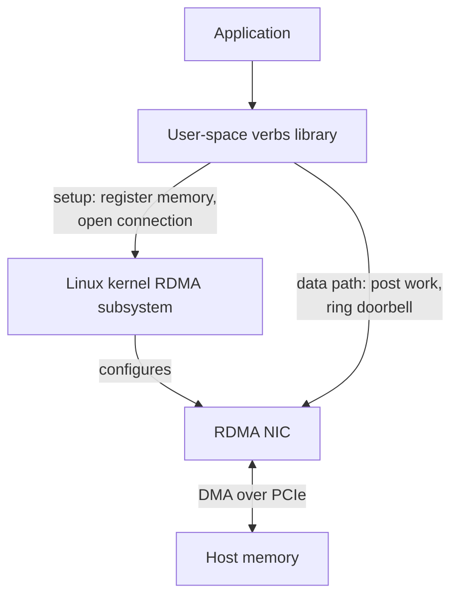

The kernel sets up the connection and registers memory, then gets
out of the way; every byte of the data path moves between the NIC and
memory over PCIe.

Further reading:

- [Introduction to Remote Direct Memory Access (RDMA)](https://www.rdmamojo.com/2014/03/31/remote-direct-memory-access-rdma/)
- [An In-Depth Understanding of RDMA Interaction Mechanism between Software and Hardware](https://www.alibabacloud.com/blog/601598)
- [RDMA Tutorial](https://www.doc.ic.ac.uk/~jgiceva/teaching/ssc18-rdma.pdf)
- [RDMA / InfiniBand / RoCEv2 / NCCL (wechat)](https://mp.weixin.qq.com/s?__biz=MzYyMzQ4ODM3OQ==&mid=2247483901&idx=1&sn=6fa6a7e1c622b927c881443244fbde34&chksm=feb3be03ed5923133b6ef9c9df500b57140195e970865121d011429145837360196a9aa67f7d&mpshare=1&scene=1&srcid=0706AhXuzisqFYJyYM4U3bdT&sharer_shareinfo=9493f2469ed50e40cb6d5a2110967f0f&sharer_shareinfo_first=9493f2469ed50e40cb6d5a2110967f0f#rd)

All abbreviations are explained in the [Glossary](#glossary) at the end.

# 1. Why RDMA Exists (Intuition)

TCP/IP spends too much CPU time on fast networks. Sending one buffer
through sockets makes the CPU touch the data many times.

The diagram below shows the path of one application buffer through TCP/IP.

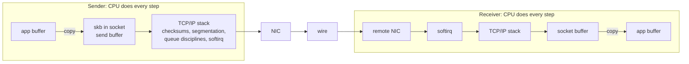

Every packet costs CPU time on both machines.

Terms used above:

- **NIC**: the network card.
- **skb**: the Linux kernel's packet buffer (`struct sk_buff`).
- **softirq**: deferred kernel work that runs after an interrupt.

Each step has a cost:

- A copy uses memory bandwidth and fills CPU caches with data the CPU does
  not need.
- A protocol step uses CPU cycles.
- A packet wakes a CPU through an interrupt and a softirq.

At 100 Gb/s, one core cannot even `memcpy` fast enough to keep the wire
full. It has no time left to run the protocol. The CPU is the bottleneck,
not the network.

RDMA (Remote Direct Memory Access) takes the CPU out of the normal data
path. It uses three ideas together:

- **Kernel bypass.** After setup, the application talks *directly* to the
  NIC through queues mapped into its memory. Posting a send and collecting
  a completion are plain memory operations. There is **no system call**.
- **Zero copy.** The NIC's DMA engine reads and writes the application's
  own buffers. (DMA, Direct Memory Access, means the device moves data
  to or from memory without the CPU.) There is no socket buffer, no `skb`,
  and no staging copy.
- **No CPU work on the remote side.** For an RDMA WRITE or READ, the
  *remote NIC* writes into, or reads from, the remote machine's registered
  memory. The remote CPU gets no interrupt and runs no instruction for
  that transfer.

What this gives datacenters:

- **~1–2 µs round-trip latency** for small messages. Tuned TCP needs tens
  of µs.
- **Full line-rate throughput with almost no CPU use.**
- Cache and memory bandwidth left free for the application.

So RDMA is used for HPC (MPI), distributed storage (NVMe-oF, Ceph, Lustre,
SMB Direct), and AI training networks (GPUDirect RDMA). The price is
complexity, and a network that must behave well (see §9).

For a real user of RDMA, see
[Linux NVMe Target Explained]({{ site.baseurl }}/storage/linux-nvme-target-explained),
§15 (the RDMA transport). It shows how the Linux kernel NVMe target uses
one-sided RDMA through keyed SGLs and the `rdma_rw` API.

# 2. The Full RDMA Stack (Top → Bottom)

RDMA has four layers, each with a very different job. The key fact is
*where the boundary between the kernel and the bypass path lies*.

The diagram below shows the four layers and the two paths through them.

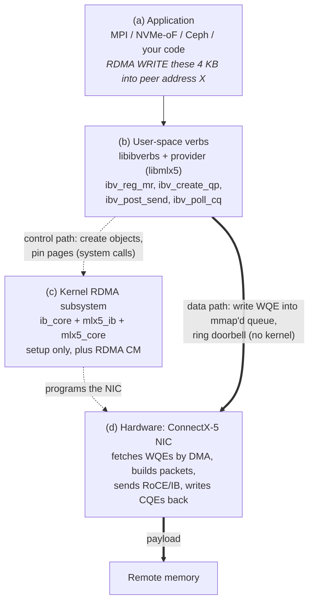

The data path goes from the application to the remote memory without
entering the kernel. Only setup goes through the kernel.

- **(a) Application.** It speaks *verbs*: "post a work request", "poll for
  completions". It never sees packets.
- **(b) User-space verbs.** This is `libibverbs`, the generic API, plus a
  vendor *provider* library (`libmlx5` for ConnectX). **The data path lives
  here.** `ibv_post_send` writes a hardware descriptor (a **WQE**, Work Queue
  Element) into a queue mapped into the process with `mmap`. Then it rings a
  **doorbell**: a write to a NIC register that tells the NIC new work is
  waiting. All of this happens in user space.
- **(c) Kernel.** It runs only the *control plane*: it creates the hardware
  objects, pins and DMA-maps memory, and programs the NIC.
  - `mlx5_core` owns the PCI device and the transport.
  - `mlx5_ib` implements the verbs objects.
  - `ib_core` is the middle layer.
  - `ib_uverbs` provides the `/dev/infiniband/uverbsN` character device, the
    system call entry point.
  - RDMA CM (Connection Manager) sets up connections.
- **(d) Hardware.** It does the actual transfer.

The `mmap` boundary is the key point. At setup, the kernel gives user space
direct, protected access to a slice of NIC registers and queue memory. The
fast path never goes back into the kernel.

# 3. The RDMA Programming Model

You create a few long-lived **objects** once. Then you run a tight
**post/poll** loop. There are five nouns and two verbs.

### The objects

- **PD: Protection Domain.** A container. MRs and QPs belong to a PD. The
  NIC refuses any access that crosses PD boundaries, so the PD is the unit
  of isolation. Call: `ibv_alloc_pd()`.
- **MR: Memory Region.** A range of the application's virtual memory that
  you *register* so the NIC may DMA to and from it. Registration pins the
  pages (locks them in RAM) and returns two keys:
  - **lkey** (local key): used by your own WQEs.
  - **rkey** (remote key): you give it to a peer so the *peer* may RDMA
    into this region.

  Call: `ibv_reg_mr()`. This is the most important setup step. Without a
  valid MR and key, the NIC will not touch the memory.
- **QP: Queue Pair.** A send queue (SQ) plus a receive queue (RQ). The QP
  *is* the connection endpoint; you post work to it. Transport types:
  - **RC** (Reliable Connected): ordered, acknowledged, one peer. Storage
    uses this.
  - **UD** (Unreliable Datagram): no connection.
  - UC, and others.

  Call: `ibv_create_qp()`.
- **CQ: Completion Queue.** A ring where the NIC writes a **CQE**
  (Completion Queue Entry) for every finished work request. One CQ can
  serve many QPs. Call: `ibv_create_cq()`.
- **SRQ** (optional): a Shared Receive Queue that feeds many QPs.

The diagram below shows how these objects relate.

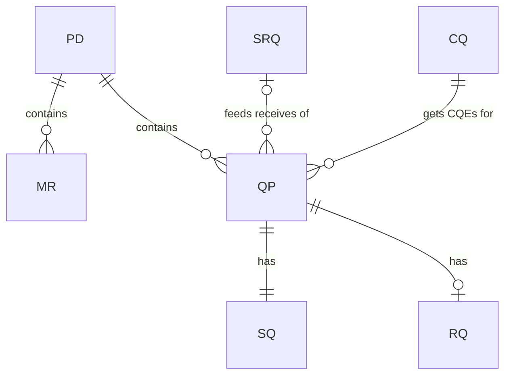

The PD groups the memory and the endpoints. A CQ and an SRQ can each be
shared by many QPs.

### The two verbs

- **post_send / post_recv**: give the NIC a *Work Request* (WR). The library
  turns it into a **WQE** in the SQ or RQ.
- **poll_cq**: collect completions (CQEs).

### Operation types (what a WR can ask for)

| Operation | Sides | What it does |
|---|---|---|
| **SEND / RECV** | two-sided | The receiver must post a RECV buffer first. Data lands in the next free one. Works like a message. |
| **RDMA WRITE** | one-sided | Pushes data straight into the peer's memory at `{remote_addr, rkey}`. The peer's CPU does nothing. |
| **RDMA READ** | one-sided | Pulls data out of the peer's memory. The peer's CPU does nothing. |
| **Atomics** | one-sided | Fetch-add or compare-swap on remote memory. |

### Connection setup (RDMA CM) and the steady-state loop

For RoCEv2 and InfiniBand you usually use the **RDMA Connection Manager**
(`rdma_cm`). It resolves addresses and exchanges QP information. Without
it, you must trade QP numbers, packet sequence numbers, and GIDs (the RDMA
address of a port) through some other channel yourself.

Setup, once per connection:

1. `rdma_create_id()`
2. `rdma_resolve_addr()`: ARP/GID lookup.
3. `rdma_resolve_route()`
4. `ibv_alloc_pd()`
5. `ibv_reg_mr()`: the kernel pins the pages.
6. `ibv_create_cq()`
7. `ibv_create_qp()`
8. `rdma_connect()`: the CM handshake.

Setup uses the kernel and a few control packets.

The diagram below shows the per-message loop after setup.

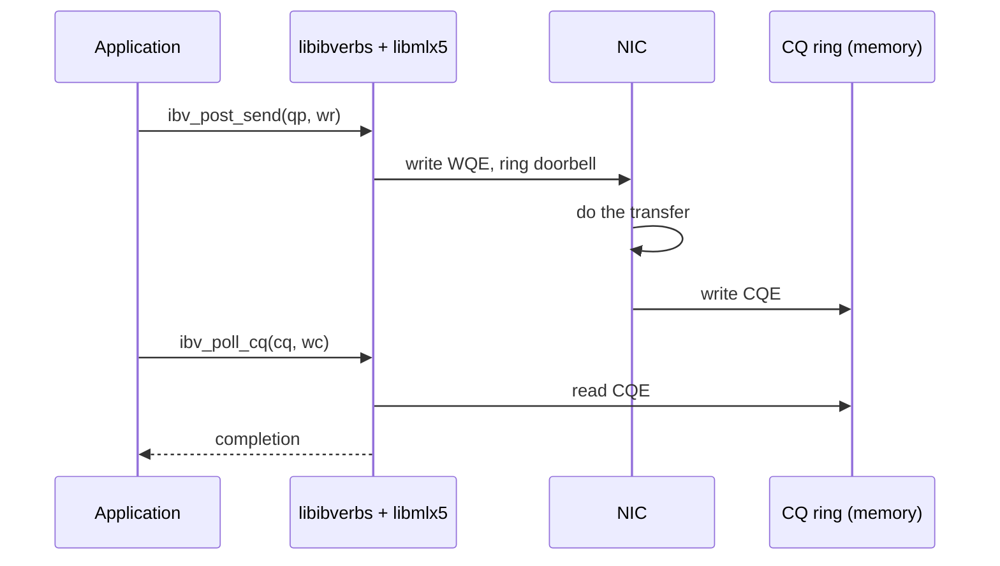

The loop has no system call, no copy, and no kernel: only user space and
hardware.

After `rdma_connect()` returns, the kernel's work is done. Each message is
just "write a descriptor, ring a bell, later read a result", all in user
space.
# 4. Inside libibverbs: Interface, Objects, Contexts, Implementation

§3 *used* the verbs API. This section opens the library itself.

libibverbs is part of [rdma-core](https://github.com/linux-rdma/rdma-core).
It is the userspace half of the RDMA stack. It has two parts:

- one vendor-neutral API that applications link against;
- a per-device **provider** plugin (`libmlx5`, `librxe`, …). A provider is
  the library code that knows one device's descriptor formats.

This section covers, top to bottom: the architecture, the API, the objects
behind it, which threads call it, and what a call does.

### 4.1 The library at a glance

The diagram shows the layers and the two ways out at the bottom.

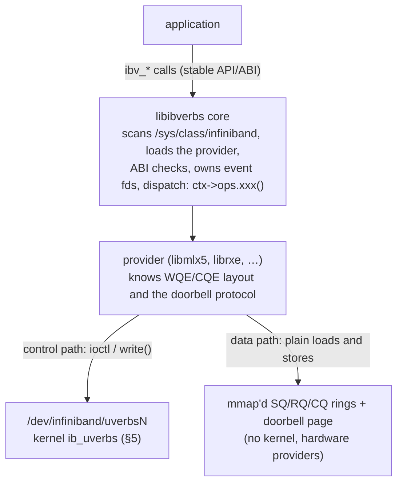

Setup goes through the kernel; data goes straight to memory the hardware
also reads.

The two halves meet in `ibv_open_device()`:

1. libibverbs opens `uverbsN`.
2. It hands the fd to the provider's context setup.
3. After that, every call goes through a per-device function table.

One exception on the data side: software providers (rxe, siw) have no
hardware to signal. Their "doorbell" is a small command `write()` into the
kernel. So the no-syscall data path is true only for hardware providers.

### 4.2 The interface: three families of calls

The API is small. It splits into three families. Only the data-path family
may run on the hot path.

| Family | Calls | Enters kernel? |
|--------|-------|----------------|
| setup / teardown | `ibv_get_device_list`, `ibv_open_device`, `ibv_alloc_pd`, `ibv_reg_mr`, `ibv_create_cq`, `ibv_create_qp`, `ibv_modify_qp`, `ibv_query_*`, destroy/dealloc | yes — a uverbs command syscall (device enumeration: sysfs reads) |
| data path | `ibv_post_send`, `ibv_post_recv`, `ibv_poll_cq`, `ibv_req_notify_cq` | **no** — memory ops + MMIO only |
| events | `ibv_get_cq_event`, `ibv_get_async_event` | yes — blocking `read()` on an fd |

- Setup runs once per connection or buffer.
- The data path runs once per I/O.
- Events are for threads that want to sleep instead of poll.
- `ibv_ack_cq_events` pairs with `ibv_get_cq_event`. It only updates a
  userspace counter, so it makes no syscall.

**Setup / teardown.** Each call is a uverbs command into `ib_uverbs`, except
device listing, which reads sysfs. These calls are expensive. Make them at
startup, never per I/O (§4.5).

| Call | What it does |
|---|---|
| [`ibv_get_device_list`](https://github.com/linux-rdma/rdma-core/blob/master/libibverbs/man/ibv_get_device_list.3.md) | lists the RDMA devices (sysfs reads); returns an `ibv_device*` array |
| [`ibv_open_device`](https://github.com/linux-rdma/rdma-core/blob/master/libibverbs/man/ibv_open_device.3) | creates the `ibv_context` root handle; sets up `cmd_fd`, which carries every later command, and `async_fd` (§4.4) |
| [`ibv_alloc_pd`](https://github.com/linux-rdma/rdma-core/blob/master/libibverbs/man/ibv_alloc_pd.3) | allocates a Protection Domain (PD), the security boundary: objects in one PD may use each other; the NIC rejects cross-PD access in hardware |
| [`ibv_reg_mr`](https://github.com/linux-rdma/rdma-core/blob/master/libibverbs/man/ibv_reg_mr.3) | pins the pages, sets up their DMA mapping, returns the `lkey`/`rkey` that every later WR quotes; the most expensive call in the library (§5.2) |
| [`ibv_create_cq`](https://github.com/linux-rdma/rdma-core/blob/master/libibverbs/man/ibv_create_cq.3) | allocates the ring the NIC writes completions (CQEs) into by DMA; can be bound to a completion channel fd for events |
| [`ibv_create_qp`](https://github.com/linux-rdma/rdma-core/blob/master/libibverbs/man/ibv_create_qp.3) | allocates the SQ/RQ rings in *provider* memory and has the kernel program the NIC (§4.6 traces it) |
| [`ibv_modify_qp`](https://github.com/linux-rdma/rdma-core/blob/master/libibverbs/man/ibv_modify_qp.3) | moves the QP through RESET→INIT→RTR→RTS (§4.3); no traffic until RTS |
| `ibv_query_*` ([`_device`](https://github.com/linux-rdma/rdma-core/blob/master/libibverbs/man/ibv_query_device.3), [`_port`](https://github.com/linux-rdma/rdma-core/blob/master/libibverbs/man/ibv_query_port.3), [`_gid`](https://github.com/linux-rdma/rdma-core/blob/master/libibverbs/man/ibv_query_gid.3.md), …) | read-only queries for the capabilities and addresses that `modify_qp` needs |
| destroy / dealloc | teardown, in reverse creation order; `ibv_dereg_mr` unpins the pages |

**Data path.** No kernel. This works only because setup left the rings in
user memory and mapped the doorbell page into the process.

| Call | What it does |
|---|---|
| [`ibv_post_send`](https://github.com/linux-rdma/rdma-core/blob/master/libibverbs/man/ibv_post_send.3) | queues a send WR: writes the WQE into the next SQ slot, write barrier, rings the doorbell (§4.6). Starts SEND, RDMA WRITE and RDMA READ alike |
| [`ibv_post_recv`](https://github.com/linux-rdma/rdma-core/blob/master/libibverbs/man/ibv_post_recv.3) | gives the RQ a buffer for an incoming SEND. One-sided WRITE/READ never use these. An empty RQ causes RNR NAKs (§8.5) |
| [`ibv_poll_cq`](https://github.com/linux-rdma/rdma-core/blob/master/libibverbs/man/ibv_poll_cq.3) | reads the CQE at the consumer index, checks its ownership bit, converts it to `ibv_wc`, advances the CQ doorbell record so the NIC can reuse the slot. This is the busy-poll loop |
| [`ibv_req_notify_cq`](https://github.com/linux-rdma/rdma-core/blob/master/libibverbs/man/ibv_req_notify_cq.3.md) | arms the CQ to raise one event on its channel at the next completion (optionally solicited-only, §7.2). One-shot: re-arm after every event |

These four calls decide performance. On this path only two costly things
remain: the MMIO doorbell write and the CQE. The rule: use them as rarely as
possible. The man pages and the provider source (`providers/mlx5/qp.c`,
`cq.c`) give five levers:

1. **Batch WRs: one doorbell per call, not per WR.**
   - `ibv_post_send` takes a *linked list* of WRs (`wr->next`).
   - mlx5 builds every WQE in a loop, then rings the doorbell once
     (`post_send_db()` at the end of `_mlx5_post_send`).
   - N chained WRs pay the §7.4 MMIO cost once. N separate calls pay it N
     times.
2. **`IBV_SEND_INLINE` for small payloads** (Send and RDMA Write only).
   - The provider copies the data into the WQE itself (`set_data_inl_seg()`).
   - The NIC skips the second DMA read of the buffer, and does not check the
     lkey.
   - You may reuse the buffer as soon as the call returns, not after a
     completion (`ibv_post_send(3)` NOTES).
   - Size limit: `cap.max_inline_data`, requested at QP create.
3. **Signal selectively, but never stop signaling.**
   - Create the QP with `sq_sig_all=0`. Set `IBV_SEND_SIGNALED` on every Nth
     WR. You get one CQE per N sends.
   - The trap: SQ slots are freed only when a completion is *polled*.
     `mlx5_parse_cqe` advances `wq->tail` from the CQE's `wqe_ctr`, which
     frees all earlier unsignaled slots too.
   - If you signal nothing, or never poll, `post_send` returns `ENOMEM`: the
     SQ looks full although its work finished long ago.
4. **Poll in batches; never overrun the CQ.**
   - `ibv_poll_cq` returns up to `num_entries` CQEs per call. Drain into an
     array, not one at a time.
   - If CQEs arrive faster than you consume them, the CQ overruns. You get
     `IBV_EVENT_CQ_ERR`, and the CQ is dead, not slowed down
     (`ibv_poll_cq(3)` NOTES).
   - Size the CQ for the worst case: outstanding *signaled* sends plus posted
     receives. Unsignaled successes write no CQE; failed WRs always do.
   - In event mode, `ibv_ack_cq_events` takes a mutex. Count events and ack
     them in one call (`ibv_get_cq_event(3)` NOTES).
5. **Keep the RQ filled; respect buffer lifetime.**
   - An empty RQ turns incoming SENDs into RNR NAKs, and the sender backs off
     (§8.5). Post receives before RTR, and repost as you poll.
   - A WR's buffers are safe to touch again only after you reap a completion
     that *covers* the WR (`ibv_post_send(3)` NOTES): its own CQE if
     signaled; for an unsignaled WR, the CQE of a later signaled WR on the
     same SQ, because an RC send queue completes in posted order.
   - Reusing a buffer early corrupts data in flight. INLINE is the only
     exception.

**Events.** The syscall here lets a thread sleep. It never carries I/O.

- [`ibv_get_cq_event`](https://github.com/linux-rdma/rdma-core/blob/master/libibverbs/man/ibv_get_cq_event.3)
  — a blocking `read()` on the completion channel. It wakes when an armed CQ
  gets a completion.
- [`ibv_get_async_event`](https://github.com/linux-rdma/rdma-core/blob/master/libibverbs/man/ibv_get_async_event.3)
  — a blocking `read()` on `async_fd` for out-of-band state:
  `IBV_EVENT_QP_FATAL` (the ERR-state flush of §4.3), port down, path
  migration.

The diagram shows the event-mode loop a sleeping thread runs.

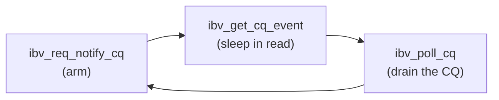

Each event wakes the thread once; it must drain the CQ and re-arm before it
sleeps again.

### 4.3 The QP state machine: `ibv_modify_qp` and `attr_mask`

`ibv_modify_qp` is one function that drives a five-state machine. An RC QP
starts in **RESET**. You must move it to **RTS**, one call per step, before
it can send one packet.

The diagram shows the states and transitions.

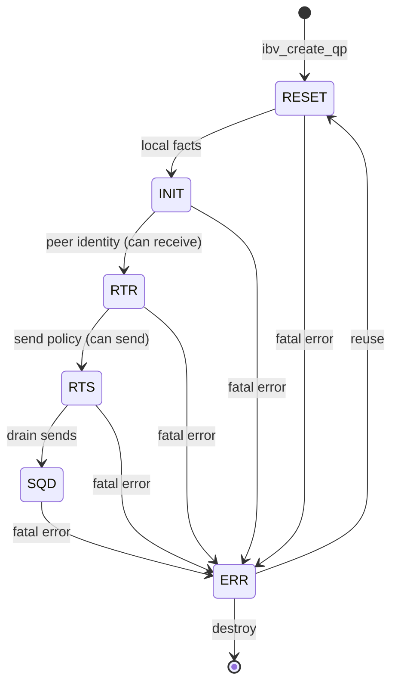

A QP can drop to ERR from any state; it can only reach RTS by going
forward one step at a time.

Each step matches what you *know* at that point of bring-up. The hardware
accepts each group of parameters only at its own transition. So a
half-configured QP can never send a packet with no address.

| Transition | Parameters | Why here |
|---|---|---|
| RESET→INIT | `port_num`, `pkey_index`, `qp_access_flags` | local facts only; you may not know the peer yet. You may *post* receives after INIT (nothing arrives yet). |
| INIT→RTR | `dest_qp_num`, `rq_psn`, `ah_attr` (GID/path), `path_mtu`, `max_dest_rd_atomic`, `min_rnr_timer` | the peer's identity; you must exchange it out-of-band first (§3, §5.3). Receiving works after RTR. |
| RTR→RTS | `sq_psn`, `timeout`, `retry_cnt`, `rnr_retry`, `max_rd_atomic` | your send-side retransmit policy; §8.5's ACK/NAK machine and §8.8's timers use exactly these values. Sending works after RTS. |

**ERR.** A fatal transport error, or an explicit modify, moves the QP to ERR.
All outstanding WRs then complete to the CQ with an error status. So a poll
loop *sees* the failure instead of hanging. This is also where §4.2's
`IBV_EVENT_QP_FATAL` comes from. From ERR, the QP goes back to RESET for
reuse, or is destroyed.

**SQD** (send-queue drain) pauses sends for live reconfiguration. Most
applications never use it.

**`attr_mask`.** It lets one call serve all five transitions:

- `struct ibv_qp_attr` has a field for *every* transition.
- The mask tells the driver which fields are set.
- The driver checks that exactly the required set for this transition is
  present. A set bit without its field, or a field without its bit, gives
  `EINVAL`.

INIT→RTR in full. Every value on the right side of the exchange came from
the peer:

```c
/* Exchanged with the peer out-of-band (or by rdma_cm, §5.3):
 *   remote_qpn, remote_psn, remote_gid
 */
struct ibv_qp_attr attr = {
    .qp_state           = IBV_QPS_RTR,
    .path_mtu           = IBV_MTU_1024,     /* must match both ends         */
    .dest_qp_num        = remote_qpn,       /* peer's QP number             */
    .rq_psn             = remote_psn,       /* expected first inbound PSN   */
    .max_dest_rd_atomic = 1,                /* inbound READs in flight      */
    .min_rnr_timer      = 12,               /* RNR back-off (§8.5)          */
    .ah_attr = {
        .is_global      = 1,                /* RoCE: GRH/GID addressing     */
        .dlid           = 0,                /* 0 on RoCE (no LIDs)          */
        .port_num       = 1,
        .grh = {
            .dgid       = remote_gid,       /* peer's GID = its IP (§8.7)   */
            .sgid_index = my_gid_index,     /* which local GID row — §8.7   */
            .hop_limit  = 1,
        },
    },
};
int attr_mask = IBV_QP_STATE | IBV_QP_AV | IBV_QP_PATH_MTU |
                IBV_QP_DEST_QPN | IBV_QP_RQ_PSN |
                IBV_QP_MAX_DEST_RD_ATOMIC | IBV_QP_MIN_RNR_TIMER;
ibv_modify_qp(qp, &attr, attr_mask);
```

RTR→RTS turns on the send side. The two masks share only `IBV_QP_STATE`:
RTR says "who is the peer"; RTS says "what to do when packets are lost".

```c
struct ibv_qp_attr attr = {
    .qp_state      = IBV_QPS_RTS,
    .sq_psn        = my_psn,        /* MUST equal the peer's rq_psn         */
    .timeout       = 14,            /* ACK timeout: 4.096 µs × 2^14 ≈ 67 ms */
    .retry_cnt     = 7,             /* retransmits on timeout before fatal  */
    .rnr_retry     = 7,             /* retries on peer RNR (7 = infinite)   */
    .max_rd_atomic = 1,             /* outbound READs in flight             */
};
int attr_mask = IBV_QP_STATE | IBV_QP_SQ_PSN | IBV_QP_TIMEOUT |
                IBV_QP_RETRY_CNT | IBV_QP_RNR_RETRY |
                IBV_QP_MAX_QP_RD_ATOMIC;
ibv_modify_qp(qp, &attr, attr_mask);
```

The diagram shows the two values that must match across the two ends.

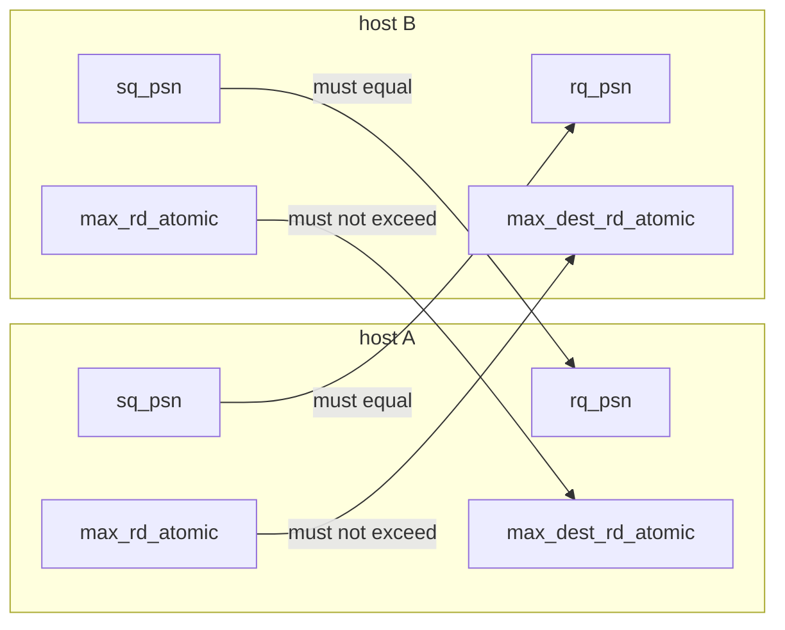

Get either one wrong and the connection fails, even though each side's own
settings look valid.

- **PSNs cross over.** Your `sq_psn` must equal the peer's `rq_psn`, and the
  other way round. If one does not match, every packet arrives as an
  out-of-sequence PSN → NAK → retransmit storm → `IBV_WC_RETRY_EXC_ERR`
  (§8.8).
- **READ limits.** Your `max_rd_atomic` must not exceed the peer's
  `max_dest_rd_atomic`. The responder sized its in-flight READ tracking at
  RTR.

You rarely write this by hand. `rdma_connect()` / `rdma_accept()` make these
three calls, using values from the CM handshake (§5.3). You still call
`ibv_modify_qp` yourself for bring-up over your own side channel, and to
move a QP to ERR/RESET in recovery code.

### 4.4 The objects: public structs, private containers

The public structs in
[`<infiniband/verbs.h>`](https://github.com/linux-rdma/rdma-core/blob/master/libibverbs/verbs.h)
are thin on purpose. An `ibv_qp` holds little more than the QP number, the
state, and back-pointers. The provider embeds each public struct inside a
private, larger struct that holds the real data. Code gets from the public
struct to the private one with `container_of`.

The diagram shows each public struct and the libmlx5 struct that contains
it.

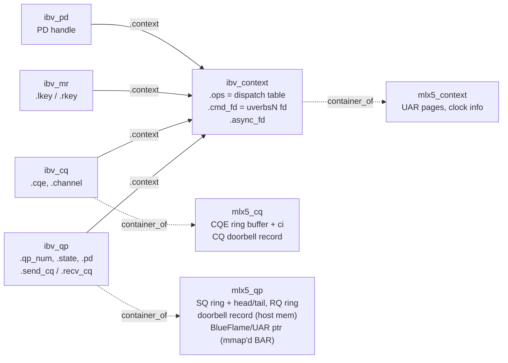

The rings and doorbells that the data path touches live only in the
provider's private structs, not in the public API.

Work moves through three small value types:

| Type | Role | Fields |
|---|---|---|
| `ibv_sge` | one scatter/gather element | `{addr, length, lkey}` |
| [`ibv_send_wr`](https://github.com/linux-rdma/rdma-core/blob/master/libibverbs/man/ibv_post_send.3) / [`ibv_recv_wr`](https://github.com/linux-rdma/rdma-core/blob/master/libibverbs/man/ibv_post_recv.3) | the work request | opcode, SGE list, flags; for one-sided ops `wr.rdma.remote_addr` / `wr.rdma.rkey` |
| [`ibv_wc`](https://github.com/linux-rdma/rdma-core/blob/master/libibverbs/man/ibv_poll_cq.3) | the completion | `wr_id`, `status`, opcode, byte count |

The man pages of the verbs that use them give the full layouts.

### 4.5 Typical execution contexts

A real application calls the library from three or four kinds of thread.
Mixing them up is the classic verbs performance bug.

| | init/control thread | data-path thread × N | event thread |
|---|---|---|---|
| runs | once; slow is fine | hot loop, no syscalls | sleeps, rare wakeups |
| does | open device, alloc PD; reg MRs (pins pages!); create CQ + QP; `modify_qp` → RTS; `rdma_cm` handshake | loop: `ibv_post_send/recv`, `ibv_poll_cq`, handle completions | `epoll` on the completion channel fd, async fd, `rdma_cm` fd; `ibv_get_cq_event` → `poll_cq` → re-arm with `ibv_req_notify_cq` |

- **Init/control.** Every create or register call may allocate, pin memory,
  and make a syscall. Do it at startup, never per I/O. §5.2 explains why
  `ibv_reg_mr` is the most expensive call in the library.
- **Data path.** All verbs are thread-safe. But two threads that post to one
  QP serialize on the provider's ring lock. To scale, give each worker
  thread its own QP + CQ; then there is no lock contention.
- **Events.** The completion channel fd and the async-event fd are normal
  pollable fds. Sleep in `epoll`, wake on a completion (solicited, §7.2),
  drain the CQ, re-arm. Async events (`IBV_EVENT_QP_FATAL`, port down, …) and
  `rdma_cm` connection events arrive the same way.

### 4.6 How a call is implemented

**Control path: `ibv_create_qp()` end to end.**

The diagram shows the calls from the application down to the kernel and
back.

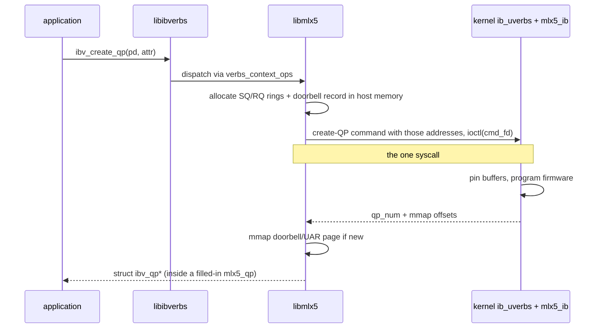

The kernel checks the request and programs the NIC, but the queues live in
memory the *provider* allocated. That is what lets the data path skip the
kernel later.

A dispatch detail: control verbs such as `ibv_create_qp` are exported
functions. They route through the provider's extended `verbs_context_ops`
table. The legacy `ibv_context.ops` slots are still used only for the
data-path entries below.

**Data path: `ibv_post_send()`.** The whole function is one inline dispatch:

```c
static inline int ibv_post_send(struct ibv_qp *qp, struct ibv_send_wr *wr,
                                struct ibv_send_wr **bad_wr)
{
        return qp->context->ops.post_send(qp, wr, bad_wr);
}
```

The diagram shows the provider's `post_send` steps and the `poll_cq` steps
that mirror them.

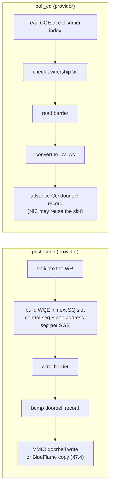

All of these steps run in userspace: no locks except the ring's own, no
syscalls, no copies.

**Direct verbs.** When the generic API is not enough, providers offer
**direct verbs** (`mlx5dv_*`). The application gets the raw ring and
doorbell addresses and builds WQEs itself. It gives up portability to gain
the last bit of latency.
# 5. Kernel Internals (Linux RDMA Stack)

The kernel has two jobs. It makes direct user-space access to the hardware
**safe**, and it helps set up connections. The sections below cover three
parts of that work.

### 5.1 mlx5_core vs mlx5_ib

One ConnectX-5 card is driven by two drivers that work together.

The diagram shows which driver sits on which.

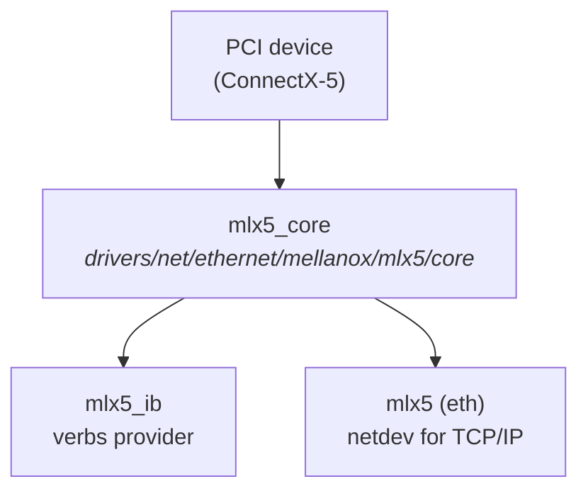

One device shows up twice: as an RDMA device and as a normal Ethernet device.

- **`mlx5_core`** is the base driver.
  - It owns the PCI BARs. A BAR (Base Address Register) is a window of
    device registers that the host maps into its address space.
  - It talks to the NIC firmware through a command interface.
  - It manages interrupt vectors and event queues (EQs).
  - It creates the firmware objects behind PD, QP, CQ and MR.
- **`mlx5_ib`** sits on top. It implements the verbs objects
  (`mlx5_ib_create_qp`, `mlx5_ib_reg_user_mr`, …). For each one, it asks
  `mlx5_core` to create the matching hardware object.
- The **Ethernet `netdev`** carries normal TCP/IP. It is also the underlay
  that RoCE runs on.

### 5.2 Memory registration: pinning + DMA mapping

This is the kernel's biggest job, and it is why MRs (memory regions) exist.

User space calls `ibv_reg_mr(pd, addr, length, access)`. After that, the NIC
must be able to DMA those pages **at any later time, without help from the
CPU**. The kernel has two problems to solve:

1. **The pages must stay where they are.**
   - The kernel calls `ib_umem_get()` (linked in the sources above).
   - `ib_umem_get()` pins the user pages with `pin_user_pages_fast()`. This
     is the `FOLL_PIN` successor to `get_user_pages`.
   - For the whole life of the MR, pinned pages are not swapped, migrated or
     compacted.
2. **Virtual addresses must become bus addresses.**
   - The kernel puts the pinned pages in a scatter/gather table and maps it
     with `dma_map_sg`. This gives the DMA addresses the NIC uses.
   - The driver writes the NIC's translation tables (MTT/MKey). With them,
     the NIC turns the I/O virtual address in a WQE into physical/bus pages.
   - The driver binds the lkey and rkey to that mapping.

The flowchart shows the steps of one `ibv_reg_mr` call.

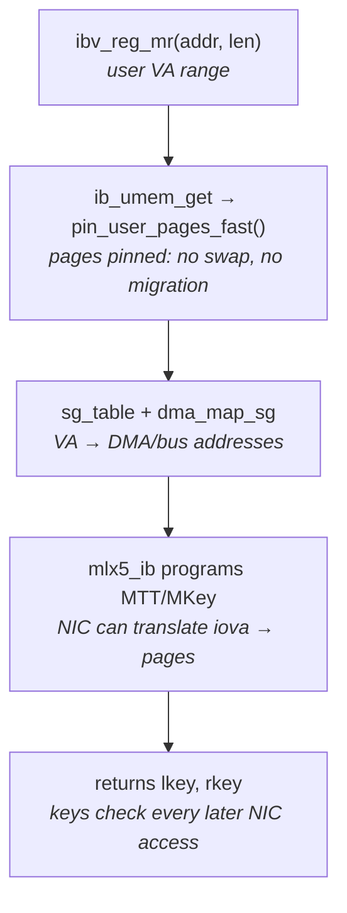

After registration, the keys and tables let the NIC reach the buffer with no
kernel involvement.

Pinning is expensive, and MRs live a long time. So registration is a *setup*
cost, spread over millions of transfers. Register large buffers once; do not
register per I/O.

### 5.3 RDMA CM: connection setup, not data

RDMA CM (`rdma_cm`, exposed as `/dev/infiniband/rdma_cm`) is the connection
manager. It does two things:

- It resolves an IP address to an RDMA path. For RoCEv2, it uses the normal
  IP/ARP/neighbour code of the Ethernet underlay.
- It runs the connection handshake. The two ends exchange QP numbers,
  initial packet sequence numbers (PSNs) and GIDs (global identifiers, the
  RDMA address of a port).

This needs network round-trips, so it is asynchronous. Applications drive it
with an event channel. **It runs only when a connection is set up, never per
message.**

The CM automates the three `ibv_modify_qp` calls of §4.3. The kernel runs
the wire handshake and *computes* the attributes. User-space librdmacm still
*issues* the modify calls.

The handshake is the IB CM protocol (IBTA Vol 1 ch. 12). It has three
messages. REQ and REP carry exactly the values that §4.3's manual code had
to exchange out of band.

The sequence below shows the three messages and when each side moves its QP
to the next state.

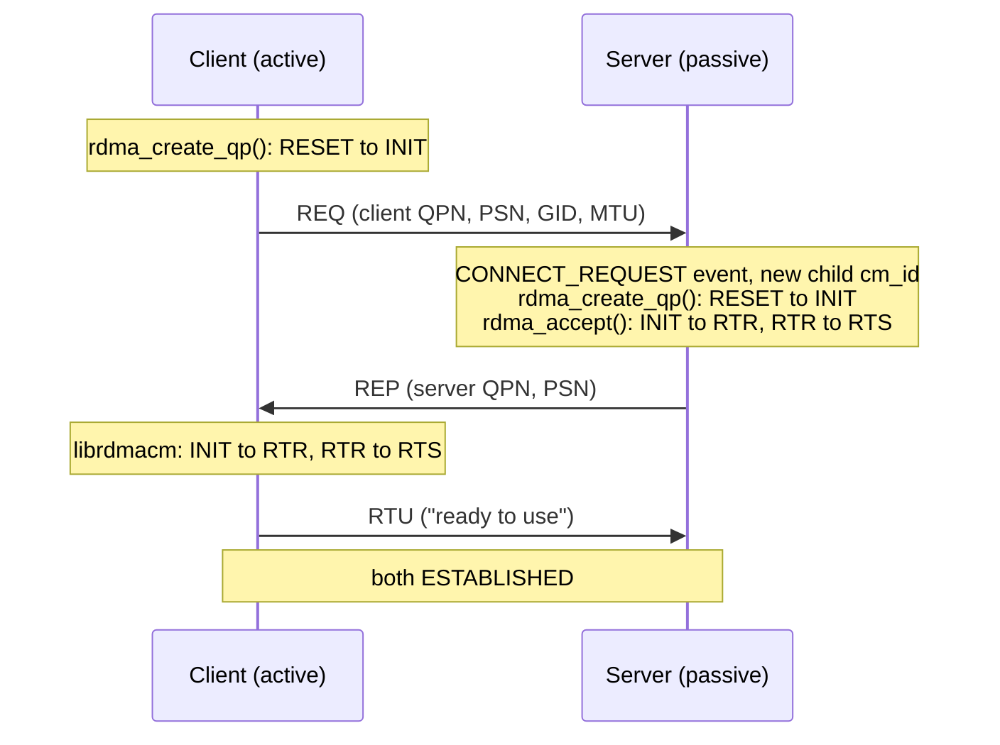

The handshake is asymmetric, so each side changes state at a different
point.

- **Server**
  1. REQ arrives. The server gets `RDMA_CM_EVENT_CONNECT_REQUEST` on a new
     child `cm_id`.
  2. The handler calls `rdma_create_qp()`. This does RESET→INIT.
  3. The handler calls `rdma_accept()`. This does INIT→RTR and RTR→RTS
     *before* the kernel sends REP. The server can do this early because REQ
     already carried the client's QPN, PSN and GID.
- **Client**
  1. `rdma_create_qp()` does RESET→INIT.
  2. `rdma_connect()` sends REQ.
  3. The client waits for REP, because it needs the server's QPN and PSN.
  4. When REP arrives, librdmacm does INIT→RTR and RTR→RTS.
  5. The kernel sends RTU and delivers `RDMA_CM_EVENT_ESTABLISHED`. When the
     application sees this event, the QP is already in RTS.

Each state change is one pair of calls between librdmacm and the kernel.

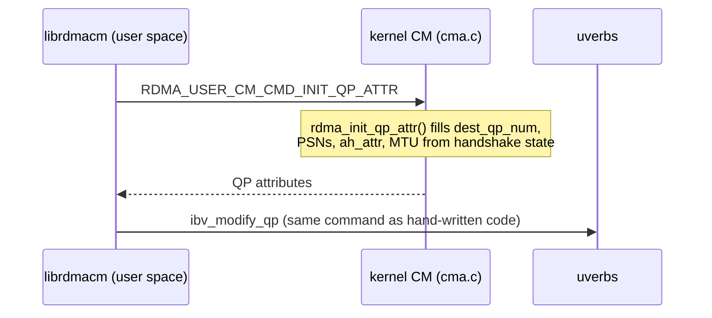

The kernel only computes the attributes. The modify call itself is the same
one you would write by hand.

Where each attribute comes from:

| Attribute | Source |
|---|---|
| local PSN | generated (randomized) by the CM |
| `ah_attr` | path record resolved by `rdma_resolve_addr` / `rdma_resolve_route` |
| `retry_count`, `rnr_retry_count` | `struct rdma_conn_param` |
| `max_rd_atomic` / `max_dest_rd_atomic` | `initiator_depth` / `responder_resources`, negotiated across REQ/REP and crossed between the two sides |

### 5.4 Why the kernel is absent from the data path

Combine 5.1–5.3. Before the first `post_send`:

- The QP's send and receive queues (SQ/RQ) and the CQ are in memory that
  the application has mmap'd.
- The NIC's doorbell is in a BAR page that the application has mmap'd.
- The hardware enforces the PD and key checks.

The diagram shows what the kernel sets up once and what runs on every I/O.

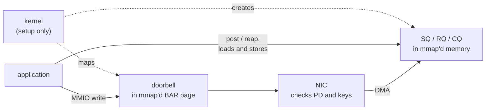

On the data path, the kernel has nothing left to do. Posting work and reaping
completions are plain loads and stores. **The kernel made the fast path safe;
it does not run on it.**

# 6. RDMA NIC Hardware Architecture

The NIC is more than a packet framer. It runs the queue and key model in
hardware. Its parts:

| Part | What it does |
|---|---|
| **Queue Pair (QP) engine** | Reads WQEs from the SQ, runs the operation, builds packets. On receive, it uses RQ WQEs. |
| **Completion Queue (CQ)** | The NIC writes one CQE per finished WQE. If the CQ is armed, it also raises an interrupt. |
| **Work Queue Entry (WQE)** | A fixed-format descriptor: opcode, local scatter/gather list (address + length + lkey), and for one-sided ops the remote `{addr, rkey}`. **A WQE is an instruction to the NIC.** |
| **Doorbell** | An MMIO register. The host writes it to say "new WQEs are ready". |
| **DMA engines** | The NIC is a **PCIe bus master**. It reads WQEs and payload from host memory and writes payload and CQEs back, without the CPU. |
| **Address translation + protection** | The NIC checks every access against the MR keys and the PD. It turns I/O virtual addresses into bus addresses with the tables the kernel wrote (§5.2). |
| **Transport + RoCE encapsulation** | For RoCEv2, the NIC wraps the InfiniBand transport (BTH + payload) in **UDP/IP/Ethernet**, with **UDP destination port 4791**. So RDMA runs on a routable Ethernet/IP network. |

The graph shows how one send moves through these parts.

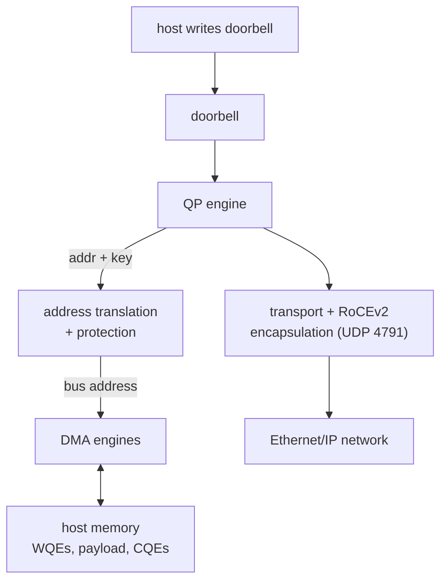

The NIC touches the host only through DMA and the doorbell.

The line between kernel and NIC, in hardware terms: the kernel wrote the
translation and protection tables and created the queues. After that, the
NIC's engines run the transfer.
# 7. ConnectX-5 Internal Datapath Deep Dive

This section walks the data path step by step, using the mlx5 driver and the
ConnectX-5 NIC as the example. Keep three facts in mind:

- The **SQ** (send queue) and **RQ** (receive queue) are ring buffers in
  **host** memory. Each slot holds one **WQE** (work queue entry): one
  instruction for the NIC.
- The **CQ** (completion queue) is also a ring in host memory. Each slot
  holds one **CQE** (completion queue entry): one result from the NIC.
- The **doorbell** is a register in the NIC's **BAR** (the NIC memory window
  that the PCIe bus exposes to the host). The host writes it to wake the NIC.

## 7.1 Send path (TX)

The diagram below shows one send, from the application call to the wire.

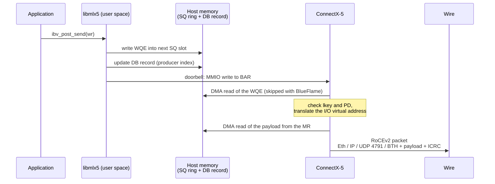

The host only writes memory and one register; the NIC does the
fetching, checking, and packet building.

Step by step:

1. The app calls `ibv_post_send`. The **provider library** (`libmlx5`, in user
   space) builds a WQE. The WQE names the operation and the local
   scatter/gather list (SGL): a list of segments, each `{addr, length, lkey}`.
   The library puts the WQE in the next SQ slot.
2. The library updates the **doorbell record**: a small producer-index field
   in host memory. Then it writes the **doorbell register** in the NIC's BAR
   with an MMIO write (a CPU store that goes to a device, not to RAM).
   - Small WQE: ConnectX-5 supports **BlueFlame**. The driver copies the WQE
     bytes straight into a write-combining doorbell region. The NIC does not
     need to DMA-read the WQE. This saves one PCIe round trip.
   - Larger or batched WQEs: the doorbell only announces the new producer
     index. The NIC then DMA-reads the WQEs from the SQ.
3. The NIC's **QP engine** runs the WQE. It reads the payload from the
   registered buffers by DMA. It checks the lkey (local key of the memory
   region) and the PD (protection domain). It translates the I/O virtual
   address through the MTT/MKey tables that the kernel programmed.
4. The NIC builds the packet.
   - RoCEv2: InfiniBand transport headers (BTH, the base transport header,
     and others) inside **UDP (port 4791) / IP / Ethernet**.
   - Native InfiniBand: the IB link layer.
5. The packet goes out on the wire. For an RDMA WRITE it carries the remote
   `{addr, rkey}` (rkey = the key that lets a remote peer access a memory
   region). The remote NIC places the payload directly.

## 7.2 Receive path (RX)

The diagram below shows what the receiving NIC does with an incoming packet.

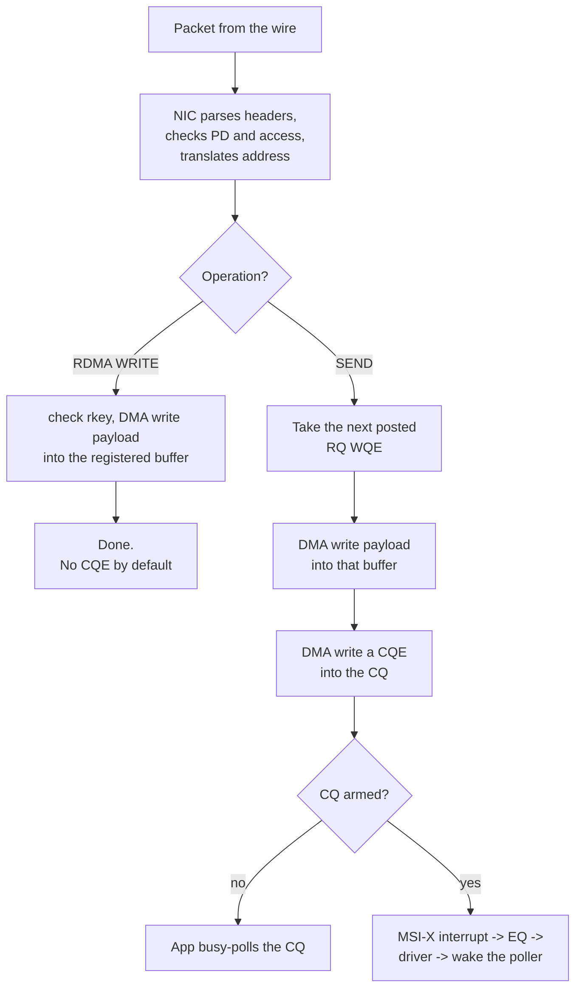

A WRITE ends at the buffer with no host work; only a SEND creates a
CQE that the app must collect.

Two cases:

- **One-sided (RDMA WRITE/READ):** the packet already names the target
  `{addr, rkey}`. The NIC checks the key and PD, then DMA-writes the payload
  into the registered buffer. **The remote CPU and kernel do nothing.** By
  default the passive side gets no CQE. The exception is WRITE-with-immediate.
- **Two-sided (SEND):** the NIC takes the next pre-posted **RQ WQE**,
  DMA-writes the payload into that buffer, and posts a **CQE** to the
  receiver's CQ. The CQE tells the app that a message arrived.

The app collects completions in one of two ways:

| Mode | How | Latency | CPU |
|---|---|---|---|
| Busy-poll | loop on `ibv_poll_cq` | lowest | uses a full core |
| Event | arm with `ibv_req_notify_cq`, sleep on the completion channel fd until the NIC raises an interrupt | higher | lower |

Every RDMA app tunes this latency/CPU trade-off.

### Solicited events

The event mode has one refinement: the **solicited** bit.

- The sender posts a SEND with `IBV_SEND_SOLICITED`. This sets the SE bit in
  the packet's transport header.
- On the receiver, that completion is marked *solicited*.
- `ibv_req_notify_cq(cq, solicited_only=1)` arms the CQ to raise an event
  **only** for solicited completions. Other completions still land in the CQ,
  but they do not wake the sleeper.
- Only SEND and Write-with-immediate can be solicited. Plain one-sided
  WRITE/READ create no receiver completion, so there is nothing to signal.

The diagram below shows the common pattern: many WRITEs, then one wake-up.

```mermaid
sequenceDiagram
    participant S as Sender
    participant RN as Receiver NIC
    participant RA as Receiver app (sleeping)
    S->>RN: RDMA WRITE (data part 1)
    S->>RN: RDMA WRITE (data part N)
    Note over RN: payload placed, no receiver CQE
    S->>RN: SEND with IBV_SEND_SOLICITED
    RN->>RA: CQE + one completion event
```

The receiver stays event-driven but takes one interrupt per batch,
not one per message.

## 7.3 WQE / CQE / CQ lifecycle

Three objects form one cycle:

| Object | Role | Producer → consumer | Contents |
|---|---|---|---|
| **WQE** (work queue entry) | the instruction | host → NIC, via SQ/RQ | opcode, local SGL, plus remote addr/rkey for one-sided ops |
| **CQE** (completion queue entry) | the result | NIC → host, via CQ | status (success/error), the WQE it completes, byte count; for inbound SENDs, immediate data and source info |
| **CQ** (completion queue) | the ring of CQEs | — | a producer index (NIC) and a consumer index (host) |

The diagram below shows the life of one work request.

```mermaid
stateDiagram-v2
    [*] --> Posted: host writes WQE into SQ/RQ
    Posted --> Executing: NIC fetches WQE
    Executing --> Completed: NIC writes CQE into CQ (DMA)
    Completed --> Polled: host polls the CQE
    Polled --> [*]: slot freed
```

Each step has exactly one owner, host or NIC, and the ring indices
hand the slot over.

Host and NIC stay in sync without locks. Each side owns one index on each ring
and reads the other side's index.

## 7.4 The doorbell mechanism

The doorbell is the *only* host→NIC signal on the fast path. Its cost matters.

- It is an **MMIO write** to a page of the NIC's PCIe BAR. The kernel maps
  that page into the process. The page is protected per QP. The write tells
  the NIC: "the SQ producer index moved."
- **Batching:** the app posts several WQEs and rings the doorbell once. The
  NIC fetches them together. This spreads the cost of the MMIO write and the
  PCIe WQE read over many WQEs. Code that needs a high message rate batches
  on purpose.
- **BlueFlame** (ConnectX only): the driver writes the bytes of a small WQE
  into a write-combining doorbell region, not just an index. The NIC reads the
  WQE from that register write. No DMA read of the SQ follows. This is the
  lowest-latency path for small messages. The cost is more CPU work and PCIe
  write bandwidth per operation.

The diagram below shows which doorbell style fits which WQE.

```mermaid
flowchart TD
    Q{"Small and<br/>latency-critical WQE?"}
    Q -- "yes" --> BF["BlueFlame: copy WQE bytes<br/>into the doorbell region"]
    BF --> N1["NIC has the WQE.<br/>No DMA read of the SQ"]
    Q -- "no (large or bulk)" --> B["Post a batch of WQEs,<br/>ring the doorbell once"]
    B --> N2["NIC DMA-reads all<br/>new WQEs from the SQ"]
```

BlueFlame buys latency with CPU and PCIe writes; batching buys
message rate.

Why it matters: an MMIO write is ordered and fairly expensive. At the top of
the message-rate curve, two choices decide whether a post costs a few hundred
ns or about a µs:

- one doorbell per WQE vs one per batch;
- BlueFlame vs a plain doorbell.

## 7.5 The PCIe DMA path

Every NIC access to host memory is a **PCIe transaction with the NIC as bus
master** (the NIC starts the transfer itself, without the CPU).

The diagram below shows what the NIC reads and writes in host memory.

```mermaid
graph LR
    subgraph HM["Host memory"]
        SQ["SQ / RQ WQEs"]
        SB["Registered send buffers"]
        DB["Doorbell record<br/>(host-written)"]
        RB["Registered receive buffers"]
        CQ["CQ (CQEs)"]
    end
    NIC["NIC (bus master)"]
    SQ -- "DMA read" --> NIC
    SB -- "DMA read" --> NIC
    DB -- "read only" --> NIC
    NIC -- "DMA write" --> RB
    NIC -- "DMA write" --> CQ
```

The NIC reports completion only by writing CQEs. It never writes
back the doorbell record.

The CPU and the kernel network stack are **not on this path**: no `skb`, no
softirq, no copy. This is why **memory registration is mandatory**. The NIC
DMAs on its own schedule, so the target pages must be:

1. pinned,
2. pre-translated to bus addresses,
3. protected by a key (§5.2).

The MR (memory region) is the contract that makes bus-master DMA into
application memory safe.
# 8. The RDMA Wire Protocol (IB / RoCEv2 packets)

The earlier sections showed *what* the NIC does. This section shows *what it
sends on the wire*.

- The InfiniBand Architecture spec (IBTA, Vol. 1) defines RDMA's transport
  packets.
- **RoCEv2** (RDMA over Converged Ethernet, version 2) carries the same
  transport packets inside UDP/IP, so they can be routed on Ethernet.
- Under the verbs and the doorbell, a queue pair is two endpoints that
  exchange these packets.
- The ACK and flow-control rules in this section explain why RoCE needs a
  tuned fabric (§9).

## 8.1 Packet anatomy (and RoCEv2 encapsulation)

A RoCEv2 packet is a normal UDP datagram. Its payload is an InfiniBand
transport packet:

```
 RoCEv2:  Ethernet [+VLAN] │ IPv4/IPv6 │ UDP dport=4791    ← routable encap
             └──▶ BTH(12B) │ [RETH/AETH/ImmDt…] │ payload(≤MTU) │ ICRC(4B)
                  the InfiniBand transport packet (opaque to routers)
```

| | Before the transport part | Transport part | Routable |
|---|---|---|---|
| RoCEv2 | Ethernet, IP, UDP (port 4791) | BTH … ICRC | yes, like any UDP flow |
| RoCEv1 | raw Ethertype | same | no |
| Native InfiniBand | **LRH** (local route header, addressed by LID) + optional **GRH** (global route header); ends with a VCRC | byte-for-byte the same | — |

- **ICRC** (invariant CRC) covers the fields that do not change from hop to
  hop. It protects the RDMA payload end to end, separately from the Ethernet
  FCS.
- Routers see only UDP. Only the two endpoint NICs parse the BTH and what
  follows it.

## 8.2 The Base Transport Header (BTH)

Every transport packet starts with a 12-byte BTH. It plays the role of a
TCP header:

| Field | Meaning |
|-------|---------|
| **OpCode** (8b) | transport service + operation + position in the message (§8.3) |
| **SE** (1b) | Solicited Event — wakes a receiver that waits only for solicited events (§7.2) |
| **PadCount / TVer** | number of payload pad bytes; transport header version |
| **P_Key** (16b) | partition key — roughly a "VLAN for RDMA" |
| **DestQP** (24b) | destination queue-pair number on the peer |
| **AckReq** (1b) | the responder must send an ACK for this packet |
| **PSN** (24b) | Packet Sequence Number, per QP; used for ordering and retransmit |

- The receiving NIC uses `DestQP` plus the source address to find the right
  QP context.
- It uses the **PSN** to detect lost and reordered packets.

## 8.3 Opcodes and message segmentation

The OpCode has two parts:

- top 3 bits: the **transport service** (RC / UC / RD / UD);
- low 5 bits: the **operation**, and *where this packet sits in a
  multi-packet message*.

Operations:

- `SEND First / Middle / Last / Only`
- `RDMA WRITE First / Middle / Last / Only`
- `RDMA READ Request`, `RDMA READ Response First / Middle / Last / Only`
- `Acknowledge`, `Atomic` (CmpSwap / FetchAdd), `…-with-Immediate`,
  `SEND-with-Invalidate`

The sender splits a message by the **path MTU** (256 B – 4 KB):

```mermaid
flowchart TD
    M["Message"] --> Q{"Larger than<br/>path MTU?"}
    Q -- no --> O["One 'Only' packet"]
    Q -- yes --> F["'First' packet"] --> MID["zero or more 'Middle' packets"] --> L["'Last' packet"]
    O --> R["Receiver reassembles by PSN"]
    L --> R
```

The packets of one message carry consecutive PSNs, so the receiver can put
them back in order.

## 8.4 Extended transport headers

Some operations carry an extra header right after the BTH:

| Header | On | Fields |
|--------|----|--------|
| **RETH** | RDMA WRITE/READ *first/only request* | Virtual Address (64), R_Key (32), DMA Length (32) |
| **AETH** | ACK, RDMA READ *response* | Syndrome (ACK/NAK code, or SEND credits) + MSN |
| **ImmDt** | *-with-Immediate | 32-bit immediate value, delivered in the CQE |
| **IETH** | SEND-with-Invalidate | R_Key to invalidate on the remote side |
| **DETH** | UD | Q_Key + source QP (datagrams have no connection) |

The **RETH** is the wire form of the `{addr, rkey, length}` you pass to
`ibv_post_send` for a one-sided operation. This is how "one-sided" works on
the wire: the request packet itself names the remote memory.

## 8.5 Reliable Connected on the wire: PSN, ACK, retransmit, flow control

RC (Reliable Connected) is the service with the most logic. It is in-order,
acknowledged, and exactly-once, and it recovers lost packets by PSN.

This diagram shows the packets for the three operations, each message
fitting in one MTU.

```mermaid
sequenceDiagram
    participant Req as Requester NIC
    participant Resp as Responder NIC
    Req->>Resp: SEND Only
    Note right of Resp: uses one posted RQ WQE
    Resp-->>Req: ACK (AETH)
    Req->>Resp: RDMA WRITE Only (RETH + data)
    Note right of Resp: data lands at {VA, R_Key}
    Resp-->>Req: ACK (AETH)
    Req->>Resp: RDMA READ Request (RETH)
    Resp-->>Req: READ Response (AETH + data)
    Note left of Req: the response is the ACK
```

SEND and WRITE need an ACK; for READ, the response packets themselves act as
the ACK.

**ACK and PSN**

- The responder tracks the PSN it expects next.
- ACKs are *coalesced*: one `Acknowledge` can cover many packets.
- The requester sets `AckReq` to force an ACK, e.g. on the Last packet of a
  message.

**NAK and retransmit; RNR**

This diagram shows the two ways a responder rejects a packet, and what the
requester does in each case.

```mermaid
sequenceDiagram
    participant Req as Requester NIC
    participant Resp as Responder NIC
    Req->>Resp: PSN 10
    Req--xResp: PSN 11 (lost)
    Req->>Resp: PSN 12
    Resp-->>Req: NAK-Sequence-Error (expects PSN 11)
    Req->>Resp: go-back-N: resend PSN 11
    Req->>Resp: resend PSN 12
    Note over Req,Resp: separate case: receiver not ready
    Req->>Resp: SEND, but no RQ WQE is posted
    Resp-->>Req: RNR NAK with back-off timer
    Note left of Req: wait for the timer, then retry
```

A PSN gap leads to a go-back-N resend from the missing PSN; a missing receive
buffer leads to an RNR wait and retry.

- **NAK-Sequence-Error** is an AETH syndrome. The requester does
  **go-back-N**: it resends everything from the expected PSN. A retransmit
  timeout causes the same resend.
- **RNR** (Receiver Not Ready): a SEND that finds no posted RQ WQE gets an
  **RNR NAK** with a back-off timer. That timer is the `min_rnr_timer` you
  set at RTR (§4.3).

**End-to-end flow control**

- For SENDs, the ACK's AETH syndrome also returns **credits**: how many
  more receive buffers the peer has. A fast sender therefore cannot overrun
  the receiver.
- One-sided WRITE/READ need no credits, because the RETH names the target
  memory directly.

The NIC runs this whole ACK/PSN/retransmit state machine in hardware. The
application sees only completions, never a packet.

## 8.6 RoCEv2 on Ethernet: PFC, ECN, and head-of-line blocking

RC's go-back-N assumes the link almost never drops packets. On a lossy
network it falls apart.

- Native InfiniBand is lossless by design: the fabric uses credit-based flow
  control.
- Ethernet drops packets under congestion. So for RoCEv2, the network under
  it must be made lossless, in two ways.

**PFC** (Priority Flow Control, 802.1Qbb)

- A switch close to running out of buffer sends a PAUSE for one traffic
  class. The upstream port stops sending that class.
- It is lossless but coarse: it pauses *the whole priority*.
- So one congested destination can stall unrelated flows in the same class.
  This is **head-of-line (HoL) blocking**.
- If PAUSEs form a cycle, the result is **PFC deadlock**.

**ECN + DCQCN** (Explicit Congestion Notification + the DCQCN rate-control
algorithm)

This diagram shows how a congested switch slows down one sender without
pausing a whole class.

```mermaid
sequenceDiagram
    participant S as Sender NIC
    participant SW as Switch
    participant R as Receiver NIC
    S->>SW: RoCEv2 packets
    Note over SW: queue builds up
    SW->>R: packets with ECN mark
    R-->>S: CNP (congestion notification packet)
    Note over S: DCQCN lowers this flow's rate
```

ECN keeps queues short, so PFC rarely has to fire, which keeps HoL blocking
rare.

**HoL blocking in the transport, too**

- RC delivers **in order per QP**.
- With plain go-back-N, one dropped packet forces a resend of every packet
  after it in the message: the tail waits for the head.
- Modern NICs add selective retransmit to reduce this.

Building §9's "tuned lossless fabric" is mostly about keeping *both* kinds of
HoL blocking under control.

## 8.7 RoCEv2 addressing: the GID table and `sgid_index`

On RoCE, a GID (Global Identifier, 128 bits) is an IP address:

- it holds the port's IPv6 address, or an IPv4 address in IPv4-mapped form;
- so `ah_attr.grh.dgid` (§4.3) is simply "the peer's IP".

`sgid_index` picks one row of the local **GID table**. That one choice fixes
three things: **source IP, RoCE version, and VLAN**.

- The table has many rows per port: one per (IP × RoCE version × VLAN).
- The kernel fills it from the netdevs (`roce_gid_mgmt.c`).
- `show_gids` decodes it. The raw entries are under
  `/sys/class/infiniband/<dev>/ports/1/gids/`.

```
 idx  GID (decoded)          type     netdev
 ───  ─────────────────────  ───────  ───────
  0   fe80::…  (link-local)  RoCE v1  eth0
  1   fe80::…  (link-local)  RoCE v2  eth0
  2   ::ffff:192.168.1.10    RoCE v1  eth0
  3   ::ffff:192.168.1.10    RoCE v2  eth0     ← usually what you want
  4   ::ffff:192.168.20.10   RoCE v2  eth0.20  (VLAN 20)
```

Rows 2 and 3 have the same source IP and reach the same peer. They differ
in encapsulation:

| | Encapsulation | Routes |
|---|---|---|
| RoCE v2 | UDP/4791 (§8.1) | yes |
| RoCE v1 | raw Ethertype 0x8915 | no |

- The receiving NIC parses only the version its QP was configured for.
- A VLAN row tags frames; a native row does not.
- **A wrong row does not fail at `ibv_modify_qp`.** The QP reaches RTS.
  The mistake shows up only as §8.8's black-holed path
  (`IBV_WC_RETRY_EXC_ERR`): packets left, and nothing ever ACKed them.

Common sources of a wrong index:

- **Manual bring-up** defaults to index 0. That is usually the
  *link-local RoCEv1* row: not routable, and likely the wrong version.
- **Multi-homed hosts** have several routable GIDs. The "obvious" low index
  is on the wrong subnet.
- **Containers / network namespaces**: GID rows belong to netdevs in one
  netns. An index that is valid on the host points to a different row, or
  to nothing, inside a container.
- **RoCEv1 on one end, v2 on the other**: the GID layer has no version
  negotiation. Both sides must pick a row of the same version.

`rdma_cm` avoids all of this. `rdma_resolve_addr` / `rdma_resolve_route` run
the normal IP routing and neighbour lookup (§5.3). The kernel picks the
egress netdev and source IP for the destination and maps them back to a GID
row. Picking by hand means doing that lookup yourself.

This diagram shows the checks for picking a row by hand.

```mermaid
flowchart TD
    A["GID table row"] --> B{"netdev = your egress<br/>interface for the peer's IP?"}
    B -- no --> X["skip row"]
    B -- yes --> C{"type = RoCE v2?"}
    C -- no --> X
    C -- yes --> D{"subnet routes<br/>to the peer?"}
    D -- no --> X
    D -- yes --> OK["use this sgid_index"]
```

The right row passes all three checks; failing any one gives a silent
black hole, not an error.

The same `grh` sub-struct sets two more values that show up on the wire:

| Field | Becomes | Effect |
|---|---|---|
| `traffic_class` | IP **DSCP** | decides whether the flow uses the PFC/ECN lossless class of §8.6 at every hop |
| `flow_label` | UDP *source* port | ECMP spreads different QPs over different paths, while one QP (and its ordering) stays on one path |

So one `ah_attr`, chosen at RTR, decides every RoCEv2 delivery property the
rest of §8 relies on.

## 8.8 ACK timeouts, retries, and diagnosing loss

This is the failure you are most likely to hit on RoCE. Two QP settings
control recovery. Both are set when the QP moves to RTS (§4.3's
`ibv_modify_qp`, or the CM's defaults):

| Setting | Meaning | Values |
|---|---|---|
| `timeout` | local ACK timeout: the requester waits `4.096 µs × 2^timeout` for an ACK, then retransmits | exponential, easy to set too small: `14` ≈ 67 ms, `18` ≈ 1 s, `0` = wait forever |
| `retry_cnt` | retransmits after ACK timeouts before giving up | 0–7 |
| `rnr_retry` | the same count, for RNR NAKs | `7` = infinite |

This diagram shows what happens when the counters run out.

```mermaid
flowchart TD
    S["Requester sends packet"] --> W{"ACK before<br/>timeout?"}
    W -- yes --> DONE["Success completion"]
    W -- "no, timer fires" --> RC{"retry_cnt<br/>left?"}
    RC -- yes --> S
    RC -- no --> E1["QP -> ERROR<br/>IBV_WC_RETRY_EXC_ERR"]
    W -- "RNR NAK" --> RR{"rnr_retry<br/>left?"}
    RR -- yes --> S
    RR -- no --> E2["QP -> ERROR<br/>IBV_WC_RNR_RETRY_EXC_ERR"]
```

Both exhausted paths move the QP to ERROR, and the next completion carries a
fatal status.

| Status | Meaning | Whose problem |
|---|---|---|
| `IBV_WC_RETRY_EXC_ERR` ("transport retry counter exceeded") | retransmitted `retry_cnt` times and *never got an ACK*: data or ACKs are being **lost**, or the peer does not answer. This is the completion behind an "ACK timeout". | fabric or peer |
| `IBV_WC_RNR_RETRY_EXC_ERR` | the receiver kept sending **RNR NAK** (no RQ WQE) until `rnr_retry` ran out: the app does not post receives fast enough | application |

**Why an ACK timeout usually happens on RoCE** (roughly most common first):

1. **The fabric is not really lossless.** PFC must be enabled and *matched
   on every hop*, on the right priority (the DSCP/PCP your RoCE traffic
   uses). One switch or NIC that drops the RoCE class loses packets
   silently, and the ACK never comes. This is the most common cause.
2. **`timeout` is too small for the path RTT** (multi-hop, congested, or
   long-distance). The timer fires before a slow but valid ACK returns, and
   the retries run out. Raise `timeout` / `retry_cnt`.
3. **A black-holed path**: wrong GID index (RoCEv1 vs v2, wrong subnet —
   §8.7), MTU mismatch, or an ACL/firewall that drops **UDP 4791**. Some
   packets never arrive.
4. **The peer QP is in error or gone.** Causes: a crash, or a one-sided
   WRITE that hit an MR without `REMOTE_WRITE` or used a stale `rkey`, so
   the responder NAKs. Repeated, this looks like a stall.

**Where to look.** mlx5 has per-port RoCE counters under
`/sys/class/infiniband/<dev>/ports/1/hw_counters/`:

| Counter | Rising means |
|---------|--------------|
| `local_ack_timeout_err` | your requester's ACK timer is firing — the main signal |
| `packet_seq_err` | packets arrived with an unexpected PSN → loss or reorder upstream |
| `out_of_buffer` | responder had no RQ WQE (the RNR path) |
| `rnr_nak_retry_err` | RNR NAKs sent — the receiver kept running out of buffers |
| `req_cqe_error` / `resp_cqe_error` | requester/responder completions ending in error |
| `np_ecn_marked_roce_packets`, `rp_cnp_handled` | DCQCN congestion control is active |
| `roce_adp_retrans` | adaptive retransmission is running (real loss) |

Also read the netdev's physical counters. On mlx5, `ethtool -S <netdev>`
reports:

- `rx_discards_phy`;
- PAUSE counters `rx_pause_ctrl_phy` / `tx_pause_ctrl_phy`, and per
  priority `rx_prioN_pause` / `tx_prioN_pause`;
- `rx_crc_errors_phy`.

Add the switch port's drop and PAUSE counts.

This diagram shows how to read those counters together.

```mermaid
flowchart TD
    A["local_ack_timeout_err rising"] --> B{"one hop shows rising<br/>*_pause_ctrl_phy AND<br/>non-zero rx_discards_phy?"}
    B -- yes --> P["PFC is not holding at that hop:<br/>packets drop there, chase it"]
    A --> L{"no loss<br/>anywhere?"}
    L -- yes --> T["timeout is too small"]
```

Timeouts with PAUSE plus drops point to one hop; timeouts with no loss
anywhere point to a `timeout` value that is too small.
# 9. Performance Model

RDMA is fast for four reasons. Each one has a cost.

### Where the time is saved

This diagram shows the four savings and what they add up to.

```mermaid
flowchart LR
    A["No syscall on the data path<br/><i>user-space memory ops + one MMIO doorbell</i>"]
    B["No copies<br/><i>NIC DMAs straight to app buffers</i>"]
    C["No remote CPU<br/><i>one-sided WRITE/READ end in the remote NIC</i>"]
    D["Cache stays warm<br/><i>payload skips kernel buffers</i>"]
    R["~1 µs one-way (~2 µs RTT) small RC messages<br/>line rate at near-zero host CPU"]
    A --> R
    B --> R
    C --> R
    D --> R
```

TCP cannot reach these numbers, because it pays CPU work for every packet.

- **No syscall.** `post_send` and `poll_cq` are user-space memory operations
  plus one MMIO doorbell (a write to a NIC register). The syscall, the socket
  layer and the protocol stack are skipped.
- **No copies.** DMA moves data between the wire and the application's own
  buffers. This saves memory bandwidth and CPU cache. At 100 Gb/s, copying
  alone would fill one core.
- **No remote CPU.** One-sided WRITE and READ complete in the remote NIC. The
  remote CPU and cache are not touched, so remote CPU load does not change
  latency.
- **Cache efficiency.** The payload is not copied through kernel buffers, so
  it does not push the application's data out of cache. On platforms that
  support it, the NIC can steer data into the right cache (DDIO-style).

### What it costs

| Cost | Why |
|---|---|
| **Complexity** | The verbs model (PD/MR/QP/CQ, RC vs UD, keys) is much harder than `read()`/`write()`. The app owns connection setup and memory management. |
| **Pinned memory** | An MR keeps its pages pinned for its whole life. This puts pressure on the VM subsystem. Registration is also slow, so the app must plan buffer lifetimes. |
| **Near-lossless network (RoCEv2)** | The RDMA transport expects very low loss. On Ethernet the operator must tune the fabric with **PFC** (priority flow control) and/or **ECN-based congestion control (DCQCN)**. Mistakes cause pause storms or congestion collapse. InfiniBand does this in the link layer itself. |
| **Tuning** | MTU, queue depth, batching, inline threshold, CQ moderation, busy-poll vs event-driven: each needs tuning per workload. |

In short: RDMA trades **programming and operating complexity** for **latency
and CPU efficiency**. It wins clearly when a workload is latency-sensitive or
spends its CPU on networking. Otherwise it is overkill.

# 10. Practical RDMA Example

The `perftest` package is the fastest way to *see* RDMA work end to end. Each
tool runs as a server and a client. The client connects to the server's IP on
the RDMA-capable interface.

Steps:

1. Install the `perftest` package on both machines.
2. Pick the RDMA device. `ibv_devices` lists them (here: `mlx5_0`).
3. Measure **RDMA WRITE** bandwidth (one-sided push):

   ```
   # server
   ib_write_bw -d mlx5_0 -i 1 -s 65536 -F

   # client (connect to server's IP)
   ib_write_bw -d mlx5_0 -i 1 -s 65536 -F 192.168.1.10
   ```

4. Measure **RDMA READ** bandwidth (one-sided pull):

   ```
   # server
   ib_read_bw -d mlx5_0 -F

   # client
   ib_read_bw -d mlx5_0 -F 192.168.1.10
   ```

5. Measure **SEND/RECV** bandwidth (two-sided):

   ```
   # server
   ib_send_bw -d mlx5_0 -F

   # client
   ib_send_bw -d mlx5_0 -F 192.168.1.10
   ```

6. For latency, run `ib_write_lat`, `ib_read_lat` or `ib_send_lat` the same
   way. These tools report **one-way** latency: half the ping-pong RTT.

Common flags (same for the `ib_*_bw` and `ib_*_lat` tools):

| Flag | Meaning |
|---|---|
| `-d <dev>` | RDMA device to use (`ibv_devices` lists them) |
| `-i <port>` | port number on that device |
| `-s <bytes>` | message size |
| `-F` | ignore CPU frequency-scaling warnings |
| `-R` | set up the connection with RDMA CM |
| `--report_gbits` | report throughput in Gb/s |

`ib_write_lat` showing ~1 µs one-way latency with no kernel call and no
copy on either side is the point of this whole post, in one command. (Both
sides still busy-poll in this test; one-sided RDMA WRITE bandwidth tests
show the remote CPU taking no part in the transfer.)

To write verbs code yourself, see the minimal SEND/RECV program
[`code/rdma-hello.c`]({{ site.baseurl }}/code/rdma-hello.c). It uses
libibverbs and brings up the QP by hand, without `rdma_cm`.
[`rdma-hello.README.md`]({{ site.baseurl }}/code/rdma-hello.README.md) explains
the setup (it runs on an ordinary machine with Soft-RoCE) and how to run it.

# 11. Mental Model Summary

**RDMA lets a NIC move data directly between application buffers on two
machines. The kernel takes part only in setup.**

The work splits into two phases. Setup goes through the kernel once:

```mermaid
flowchart LR
    R["ibv_reg_mr<br/><i>pin pages, get keys</i>"]
    Q["create QP + CQ<br/><i>hardware queues</i>"]
    C["rdma_connect<br/><i>RDMA CM handshake</i>"]
    K["kernel done"]
    R --> Q --> C --> K
```

After setup, the kernel has no further role in moving data.

The data path is only user space and hardware:

```mermaid
sequenceDiagram
    participant App
    participant NIC as Local NIC
    participant RNIC as Remote NIC
    participant RMem as Remote MR
    App->>App: post_send writes WQE into SQ
    App->>NIC: doorbell (MMIO write to NIC BAR)
    NIC->>App: DMA: fetch WQE, gather payload
    NIC->>RNIC: RoCEv2 (UDP 4791) or IB packets
    RNIC->>RMem: DMA into peer MR (no remote CPU)
    NIC->>App: CQE into CQ
    App->>App: poll_cq
```

No syscall, no copy and no remote CPU appear on the data path.

In words:

1. The app registers memory: the kernel pins pages and returns keys.
2. The app creates a QP and a CQ, and connects with RDMA CM. All of this goes
   through the kernel, once.
3. To send, the app writes a WQE (work-queue entry) into an mmap'd queue and
   rings the doorbell.
4. The NIC fetches the WQE by DMA and checks it against the memory keys.
5. The NIC builds RoCEv2 or InfiniBand packets. The remote NIC DMA-writes the
   payload into (or reads it from) the remote registered memory.
6. The NIC posts a completion to the CQ, which the app polls.

# Summary

**Main advantages**

| Advantage | Why |
|---|---|
| **Microsecond latency** | The data path is user-space memory ops plus one MMIO doorbell. No syscall, socket layer or protocol stack. |
| **Zero copy, near-zero CPU at line rate** | The NIC DMAs to and from application buffers. A copy-based stack would use up memory bandwidth and CPU cache at 100 Gb/s. |
| **Remote CPU bypass** | One-sided WRITE/READ/atomics complete in the remote NIC. Remote CPU load does not change latency. |
| **Clean control/data split** | The kernel makes direct hardware access *safe* (pinning, key/PD protection, address translation) but stays off the fast path. This is why the bypass is both fast and secure. |

**Main problems and limits**

| Problem | Why |
|---|---|
| **Programming complexity** | PD/MR/QP/CQ, RC vs UD and explicit keys are much harder than `read()`/`write()`. The application owns setup and buffer lifetimes. |
| **Pinned-memory pressure** | MRs keep pages pinned for their whole life, and registration is slow. Apps must reuse buffers carefully. This stresses the VM subsystem. |
| **Fabric requirements (RoCEv2)** | The transport expects very low loss. On Ethernet this needs a tuned, near-lossless fabric (PFC and/or ECN/DCQCN). Mistakes cause pause storms or congestion collapse. |
| **Kernel bypass cuts both ways** | The kernel is not on the data path, so it cannot observe, throttle or firewall RDMA traffic. This makes isolation, accounting, containers and multi-tenant setups harder. |

---

# Glossary

### Core

- **RDMA** — Remote Direct Memory Access: a NIC reads or writes remote memory with no work by the remote CPU.
- **NIC** — Network Interface Card; here, an RDMA-capable one.
- **CPU** — Central Processing Unit.
- **DMA** — Direct Memory Access: a device moves data to or from memory without the CPU.
- **API** — Application Programming Interface.

### Verbs object model

- **PD** — Protection Domain: an isolation container; each MR and QP belongs to one PD.
- **MR** — Memory Region: registered (pinned) memory that the NIC may access by DMA.
- **lkey / rkey** — local / remote key: they control the NIC's access to an MR; the rkey is given to the peer.
- **QP** — Queue Pair: a send queue plus a receive queue; the endpoint of a connection.
- **SQ / RQ** — Send Queue / Receive Queue inside a QP.
- **CQ** — Completion Queue: the NIC writes one CQE here for each finished work request.
- **SRQ** — Shared Receive Queue: one receive queue that feeds many QPs.
- **WR** — Work Request: an operation the application posts; it becomes a WQE.
- **WQE** — Work Queue Entry: the hardware descriptor in the SQ or RQ, an instruction to the NIC.
- **CQE** — Completion Queue Entry: the result the NIC writes into the CQ.
- **SGE / SGL** — scatter/gather element `{addr, length, lkey}` / the list of them in one WR.
- **RESET / INIT / RTR / RTS / SQD / ERR** — QP states: reset, initialized, Ready To Receive, Ready To Send, Send Queue Drain, error.

### QP transport types

- **RC** — Reliable Connected: ordered and acknowledged, with one peer; storage uses it.
- **UC** — Unreliable Connected.
- **UD** — Unreliable Datagram: connectionless.

### Operations

- **SEND / RECV** — two-sided message; the receiver must post a RECV buffer first.
- **RDMA WRITE / READ** — one-sided push into or pull from the peer's memory; the peer CPU does nothing.
- **Atomics** — one-sided fetch-add or compare-swap on remote memory.

### Memory and address translation

- **iova** — I/O virtual address: the address the NIC translates through the MTT.
- **VA** — Virtual Address.
- **MTT** — Memory Translation Table: an mlx5 NIC table that maps I/O virtual addresses to bus pages.
- **MKey** — Memory Key: the mlx5 object that binds an lkey/rkey to a translation.

### Hardware and PCIe path

- **PCIe / PCI** — Peripheral Component Interconnect (Express): the host bus; the NIC is a bus master on it.
- **BAR** — Base Address Register: a window of NIC registers, mapped (mmap) into a process.
- **EQ** — Event Queue: where the NIC posts an event before it raises an MSI-X interrupt to wake a sleeping poller.
- **MMIO** — Memory-Mapped I/O: a CPU load or store to device registers, for example the doorbell.
- **DB** — Doorbell: the MMIO write that tells the NIC new WQEs are ready.
- **BlueFlame** — mlx5 fast doorbell: it carries a small WQE's bytes inline, so the NIC skips a DMA read.
- **DDIO** — Data Direct I/O (Intel): DMA data goes straight into the CPU cache.
- **UAR** — User Access Region: the mmap'd page of the NIC BAR that holds a process's doorbells.
- **write-combining** — a CPU mapping mode that merges stores into one PCIe burst; BlueFlame uses it.

### Connection setup

- **CM / rdma_cm** — (RDMA) Connection Manager: resolves address and route, and exchanges QP information.
- **GID** — Global Identifier: the address of an RDMA endpoint (IB or RoCE).
- **ARP** — Address Resolution Protocol: the IP-to-MAC lookup that the RoCE underlay reuses.

### Fabric and transport

- **RETH / AETH** — RDMA Extended Transport Header (remote VA, R_Key, length) / ACK Extended Transport Header (ACK/NAK syndrome and MSN).
- **QPN** — Queue Pair Number: the 24-bit id of a QP, carried in the BTH.
- **HoL blocking** — head-of-line blocking: a paused queue also stalls traffic that is not congested.
- **VCRC** — Variant CRC: the per-hop checksum of a native InfiniBand packet.
- **P_Key** — Partition Key: InfiniBand partition membership, checked on each packet.
- **InfiniBand (IB)** — a network built for RDMA: its own link, network and transport layers, LID addressing and a subnet manager; lossless at the link layer. RoCE later carried it over Ethernet.
- **RoCE / RoCEv2** — RDMA over Converged Ethernet; v2 is routable, over UDP/IP.
- **BTH** — Base Transport Header: the InfiniBand transport header; RoCEv2 carries it over UDP.
- **PSN** — Packet Sequence Number: a 24-bit per-QP packet counter used for ordering and retransmit.
- **RNR** — Receiver Not Ready: a NAK sent when a SEND arrives and no receive buffer is posted; the sender backs off and retries.
- **LRH / GRH** — Local / Global Route Header: native InfiniBand headers (LRH addressed by LID); RoCEv2 replaces them with Ethernet, IP and UDP.
- **ICRC** — Invariant CRC: the end-to-end checksum of an RDMA packet.
- **TCP / UDP / IP** — standard Internet transport and network protocols.
- **MTU** — Maximum Transmission Unit.
- **RTT** — Round-Trip Time.
- **PFC** — Priority Flow Control: makes Ethernet lossless by sending pause frames.
- **CNP** — Congestion Notification Packet: the receiver sends it back when ECN-marked packets arrive, so the sender slows down.
- **ECN / DCQCN** — Explicit Congestion Notification / Data Center QCN: RoCE congestion control.

### Software stack

- **libibverbs** — the generic user-space verbs API (`ibv_*`).
- **libmlx5** — the mlx5 user-space provider behind libibverbs.
- **mlx5_core** — the mlx5 PCI and transport driver: owns the BARs, the firmware command interface and the objects.
- **mlx5_ib** — the mlx5 InfiniBand/verbs provider, on top of mlx5_core.
- **ib_core / ib_uverbs** — the kernel RDMA midlayer / the `/dev/infiniband/uverbsN` system-call interface.
- **`ibv_*` / `rdma_*`** — verbs calls (`ibv_reg_mr`, `ibv_post_send`, …) / RDMA CM calls (`rdma_connect`, …).

### Workloads

- **HPC / MPI** — High-Performance Computing / Message Passing Interface.
- **NVMe / NVMe-oF** — NVM Express / NVMe over Fabrics (storage over RDMA).
- **GPUDirect** — RDMA directly between the NIC and GPU memory (GPUDirect RDMA).
- **AI** — Artificial Intelligence (training and inference fabrics).
- **VM** — Virtual Machine.


