* TOC
{:toc}

**Summary.** A Ceph OSD manages memory around one number, `osd_memory_target`:
it measures how much memory it really has mapped, and grows or shrinks four
caches so that the total lands on that number. The four caches are the two
RocksDB block caches, BlueStore's metadata cache and BlueStore's data cache; a
tuner called PriorityCache hands memory to them by how recently each cache's
entries were used, and a background thread turns the result into per-shard
limits and evicts the rest. This post explains the configuration options, how
the caches are grouped, and which code paths do the work, with references to
Ceph v21.3.0.

Scope: this is about the OSD daemon, where almost all of Ceph's memory logic
lives. The last section covers how cephadm sets the OSD's budget on a host,
which is the only place other daemons enter the picture.

## 1. The one number: `osd_memory_target`

`osd_memory_target` is the amount of memory the OSD tries to keep *mapped*.
"Mapped" means memory the process has actually taken from the kernel and not
given back, as reported by the memory allocator (tcmalloc). It is not a hard
limit. The OSD does not refuse allocations when it goes over; it shrinks its
caches until it comes back under.

The options around it, all in
[`src/common/options/global.yaml.in`](https://github.com/ceph/ceph/blob/v21.3.0/src/common/options/global.yaml.in#L3913):

| Option | Default | Meaning |
|---|---|---|
| `osd_memory_target` | 4 GiB (min 896 MiB) | Memory the OSD tries to keep mapped. Must be at least `osd_memory_base + osd_memory_cache_min`. Changeable at runtime. |
| `osd_memory_base` | 768 MiB | Estimate of the memory the OSD needs *without* caches. Subtracted from the target before caches are sized. |
| `osd_memory_expected_fragmentation` | 0.15 | Fraction of the target assumed lost to allocator fragmentation. |
| `osd_memory_cache_min` | 128 MiB (min 128 MiB) | The least memory the caches get, whatever the target. |
| `osd_memory_cache_resize_interval` | 1 s | How often the tuner re-measures mapped memory and resizes. |
| `osd_memory_target_cgroup_limit_ratio` | 0.8 | In a container, the target defaults to the pod's memory limit times this ratio. |
| `osd_memory_target_autotune` | false | Lets cephadm set the target per host (§11). |

### 1.1 Where the number comes from

This flowchart shows the three ways `osd_memory_target` gets its value, from
lowest to highest precedence.

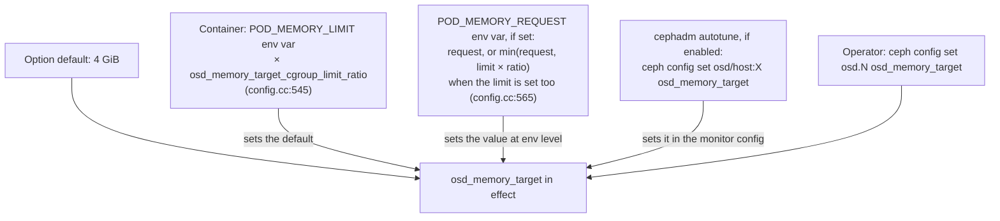

Take away: the container path reads environment variables that the
orchestrator sets, not the cgroup files; the cgroup limit itself is only
reported in daemon metadata.

In detail, from
[`md_config_t::parse_env()`](https://github.com/ceph/ceph/blob/v21.3.0/src/common/config.cc#L475):

1. If `POD_MEMORY_LIMIT` is set and the ratio is above 0, the limit times the
   ratio becomes the *default* of `osd_memory_target`.
2. If `POD_MEMORY_REQUEST` is set, it is set as `osd_memory_target` at
   environment level; when the limit is also set, the smaller of the request
   and (limit × ratio) is used.
3. Nothing in `src/osd/OSD.cc` or `src/ceph_osd.cc` reads
   `osd_memory_target`. The OSD process itself never caps the allocator;
   only BlueStore acts on the number.

## 2. From the target to a cache ceiling

BlueStore does not hand the whole target to its caches. It first takes off
the memory the OSD needs anyway and the fragmentation reserve. The code is in
[`MempoolThread::entry()`](https://github.com/ceph/ceph/blob/v21.3.0/src/os/bluestore/BlueStore.cc#L5562):

```cpp
  uint64_t ltarget = (1.0 - fragmentation) * target;
  if (ltarget > base + min) {
    max = ltarget - base;
  }                              // else max stays equal to min
```

Here `target` is `osd_memory_target`, `fragmentation` is
`osd_memory_expected_fragmentation`, `base` is `osd_memory_base` and `min` is
`osd_memory_cache_min`. The result `max` is the most the four caches may use
together. With the defaults:

| Step | Value |
|---|---|
| target | 4096 MiB |
| × (1 − 0.15) | 3481.6 MiB |
| − base 768 MiB | **2713.6 MiB ≈ 2.65 GiB** cache ceiling |
| floor | 128 MiB (`osd_memory_cache_min`) |

This diagram shows how the target is carved up.

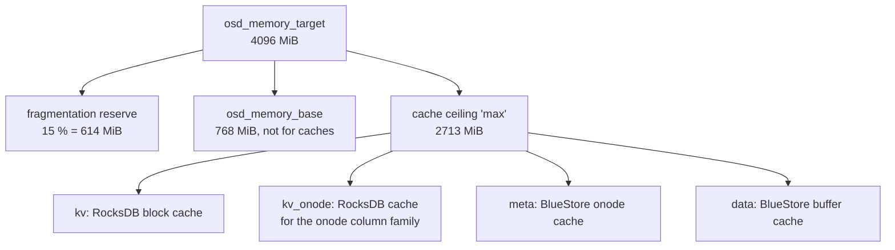

Take away: the four caches never see the raw target; they share at most the
ceiling, and the tuner usually gives them less than that.

The same formula is recomputed in
[`_update_cache_settings()`](https://github.com/ceph/ceph/blob/v21.3.0/src/os/bluestore/BlueStore.cc#L5765)
when the options change at runtime.

## 3. The four caches

| Name in the tuner | Class | What it holds | Static share (ratio option, default) |
|---|---|---|---|
| `kv` | `rocksdb_cache::BinnedLRUCache` | RocksDB data, index and filter blocks for all column families except the onode one. | `bluestore_cache_kv_ratio` = 0.45 |
| `kv_onode` | `rocksdb_cache::BinnedLRUCache` | RocksDB blocks of the `O` column family, which stores onodes (object metadata) on disk. | `bluestore_cache_kv_onode_ratio` = 0.04 |
| `meta` | `MempoolThread::MetaCache` over the onode cache shards | Decoded onodes with their extent maps, blobs, shared blobs, checksums and attributes. | `bluestore_cache_meta_ratio` = 0.45 |
| `data` | `MempoolThread::DataCache` over the buffer cache shards | Object data that was read or written recently. | derived: 1 − 0.45 − 0.45 − 0.04 = **0.06** |

An *onode* is BlueStore's in-memory record of one object: where its bytes
live on disk and what attributes it has. A *blob* is one allocated piece of
disk space that an onode's extents point to.

The ratios are validated and the data ratio derived in
[`_set_cache_sizes()`](https://github.com/ceph/ceph/blob/v21.3.0/src/os/bluestore/BlueStore.cc#L6155):
each ratio must be in [0, 1], their sum must not exceed 1, and
`cache_data_ratio = 1 − meta − kv − kv_onode`, clamped at 0
([L6226](https://github.com/ceph/ceph/blob/v21.3.0/src/os/bluestore/BlueStore.cc#L6226)).

Two sizing options exist only for the static case, when autotuning is off:

| Option | Default | Used when |
|---|---|---|
| `bluestore_cache_size` | 0 (= pick by media) | `bluestore_cache_autotune = false` |
| `bluestore_cache_size_hdd` / `_ssd` | 1 GiB / 3 GiB | Same; chosen by whether the device is rotational ([L6185](https://github.com/ceph/ceph/blob/v21.3.0/src/os/bluestore/BlueStore.cc#L6185)) |

With `bluestore_cache_autotune = true` (the default), these sizes are
replaced by the tuner's result, but the ratios still matter: they become the
weights the tuner uses when caches compete (§6).

### 3.1 How the pieces connect

This diagram shows the components from the option down to the shards that
hold entries.

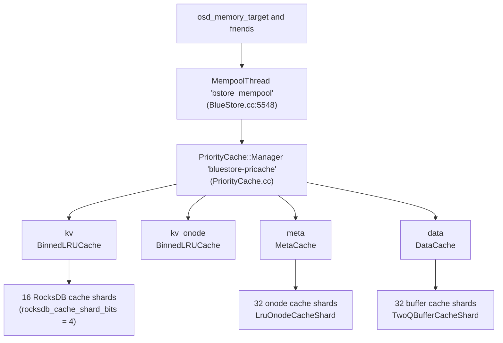

Take away: the tuner only decides byte counts; the shards are where entries
are stored, aged and evicted.

The manager is created in
[`MempoolThread::entry()`](https://github.com/ceph/ceph/blob/v21.3.0/src/os/bluestore/BlueStore.cc#L5569)
only if `bluestore_cache_autotune` is on *and* the RocksDB block cache is a
`BinnedLRUCache` (`rocksdb_cache_type = binned_lru`, the default). With any
other RocksDB cache type there is no tuner, and the static ratios apply.

## 4. The background thread and its loop

One thread per OSD, named `bstore_mempool`, does all cache sizing. It is
started at mount, after the key-value store and deferred-write replay are up
([`_mount()`](https://github.com/ceph/ceph/blob/v21.3.0/src/os/bluestore/BlueStore.cc#L9556),
which calls `mempool_thread.init()` at L9641),
and stopped at unmount.

This flowchart shows one pass of the loop in
[`MempoolThread::entry()`](https://github.com/ceph/ceph/blob/v21.3.0/src/os/bluestore/BlueStore.cc#L5587).

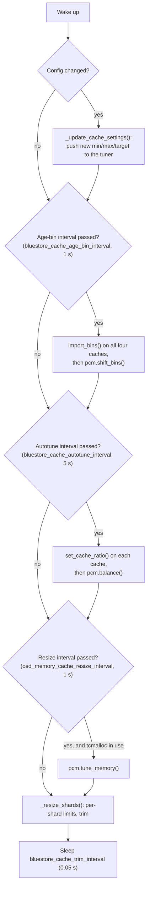

Take away: the thread wakes twenty times a second, but the expensive steps
run on their own timers; only `_resize_shards()` runs every pass.

The steps in order, with their code:

1. If a config change was flagged (`config_changed`, incremented by
   [`_update_osd_memory_options()`](https://github.com/ceph/ceph/blob/v21.3.0/src/os/bluestore/BlueStore.cc#L6122)),
   recompute min, max and target and push them to the tuner.
2. Every `bluestore_cache_age_bin_interval`: load the age-bin boundaries
   into each cache and rotate the bins
   ([L5610](https://github.com/ceph/ceph/blob/v21.3.0/src/os/bluestore/BlueStore.cc#L5610)).
   §6.1 explains bins.
3. Every `bluestore_cache_autotune_interval`: give each cache its ratio and
   run `balance()`
   ([L5627](https://github.com/ceph/ceph/blob/v21.3.0/src/os/bluestore/BlueStore.cc#L5627)).
4. Every `osd_memory_cache_resize_interval`, and only when the process runs
   on tcmalloc: run `tune_memory()`
   ([L5648](https://github.com/ceph/ceph/blob/v21.3.0/src/os/bluestore/BlueStore.cc#L5648)).
5. Every pass: `_resize_shards()`
   ([L5667](https://github.com/ceph/ceph/blob/v21.3.0/src/os/bluestore/BlueStore.cc#L5667)).
6. Sleep `bluestore_cache_trim_interval`
   ([L5688](https://github.com/ceph/ceph/blob/v21.3.0/src/os/bluestore/BlueStore.cc#L5688)).

## 5. Step one of tuning: measure and move the total

`tune_memory()` decides how much memory *all* caches together may use right
now. It lives in
[`PriorityCache::Manager::tune_memory()`](https://github.com/ceph/ceph/blob/v21.3.0/src/common/PriorityCache.cc#L119).

The procedure:

1. Ask tcmalloc to give free pages back to the kernel
   (`ceph_heap_release_free_memory()`).
2. Read two tcmalloc numbers: `generic.heap_size` and
   `tcmalloc.pageheap_unmapped_bytes`.
3. `mapped = heap_size − unmapped`. This is the OSD's real footprint.
4. Start from the previous total, clamped between `min` and `max` (§2).
5. If `mapped < target`: grow by a fraction of the room left up to `max`.
   If `mapped ≥ target`: shrink by a fraction of the room left down to
   `min`.
6. Store the result as `tuned_mem` and publish it as a perf counter.

The two formulas, from the code:

```cpp
  if (mapped < target_mem) {
    double ratio = 1 - ((double) mapped / target_mem);
    new_size += ratio * (max_mem - new_size);
  } else {
    double ratio = 1 - ((double) target_mem / mapped);
    new_size -= ratio * (new_size - min_mem);
  }
```

This flowchart shows the decision.

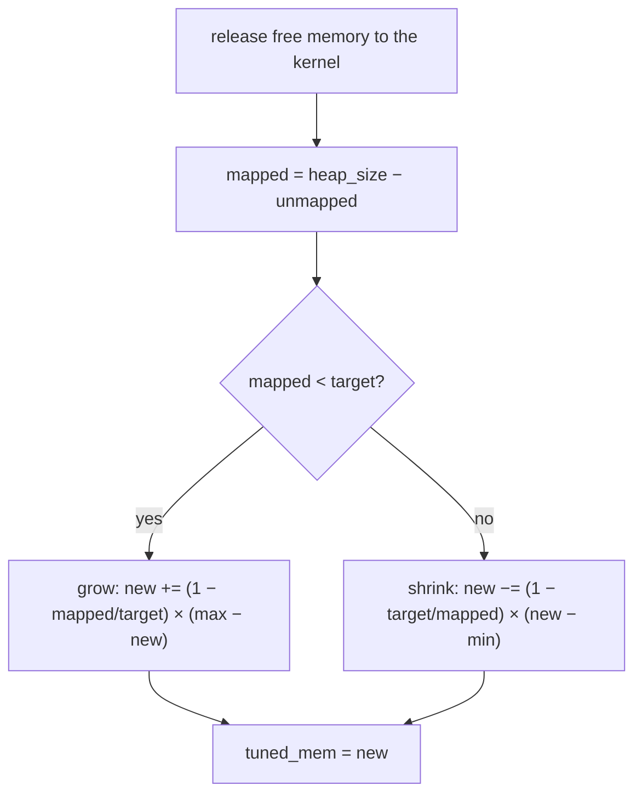

Take away: the further the OSD is from its target, the bigger the step. Close
to the target the steps become tiny, so the total settles instead of
oscillating. The code's own comment: "Approach the min/max slowly, but bounce
away quickly."

Two consequences worth knowing:

- `tuned_mem` is initialised to `min` (128 MiB), but the constructor runs
  `tune_memory()` once
  ([constructor](https://github.com/ceph/ceph/blob/v21.3.0/src/common/PriorityCache.cc#L69),
  L110), so the first value is `min + (1 − mapped/target) × (max − min)`.
  From there it approaches the target over the first minutes after an OSD
  starts.
- Without tcmalloc the loop never calls `tune_memory()`
  ([L5649](https://github.com/ceph/ceph/blob/v21.3.0/src/os/bluestore/BlueStore.cc#L5649)).
  The one call from the constructor reads heap statistics that stay at zero,
  so `mapped = 0` and `tuned_mem` is set to `max` for the life of the OSD.

## 6. Step two of tuning: split the total between caches

`balance()` divides `tuned_mem` among the four caches. It does not divide by
ratio first. It walks twelve priority levels from most to least important,
and at each level every cache may ask for bytes. Ratios only decide who wins
when the caches ask for more than is left: each cache's *fair share* is the
remaining memory times its ratio (§6.2).

### 6.1 Priorities are ages

The priority levels are `PRI0` to `PRI11` (`LAST`) in
[`PriorityCache.h`](https://github.com/ceph/ceph/blob/v21.3.0/src/common/PriorityCache.h#L43).
The header has no comments on them; their meaning comes from how the caches
fill them:

| Level | kv / kv_onode (RocksDB) | meta / data (BlueStore) |
|---|---|---|
| `PRI0` | The bytes in RocksDB's high-priority pool (index and filter blocks marked high priority) plus 64 MiB, rounded up to a chunk (§6.3), so at least 64 MiB even when the pool is empty ([BinnedLRUCache.cc:776](https://github.com/ceph/ceph/blob/v21.3.0/src/kv/rocksdb_cache/BinnedLRUCache.cc#L776)) | Nothing; BlueStore puts nothing in PRI0 ([BlueStore.h:2618](https://github.com/ceph/ceph/blob/v21.3.0/src/os/bluestore/BlueStore.h#L2618)) |
| `PRI1` … `PRI10` | Bytes whose last use falls in age bin range *p* | Same |
| `PRI11` (`LAST`) | Everything older than the last bin | Same |

An *age bin* is a counter of bytes (for data and RocksDB) or of onodes (for
meta) touched during one interval of `bluestore_cache_age_bin_interval`
(1 s). Every interval the bins shift by one, so an entry that is not touched
moves into older bins. The option `bluestore_cache_age_bins_<cache>` lists
ten boundaries; priority *p* covers the bins between boundary *p−1* and
boundary *p*.

With the default `"1 2 6 24 120 720 0 0 0 0"` for kv, meta and data:

| Priority | Age of the entries |
|---|---|
| PRI1 | touched in the last 1 s |
| PRI2 | 1 to 2 s ago |
| PRI3 | 2 to 6 s ago |
| PRI4 | 6 to 24 s ago |
| PRI5 | 24 s to 2 min ago |
| PRI6 | 2 to 12 min ago |
| PRI7 to PRI10 | empty (boundary 0) |
| LAST | older than 12 min |

The kv_onode cache uses `"0 0 0 0 0 0 0 0 0 720"`: all its entries up to 12
minutes old sit in PRI10, behind everything the other caches used in the
last 12 minutes.

### 6.2 How one balance runs

This sequence shows one `balance()` call between the manager and the caches.

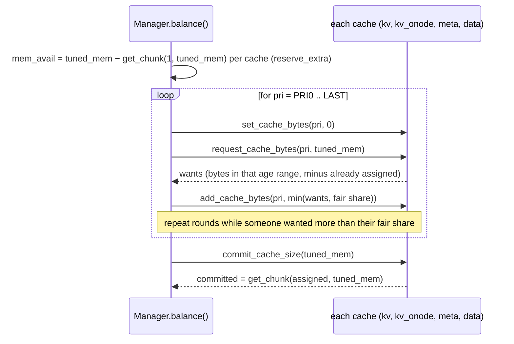

Take away: a cache gets everything it asks for at a high priority as long as
memory lasts; the ratio is only used to split what is left when several
caches ask for more than the fair share.

The rounds at one priority, from
[`balance_priority()`](https://github.com/ceph/ceph/blob/v21.3.0/src/common/PriorityCache.cc#L332):

1. Every cache's bytes for this priority are reset to 0.
2. Each cache says what it wants at this priority.
3. Each cache's fair share is `mem_avail × (its ratio ÷ sum of ratios of the
   caches still asking)`. If every remaining cache has ratio 0, they split
   equally.
4. A cache that wants less than its fair share gets exactly what it wants and
   drops out of the round. A cache that wants more gets its fair share and
   stays in for the next round.
5. Repeat while there are caches still asking and memory left.
6. For `LAST` only, each cache's share is overwritten with
   `mem_avail × ratio`
   ([L398](https://github.com/ceph/ceph/blob/v21.3.0/src/common/PriorityCache.cc#L398)),
   so whatever remains after the aged priorities is handed out by ratio.
   The bytes the rounds assigned at `LAST` are discarded by this overwrite,
   and if the ratios sum to less than 1 the remainder stays unassigned.

### 6.3 Commit rounds up

After balancing, each cache is told to commit. The committed size is not the
assigned bytes; it is rounded up by
[`get_chunk()`](https://github.com/ceph/ceph/blob/v21.3.0/src/common/PriorityCache.cc#L33):

1. `chunk` = the total rounded up to a power of two, divided by 256, clamped
   between 4 MiB and 64 MiB.
2. committed = assigned + 64 MiB, rounded up to a multiple of `chunk`.

The 64 MiB of headroom exists, per the comment in the code, so the RocksDB
block cache can absorb reads during compaction without evicting. Because of
it, `balance()` first subtracts `get_chunk(1, tuned_mem)`, which is 64 MiB
plus one chunk, per cache from `mem_avail` (`reserve_extra`,
[L280](https://github.com/ceph/ceph/blob/v21.3.0/src/common/PriorityCache.cc#L280)).
With `tuned_mem` near the default ceiling the chunk is 16 MiB, so that is
80 MiB per cache, 320 MiB for four.

What commit does per cache type:

- RocksDB (`BinnedLRUCache::commit_cache_size`,
  [L803](https://github.com/ceph/ceph/blob/v21.3.0/src/kv/rocksdb_cache/BinnedLRUCache.cc#L803)):
  sets the block cache capacity to the committed size, which evicts at once,
  and sets the high-priority pool ratio to `PRI0 bytes ÷ committed`.
- BlueStore (`MempoolCache::commit_cache_size`,
  [BlueStore.h:2665](https://github.com/ceph/ceph/blob/v21.3.0/src/os/bluestore/BlueStore.h#L2665)):
  only records the number. The eviction happens in `_resize_shards()` (§7).

## 7. Step three: from bytes to shard limits and eviction

[`_resize_shards()`](https://github.com/ceph/ceph/blob/v21.3.0/src/os/bluestore/BlueStore.cc#L5699)
runs every pass of the loop and turns the committed sizes into limits that
each shard enforces.

```cpp
  uint64_t max_shard_onodes = static_cast<uint64_t>(
      (meta_alloc / (double) onode_shards) / meta_cache->get_bytes_per_onode());
  uint64_t max_shard_buffer = static_cast<uint64_t>(data_alloc / buffer_shards);
```

- With the tuner on, `meta_alloc` and `data_alloc` are the committed sizes
  ([L5718](https://github.com/ceph/ceph/blob/v21.3.0/src/os/bluestore/BlueStore.cc#L5718)).
  With it off, they are `ratio × cache_size`.
- The onode limit is a *count*, because the onode cache evicts whole onodes.
  `get_bytes_per_onode()` is the metadata mempool bytes divided by the number
  of onodes
  ([BlueStore.h:2756](https://github.com/ceph/ceph/blob/v21.3.0/src/os/bluestore/BlueStore.h#L2756)).
- The buffer limit is in bytes.

This flowchart shows how a limit becomes an eviction.

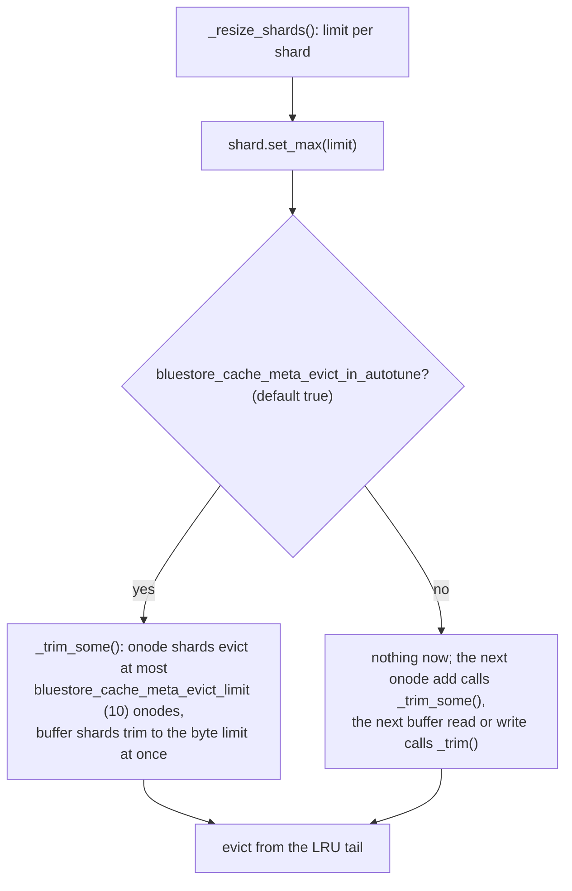

Take away: onode eviction is gradual and spread over the loop's many passes;
buffer eviction is immediate.

The per-shard details:

- [`CacheShard::set_max()`](https://github.com/ceph/ceph/blob/v21.3.0/src/os/bluestore/BlueStore.h#L1537)
  stores the limit and, when `bluestore_cache_meta_evict_in_autotune` is
  true, calls `_trim_some()`.
- [`_trim_some()`](https://github.com/ceph/ceph/blob/v21.3.0/src/os/bluestore/BlueStore.h#L1557)
  trims to `max(num − bluestore_cache_meta_evict_limit, max)`. For an onode
  shard `num` is an onode count, so at most 10 onodes go per call; a value
  below 2 means "trim all at once". For a buffer shard `num` counts buffers
  while `max` is in bytes, so the subtraction almost never matters and the
  shard trims to its byte limit in one call.
- Adding or renaming an onode calls `_trim_some()` on its shard
  ([`OnodeSpace::add_onode`](https://github.com/ceph/ceph/blob/v21.3.0/src/os/bluestore/BlueStore.cc#L2064)),
  so onode shards trim gradually even with
  `bluestore_cache_meta_evict_in_autotune` off. Any buffer read, write,
  discard or write completion calls `_trim()` on its buffer shard right away.

### 7.1 Shards and how a collection finds its shard

- The OSD creates the shards at start with
  `store->set_cache_shards(get_num_cache_shards())`
  ([OSD.cc:3699](https://github.com/ceph/ceph/blob/v21.3.0/src/osd/OSD.cc#L3699)).
  The count is `osd_num_cache_shards`, default 32
  ([osd.yaml.in:950](https://github.com/ceph/ceph/blob/v21.3.0/src/common/options/osd.yaml.in#L950)).
- [`BlueStore::set_cache_shards()`](https://github.com/ceph/ceph/blob/v21.3.0/src/os/bluestore/BlueStore.cc#L9405)
  creates that many onode shards and that many buffer shards. It can only
  grow the count.
- A collection (one placement group's objects) is assigned a shard by the
  placement group's hash: `onode_cache_shards[cid.hash_to_shard(n)]`
  ([L8459](https://github.com/ceph/ceph/blob/v21.3.0/src/os/bluestore/BlueStore.cc#L8459)),
  where `hash_to_shard` is the PG number modulo the shard count
  ([osd_types.h:634](https://github.com/ceph/ceph/blob/v21.3.0/src/osd/osd_types.h#L634)).
- When a PG splits, `Collection::split_cache` moves the affected onodes and
  buffers to the new collection's shards.

## 8. Inside the caches

Each cache below ends with the call stacks that allocate and free its
entries, recorded on a live OSD: ceph `21.3.0-2868-gba165903a5a`
(RelWithDebInfo, vstart, four OSDs, `osd_memory_target` = 1 GiB, so the
caches share the 128 MiB floor and trim all the time). The probes are perf
uprobes on the OSD binary with DWARF unwinding, taken during recovery pushes,
client reads, and cold reads after a `compact`; the script is
[`cachestacks.sh`]({{ site.baseurl }}/code/ceph/cachestacks.sh) and the
folding is [`cachefold.py`]({{ site.baseurl }}/code/ceph/cachefold.py).
A stack reads top-down from the probed function, `*` marks an inlined frame,
the number is how often that exact stack fired in one window, and `std::`
and thread-pool frames are dropped.

Two things the binary taught about probing it. The constructors of `Onode`
and `Buffer` are inlined into every caller, so the class's `operator new`
and `operator delete` are probed instead; they are out-of-line mempool
allocators and fire for every object. And `BinnedLRUCacheShard::Insert()`
has an out-of-line copy for the vtable that is never executed, because its
only caller, `rocksdb_cache::ShardedCache::Insert()`, inlined it: a probe on
it attaches cleanly and counts zero. bpftrace cannot do this job on this
build: without frame pointers its `ustack()` stops after two frames.

### 8.1 The onode cache: an LRU with pinning

`bluestore_cache_type` names two cache kinds, `2q` (default) and `lru`, but
the onode cache ignores it and is always an LRU
([`OnodeCacheShard::create`](https://github.com/ceph/ceph/blob/v21.3.0/src/os/bluestore/BlueStore.cc#L1222)).
LRU means "least recently used": the entry that has gone longest without use
is evicted first.

An onode that an operation is using must not be evicted. The mechanism is
a second reference counter, `pin_nref`:

1. The cache's own index holds one reference, so an idle onode has
   `pin_nref == 1` and sits on the LRU list.
2. Any operation or transaction that takes the onode bumps `pin_nref`
   ([`Onode::get()`](https://github.com/ceph/ceph/blob/v21.3.0/src/os/bluestore/BlueStore.cc#L4912)).
   Taking it does not move it. But `_add` links only unpinned onodes, and
   when [`_trim_to()`](https://github.com/ceph/ceph/blob/v21.3.0/src/os/bluestore/BlueStore.cc#L1172)
   reaches a pinned one at the tail it unlinks and skips it instead of
   evicting it. The shard still counts it toward `num`.
3. When the last extra reference drops
   ([`Onode::put()`](https://github.com/ceph/ceph/blob/v21.3.0/src/os/bluestore/BlueStore.cc#L4917)),
   the onode goes back to the front of the LRU.

The option `bluestore_cache_trim_max_skip_pinned` still exists but nothing
reads it at this version.

Onode memory is not fixed. An onode's extent map is stored on disk in
pieces ("shards" of the map, unrelated to cache shards) and loaded on demand
by `fault_range()`. Nothing unloads a loaded piece; the memory is released
only when the whole onode is evicted.

**Call stacks.** Allocation and insertion are one step:
[`get_onode()`](https://github.com/ceph/ceph/blob/v21.3.0/src/os/bluestore/BlueStore.cc#L5388) misses the onode space,
[`create_decode()`](https://github.com/ceph/ceph/blob/v21.3.0/src/os/bluestore/BlueStore.cc#L4953) builds the onode from
its RocksDB value, and
[`add_onode()`](https://github.com/ceph/ceph/blob/v21.3.0/src/os/bluestore/BlueStore.cc#L2064) links it into the shard
and trims the shard on the spot.

```
alloc + insert, client read              3496x  tp_osd_tp
  BlueStore::Onode::operator new
  BlueStore::Onode::create_decode
  BlueStore::Collection::get_onode          -> OnodeSpace::add_onode -> _trim_some*
  BlueStore::getattr
  PGBackend::objects_get_attr
  PrimaryLogPG::get_object_context
  PrimaryLogPG::find_object_context
  PrimaryLogPG::do_op_impl
  PrimaryLogPG::do_op
  OSD::dequeue_op

alloc + insert, write (recovery push)     193x  tp_osd_tp
  BlueStore::Onode::operator new
  BlueStore::Onode::create_decode
  BlueStore::Collection::get_onode
  BlueStore::_txc_add_transaction
  BlueStore::queue_transactions
  PrimaryLogPG::queue_transaction
  ReplicatedBackend::_do_push
  PGBackend::handle_message
  PrimaryLogPG::do_request
  OSD::dequeue_op
```

```
free, inline on insert                   1124x  tp_osd_tp   (same op as above)
  BlueStore::Onode::operator delete         <- OnodeSpace::_remove drops the last ref, Onode::put
  std::_Hashtable::_M_erase
  LruOnodeCacheShard::_trim_to
  BlueStore::CacheShard::_trim_some*
  BlueStore::OnodeSpace::add_onode
  BlueStore::Collection::get_onode
  BlueStore::getattr
  ...

free, background                         2300x  bstore_mempool
  BlueStore::Onode::operator delete
  std::_Hashtable::_M_erase
  LruOnodeCacheShard::_trim_to
  BlueStore::CacheShard::_trim_some*
  BlueStore::CacheShard::set_max*
  BlueStore::MempoolThread::_resize_shards
  BlueStore::MempoolThread::entry

free, collection removed                   14x  bstore_kv_final
  BlueStore::Onode::operator delete
  BlueStore::OnodeSpace::clear
  BlueStore::_reap_collections
  BlueStore::_kv_finalize_thread
```

Take away: the op thread that inserts an onode is also the thread that
evicts one, because `add_onode()` calls `_trim_some()`; the mempool thread
only catches up. In the read window the split was about 1,700 inline to
2,300 background, in the recovery window 330 to 58. An eviction frees the
onode, its loaded extent-map shards, and its cached buffers (§8.2).

### 8.2 The data cache: 2Q

The buffer cache holds `Buffer` objects: a range of one object's data. The
default `2q` shard
([`TwoQBufferCacheShard`](https://github.com/ceph/ceph/blob/v21.3.0/src/os/bluestore/BlueStore.cc#L1343))
keeps three lists, so that data touched once does not push out data touched
often.

This diagram shows the lists and the moves between them.

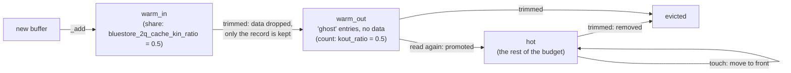

Take away: a buffer has to be read twice, with the second read coming while
its ghost record is still around, before it is treated as hot. A touch in
`warm_in` deliberately does not move it, per the comment in the code.

Trim in
[`_trim_to()`](https://github.com/ceph/ceph/blob/v21.3.0/src/os/bluestore/BlueStore.cc#L1521)
sizes `warm_in` to `max × kin_ratio`, `hot` to the rest, and `warm_out` to a
*count* of ghosts derived from the average buffer size times `kout_ratio`.

Each buffer's data moves between memory pools as it changes state. This
state diagram shows the lifecycle.

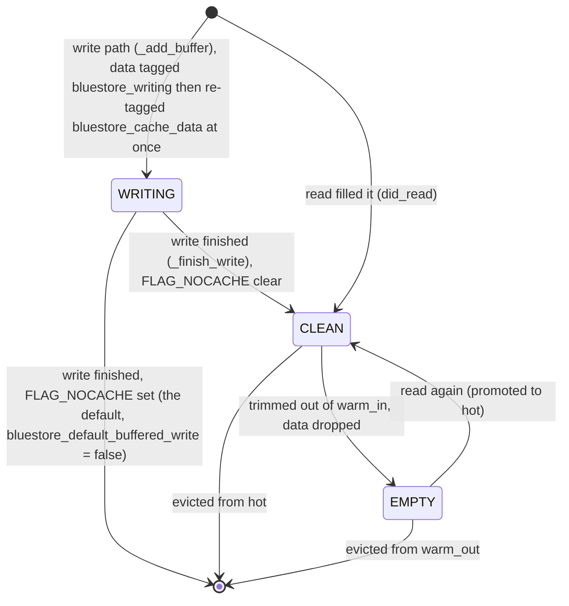

Take away: `bluestore_cache_data` in a mempool dump already includes the data
of writes still in flight, because `_add_buffer` re-tags it at once. The
`bluestore_writing` tag lasts only for the moment in between. Deferred-write
data is the exception; it sits in `bluestore_writing_deferred`.

The tagging is in
[`_add_buffer`](https://github.com/ceph/ceph/blob/v21.3.0/src/os/bluestore/BlueStore.cc#L1705)
at L1721 and L1742. The re-tag in
[`_finish_write`](https://github.com/ceph/ceph/blob/v21.3.0/src/os/bluestore/BlueStore.cc#L1933)
at L1957 changes nothing by then.

**Call stacks.** A buffer is allocated by the reader or writer that needs
it. [`did_read()`](https://github.com/ceph/ceph/blob/v21.3.0/src/os/bluestore/BlueStore.h#L514) and `write()` do the
same three things: `_discard()` whatever overlaps, `_add_buffer()`, then
`cache->_trim()`.

```
alloc, read fill                         4167x  tp_osd_tp
  BlueStore::BufferSpace::_add_buffer
  BlueStore::BufferSpace::did_read*         -> _discard* before, cache->_trim() after
  BlueStore::_generate_read_result_bl
  BlueStore::_do_read
  BlueStore::read
  ReplicatedBackend::objects_read_sync
  PrimaryLogPG::do_read
  PrimaryLogPG::do_osd_ops
  PrimaryLogPG::execute_ctx
  PrimaryLogPG::do_op

alloc, write                              221x  tp_osd_tp
  BlueStore::BufferSpace::_add_buffer
  BlueStore::BufferSpace::write*
  BlueStore::_buffer_cache_write*
  BlueStore::_do_alloc_write
  BlueStore::_do_write
  BlueStore::_write
  BlueStore::_txc_add_transaction
  BlueStore::queue_transactions
```

Recovery reads take the first path through `readv()` from
`build_push_op()`, with the same frames below `_generate_read_result_bl`.

```
free, write finished                      244x  bstore_kv_final
  BlueStore::Buffer::operator delete        FLAG_NOCACHE: the default write is not cached
  BlueStore::BufferSpace::_finish_write
  BlueStore::Onode::finish_write
  BlueStore::TransContext::finish_writing
  BlueStore::_txc_finish
  BlueStore::_kv_finalize_thread

free, trim inline on a read fill         2418x  tp_osd_tp
  BlueStore::Buffer::operator delete
  BlueStore::BufferSpace::_rm_buffer*
  TwoQBufferCacheShard::_trim_to
  BlueStore::CacheShard::_trim*
  BlueStore::BufferSpace::did_read*
  BlueStore::_generate_read_result_bl
  BlueStore::_do_read
  ...

free, overlapped by the new buffer        169x  tp_osd_tp
  BlueStore::Buffer::operator delete
  BlueStore::BufferSpace::_discard
  BlueStore::BufferSpace::did_read*
  BlueStore::_generate_read_result_bl
  ...

free, onode evicted                       282x  bstore_mempool
  BlueStore::Buffer::operator delete
  BlueStore::BufferSpace::_clear
  BlueStore::Onode::~Onode
  BlueStore::Onode::put
  std::_Hashtable::_M_erase
  LruOnodeCacheShard::_trim_to
  BlueStore::CacheShard::_trim_some*
  BlueStore::CacheShard::set_max*
  BlueStore::MempoolThread::_resize_shards
```

Take away: in these windows no buffer was freed by the mempool thread's own
buffer-shard `set_max()`. A buffer leaves with the reader that inserts the
next one, with the write that finishes, or with its onode. The writing
buffer of a default write is not cache at all: it serves readers while the
write is in flight and is erased in `_txc_finish()`.

### 8.3 The RocksDB block caches

BlueStore stores all metadata in RocksDB, a key-value database. RocksDB
reads its files in blocks and keeps them in a block cache. Ceph replaces
RocksDB's own cache with `BinnedLRUCache`, an LRU with two additions: a
high-priority pool and age bins, so that the tuner can see how old each
block is.

| Option | Default | Effect |
|---|---|---|
| `rocksdb_cache_type` | `binned_lru` | Must stay `binned_lru` for the tuner to exist (§3.1). `lru` and `clock` are RocksDB's own caches. |
| `rocksdb_cache_size` | 512 MiB | Initial size of the default block cache; BlueStore overrides that one with `kv_ratio × cache_size` at startup ([L8280](https://github.com/ceph/ceph/blob/v21.3.0/src/os/bluestore/BlueStore.cc#L8280)). The onode column family's cache starts at `rocksdb_cache_size` unless `bluestore_rocksdb_cfs` gives a `size=`. The tuner resizes both afterwards. |
| `rocksdb_cache_shard_bits` | 4 | 2⁴ = 16 internal shards, for lock spreading. |
| `rocksdb_cache_index_and_filter_blocks` | true | Index and filter blocks live in the block cache instead of outside it. |
| `rocksdb_cache_index_and_filter_blocks_with_high_priority` | false | They are *not* marked high priority by default, so the high-priority pool is normally empty and the PRI0 request is its 64 MiB minimum. |
| `bluestore_rocksdb_cfs` | `... O(3,0-13)=block_cache={type=binned_lru} ...` | Gives the onode column family its own `BinnedLRUCache`; that is the `kv_onode` cache. |

The block cache is created in
[`RocksDBStore::create_block_cache()`](https://github.com/ceph/ceph/blob/v21.3.0/src/kv/RocksDBStore.cc#L468)
and the per-column-family cache in
[`apply_block_cache_options()`](https://github.com/ceph/ceph/blob/v21.3.0/src/kv/RocksDBStore.cc#L960).
A separate cache for a column family is only created when its option string
gives a type, size or high ratio; otherwise the family shares the default
cache.

**Call stacks.** A block enters through RocksDB's table reader, which calls
[`ShardedCache::Insert()`](https://github.com/ceph/ceph/blob/v21.3.0/src/kv/rocksdb_cache/ShardedCache.cc#L46) after a
cache miss. BlueStore reaches it with point gets and with iterators.

```
alloc, onode point get (kv_onode cache)   519x  tp_osd_tp
  rocksdb_cache::ShardedCache::Insert       -> BinnedLRUCacheShard::Insert* -> EvictFromLRU* -> FreeDeleted
  rocksdb::BlockBasedTable::PutDataBlockToCache
  rocksdb::BlockBasedTable::MaybeReadBlockAndLoadToCache
  rocksdb::BlockBasedTable::RetrieveBlock
  rocksdb::BlockBasedTable::NewDataBlockIterator
  rocksdb::BlockBasedTable::Get
  rocksdb::TableCache::Get
  rocksdb::Version::Get
  rocksdb::DBImpl::Get
  RocksDBStore::get
  BlueStore::Collection::get_onode
  BlueStore::getattr
  PGBackend::objects_get_attr
  PrimaryLogPG::get_object_context
  PrimaryLogPG::do_op_impl

alloc, collection listing (backfill scan) 624x  tp_osd_tp
  rocksdb_cache::ShardedCache::Insert
  rocksdb::BlockBasedTable::PutDataBlockToCache
  rocksdb::BlockBasedTable::MaybeReadBlockAndLoadToCache
  rocksdb::BlockBasedTable::RetrieveBlock
  rocksdb::BlockBasedTable::NewDataBlockIterator
  rocksdb::BlockBasedTableIterator::InitDataBlock
  rocksdb::BlockBasedTableIterator::FindBlockForward
  rocksdb::BlockBasedTableIterator::Next
  rocksdb::MergingIterator::Next
  rocksdb::DBIter::Next
  ShardMergeIteratorImpl::next
  SortedCollectionListIterator::get_next_chunk
  BlueStore::_collection_list

alloc, extent-map shard load               18x  tp_osd_tp
  rocksdb_cache::ShardedCache::Insert
  ... rocksdb::BlockBasedTable::Get ... RocksDBStore::get
  BlueStore::ExtentMap::maybe_load_shard
  BlueStore::_fiemap
  ReplicatedBackend::build_push_op

compaction, placeholder entry           19168x  RocksDB background thread
  rocksdb_cache::ShardedCache::Insert
  rocksdb::PlaceholderCacheInterface::Insert*
  rocksdb::BlockBasedTable::NewDataBlockIterator
  rocksdb::BlockBasedTableIterator::InitDataBlock
  rocksdb::BlockBasedTableIterator::Next
  rocksdb::MergingIterator::Next
  rocksdb::CompactionIterator::Next
  rocksdb::CompactionJob::ProcessKeyValueCompaction
  rocksdb::CompactionJob::Run
  rocksdb::DBImpl::BackgroundCompaction
```

The last one is not a cached block. A compaction reads with the cache fill
off, and RocksDB inserts a value-less placeholder that charges the block's
size to the cache while the iterator holds it; the block is freed when the
iterator moves on (36,000 `Block::~Block` in that window). It is why
`inserts` in the `rocksdb-cache-O` perf counters runs far ahead of `elems`.

```
free, tuner resize                         30x  bstore_mempool   (every balance round)
  rocksdb_cache::BinnedLRUCache::commit_cache_size   -> SetCapacity -> EvictFromLRU -> FreeDeleted -> Block::~Block
  PriorityCache::Manager::balance
  BlueStore::MempoolThread::entry

free, insert into a full shard                        (inlined into ShardedCache::Insert, see above)
  rocksdb_cache::ShardedCache::Insert
  rocksdb_cache::BinnedLRUCacheShard::Insert*
  rocksdb_cache::BinnedLRUCacheShard::EvictFromLRU*
  rocksdb_cache::BinnedLRUCacheShard::FreeDeleted    -> Block::~Block
```

Take away: both free paths exist, neither freed a block in this run. At
the floor each RocksDB cache is handed its 64 MiB minimum chunk and never
shrinks, and the kv_onode cache's usage stayed under it (`rocksdb-cache-O` in
`perf dump`: capacity 64 MiB, usage 48 MiB, 10,743 blocks after 32,750
inserts over the OSD's life). So on a small OSD the RocksDB caches only
grow to the chunk; the `hits`, `misses` and `inserts` counters there are
the way to see them work, since `dump_objectstore_kv_stats` needs
`rocksdb_perf` on.

## 9. Mempools: how BlueStore knows what it uses

The tuner needs to know how many bytes the metadata cache holds. BlueStore
does not walk its data structures to find out. Instead, every cached object
type is allocated from a named *mempool*, and each pool keeps running
counters of bytes and items.

- The pool list is one macro,
  [`DEFINE_MEMORY_POOLS_HELPER`](https://github.com/ceph/ceph/blob/v21.3.0/src/include/mempool.h#L154).
  The BlueStore pools: `bluestore_cache_data`, `bluestore_cache_onode`,
  `bluestore_cache_meta`, `bluestore_cache_other`, `bluestore_cache_buffer`,
  `bluestore_extent`, `bluestore_blob`, `bluestore_shared_blob`,
  `bluestore_inline_bl`, `bluestore_fsck`, `bluestore_txc`,
  `bluestore_writing_deferred`, `bluestore_writing`, `bluestore_alloc`, plus
  `bluefs`, `bluefs_file_reader` and `bluefs_file_writer`.
- Counting is done in the allocator
  ([`pool_allocator::allocate`](https://github.com/ceph/ceph/blob/v21.3.0/src/include/mempool.h#L345)):
  it adds `sizeof(T) × n` bytes and `n` items to one of up to 128 per-pool
  counter shards, picked by CPU or by a per-thread index so that threads do
  not fight over one counter.
- Reading a pool's total
  ([`allocated_bytes()`](https://github.com/ceph/ceph/blob/v21.3.0/src/common/mempool.cc#L124))
  sums the counter shards.

Which pools feed which cache:

| Cache | "Used bytes" come from |
|---|---|
| meta | Sum of `bluestore_blob`, `bluestore_extent`, `bluestore_cache_buffer`, `bluestore_cache_meta`, `bluestore_cache_other`, `bluestore_cache_onode`, `bluestore_shared_blob`, `bluestore_inline_bl` ([BlueStore.h:2731](https://github.com/ceph/ceph/blob/v21.3.0/src/os/bluestore/BlueStore.h#L2731)) |
| data | The buffer shards' own `buffer_bytes` counters, not a mempool ([BlueStore.h:2778](https://github.com/ceph/ceph/blob/v21.3.0/src/os/bluestore/BlueStore.h#L2778)) |
| kv, kv_onode | RocksDB's own usage counters (`GetUsage()`, `GetHighPriPoolUsage()`) |

Note that `bluestore_cache_buffer` counts the `Buffer` *records*, not the
data they point to, so it belongs to meta. The data itself is in
`bluestore_cache_data`, which is shown in dumps but not used by the tuner.

### 9.1 How to look at an OSD's memory

1. The tuner's view, as perf counters:
   ```
   ceph daemon osd.N perf dump bluestore-pricache
   ```
   gives `target_bytes`, `mapped_bytes`, `unmapped_bytes`, `heap_bytes` and
   `cache_bytes` (the manager's counters,
   [PriorityCache.cc:86](https://github.com/ceph/ceph/blob/v21.3.0/src/common/PriorityCache.cc#L86)).
   Each cache has its own set, `bluestore-pricache:kv`,
   `bluestore-pricache:meta` and so on, with `pri0_bytes` to `pri11_bytes`,
   `reserved_bytes` and `committed_bytes`.
2. The pools:
   ```
   ceph daemon osd.N dump_mempools
   ```
   registered in
   [`ceph_context.cc:172`](https://github.com/ceph/ceph/blob/v21.3.0/src/common/ceph_context.cc#L172);
   it works for every Ceph daemon, not only OSDs.
3. The allocator:
   ```
   ceph tell osd.N heap stats
   ```
   which needs tcmalloc.
4. The tuner's decisions, at debug level 5 of the `prioritycache` subsystem,
   as lines `prioritycache tune_memory target: … mapped: … unmapped: … heap: … old mem: … new mem: …`.
5. The kernel's view next to the tuner's view, sampled over time:
   [`osd-rss-watch.sh`]({{ site.baseurl }}/code/ceph/osd-rss-watch.sh)
   prints one line per OSD per interval with `VmRSS` split into anon and
   file from `/proc/PID/status`, the charge of the cgroup the OSD runs in,
   and `heap`, `mapped`, `unmapped`, `target` and `tuned` from the perf
   counters above, plus the mempool total.
   ```
   osd-rss-watch.sh -i 10                                    # packaged OSDs
   CEPH=build/bin/ceph osd-rss-watch.sh -c build/ceph.conf   # vstart
   ```
   Read it as `rss = anon + file`, and `anon ≈ mapped` plus what tcmalloc
   does not manage (thread stacks, RocksDB's own mmaps). `unmapped` is
   released to the kernel and not resident. An `anon` that keeps growing
   while `mapped` stays flat is memory the tuner does not see; `tuned`
   dropping while `anon` does not is the tuner shrinking caches that are
   not what fills the OSD.

## 10. What changes at runtime, and what does not

Only the four `osd_memory_*` sizing options carry the `runtime` flag, and
of the keys BlueStore tracks only some have a handler.
From
[`BlueStore::handle_conf_change()`](https://github.com/ceph/ceph/blob/v21.3.0/src/os/bluestore/BlueStore.cc#L5918)
and
[`_set_cache_sizes()`](https://github.com/ceph/ceph/blob/v21.3.0/src/os/bluestore/BlueStore.cc#L6155):

| Option | Takes effect |
|---|---|
| `osd_memory_target`, `osd_memory_base`, `osd_memory_cache_min`, `osd_memory_expected_fragmentation` | At runtime, within one loop pass (0.05 s): the change flags `config_changed`, the thread calls `_update_cache_settings()`. |
| `bluestore_cache_autotune`, `bluestore_cache_autotune_interval`, `bluestore_cache_age_bin_interval`, `osd_memory_target_cgroup_limit_ratio` | Tracked, but no handler: only at mount. |
| `bluestore_cache_age_bins_*` | Only at mount. The tracked key names (`bluestore_cache_kv_age_bins` and so on) do not match the real option names, and there is no handler for them. |
| `osd_memory_cache_resize_interval` | Only at mount; it is read once in `_set_cache_sizes()`. |
| `osd_num_cache_shards` | Startup only. |

Two environment facts matter as much as any option:

- The tuner only measures memory when the OSD runs on tcmalloc
  ([L5649](https://github.com/ceph/ceph/blob/v21.3.0/src/os/bluestore/BlueStore.cc#L5649)).
- The packaged units set `TCMALLOC_MAX_TOTAL_THREAD_CACHE_BYTES=134217728`
  (128 MiB) in `etc/sysconfig/ceph` and `etc/default/ceph`, and cephadm sets
  the same for its containers. That caps tcmalloc's per-thread free lists,
  which are part of "mapped" but not of any cache.

## 11. cephadm: setting the target per host

With `osd_memory_target_autotune = true`, the cephadm orchestrator computes
one target for all autotuned OSDs on a host and writes it into the cluster
configuration. The code is
[`MemoryAutotuner.tune()`](https://github.com/ceph/ceph/blob/v21.3.0/src/pybind/mgr/cephadm/autotune.py#L32),
called from
[`_autotune_host_memory()`](https://github.com/ceph/ceph/blob/v21.3.0/src/pybind/mgr/cephadm/serve.py#L194).

The procedure:

1. Start with the host's total memory times `autotune_memory_target_ratio`
   (module option, default 0.7).
2. Subtract, for every non-OSD daemon on the host, the larger of a per-type
   minimum and its measured usage. The minimums: 4 GiB for mds, mgr and
   nvmeof; 1 GiB for mon; 128 MiB for crash, keepalived and haproxy; 1 GiB
   otherwise. For an mds, subtract `mds_cache_memory_limit` instead.
3. Subtract the `osd_memory_target` of every OSD that has autotune turned
   off.
4. Divide what is left equally among the OSDs that have autotune on.
5. If the result differs from an OSD's own setting, remove the per-OSD value
   and set `osd_memory_target` for the mask `osd/host:<hostname>`.
6. If there is nothing to tune, because no OSD is autotuned or the remainder
   is not positive, and autotune is on globally, remove the host mask's
   `osd_memory_target` instead.

This flowchart shows the computation.

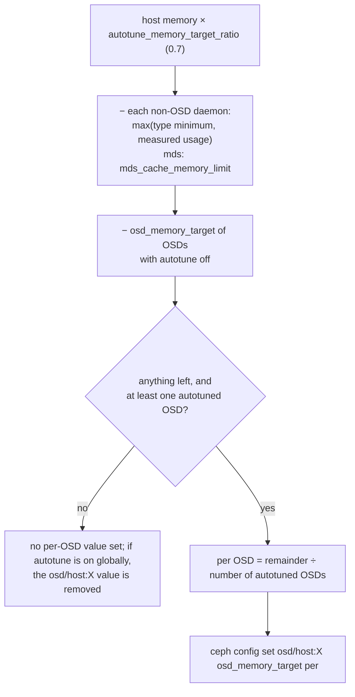

Take away: cephadm has no floor or ceiling of its own; the only floor is the
option's minimum of 896 MiB, and a `config set` below it fails with a logged
warning. It runs every `autotune_interval` (default 10 minutes) on hosts
without the `_no_autotune_memory` label.

## 12. The whole picture in one pass

Putting §2 to §7 together, this is what one OSD does after start, with the
defaults:

1. At mount, `_set_cache_sizes()` reads the options: ceiling 2713 MiB, floor
   128 MiB, ratios 0.45 / 0.45 / 0.04 / 0.06.
2. The thread starts; the tuner's first measurement puts `tuned_mem`
   between 128 MiB and the ceiling, depending on how much is already mapped.
3. Every second, `tune_memory()` sees mapped memory below 4 GiB and grows
   `tuned_mem` by a fraction of the distance to the ceiling.
4. Every five seconds, `balance()` walks the priorities: the two RocksDB
   caches' PRI0 requests first (their high-priority blocks plus 64 MiB
   each), then everything any cache touched in the last second, then the last two seconds, and so on, giving each cache what
   it asks for until the memory runs out. Whatever is left goes out by
   ratio. Each cache commits a size rounded up to a chunk plus 64 MiB.
5. Twenty times a second, `_resize_shards()` turns the committed sizes into
   per-shard limits: onode counts for the 32 onode shards, bytes for the 32
   buffer shards. RocksDB got its new capacity at commit.
6. Onode shards evict a few onodes per pass until they are under their
   limits; buffer shards trim to their byte limit at once.
7. If mapped memory climbs past 4 GiB, step 3 shrinks `tuned_mem`, step 4
   hands out less, and step 6 evicts more, until mapped memory falls back
   under the target.

## 13. A case: the page cache "beat" BlueStore's cache

[PR #72884](https://github.com/ceph/ceph/pull/72884) lets BlueStore read
object data through the kernel's page cache. Its author measured hot 4K
random reads and found 1 GiB OSDs plus the page cache 21 % faster than
OSDs with a 4 GiB target. Two explanations are possible: the kernel caches
data better than BlueStore, or BlueStore's cache was not using the memory
it had. I repeated the test on a 4-OSD vstart cluster and found the second.

### 13.1 The test

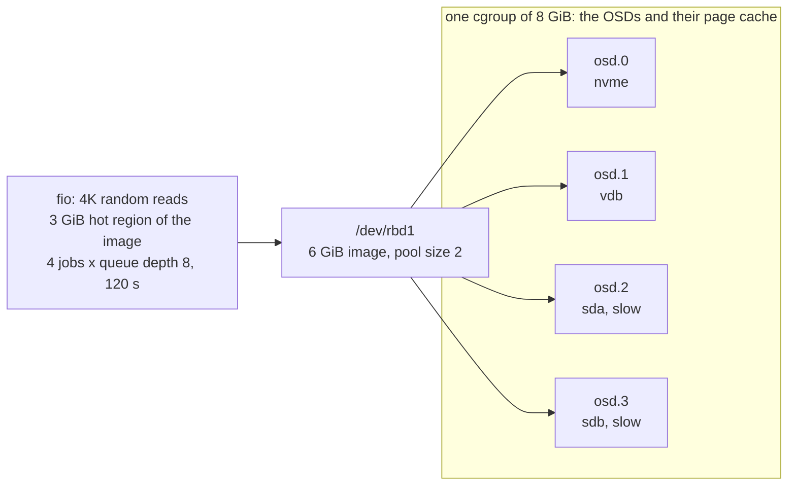

Three settings, called arms. Each arm restarts the OSDs, warms up with two
sequential reads of the hot region, then runs the measured pass.

| arm | `osd_memory_target` | tuner settings | page cache reads |
|---|---|---|---|
| base | 2 GiB | defaults | off |
| fw | 2 GiB | `osd_memory_base` 256 MiB, meta and kv ratios 0.30 | off |
| pc | 1 GiB | the PR's advice: meta 0.50, kv 0.45 | on |

Per OSD the harness records `buffer_hit_bytes` and `buffer_miss_bytes`,
`read_lat`, CPU time per read, and a perf profile of the threads:
[`hotpass.sh`]({{ site.baseurl }}/code/ceph/hotpass.sh).

### 13.2 What came out

| arm | IOPS | buffer hit rate | p99 latency | data cache held per OSD |
|---|---|---|---|---|
| base | 3,179 | 55 % | 80 ms | 330 to 490 MiB |
| fw | 5,824 | 85 % | 52 ms | 490 to 680 MiB |
| pc | 98,032 | page cache, all hits | 1.0 ms | 60 MiB, plus 3.2 GiB of page cache |

Each OSD's share of the hot region is 0.6 to 1.0 GiB. The page cache held
all of it after one pass. BlueStore's cache never did, although the tuner
had committed 760 to 880 MiB per OSD to it. On this machine a miss goes to a
slow disk, so the hit rate decides the result.

Two things it was *not*:

- **Not the hit path.** With a 3 GiB target and ratios of 0.10 the cache
  finally held the data (98 to 100 % hits). A hit then cost 4 µs of
  `read_lat`, against 20 µs for a page-cache hit, at the same CPU per read.
  Once BlueStore's cache has the data, it serves it faster than the kernel.
- **Not the growth ramp of §6.3.** Six warm passes instead of two changed
  nothing. The cache reached the same size within a minute and stayed there.

### 13.3 Why the cache stops at 70 % of its budget

First, what a shard is. BlueStore does not keep one data cache and one
onode cache; it cuts each into N independent pieces, so that the OSD's op
threads do not all wait for one lock. N is the OSD's op-queue shard count
(`osd_op_num_shards`, 8 on flash), set at start by
[`set_cache_shards()`](https://github.com/ceph/ceph/blob/v21.3.0/src/os/bluestore/BlueStore.cc#L9405).
Each piece has its own lock, its own 2Q lists and its own byte limit. Every
collection, that is every PG on the OSD, belongs to exactly one piece, and
all of that PG's data is cached there. Budget cannot move between pieces.

```
        data cache budget, committed by the tuner: 816 MiB
                         │  split 8 ways
   ┌──────────┬──────────┼──────────┬─────────────┐
 shard 0    shard 1    shard 2    shard 3   ...  shard 7      own lock, own lists,
 102 MiB    102 MiB    102 MiB    102 MiB        102 MiB      own limit
   ▲          ▲          ▲          ▲              ▲
 PG 2.0     PG 2.1     PG 2.2     PG 2.3         PG 2.7       PG n -> shard n mod 8
 PG 2.8     PG 2.9     PG 2.a     PG 2.b         PG 2.f
  ...        ...        ...        ...            ...
```

[`_resize_shards()`](https://github.com/ceph/ceph/blob/v21.3.0/src/os/bluestore/BlueStore.cc#L5699) gives every
buffer shard the same limit, the committed bytes divided by the shard
count (L5756). A collection goes to a shard by its PG number modulo the
count ([`hash_to_shard()`](https://github.com/ceph/ceph/blob/v21.3.0/src/osd/osd_types.h#L634)), and the PGs an OSD
is primary for do not spread evenly: on these four OSDs the busiest shard
carried 1.3 to 1.6 times the average.

```
example: tuner commits 816 MiB to the data cache; 8 shards, each allowed 816 / 8 = 102 MiB

shard        0     1     2     3     4     5     6     7
hot data   140   140    70    70    90   140   120   170  MiB  what the shard needs (940)
allowed    102   102   102   102   102   102   102   102  MiB  equal split
held       102   102    70    70    90   102   102   102  MiB  = 740 of 816

             ^ full: trims on every insert   ^ never fills: 32 + 32 + 12 = 76 MiB stranded
```

The loaded shards sit at their limit and
[`_trim_some()`](https://github.com/ceph/ceph/blob/v21.3.0/src/os/bluestore/BlueStore.h#L1557) evicts on every
insert; the light shards never reach theirs. The budget that is stranded in
the light shards is lost, and inside a loaded shard the 2Q split between
`warm_in` and `hot` (§8.2) loses a little more. Measured: 574 MiB held of
816 committed, which is where the 85 % hit rate comes from. More budget
only helps by accident, when even the busiest shard fits.

### 13.4 The fix

Keep a small floor per shard and split the rest by what each shard holds:

```
max_i = floor + (committed - 8 * floor) * held_i / sum(held)      floor = committed / 64
```

The limits still add up to the committed size. A shard at its limit gains
budget as long as another shard holds less than its share, so the split
follows the data in a few rounds of the mempool thread. The same rule
applies to the onode shards. It is a 29-line change in `_resize_shards()`:
[`shard-demand.patch`]({{ site.baseurl }}/code/ceph/shard-demand.patch).

Same fw settings, same test, with the patch:

| arm | IOPS | buffer hit rate | p99 | `op_r_latency` | OSD CPU per read | cgroup memory |
|---|---|---|---|---|---|---|
| fw, stock | 5,824 | 85 % | 52 ms | 0.2 to 15 ms | 130 to 150 µs | 2.8 GiB |
| fw + patch | 105,585 | 100 % | 0.95 ms | 0.046 ms | 33 to 43 µs | 3.4 GiB |
| pc | 98,032 | page cache | 1.04 ms | 0.071 ms | 37 to 48 µs | 3.7 GiB |

With a 2 GiB hot region the patched fw arm gives 107,543 IOPS against
98,020 for the page cache, at 2.4 against 2.7 GiB. BlueStore's own cache
beats the page cache on every column once it is allowed to hold the data.

### 13.5 Three more things the tuner does to a small OSD

- It only lets a cache grow by 64 MiB plus one chunk per 5-second round,
  because [`request_cache_bytes()`](https://github.com/ceph/ceph/blob/v21.3.0/src/os/bluestore/BlueStore.h#L2618)
  asks for what the cache already holds (§6.3).
- At the `LAST` priority the defaults give the data cache 6 % (§6.2), and
  `osd_memory_base` takes 768 MiB before any cache is sized (§2). On a
  1.5 GiB OSD that is half the target.
- `bluestore_cache_type = lru` aborts the OSD at start on current main, an
  assert in `LruBufferCacheShard::_rm()` on the age-bin accounting. The
  2Q cache is the only one that runs.

### 13.6 Takeaways

- Measure the hit rate before judging the mechanism. `buffer_hit_bytes`,
  `buffer_miss_bytes` and `read_lat` in `perf dump` tell in one minute
  whether a cache holds its working set.
- An equal split over shards plus an uneven mapping onto them strands
  budget. Any sharded cache with fixed per-shard caps has this problem;
  let the caps follow demand.
- A page-cache hit costs a system call, a copy and a checksum. A BlueStore
  cache hit costs a reference count. When both hold the data, BlueStore's
  is the faster one, and it is the one the tuner can see.

## Glossary

| Term | Meaning here |
|---|---|
| OSD | Object Storage Daemon, the Ceph process that owns one disk. |
| BlueStore | The OSD's storage backend. It writes object data to a raw block device and all metadata to RocksDB. |
| RocksDB | An embedded key-value database. BlueStore keeps object metadata, allocation state and more in it. |
| column family | A separate key space inside one RocksDB database. BlueStore uses several; `O` holds onodes. |
| block cache | RocksDB's in-memory cache of file blocks. Ceph's version is `BinnedLRUCache`. |
| onode | BlueStore's in-memory record of one object: its extents, blobs, checksums and attributes. |
| blob | One allocated region on disk that an onode's extents point to. |
| buffer | A cached range of one object's data in BlueStore's data cache. |
| shard | One of N independent slices of a cache, each with its own lock and limit; a collection maps to one shard. |
| collection | The set of objects of one placement group (PG) on one OSD. |
| LRU | Least recently used: evict the entry that went longest without being touched. |
| 2Q | A cache with a probation list (`warm_in`), a ghost list (`warm_out`) and a main list (`hot`), so one-time reads do not evict repeatedly used data. |
| age bin | A counter of bytes (or onodes) last touched during one interval; bins shift every `bluestore_cache_age_bin_interval`. |
| priority (PRI0 to PRI11) | The tuner's twelve levels. PRI0 is the RocksDB caches' high-priority pool plus a 64 MiB minimum; PRI1 to PRI10 are age ranges; PRI11 (`LAST`) is everything older. |
| PriorityCache | The tuner (`src/common/PriorityCache.cc`) that measures mapped memory and splits a total among caches by priority and ratio. |
| mapped memory | Memory the allocator holds from the kernel: `generic.heap_size − tcmalloc.pageheap_unmapped_bytes`. |
| tcmalloc | The memory allocator Ceph is built with. The tuner needs it for its statistics and to release free pages. |
| mempool | A named allocation pool with byte and item counters; `dump_mempools` prints them. |
| chunk | The rounding unit for a committed cache size: the total rounded to a power of two over 256, clamped to 4 to 64 MiB. |
| cephadm | Ceph's orchestrator for container deployments; it can set `osd_memory_target` per host. |
| perf counter | A named statistic a daemon exposes through `perf dump`. |
| uprobe | A kernel breakpoint on a user-space function. perf and bpftrace use it to record each call, and perf can unwind the call stack from DWARF when the binary has no frame pointers. |

## Code references

All links point at tag `v21.3.0` of `ceph/ceph`.

| Symbol | Role |
|---|---|
| [`MempoolThread::entry()`](https://github.com/ceph/ceph/blob/v21.3.0/src/os/bluestore/BlueStore.cc#L5548) | The loop: age bins, balance, tune, resize, sleep |
| [`MempoolThread::_resize_shards()`](https://github.com/ceph/ceph/blob/v21.3.0/src/os/bluestore/BlueStore.cc#L5699) | Committed bytes to per-shard limits |
| [`MempoolThread::_update_cache_settings()`](https://github.com/ceph/ceph/blob/v21.3.0/src/os/bluestore/BlueStore.cc#L5765) | Runtime min/max/target recompute |
| [`BlueStore::_set_cache_sizes()`](https://github.com/ceph/ceph/blob/v21.3.0/src/os/bluestore/BlueStore.cc#L6155) | Reads options at mount, validates ratios |
| [`BlueStore::_update_osd_memory_options()`](https://github.com/ceph/ceph/blob/v21.3.0/src/os/bluestore/BlueStore.cc#L6122) | Flags a config change for the thread |
| [`BlueStore::set_cache_shards()`](https://github.com/ceph/ceph/blob/v21.3.0/src/os/bluestore/BlueStore.cc#L9405) | Creates onode and buffer shards |
| [`MempoolCache`, `MetaCache`, `DataCache`](https://github.com/ceph/ceph/blob/v21.3.0/src/os/bluestore/BlueStore.h#L2606) | BlueStore's two tuner participants |
| [`CacheShard::set_max()` / `_trim_some()`](https://github.com/ceph/ceph/blob/v21.3.0/src/os/bluestore/BlueStore.h#L1537) | Limit and gradual eviction per shard |
| [`LruOnodeCacheShard`](https://github.com/ceph/ceph/blob/v21.3.0/src/os/bluestore/BlueStore.cc#L1093) | Onode LRU with pinning |
| [`TwoQBufferCacheShard`](https://github.com/ceph/ceph/blob/v21.3.0/src/os/bluestore/BlueStore.cc#L1343) | Data 2Q cache |
| [`PriorityCache::Manager::tune_memory()`](https://github.com/ceph/ceph/blob/v21.3.0/src/common/PriorityCache.cc#L119) | Measure mapped memory, move the total |
| [`PriorityCache::Manager::balance()`](https://github.com/ceph/ceph/blob/v21.3.0/src/common/PriorityCache.cc#L275) | Split the total by priority |
| [`PriorityCache::get_chunk()`](https://github.com/ceph/ceph/blob/v21.3.0/src/common/PriorityCache.cc#L33) | Commit rounding and 64 MiB headroom |
| [`BinnedLRUCache::commit_cache_size()`](https://github.com/ceph/ceph/blob/v21.3.0/src/kv/rocksdb_cache/BinnedLRUCache.cc#L803) | Resize the RocksDB block cache |
| [`RocksDBStore::create_block_cache()`](https://github.com/ceph/ceph/blob/v21.3.0/src/kv/RocksDBStore.cc#L468) | Block cache by `rocksdb_cache_type` |
| [`md_config_t::parse_env()`](https://github.com/ceph/ceph/blob/v21.3.0/src/common/config.cc#L475) | Container memory limit to target |
| [`MemoryAutotuner.tune()`](https://github.com/ceph/ceph/blob/v21.3.0/src/pybind/mgr/cephadm/autotune.py#L32) | cephadm per-host target |
| [`DEFINE_MEMORY_POOLS_HELPER`](https://github.com/ceph/ceph/blob/v21.3.0/src/include/mempool.h#L154) | The mempool list |
| [`Collection::get_onode()`](https://github.com/ceph/ceph/blob/v21.3.0/src/os/bluestore/BlueStore.cc#L5388) | Onode miss: `create_decode()` (L4953), then `add_onode()` |
| [`OnodeSpace::add_onode()`](https://github.com/ceph/ceph/blob/v21.3.0/src/os/bluestore/BlueStore.cc#L2064) | Insert into the shard, then `_trim_some()` inline |
| [`Onode::put()`](https://github.com/ceph/ceph/blob/v21.3.0/src/os/bluestore/BlueStore.cc#L4917) | Last reference drops: `delete`, with the onode's buffers |
| [`_reap_collections()`](https://github.com/ceph/ceph/blob/v21.3.0/src/os/bluestore/BlueStore.cc#L12537) | `OnodeSpace::clear()` when a collection is removed |
| [`BufferSpace::did_read()` / `write()`](https://github.com/ceph/ceph/blob/v21.3.0/src/os/bluestore/BlueStore.h#L514) | `_discard()`, `_add_buffer()`, `cache->_trim()` |
| [`BufferSpace::_discard()`](https://github.com/ceph/ceph/blob/v21.3.0/src/os/bluestore/BlueStore.cc#L1781) / [`__rm_buffer()`](https://github.com/ceph/ceph/blob/v21.3.0/src/os/bluestore/BlueStore.cc#L1752) | Buffer freed by overlap or by trim |
| [`BlueStore::_collection_list()`](https://github.com/ceph/ceph/blob/v21.3.0/src/os/bluestore/BlueStore.cc#L13897) | RocksDB iterator over the onode column family (backfill scans) |
| [`ShardedCache::Insert()`](https://github.com/ceph/ceph/blob/v21.3.0/src/kv/rocksdb_cache/ShardedCache.cc#L46) | The RocksDB cache entry point BlueStore's reads reach |
| [`BinnedLRUCacheShard::Insert()`](https://github.com/ceph/ceph/blob/v21.3.0/src/kv/rocksdb_cache/BinnedLRUCache.cc#L422) / [`EvictFromLRU()`](https://github.com/ceph/ceph/blob/v21.3.0/src/kv/rocksdb_cache/BinnedLRUCache.cc#L277) / [`FreeDeleted()`](https://github.com/ceph/ceph/blob/v21.3.0/src/kv/rocksdb_cache/BinnedLRUCache.cc#L296) / [`SetCapacity()`](https://github.com/ceph/ceph/blob/v21.3.0/src/kv/rocksdb_cache/BinnedLRUCache.cc#L307) | Insert with eviction; the tuner's resize |


