* TOC
{:toc}

**Summary.** A Ceph OSD manages memory around one number, `osd_memory_target`:
it measures how much memory it really has mapped, and grows or shrinks four
caches so that the total lands on that number. The four caches are the two
RocksDB block caches, BlueStore's metadata cache and BlueStore's data cache; a
tuner called PriorityCache hands memory to them by how recently each cache's
entries were used, and a background thread turns the result into per-shard
limits and evicts the rest. This post explains the configuration options, how
the caches are grouped, and which code paths do the work, with references to
Ceph v21.3.0.

Scope: this is about the OSD daemon, where almost all of Ceph's memory logic
lives. The last section covers how cephadm sets the OSD's budget on a host,
which is the only place other daemons enter the picture.

## 1. The one number: `osd_memory_target`

`osd_memory_target` is the amount of memory the OSD tries to keep *mapped*.
"Mapped" means memory the process has actually taken from the kernel and not
given back, as reported by the memory allocator (tcmalloc). It is not a hard
limit. The OSD does not refuse allocations when it goes over; it shrinks its
caches until it comes back under.

The options around it, all in
[`src/common/options/global.yaml.in`](https://github.com/ceph/ceph/blob/v21.3.0/src/common/options/global.yaml.in#L3913):

| Option | Default | Meaning |
|---|---|---|
| `osd_memory_target` | 4 GiB (min 896 MiB) | Memory the OSD tries to keep mapped. Must be at least `osd_memory_base + osd_memory_cache_min`. Changeable at runtime. |
| `osd_memory_base` | 768 MiB | Estimate of the memory the OSD needs *without* caches. Subtracted from the target before caches are sized. |
| `osd_memory_expected_fragmentation` | 0.15 | Fraction of the target assumed lost to allocator fragmentation. |
| `osd_memory_cache_min` | 128 MiB (min 128 MiB) | The least memory the caches get, whatever the target. |
| `osd_memory_cache_resize_interval` | 1 s | How often the tuner re-measures mapped memory and resizes. |
| `osd_memory_target_cgroup_limit_ratio` | 0.8 | In a container, the target defaults to the pod's memory limit times this ratio. |
| `osd_memory_target_autotune` | false | Lets cephadm set the target per host (§11). |

### 1.1 Where the number comes from

This flowchart shows the three ways `osd_memory_target` gets its value, from
lowest to highest precedence.

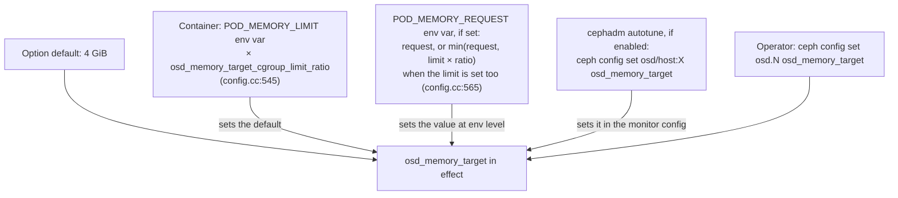

Take away: the container path reads environment variables that the
orchestrator sets, not the cgroup files; the cgroup limit itself is only
reported in daemon metadata.

In detail, from
[`md_config_t::parse_env()`](https://github.com/ceph/ceph/blob/v21.3.0/src/common/config.cc#L475):

1. If `POD_MEMORY_LIMIT` is set and the ratio is above 0, the limit times the
   ratio becomes the *default* of `osd_memory_target`.
2. If `POD_MEMORY_REQUEST` is set, it is set as `osd_memory_target` at
   environment level; when the limit is also set, the smaller of the request
   and (limit × ratio) is used.
3. Nothing in `src/osd/OSD.cc` or `src/ceph_osd.cc` reads
   `osd_memory_target`. The OSD process itself never caps the allocator;
   only BlueStore acts on the number.

## 2. From the target to a cache ceiling

BlueStore does not hand the whole target to its caches. It first takes off
the memory the OSD needs anyway and the fragmentation reserve. The code is in
[`MempoolThread::entry()`](https://github.com/ceph/ceph/blob/v21.3.0/src/os/bluestore/BlueStore.cc#L5562):

```cpp
  uint64_t ltarget = (1.0 - fragmentation) * target;
  if (ltarget > base + min) {
    max = ltarget - base;
  }                              // else max stays equal to min
```

Here `target` is `osd_memory_target`, `fragmentation` is
`osd_memory_expected_fragmentation`, `base` is `osd_memory_base` and `min` is
`osd_memory_cache_min`. The result `max` is the most the four caches may use
together. With the defaults:

| Step | Value |
|---|---|
| target | 4096 MiB |
| × (1 − 0.15) | 3481.6 MiB |
| − base 768 MiB | **2713.6 MiB ≈ 2.65 GiB** cache ceiling |
| floor | 128 MiB (`osd_memory_cache_min`) |

This diagram shows how the target is carved up.

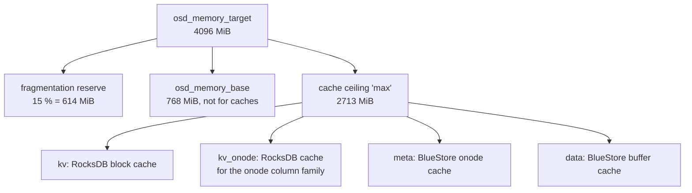

Take away: the four caches never see the raw target; they share at most the
ceiling, and the tuner usually gives them less than that.

The same formula is recomputed in
[`_update_cache_settings()`](https://github.com/ceph/ceph/blob/v21.3.0/src/os/bluestore/BlueStore.cc#L5765)
when the options change at runtime.

## 3. The four caches

| Name in the tuner | Class | What it holds | Static share (ratio option, default) |
|---|---|---|---|
| `kv` | `rocksdb_cache::BinnedLRUCache` | RocksDB data, index and filter blocks for all column families except the onode one. | `bluestore_cache_kv_ratio` = 0.45 |
| `kv_onode` | `rocksdb_cache::BinnedLRUCache` | RocksDB blocks of the `O` column family, which stores onodes (object metadata) on disk. | `bluestore_cache_kv_onode_ratio` = 0.04 |
| `meta` | `MempoolThread::MetaCache` over the onode cache shards | Decoded onodes with their extent maps, blobs, shared blobs, checksums and attributes. | `bluestore_cache_meta_ratio` = 0.45 |
| `data` | `MempoolThread::DataCache` over the buffer cache shards | Object data that was read or written recently. | derived: 1 − 0.45 − 0.45 − 0.04 = **0.06** |

An *onode* is BlueStore's in-memory record of one object: where its bytes
live on disk and what attributes it has. A *blob* is one allocated piece of
disk space that an onode's extents point to.

The ratios are validated and the data ratio derived in
[`_set_cache_sizes()`](https://github.com/ceph/ceph/blob/v21.3.0/src/os/bluestore/BlueStore.cc#L6155):
each ratio must be in [0, 1], their sum must not exceed 1, and
`cache_data_ratio = 1 − meta − kv − kv_onode`, clamped at 0
([L6226](https://github.com/ceph/ceph/blob/v21.3.0/src/os/bluestore/BlueStore.cc#L6226)).

Two sizing options exist only for the static case, when autotuning is off:

| Option | Default | Used when |
|---|---|---|
| `bluestore_cache_size` | 0 (= pick by media) | `bluestore_cache_autotune = false` |
| `bluestore_cache_size_hdd` / `_ssd` | 1 GiB / 3 GiB | Same; chosen by whether the device is rotational ([L6185](https://github.com/ceph/ceph/blob/v21.3.0/src/os/bluestore/BlueStore.cc#L6185)) |

With `bluestore_cache_autotune = true` (the default), these sizes are
replaced by the tuner's result, but the ratios still matter: they become the
weights the tuner uses when caches compete (§6).

### 3.1 How the pieces connect

This diagram shows the components from the option down to the shards that
hold entries.

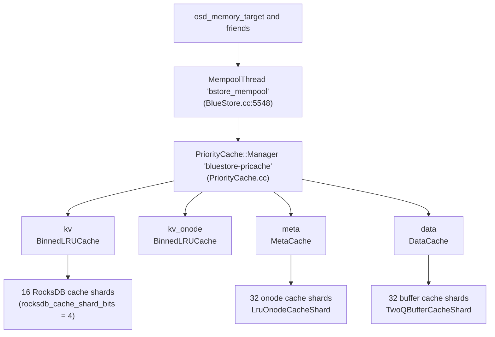

Take away: the tuner only decides byte counts; the shards are where entries
are stored, aged and evicted.

The manager is created in
[`MempoolThread::entry()`](https://github.com/ceph/ceph/blob/v21.3.0/src/os/bluestore/BlueStore.cc#L5569)
only if `bluestore_cache_autotune` is on *and* the RocksDB block cache is a
`BinnedLRUCache` (`rocksdb_cache_type = binned_lru`, the default). With any
other RocksDB cache type there is no tuner, and the static ratios apply.

## 4. The background thread and its loop

One thread per OSD, named `bstore_mempool`, does all cache sizing. It is
started at mount, after the key-value store and deferred-write replay are up
([`_mount()`](https://github.com/ceph/ceph/blob/v21.3.0/src/os/bluestore/BlueStore.cc#L9556),
which calls `mempool_thread.init()` at L9641),
and stopped at unmount.

This flowchart shows one pass of the loop in
[`MempoolThread::entry()`](https://github.com/ceph/ceph/blob/v21.3.0/src/os/bluestore/BlueStore.cc#L5587).

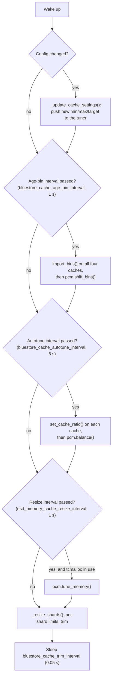

Take away: the thread wakes twenty times a second, but the expensive steps
run on their own timers; only `_resize_shards()` runs every pass.

The steps in order, with their code:

1. If a config change was flagged (`config_changed`, incremented by
   [`_update_osd_memory_options()`](https://github.com/ceph/ceph/blob/v21.3.0/src/os/bluestore/BlueStore.cc#L6122)),
   recompute min, max and target and push them to the tuner.
2. Every `bluestore_cache_age_bin_interval`: load the age-bin boundaries
   into each cache and rotate the bins
   ([L5610](https://github.com/ceph/ceph/blob/v21.3.0/src/os/bluestore/BlueStore.cc#L5610)).
   §6.1 explains bins.
3. Every `bluestore_cache_autotune_interval`: give each cache its ratio and
   run `balance()`
   ([L5627](https://github.com/ceph/ceph/blob/v21.3.0/src/os/bluestore/BlueStore.cc#L5627)).
4. Every `osd_memory_cache_resize_interval`, and only when the process runs
   on tcmalloc: run `tune_memory()`
   ([L5648](https://github.com/ceph/ceph/blob/v21.3.0/src/os/bluestore/BlueStore.cc#L5648)).
5. Every pass: `_resize_shards()`
   ([L5667](https://github.com/ceph/ceph/blob/v21.3.0/src/os/bluestore/BlueStore.cc#L5667)).
6. Sleep `bluestore_cache_trim_interval`
   ([L5688](https://github.com/ceph/ceph/blob/v21.3.0/src/os/bluestore/BlueStore.cc#L5688)).

## 5. Step one of tuning: measure and move the total

`tune_memory()` decides how much memory *all* caches together may use right
now. It lives in
[`PriorityCache::Manager::tune_memory()`](https://github.com/ceph/ceph/blob/v21.3.0/src/common/PriorityCache.cc#L119).

The procedure:

1. Ask tcmalloc to give free pages back to the kernel
   (`ceph_heap_release_free_memory()`).
2. Read two tcmalloc numbers: `generic.heap_size` and
   `tcmalloc.pageheap_unmapped_bytes`.
3. `mapped = heap_size − unmapped`. This is the OSD's real footprint.
4. Start from the previous total, clamped between `min` and `max` (§2).
5. If `mapped < target`: grow by a fraction of the room left up to `max`.
   If `mapped ≥ target`: shrink by a fraction of the room left down to
   `min`.
6. Store the result as `tuned_mem` and publish it as a perf counter.

The two formulas, from the code:

```cpp
  if (mapped < target_mem) {
    double ratio = 1 - ((double) mapped / target_mem);
    new_size += ratio * (max_mem - new_size);
  } else {
    double ratio = 1 - ((double) target_mem / mapped);
    new_size -= ratio * (new_size - min_mem);
  }
```

This flowchart shows the decision.

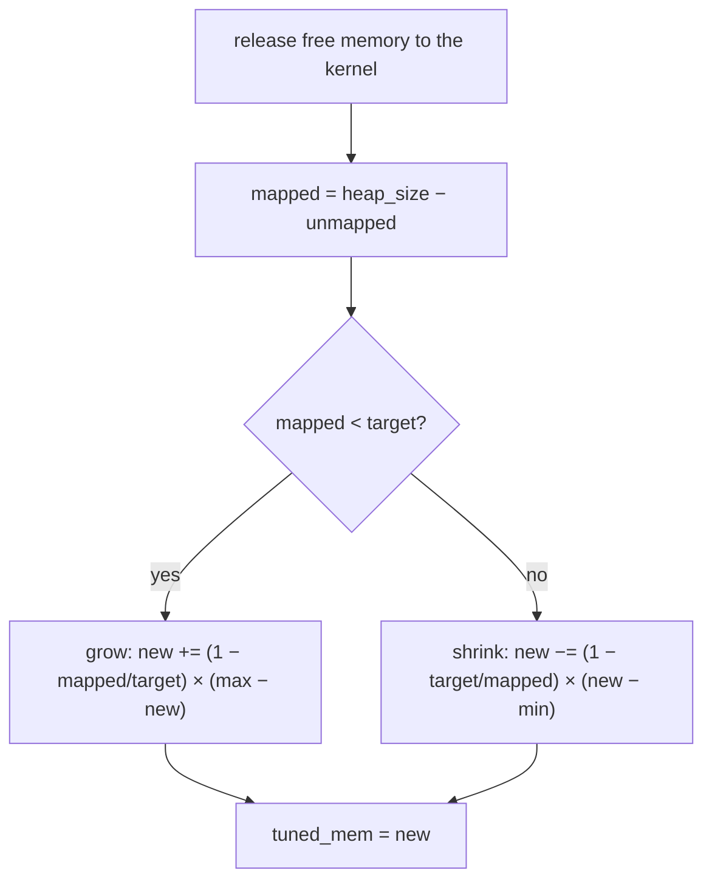

Take away: the further the OSD is from its target, the bigger the step. Close
to the target the steps become tiny, so the total settles instead of
oscillating. The code's own comment: "Approach the min/max slowly, but bounce
away quickly."

Two consequences worth knowing:

- `tuned_mem` is initialised to `min` (128 MiB), but the constructor runs
  `tune_memory()` once
  ([constructor](https://github.com/ceph/ceph/blob/v21.3.0/src/common/PriorityCache.cc#L69),
  L110), so the first value is `min + (1 − mapped/target) × (max − min)`.
  From there it approaches the target over the first minutes after an OSD
  starts.
- Without tcmalloc the loop never calls `tune_memory()`
  ([L5649](https://github.com/ceph/ceph/blob/v21.3.0/src/os/bluestore/BlueStore.cc#L5649)).
  The one call from the constructor reads heap statistics that stay at zero,
  so `mapped = 0` and `tuned_mem` is set to `max` for the life of the OSD.

## 6. Step two of tuning: split the total between caches

`balance()` divides `tuned_mem` among the four caches. It does not divide by
ratio first. It walks twelve priority levels from most to least important,
and at each level every cache may ask for bytes. Ratios only decide who wins
when the caches ask for more than is left: each cache's *fair share* is the
remaining memory times its ratio (§6.2).

### 6.1 Priorities are ages

The priority levels are `PRI0` to `PRI11` (`LAST`) in
[`PriorityCache.h`](https://github.com/ceph/ceph/blob/v21.3.0/src/common/PriorityCache.h#L43).
The header has no comments on them; their meaning comes from how the caches
fill them:

| Level | kv / kv_onode (RocksDB) | meta / data (BlueStore) |
|---|---|---|
| `PRI0` | The bytes in RocksDB's high-priority pool (index and filter blocks marked high priority) plus 64 MiB, rounded up to a chunk (§6.3), so at least 64 MiB even when the pool is empty ([BinnedLRUCache.cc:776](https://github.com/ceph/ceph/blob/v21.3.0/src/kv/rocksdb_cache/BinnedLRUCache.cc#L776)) | Nothing; BlueStore puts nothing in PRI0 ([BlueStore.h:2618](https://github.com/ceph/ceph/blob/v21.3.0/src/os/bluestore/BlueStore.h#L2618)) |
| `PRI1` … `PRI10` | Bytes whose last use falls in age bin range *p* | Same |
| `PRI11` (`LAST`) | Everything older than the last bin | Same |

An *age bin* is a counter of bytes (for data and RocksDB) or of onodes (for
meta) touched during one interval of `bluestore_cache_age_bin_interval`
(1 s). Every interval the bins shift by one, so an entry that is not touched
moves into older bins. The option `bluestore_cache_age_bins_<cache>` lists
ten boundaries; priority *p* covers the bins between boundary *p−1* and
boundary *p*.

With the default `"1 2 6 24 120 720 0 0 0 0"` for kv, meta and data:

| Priority | Age of the entries |
|---|---|
| PRI1 | touched in the last 1 s |
| PRI2 | 1 to 2 s ago |
| PRI3 | 2 to 6 s ago |
| PRI4 | 6 to 24 s ago |
| PRI5 | 24 s to 2 min ago |
| PRI6 | 2 to 12 min ago |
| PRI7 to PRI10 | empty (boundary 0) |
| LAST | older than 12 min |

The kv_onode cache uses `"0 0 0 0 0 0 0 0 0 720"`: all its entries up to 12
minutes old sit in PRI10, behind everything the other caches used in the
last 12 minutes.

### 6.2 How one balance runs

This sequence shows one `balance()` call between the manager and the caches.

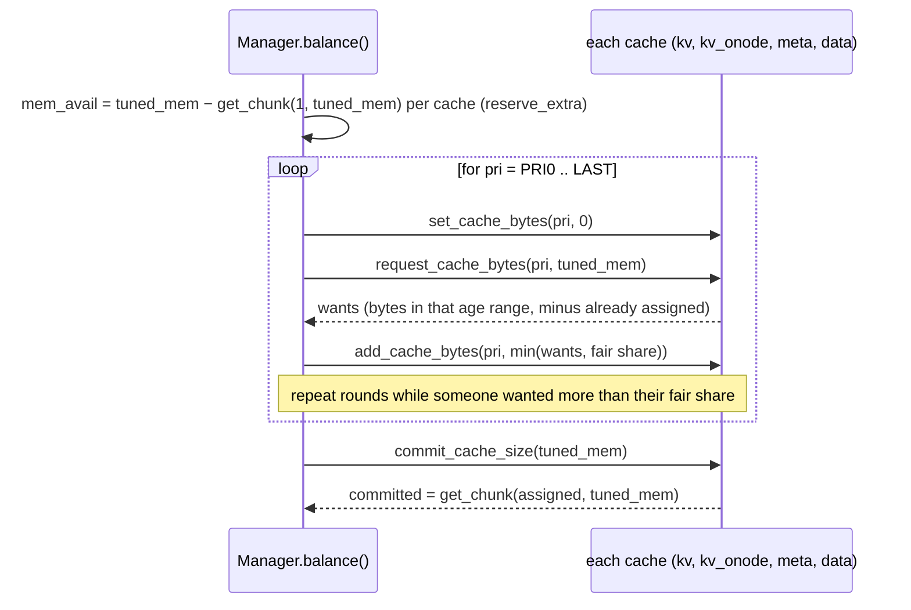

Take away: a cache gets everything it asks for at a high priority as long as
memory lasts; the ratio is only used to split what is left when several
caches ask for more than the fair share.

The rounds at one priority, from
[`balance_priority()`](https://github.com/ceph/ceph/blob/v21.3.0/src/common/PriorityCache.cc#L332):

1. Every cache's bytes for this priority are reset to 0.
2. Each cache says what it wants at this priority.
3. Each cache's fair share is `mem_avail × (its ratio ÷ sum of ratios of the
   caches still asking)`. If every remaining cache has ratio 0, they split
   equally.
4. A cache that wants less than its fair share gets exactly what it wants and
   drops out of the round. A cache that wants more gets its fair share and
   stays in for the next round.
5. Repeat while there are caches still asking and memory left.
6. For `LAST` only, each cache's share is overwritten with
   `mem_avail × ratio`
   ([L398](https://github.com/ceph/ceph/blob/v21.3.0/src/common/PriorityCache.cc#L398)),
   so whatever remains after the aged priorities is handed out by ratio.
   The bytes the rounds assigned at `LAST` are discarded by this overwrite,
   and if the ratios sum to less than 1 the remainder stays unassigned.

### 6.3 Commit rounds up

After balancing, each cache is told to commit. The committed size is not the
assigned bytes; it is rounded up by
[`get_chunk()`](https://github.com/ceph/ceph/blob/v21.3.0/src/common/PriorityCache.cc#L33):

1. `chunk` = the total rounded up to a power of two, divided by 256, clamped
   between 4 MiB and 64 MiB.
2. committed = assigned + 64 MiB, rounded up to a multiple of `chunk`.

The 64 MiB of headroom exists, per the comment in the code, so the RocksDB
block cache can absorb reads during compaction without evicting. Because of
it, `balance()` first subtracts `get_chunk(1, tuned_mem)`, which is 64 MiB
plus one chunk, per cache from `mem_avail` (`reserve_extra`,
[L280](https://github.com/ceph/ceph/blob/v21.3.0/src/common/PriorityCache.cc#L280)).
With `tuned_mem` near the default ceiling the chunk is 16 MiB, so that is
80 MiB per cache, 320 MiB for four.

What commit does per cache type:

- RocksDB (`BinnedLRUCache::commit_cache_size`,
  [L803](https://github.com/ceph/ceph/blob/v21.3.0/src/kv/rocksdb_cache/BinnedLRUCache.cc#L803)):
  sets the block cache capacity to the committed size, which evicts at once,
  and sets the high-priority pool ratio to `PRI0 bytes ÷ committed`.
- BlueStore (`MempoolCache::commit_cache_size`,
  [BlueStore.h:2665](https://github.com/ceph/ceph/blob/v21.3.0/src/os/bluestore/BlueStore.h#L2665)):
  only records the number. The eviction happens in `_resize_shards()` (§7).

## 7. Step three: from bytes to shard limits and eviction

[`_resize_shards()`](https://github.com/ceph/ceph/blob/v21.3.0/src/os/bluestore/BlueStore.cc#L5699)
runs every pass of the loop and turns the committed sizes into limits that
each shard enforces.

```cpp
  uint64_t max_shard_onodes = static_cast<uint64_t>(
      (meta_alloc / (double) onode_shards) / meta_cache->get_bytes_per_onode());
  uint64_t max_shard_buffer = static_cast<uint64_t>(data_alloc / buffer_shards);
```

- With the tuner on, `meta_alloc` and `data_alloc` are the committed sizes
  ([L5718](https://github.com/ceph/ceph/blob/v21.3.0/src/os/bluestore/BlueStore.cc#L5718)).
  With it off, they are `ratio × cache_size`.
- The onode limit is a *count*, because the onode cache evicts whole onodes.
  `get_bytes_per_onode()` is the metadata mempool bytes divided by the number
  of onodes
  ([BlueStore.h:2756](https://github.com/ceph/ceph/blob/v21.3.0/src/os/bluestore/BlueStore.h#L2756)).
- The buffer limit is in bytes.

This flowchart shows how a limit becomes an eviction.

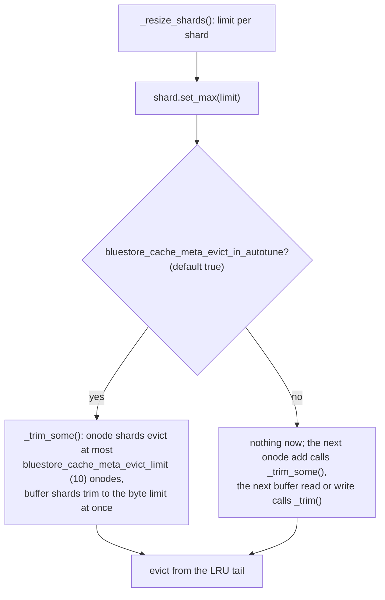

Take away: onode eviction is gradual and spread over the loop's many passes;
buffer eviction is immediate.

The per-shard details:

- [`CacheShard::set_max()`](https://github.com/ceph/ceph/blob/v21.3.0/src/os/bluestore/BlueStore.h#L1537)
  stores the limit and, when `bluestore_cache_meta_evict_in_autotune` is
  true, calls `_trim_some()`.
- [`_trim_some()`](https://github.com/ceph/ceph/blob/v21.3.0/src/os/bluestore/BlueStore.h#L1557)
  trims to `max(num − bluestore_cache_meta_evict_limit, max)`. For an onode
  shard `num` is an onode count, so at most 10 onodes go per call; a value
  below 2 means "trim all at once". For a buffer shard `num` counts buffers
  while `max` is in bytes, so the subtraction almost never matters and the
  shard trims to its byte limit in one call.
- Adding or renaming an onode calls `_trim_some()` on its shard
  ([`OnodeSpace::add_onode`](https://github.com/ceph/ceph/blob/v21.3.0/src/os/bluestore/BlueStore.cc#L2064)),
  so onode shards trim gradually even with
  `bluestore_cache_meta_evict_in_autotune` off. Any buffer read, write,
  discard or write completion calls `_trim()` on its buffer shard right away.

### 7.1 Shards and how a collection finds its shard

- The OSD creates the shards at start with
  `store->set_cache_shards(get_num_cache_shards())`
  ([OSD.cc:3699](https://github.com/ceph/ceph/blob/v21.3.0/src/osd/OSD.cc#L3699)).
  The count is `osd_num_cache_shards`, default 32
  ([osd.yaml.in:950](https://github.com/ceph/ceph/blob/v21.3.0/src/common/options/osd.yaml.in#L950)).
- [`BlueStore::set_cache_shards()`](https://github.com/ceph/ceph/blob/v21.3.0/src/os/bluestore/BlueStore.cc#L9405)
  creates that many onode shards and that many buffer shards. It can only
  grow the count.
- A collection (one placement group's objects) is assigned a shard by the
  placement group's hash: `onode_cache_shards[cid.hash_to_shard(n)]`
  ([L8459](https://github.com/ceph/ceph/blob/v21.3.0/src/os/bluestore/BlueStore.cc#L8459)),
  where `hash_to_shard` is the PG number modulo the shard count
  ([osd_types.h:634](https://github.com/ceph/ceph/blob/v21.3.0/src/osd/osd_types.h#L634)).
- When a PG splits, `Collection::split_cache` moves the affected onodes and
  buffers to the new collection's shards.

## 8. Inside the caches

Each cache below ends with the call stacks that allocate and free its
entries, recorded on a live OSD: ceph `21.3.0-2868-gba165903a5a`
(RelWithDebInfo, vstart, four OSDs, `osd_memory_target` = 1 GiB, so the
caches share the 128 MiB floor and trim all the time). The probes are perf
uprobes on the OSD binary with DWARF unwinding, taken during recovery pushes,
client reads, and cold reads after a `compact`; the script is
[`cachestacks.sh`]({{ site.baseurl }}/code/ceph/cachestacks.sh) and the
folding is [`cachefold.py`]({{ site.baseurl }}/code/ceph/cachefold.py).
A stack reads top-down from the probed function, `*` marks an inlined frame,
the number is how often that exact stack fired in one window, and `std::`
and thread-pool frames are dropped.

Two things the binary taught about probing it. The constructors of `Onode`
and `Buffer` are inlined into every caller, so the class's `operator new`
and `operator delete` are probed instead; they are out-of-line mempool
allocators and fire for every object. And `BinnedLRUCacheShard::Insert()`
has an out-of-line copy for the vtable that is never executed, because its
only caller, `rocksdb_cache::ShardedCache::Insert()`, inlined it: a probe on
it attaches cleanly and counts zero. bpftrace cannot do this job on this
build: without frame pointers its `ustack()` stops after two frames.

### 8.1 The onode cache: an LRU with pinning

`bluestore_cache_type` names two cache kinds, `2q` (default) and `lru`, but
the onode cache ignores it and is always an LRU
([`OnodeCacheShard::create`](https://github.com/ceph/ceph/blob/v21.3.0/src/os/bluestore/BlueStore.cc#L1222)).
LRU means "least recently used": the entry that has gone longest without use
is evicted first.

An onode that an operation is using must not be evicted. The mechanism is
a second reference counter, `pin_nref`:

1. The cache's own index holds one reference, so an idle onode has
   `pin_nref == 1` and sits on the LRU list.
2. Any operation or transaction that takes the onode bumps `pin_nref`
   ([`Onode::get()`](https://github.com/ceph/ceph/blob/v21.3.0/src/os/bluestore/BlueStore.cc#L4912)).
   Taking it does not move it. But `_add` links only unpinned onodes, and
   when [`_trim_to()`](https://github.com/ceph/ceph/blob/v21.3.0/src/os/bluestore/BlueStore.cc#L1172)
   reaches a pinned one at the tail it unlinks and skips it instead of
   evicting it. The shard still counts it toward `num`.
3. When the last extra reference drops
   ([`Onode::put()`](https://github.com/ceph/ceph/blob/v21.3.0/src/os/bluestore/BlueStore.cc#L4917)),
   the onode goes back to the front of the LRU.

The option `bluestore_cache_trim_max_skip_pinned` still exists but nothing
reads it at this version.

Onode memory is not fixed. An onode's extent map is stored on disk in
pieces ("shards" of the map, unrelated to cache shards) and loaded on demand
by `fault_range()`. Nothing unloads a loaded piece; the memory is released
only when the whole onode is evicted.

**Call stacks.** Allocation and insertion are one step:
[`get_onode()`](https://github.com/ceph/ceph/blob/v21.3.0/src/os/bluestore/BlueStore.cc#L5388) misses the onode space,
[`create_decode()`](https://github.com/ceph/ceph/blob/v21.3.0/src/os/bluestore/BlueStore.cc#L4953) builds the onode from
its RocksDB value, and
[`add_onode()`](https://github.com/ceph/ceph/blob/v21.3.0/src/os/bluestore/BlueStore.cc#L2064) links it into the shard
and trims the shard on the spot.

```
alloc + insert, client read              3496x  tp_osd_tp
  BlueStore::Onode::operator new
  BlueStore::Onode::create_decode
  BlueStore::Collection::get_onode          -> OnodeSpace::add_onode -> _trim_some*
  BlueStore::getattr
  PGBackend::objects_get_attr
  PrimaryLogPG::get_object_context
  PrimaryLogPG::find_object_context
  PrimaryLogPG::do_op_impl
  PrimaryLogPG::do_op
  OSD::dequeue_op

alloc + insert, write (recovery push)     193x  tp_osd_tp
  BlueStore::Onode::operator new
  BlueStore::Onode::create_decode
  BlueStore::Collection::get_onode
  BlueStore::_txc_add_transaction
  BlueStore::queue_transactions
  PrimaryLogPG::queue_transaction
  ReplicatedBackend::_do_push
  PGBackend::handle_message
  PrimaryLogPG::do_request
  OSD::dequeue_op
```

```
free, inline on insert                   1124x  tp_osd_tp   (same op as above)
  BlueStore::Onode::operator delete         <- OnodeSpace::_remove drops the last ref, Onode::put
  std::_Hashtable::_M_erase
  LruOnodeCacheShard::_trim_to
  BlueStore::CacheShard::_trim_some*
  BlueStore::OnodeSpace::add_onode
  BlueStore::Collection::get_onode
  BlueStore::getattr
  ...

free, background                         2300x  bstore_mempool
  BlueStore::Onode::operator delete
  std::_Hashtable::_M_erase
  LruOnodeCacheShard::_trim_to
  BlueStore::CacheShard::_trim_some*
  BlueStore::CacheShard::set_max*
  BlueStore::MempoolThread::_resize_shards
  BlueStore::MempoolThread::entry

free, collection removed                   14x  bstore_kv_final
  BlueStore::Onode::operator delete
  BlueStore::OnodeSpace::clear
  BlueStore::_reap_collections
  BlueStore::_kv_finalize_thread
```

Take away: the op thread that inserts an onode is also the thread that
evicts one, because `add_onode()` calls `_trim_some()`; the mempool thread
only catches up. In the read window the split was about 1,700 inline to
2,300 background, in the recovery window 330 to 58. An eviction frees the
onode, its loaded extent-map shards, and its cached buffers (§8.2).

### 8.2 The data cache: 2Q

The buffer cache holds `Buffer` objects: a range of one object's data. The
default `2q` shard
([`TwoQBufferCacheShard`](https://github.com/ceph/ceph/blob/v21.3.0/src/os/bluestore/BlueStore.cc#L1343))
keeps three lists, so that data touched once does not push out data touched
often.

This diagram shows the lists and the moves between them.

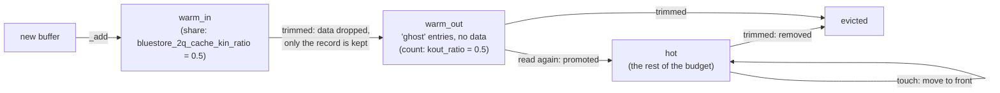

Take away: a buffer has to be read twice, with the second read coming while
its ghost record is still around, before it is treated as hot. A touch in
`warm_in` deliberately does not move it, per the comment in the code.

Trim in
[`_trim_to()`](https://github.com/ceph/ceph/blob/v21.3.0/src/os/bluestore/BlueStore.cc#L1521)
sizes `warm_in` to `max × kin_ratio`, `hot` to the rest, and `warm_out` to a
*count* of ghosts derived from the average buffer size times `kout_ratio`.

Each buffer's data moves between memory pools as it changes state. This
state diagram shows the lifecycle.

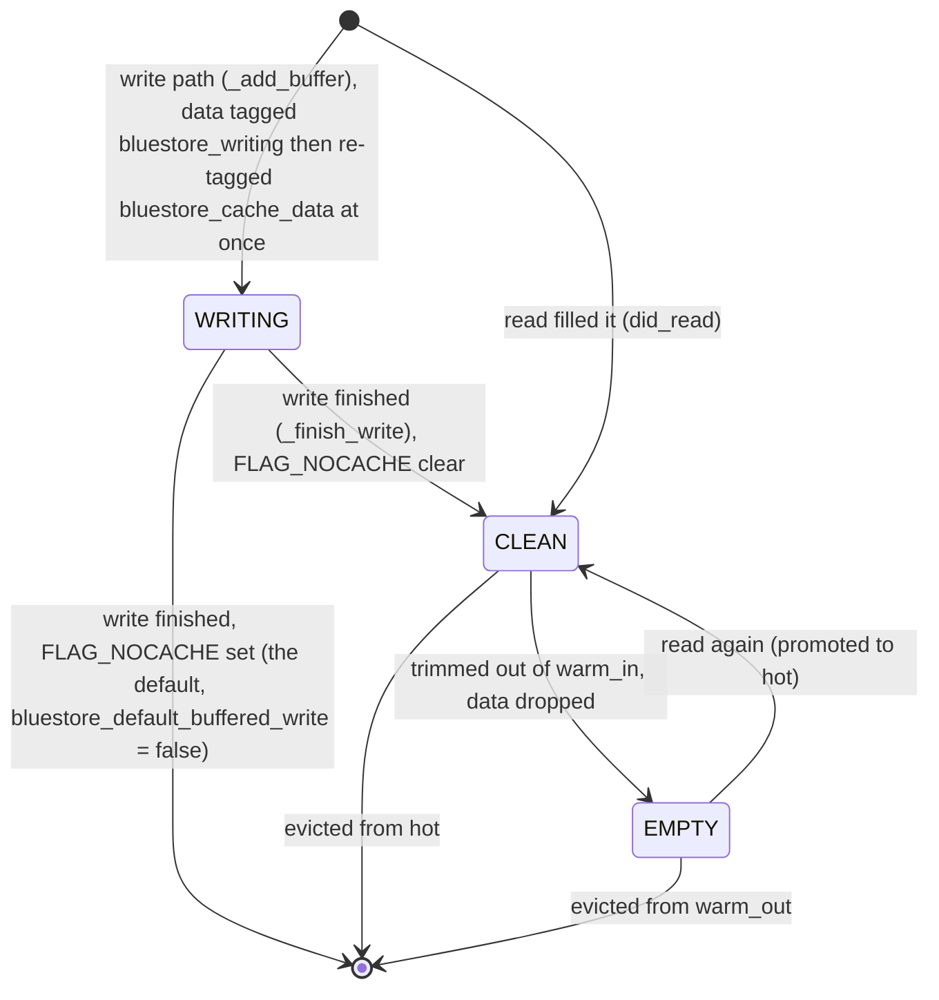

Take away: `bluestore_cache_data` in a mempool dump already includes the data
of writes still in flight, because `_add_buffer` re-tags it at once. The
`bluestore_writing` tag lasts only for the moment in between. Deferred-write
data is the exception; it sits in `bluestore_writing_deferred`.

The tagging is in
[`_add_buffer`](https://github.com/ceph/ceph/blob/v21.3.0/src/os/bluestore/BlueStore.cc#L1705)
at L1721 and L1742. The re-tag in
[`_finish_write`](https://github.com/ceph/ceph/blob/v21.3.0/src/os/bluestore/BlueStore.cc#L1933)
at L1957 changes nothing by then.

**Call stacks.** A buffer is allocated by the reader or writer that needs
it. [`did_read()`](https://github.com/ceph/ceph/blob/v21.3.0/src/os/bluestore/BlueStore.h#L514) and `write()` do the
same three things: `_discard()` whatever overlaps, `_add_buffer()`, then
`cache->_trim()`.

```
alloc, read fill                         4167x  tp_osd_tp
  BlueStore::BufferSpace::_add_buffer
  BlueStore::BufferSpace::did_read*         -> _discard* before, cache->_trim() after
  BlueStore::_generate_read_result_bl
  BlueStore::_do_read
  BlueStore::read
  ReplicatedBackend::objects_read_sync
  PrimaryLogPG::do_read
  PrimaryLogPG::do_osd_ops
  PrimaryLogPG::execute_ctx
  PrimaryLogPG::do_op

alloc, write                              221x  tp_osd_tp
  BlueStore::BufferSpace::_add_buffer
  BlueStore::BufferSpace::write*
  BlueStore::_buffer_cache_write*
  BlueStore::_do_alloc_write
  BlueStore::_do_write
  BlueStore::_write
  BlueStore::_txc_add_transaction
  BlueStore::queue_transactions
```

Recovery reads take the first path through `readv()` from
`build_push_op()`, with the same frames below `_generate_read_result_bl`.

```
free, write finished                      244x  bstore_kv_final
  BlueStore::Buffer::operator delete        FLAG_NOCACHE: the default write is not cached
  BlueStore::BufferSpace::_finish_write
  BlueStore::Onode::finish_write
  BlueStore::TransContext::finish_writing
  BlueStore::_txc_finish
  BlueStore::_kv_finalize_thread

free, trim inline on a read fill         2418x  tp_osd_tp
  BlueStore::Buffer::operator delete
  BlueStore::BufferSpace::_rm_buffer*
  TwoQBufferCacheShard::_trim_to
  BlueStore::CacheShard::_trim*
  BlueStore::BufferSpace::did_read*
  BlueStore::_generate_read_result_bl
  BlueStore::_do_read
  ...

free, overlapped by the new buffer        169x  tp_osd_tp
  BlueStore::Buffer::operator delete
  BlueStore::BufferSpace::_discard
  BlueStore::BufferSpace::did_read*
  BlueStore::_generate_read_result_bl
  ...

free, onode evicted                       282x  bstore_mempool
  BlueStore::Buffer::operator delete
  BlueStore::BufferSpace::_clear
  BlueStore::Onode::~Onode
  BlueStore::Onode::put
  std::_Hashtable::_M_erase
  LruOnodeCacheShard::_trim_to
  BlueStore::CacheShard::_trim_some*
  BlueStore::CacheShard::set_max*
  BlueStore::MempoolThread::_resize_shards
```

Take away: in these windows no buffer was freed by the mempool thread's own
buffer-shard `set_max()`. A buffer leaves with the reader that inserts the
next one, with the write that finishes, or with its onode. The writing
buffer of a default write is not cache at all: it serves readers while the
write is in flight and is erased in `_txc_finish()`.

### 8.3 The RocksDB block caches

BlueStore stores all metadata in RocksDB, a key-value database. RocksDB
reads its files in blocks and keeps them in a block cache. Ceph replaces
RocksDB's own cache with `BinnedLRUCache`, an LRU with two additions: a
high-priority pool and age bins, so that the tuner can see how old each
block is.

| Option | Default | Effect |
|---|---|---|
| `rocksdb_cache_type` | `binned_lru` | Must stay `binned_lru` for the tuner to exist (§3.1). `lru` and `clock` are RocksDB's own caches. |
| `rocksdb_cache_size` | 512 MiB | Initial size of the default block cache; BlueStore overrides that one with `kv_ratio × cache_size` at startup ([L8280](https://github.com/ceph/ceph/blob/v21.3.0/src/os/bluestore/BlueStore.cc#L8280)). The onode column family's cache starts at `rocksdb_cache_size` unless `bluestore_rocksdb_cfs` gives a `size=`. The tuner resizes both afterwards. |
| `rocksdb_cache_shard_bits` | 4 | 2⁴ = 16 internal shards, for lock spreading. |
| `rocksdb_cache_index_and_filter_blocks` | true | Index and filter blocks live in the block cache instead of outside it. |
| `rocksdb_cache_index_and_filter_blocks_with_high_priority` | false | They are *not* marked high priority by default, so the high-priority pool is normally empty and the PRI0 request is its 64 MiB minimum. |
| `bluestore_rocksdb_cfs` | `... O(3,0-13)=block_cache={type=binned_lru} ...` | Gives the onode column family its own `BinnedLRUCache`; that is the `kv_onode` cache. |

The block cache is created in
[`RocksDBStore::create_block_cache()`](https://github.com/ceph/ceph/blob/v21.3.0/src/kv/RocksDBStore.cc#L468)
and the per-column-family cache in
[`apply_block_cache_options()`](https://github.com/ceph/ceph/blob/v21.3.0/src/kv/RocksDBStore.cc#L960).
A separate cache for a column family is only created when its option string
gives a type, size or high ratio; otherwise the family shares the default
cache.

**Call stacks.** A block enters through RocksDB's table reader, which calls
[`ShardedCache::Insert()`](https://github.com/ceph/ceph/blob/v21.3.0/src/kv/rocksdb_cache/ShardedCache.cc#L46) after a
cache miss. BlueStore reaches it with point gets and with iterators.

```
alloc, onode point get (kv_onode cache)   519x  tp_osd_tp
  rocksdb_cache::ShardedCache::Insert       -> BinnedLRUCacheShard::Insert* -> EvictFromLRU* -> FreeDeleted
  rocksdb::BlockBasedTable::PutDataBlockToCache
  rocksdb::BlockBasedTable::MaybeReadBlockAndLoadToCache
  rocksdb::BlockBasedTable::RetrieveBlock
  rocksdb::BlockBasedTable::NewDataBlockIterator
  rocksdb::BlockBasedTable::Get
  rocksdb::TableCache::Get
  rocksdb::Version::Get
  rocksdb::DBImpl::Get
  RocksDBStore::get
  BlueStore::Collection::get_onode
  BlueStore::getattr
  PGBackend::objects_get_attr
  PrimaryLogPG::get_object_context
  PrimaryLogPG::do_op_impl

alloc, collection listing (backfill scan) 624x  tp_osd_tp
  rocksdb_cache::ShardedCache::Insert
  rocksdb::BlockBasedTable::PutDataBlockToCache
  rocksdb::BlockBasedTable::MaybeReadBlockAndLoadToCache
  rocksdb::BlockBasedTable::RetrieveBlock
  rocksdb::BlockBasedTable::NewDataBlockIterator
  rocksdb::BlockBasedTableIterator::InitDataBlock
  rocksdb::BlockBasedTableIterator::FindBlockForward
  rocksdb::BlockBasedTableIterator::Next
  rocksdb::MergingIterator::Next
  rocksdb::DBIter::Next
  ShardMergeIteratorImpl::next
  SortedCollectionListIterator::get_next_chunk
  BlueStore::_collection_list

alloc, extent-map shard load               18x  tp_osd_tp
  rocksdb_cache::ShardedCache::Insert
  ... rocksdb::BlockBasedTable::Get ... RocksDBStore::get
  BlueStore::ExtentMap::maybe_load_shard
  BlueStore::_fiemap
  ReplicatedBackend::build_push_op

compaction, placeholder entry           19168x  RocksDB background thread
  rocksdb_cache::ShardedCache::Insert
  rocksdb::PlaceholderCacheInterface::Insert*
  rocksdb::BlockBasedTable::NewDataBlockIterator
  rocksdb::BlockBasedTableIterator::InitDataBlock
  rocksdb::BlockBasedTableIterator::Next
  rocksdb::MergingIterator::Next
  rocksdb::CompactionIterator::Next
  rocksdb::CompactionJob::ProcessKeyValueCompaction
  rocksdb::CompactionJob::Run
  rocksdb::DBImpl::BackgroundCompaction
```

The last one is not a cached block. A compaction reads with the cache fill
off, and RocksDB inserts a value-less placeholder that charges the block's
size to the cache while the iterator holds it; the block is freed when the
iterator moves on (36,000 `Block::~Block` in that window). It is why
`inserts` in the `rocksdb-cache-O` perf counters runs far ahead of `elems`.

```
free, tuner resize                         30x  bstore_mempool   (every balance round)
  rocksdb_cache::BinnedLRUCache::commit_cache_size   -> SetCapacity -> EvictFromLRU -> FreeDeleted -> Block::~Block
  PriorityCache::Manager::balance
  BlueStore::MempoolThread::entry

free, insert into a full shard                        (inlined into ShardedCache::Insert, see above)
  rocksdb_cache::ShardedCache::Insert
  rocksdb_cache::BinnedLRUCacheShard::Insert*
  rocksdb_cache::BinnedLRUCacheShard::EvictFromLRU*
  rocksdb_cache::BinnedLRUCacheShard::FreeDeleted    -> Block::~Block
```

Take away: both free paths exist, neither freed a block in this run. At
the floor each RocksDB cache is handed its 64 MiB minimum chunk and never
shrinks, and the kv_onode cache's usage stayed under it (`rocksdb-cache-O` in
`perf dump`: capacity 64 MiB, usage 48 MiB, 10,743 blocks after 32,750
inserts over the OSD's life). So on a small OSD the RocksDB caches only
grow to the chunk; the `hits`, `misses` and `inserts` counters there are
the way to see them work, since `dump_objectstore_kv_stats` needs
`rocksdb_perf` on.

## 9. Mempools: how BlueStore knows what it uses

The tuner needs to know how many bytes the metadata cache holds. BlueStore
does not walk its data structures to find out. Instead, every cached object
type is allocated from a named *mempool*, and each pool keeps running
counters of bytes and items.

- The pool list is one macro,
  [`DEFINE_MEMORY_POOLS_HELPER`](https://github.com/ceph/ceph/blob/v21.3.0/src/include/mempool.h#L154).
  The BlueStore pools: `bluestore_cache_data`, `bluestore_cache_onode`,
  `bluestore_cache_meta`, `bluestore_cache_other`, `bluestore_cache_buffer`,
  `bluestore_extent`, `bluestore_blob`, `bluestore_shared_blob`,
  `bluestore_inline_bl`, `bluestore_fsck`, `bluestore_txc`,
  `bluestore_writing_deferred`, `bluestore_writing`, `bluestore_alloc`, plus
  `bluefs`, `bluefs_file_reader` and `bluefs_file_writer`.
- Counting is done in the allocator
  ([`pool_allocator::allocate`](https://github.com/ceph/ceph/blob/v21.3.0/src/include/mempool.h#L345)):
  it adds `sizeof(T) × n` bytes and `n` items to one of up to 128 per-pool
  counter shards, picked by CPU or by a per-thread index so that threads do
  not fight over one counter.
- Reading a pool's total
  ([`allocated_bytes()`](https://github.com/ceph/ceph/blob/v21.3.0/src/common/mempool.cc#L124))
  sums the counter shards.

Which pools feed which cache:

| Cache | "Used bytes" come from |
|---|---|
| meta | Sum of `bluestore_blob`, `bluestore_extent`, `bluestore_cache_buffer`, `bluestore_cache_meta`, `bluestore_cache_other`, `bluestore_cache_onode`, `bluestore_shared_blob`, `bluestore_inline_bl` ([BlueStore.h:2731](https://github.com/ceph/ceph/blob/v21.3.0/src/os/bluestore/BlueStore.h#L2731)) |
| data | The buffer shards' own `buffer_bytes` counters, not a mempool ([BlueStore.h:2778](https://github.com/ceph/ceph/blob/v21.3.0/src/os/bluestore/BlueStore.h#L2778)) |
| kv, kv_onode | RocksDB's own usage counters (`GetUsage()`, `GetHighPriPoolUsage()`) |

Note that `bluestore_cache_buffer` counts the `Buffer` *records*, not the
data they point to, so it belongs to meta. The data itself is in
`bluestore_cache_data`, which is shown in dumps but not used by the tuner.

### 9.1 How to look at an OSD's memory

1. The tuner's view, as perf counters:
   ```
   ceph daemon osd.N perf dump bluestore-pricache
   ```
   gives `target_bytes`, `mapped_bytes`, `unmapped_bytes`, `heap_bytes` and
   `cache_bytes` (the manager's counters,
   [PriorityCache.cc:86](https://github.com/ceph/ceph/blob/v21.3.0/src/common/PriorityCache.cc#L86)).
   Each cache has its own set, `bluestore-pricache:kv`,
   `bluestore-pricache:meta` and so on, with `pri0_bytes` to `pri11_bytes`,
   `reserved_bytes` and `committed_bytes`.
2. The pools:
   ```
   ceph daemon osd.N dump_mempools
   ```
   registered in
   [`ceph_context.cc:172`](https://github.com/ceph/ceph/blob/v21.3.0/src/common/ceph_context.cc#L172);
   it works for every Ceph daemon, not only OSDs.
3. The allocator:
   ```
   ceph tell osd.N heap stats
   ```
   which needs tcmalloc.
4. The tuner's decisions, at debug level 5 of the `prioritycache` subsystem,
   as lines `prioritycache tune_memory target: … mapped: … unmapped: … heap: … old mem: … new mem: …`.
5. The kernel's view next to the tuner's view, sampled over time:
   [`osd-rss-watch.sh`]({{ site.baseurl }}/code/ceph/osd-rss-watch.sh)
   prints one line per OSD per interval with `VmRSS` split into anon and
   file from `/proc/PID/status`, the charge of the cgroup the OSD runs in,
   and `heap`, `mapped`, `unmapped`, `target` and `tuned` from the perf
   counters above, plus the mempool total.
   ```
   osd-rss-watch.sh -i 10                                    # packaged OSDs
   CEPH=build/bin/ceph osd-rss-watch.sh -c build/ceph.conf   # vstart
   ```
   Read it as `rss = anon + file`, and `anon ≈ mapped` plus what tcmalloc
   does not manage (thread stacks, RocksDB's own mmaps). `unmapped` is
   released to the kernel and not resident. An `anon` that keeps growing
   while `mapped` stays flat is memory the tuner does not see; `tuned`
   dropping while `anon` does not is the tuner shrinking caches that are
   not what fills the OSD.

## 10. What changes at runtime, and what does not

Only the four `osd_memory_*` sizing options carry the `runtime` flag, and
of the keys BlueStore tracks only some have a handler.
From
[`BlueStore::handle_conf_change()`](https://github.com/ceph/ceph/blob/v21.3.0/src/os/bluestore/BlueStore.cc#L5918)
and
[`_set_cache_sizes()`](https://github.com/ceph/ceph/blob/v21.3.0/src/os/bluestore/BlueStore.cc#L6155):

| Option | Takes effect |
|---|---|
| `osd_memory_target`, `osd_memory_base`, `osd_memory_cache_min`, `osd_memory_expected_fragmentation` | At runtime, within one loop pass (0.05 s): the change flags `config_changed`, the thread calls `_update_cache_settings()`. |
| `bluestore_cache_autotune`, `bluestore_cache_autotune_interval`, `bluestore_cache_age_bin_interval`, `osd_memory_target_cgroup_limit_ratio` | Tracked, but no handler: only at mount. |
| `bluestore_cache_age_bins_*` | Only at mount. The tracked key names (`bluestore_cache_kv_age_bins` and so on) do not match the real option names, and there is no handler for them. |
| `osd_memory_cache_resize_interval` | Only at mount; it is read once in `_set_cache_sizes()`. |
| `osd_num_cache_shards` | Startup only. |

Two environment facts matter as much as any option:

- The tuner only measures memory when the OSD runs on tcmalloc
  ([L5649](https://github.com/ceph/ceph/blob/v21.3.0/src/os/bluestore/BlueStore.cc#L5649)).
- The packaged units set `TCMALLOC_MAX_TOTAL_THREAD_CACHE_BYTES=134217728`
  (128 MiB) in `etc/sysconfig/ceph` and `etc/default/ceph`, and cephadm sets
  the same for its containers. That caps tcmalloc's per-thread free lists,
  which are part of "mapped" but not of any cache.

## 11. cephadm: setting the target per host

With `osd_memory_target_autotune = true`, the cephadm orchestrator computes
one target for all autotuned OSDs on a host and writes it into the cluster
configuration. The code is
[`MemoryAutotuner.tune()`](https://github.com/ceph/ceph/blob/v21.3.0/src/pybind/mgr/cephadm/autotune.py#L32),
called from
[`_autotune_host_memory()`](https://github.com/ceph/ceph/blob/v21.3.0/src/pybind/mgr/cephadm/serve.py#L194).

The procedure:

1. Start with the host's total memory times `autotune_memory_target_ratio`
   (module option, default 0.7).
2. Subtract, for every non-OSD daemon on the host, the larger of a per-type
   minimum and its measured usage. The minimums: 4 GiB for mds, mgr and
   nvmeof; 1 GiB for mon; 128 MiB for crash, keepalived and haproxy; 1 GiB
   otherwise. For an mds, subtract `mds_cache_memory_limit` instead.
3. Subtract the `osd_memory_target` of every OSD that has autotune turned
   off.
4. Divide what is left equally among the OSDs that have autotune on.
5. If the result differs from an OSD's own setting, remove the per-OSD value
   and set `osd_memory_target` for the mask `osd/host:<hostname>`.
6. If there is nothing to tune, because no OSD is autotuned or the remainder
   is not positive, and autotune is on globally, remove the host mask's
   `osd_memory_target` instead.

This flowchart shows the computation.

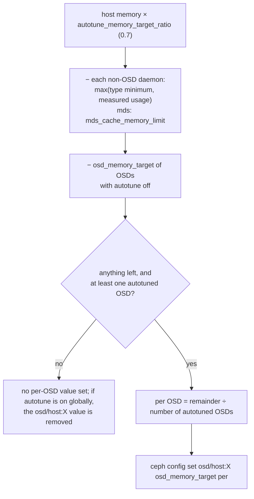

Take away: cephadm has no floor or ceiling of its own; the only floor is the
option's minimum of 896 MiB, and a `config set` below it fails with a logged
warning. It runs every `autotune_interval` (default 10 minutes) on hosts
without the `_no_autotune_memory` label.

## 12. The whole picture in one pass

Putting §2 to §7 together, this is what one OSD does after start, with the
defaults:

1. At mount, `_set_cache_sizes()` reads the options: ceiling 2713 MiB, floor
   128 MiB, ratios 0.45 / 0.45 / 0.04 / 0.06.
2. The thread starts; the tuner's first measurement puts `tuned_mem`
   between 128 MiB and the ceiling, depending on how much is already mapped.
3. Every second, `tune_memory()` sees mapped memory below 4 GiB and grows
   `tuned_mem` by a fraction of the distance to the ceiling.
4. Every five seconds, `balance()` walks the priorities: the two RocksDB
   caches' PRI0 requests first (their high-priority blocks plus 64 MiB
   each), then everything any cache touched in the last second, then the last two seconds, and so on, giving each cache what
   it asks for until the memory runs out. Whatever is left goes out by
   ratio. Each cache commits a size rounded up to a chunk plus 64 MiB.
5. Twenty times a second, `_resize_shards()` turns the committed sizes into
   per-shard limits: onode counts for the 32 onode shards, bytes for the 32
   buffer shards. RocksDB got its new capacity at commit.
6. Onode shards evict a few onodes per pass until they are under their
   limits; buffer shards trim to their byte limit at once.
7. If mapped memory climbs past 4 GiB, step 3 shrinks `tuned_mem`, step 4
   hands out less, and step 6 evicts more, until mapped memory falls back
   under the target.

## 13. A case: the page cache "beat" BlueStore's cache

[PR #72884](https://github.com/ceph/ceph/pull/72884) lets BlueStore read
object data through the kernel's page cache. Its author measured hot 4K
random reads and found 1 GiB OSDs plus the page cache 21 % faster than
OSDs with a 4 GiB target. Two explanations are possible: the kernel caches
data better than BlueStore, or BlueStore's cache was not using the memory
it had. I repeated the test on a 4-OSD vstart cluster and found the second.

### 13.1 The test

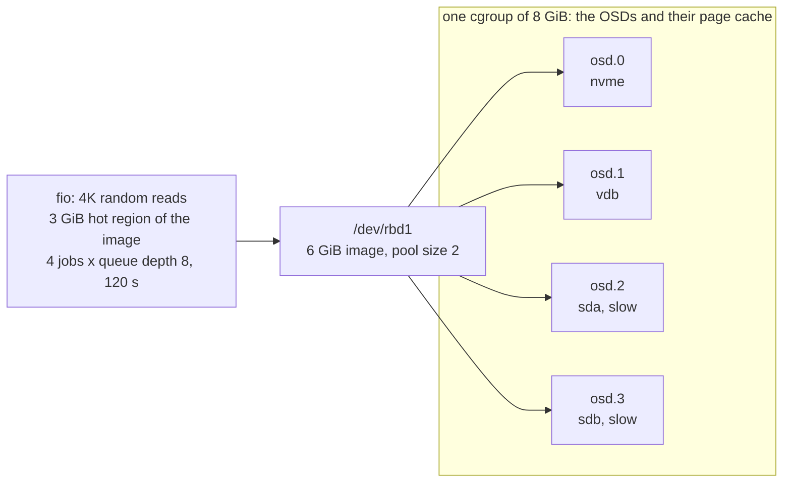

Three settings, called arms. Each arm restarts the OSDs, warms up with two
sequential reads of the hot region, then runs the measured pass.

| arm | `osd_memory_target` | tuner settings | page cache reads |
|---|---|---|---|
| base | 2 GiB | defaults | off |
| fw | 2 GiB | `osd_memory_base` 256 MiB, meta and kv ratios 0.30 | off |
| pc | 1 GiB | the PR's advice: meta 0.50, kv 0.45 | on |

Per OSD the harness records `buffer_hit_bytes` and `buffer_miss_bytes`,
`read_lat`, CPU time per read, and a perf profile of the threads:
[`hotpass.sh`]({{ site.baseurl }}/code/ceph/hotpass.sh).

### 13.2 What came out

| arm | IOPS | buffer hit rate | p99 latency | data cache held per OSD |
|---|---|---|---|---|
| base | 3,179 | 55 % | 80 ms | 330 to 490 MiB |
| fw | 5,824 | 85 % | 52 ms | 490 to 680 MiB |
| pc | 98,032 | page cache, all hits | 1.0 ms | 60 MiB, plus 3.2 GiB of page cache |

Each OSD's share of the hot region is 0.6 to 1.0 GiB. The page cache held
all of it after one pass. BlueStore's cache never did, although the tuner
had committed 760 to 880 MiB per OSD to it. On this machine a miss goes to a
slow disk, so the hit rate decides the result.

Two things it was *not*:

- **Not the hit path.** With a 3 GiB target and ratios of 0.10 the cache
  finally held the data (98 to 100 % hits). A hit then cost 4 µs of
  `read_lat`, against 20 µs for a page-cache hit, at the same CPU per read.
  Once BlueStore's cache has the data, it serves it faster than the kernel.
- **Not the growth ramp of §6.3.** Six warm passes instead of two changed
  nothing. The cache reached the same size within a minute and stayed there.

### 13.3 Why the cache stops at 70 % of its budget

First, what a shard is. BlueStore does not keep one data cache and one
onode cache; it cuts each into N independent pieces, so that the OSD's op
threads do not all wait for one lock. N is the OSD's op-queue shard count
(`osd_op_num_shards`, 8 on flash), set at start by
[`set_cache_shards()`](https://github.com/ceph/ceph/blob/v21.3.0/src/os/bluestore/BlueStore.cc#L9405).
Each piece has its own lock, its own 2Q lists and its own byte limit. Every
collection, that is every PG on the OSD, belongs to exactly one piece, and
all of that PG's data is cached there. Budget cannot move between pieces.

```
        data cache budget, committed by the tuner: 816 MiB
                         │  split 8 ways
   ┌──────────┬──────────┼──────────┬─────────────┐
 shard 0    shard 1    shard 2    shard 3   ...  shard 7      own lock, own lists,
 102 MiB    102 MiB    102 MiB    102 MiB        102 MiB      own limit
   ▲          ▲          ▲          ▲              ▲
 PG 2.0     PG 2.1     PG 2.2     PG 2.3         PG 2.7       PG n -> shard n mod 8
 PG 2.8     PG 2.9     PG 2.a     PG 2.b         PG 2.f
  ...        ...        ...        ...            ...
```

[`_resize_shards()`](https://github.com/ceph/ceph/blob/v21.3.0/src/os/bluestore/BlueStore.cc#L5699) gives every
buffer shard the same limit, the committed bytes divided by the shard
count (L5756). A collection goes to a shard by its PG number modulo the
count ([`hash_to_shard()`](https://github.com/ceph/ceph/blob/v21.3.0/src/osd/osd_types.h#L634)), and the PGs an OSD
is primary for do not spread evenly: on these four OSDs the busiest shard
carried 1.3 to 1.6 times the average.

```
example: tuner commits 816 MiB to the data cache; 8 shards, each allowed 816 / 8 = 102 MiB

shard        0     1     2     3     4     5     6     7
hot data   140   140    70    70    90   140   120   170  MiB  what the shard needs (940)
allowed    102   102   102   102   102   102   102   102  MiB  equal split
held       102   102    70    70    90   102   102   102  MiB  = 740 of 816

             ^ full: trims on every insert   ^ never fills: 32 + 32 + 12 = 76 MiB stranded
```

The loaded shards sit at their limit and
[`_trim_some()`](https://github.com/ceph/ceph/blob/v21.3.0/src/os/bluestore/BlueStore.h#L1557) evicts on every
insert; the light shards never reach theirs. The budget that is stranded in
the light shards is lost, and inside a loaded shard the 2Q split between
`warm_in` and `hot` (§8.2) loses a little more. Measured: 574 MiB held of
816 committed, which is where the 85 % hit rate comes from. More budget
only helps by accident, when even the busiest shard fits.

### 13.4 The fix

Keep a small floor per shard and split the rest by what each shard holds:

```
max_i = floor + (committed - 8 * floor) * held_i / sum(held)      floor = committed / 64
```

The limits still add up to at most the committed size. A shard at its
limit gains budget as long as another shard holds less than its share, so
the split follows the data in a few rounds of the mempool thread. A shard
holding exactly its even share is a fixed point, so when every shard wants
more than its share the split stays even, as today. The onode shards keep
the even split for now, because their count includes pinned onodes that
cannot be evicted. The change is confined to `_resize_shards()`:
[`shard-demand.patch`]({{ site.baseurl }}/code/ceph/shard-demand.patch),
filed as [tracker #82021](https://tracker.ceph.com/issues/82021), fix in
[PR #73018](https://github.com/ceph/ceph/pull/73018).

Same fw settings, same test, with the patch:

| arm | IOPS | buffer hit rate | p99 | `op_r_latency` | OSD CPU per read | cgroup memory |
|---|---|---|---|---|---|---|
| fw, stock | 5,824 | 85 % | 52 ms | 0.2 to 15 ms | 130 to 150 µs | 2.8 GiB |
| fw + patch | 105,585 | 100 % | 0.95 ms | 0.046 ms | 33 to 43 µs | 3.4 GiB |
| pc | 98,032 | page cache | 1.04 ms | 0.071 ms | 37 to 48 µs | 3.7 GiB |

With a 2 GiB hot region the patched fw arm gives 107,543 IOPS against
98,020 for the page cache, at 2.4 against 2.7 GiB. A later A/B on the same
cluster with the reviewed patch, the stock and patched binaries built from
one tree, and disk reads per OSD recorded as cache-independent evidence
gave the same picture: 5,643 IOPS with 77 to 253 MiB read from disk per
OSD, against 106,712 with none. BlueStore's own cache beats the page cache
on every column once it is allowed to hold the data.

### 13.5 Three more things the tuner does to a small OSD

- It only lets a cache grow by 64 MiB plus one chunk per 5-second round,
  because [`request_cache_bytes()`](https://github.com/ceph/ceph/blob/v21.3.0/src/os/bluestore/BlueStore.h#L2618)
  asks for what the cache already holds (§6.3).
- At the `LAST` priority the defaults give the data cache 6 % (§6.2), and
  `osd_memory_base` takes 768 MiB before any cache is sized (§2). On a
  1.5 GiB OSD that is half the target.
- `bluestore_cache_type = lru` aborts the OSD at start on current main, an
  assert in `LruBufferCacheShard::_rm()` on the age-bin accounting. The
  2Q cache is the only one that runs.

### 13.6 Takeaways

- Measure the hit rate before judging the mechanism. `buffer_hit_bytes`,
  `buffer_miss_bytes` and `read_lat` in `perf dump` tell in one minute
  whether a cache holds its working set.
- An equal split over shards plus an uneven mapping onto them strands
  budget. Any sharded cache with fixed per-shard caps has this problem;
  let the caps follow demand.
- A page-cache hit costs a system call, a copy and a checksum. A BlueStore
  cache hit costs a reference count. When both hold the data, BlueStore's
  is the faster one, and it is the one the tuner can see.

## 14. Can the default target be 2 GiB?

### 14.1 The answer in one view

The target sizes the caches and nothing else. Everything else the OSD
allocates has its own bound, set by other options, and `osd_memory_base`
is a fixed guess for the sum of those bounds. At 4 GiB the guess is a third
of the target; at 2 GiB it is more than half. Measured on four capped OSDs,
a 2 GiB target never came close to its cgroup limit, so 2 GiB works for a
normal read/write/recovery mix. It is not a safe *default* until the parts
outside the target are tied to it.

```
osd_memory_target = 2048 MiB
 ├─ 15 % fragmentation reserve    307 MiB   fixed share
 ├─ osd_memory_base               768 MiB   fixed guess for "everything else"
 └─ cache ceiling (max)           973 MiB   the only part the tuner moves (§2)
                                             kv | kv_onode | meta | data

"everything else" is bounded per part, not by the target:
  RocksDB memtables   ≤ max_total_wal_size              1024 MiB   #1
  client messages     ≤ osd_client_message_size_cap      500 MiB   #2
  pg log              ≈ 300000 entries/OSD × ~500 B    ~150 MiB   #3
  tcmalloc free lists   seen 15–140 MiB per OSD, released each round
  maps, threads, in-flight data, BlueFS                   tens of MiB
                                                         ----------
  sum of the bounds                                     ~1.7 GiB  >  1075 MiB reserve
```

1. In every phase of the test the "everything else" part stayed between
   0.1 and 0.46 GiB per OSD (§14.2). The reserve of 1075 MiB is 2.3× that.
2. The caches, not the reserve, set the OSD's size: the peak RSS was the
   cache ceiling plus about 60 MiB (§14.2).
3. The default stays 4 GiB because #1 to #3 are not sized by the target. A
   write burst can put 1 GiB of memtables and 0.5 GiB of client messages
   next to the caches, and the tuner only reacts after `mapped` has grown
   (§14.3).
4. Tie #1 and #2 to the target, then `osd_memory_base` can drop and a 2 GiB
   OSD keeps about 1.4 GiB of cache instead of 0.95 (§14.4).

### 14.2 What was measured

[`memtarget.sh`]({{ site.baseurl }}/code/ceph/memtarget.sh) runs the vstart
cluster of §13 (4 OSDs, 512 PGs, pool size 2, 6 GiB RBD image) with each
OSD in its own cgroup capped at 2 GiB (`memory.oom.group = 1`, so a kill is
visible) and `osd_memory_target` 2 GiB. The phases are: idle, 4 GiB
sequential write, 4K random write (180 s), 4K random read (120 s), recovery
(osd.0 out, then in) and a deep scrub. A sampler reads the cgroup and RSS
every 5 s; at the end of each phase it stores `perf dump`,
`dump_mempools` and `heap stats` of every OSD.

| Arm | Options on top of the defaults | Binary |
|---|---|---|
| d2 | none | stock |
| d2b | `osd_memory_base` 256 MiB | stock |
| r2 | pg log 50000/100/500, `max_write_buffer_number=4, write_buffer_size=64 MiB, max_total_wal_size=256 MiB`, `osd_client_message_size_cap` 128 MiB | stock |
| r2p | r2 + `osd_memory_base` 256 MiB | shard-limit patch (§13.4) |

Peak RSS (MiB, the largest of the four OSDs) per phase, and the range of
"everything else" (`mapped` minus the bytes the four caches hold; it
includes tcmalloc's free lists):

| Arm | cache ceiling | seq write | rand write | rand read | recovery | scrub | everything else | OOM kills |
|---|---|---|---|---|---|---|---|---|
| d2 | 972 | 515 | 431 | 650 | 1036 | 1019 | 131–460 | 0 |
| d2b | 1484 | 257 | 428 | 663 | 1098 | 1093 | 103–489 | 0 |
| r2 | 972 | 284 | 420 | 626 | 980 | 975 | 123–438 | 0 |
| r2p | 1484 | 250 | 382 | 611 | 1499 | 1494 | 100–464 | 0 |

What the numbers say:

- The peak is the recovery phase, and it is the cache ceiling plus tcmalloc
  overhead: d2's busiest OSD reached `mapped` 975 MiB against a ceiling of
  972 (data cache 467 MiB of recovered objects); r2p reached 1441 against
  1484 (data cache 939 MiB). A smaller `osd_memory_base` raises the
  ceiling and nothing else moves.
- Whether the OSD uses the higher ceiling depends on the cache code, not
  on the tuner: d2b (stock binary, same 256 MiB base as r2p) stopped at
  `mapped` 1047 with a data cache of 514 MiB, because the equal per-shard
  limits of §13.3 cap each shard and the cache then asks for less. The
  patched r2p filled the same ceiling to 1441.
- The tuner granted the full ceiling in every snapshot (`cache_bytes` =
  `max`), because `mapped` never reached the target. Below the ceiling the
  caches are sized by the working set, not by the tuner: 0 to 300 MiB of
  data cache in the read phase, up to 986 MiB after recovery.
- "Everything else" is 100–460 MiB and peaks in recovery, where 50–140 MiB
  of it is tcmalloc free lists after the data cache churned. The pg log is
  the next item: 130 000 entries of about 500 B, 44–66 MiB per OSD with
  the defaults, 27–40 MiB with `osd_target_pg_log_entries_per_osd` 50000.
- The RocksDB bounds of r2 changed nothing measurable, and that is a limit
  of this VM, not a result: its disks take 15 MiB/s of sequential and 250
  IOPS of random writes, so a 16 MiB memtable fills in minutes and is
  flushed long before the WAL cap matters. The memtable bound in §14.3 is
  read from the options, not measured; §15.3 measures it.

Unit of all the memory numbers: MiB. All four arms ran on
21.3.0-2872-gfe630588daf; r2p used the §13.4 patch. One OSD of d2b failed
to start on the first try (device still busy after the previous arm) and
was restarted by the harness before the idle phase; no OSD was killed in
any phase.

### 14.3 Why the default is still 4 GiB

The tuner measures `mapped` once per round and moves the caches toward
`target − mapped`
([`tune_memory()`](https://github.com/ceph/ceph/blob/v21.3.0/src/common/PriorityCache.cc#L119)).
It sees a memtable or a message buffer only after it was allocated. The
caches can give back at most `ceiling − osd_memory_cache_min` (845 MiB at
2 GiB), and the shrink is one step per `bluestore_cache_autotune_interval`
(5 s). Anything outside the caches that grows faster or larger than that
makes RSS pass the target; whether the OSD dies is then decided by the
cgroup, not by Ceph.

```
            what can grow outside the caches at 2 GiB, worst case
            ───────────────────────────────────────────────────────
 #1 memtables   16 MiB × up to 64 per column family, 12 families;
                L and P merge 32 memtables before a flush;
                the only global bound is max_total_wal_size = 1 GiB:
                RocksDB flushes the family holding the oldest WAL
                when the WALs pass it, so ≈ 1 GiB can sit in memory.
                No WriteBufferManager: nothing ties this to the target.
 #2 messages    osd_client_message_size_cap = 500 MiB of client data
                waiting in the messenger before the throttle blocks.
 #3 pg log      osd_target_pg_log_entries_per_osd = 300000 entries
                plus osd_pg_log_dups_tracked = 3000 per PG.
            ───────────────────────────────────────────────────────
                #1 + #2 + #3 ≈ 1.7 GiB   vs   reserve 1075 MiB
```

On the VM none of this happened: writes are too slow to fill a memtable,
and one fio client never had 500 MiB in flight. On an NVMe OSD doing
50 000 4K writes per second a 16 MiB memtable fills in well under a second
and the WAL cap is reached in tens of seconds; that is the case the 768 MiB
base and the 4 GiB default were sized for.

Two details of how the target is set, for completeness. The option has a
floor of 896 MiB, which is `osd_memory_base` + `osd_memory_cache_min`
(`global.yaml.in`). Under Kubernetes the default becomes
`osd_memory_target_cgroup_limit_ratio` (0.8) × `POD_MEMORY_LIMIT`
([`config.cc`](https://github.com/ceph/ceph/blob/v21.3.0/src/common/config.cc#L553));
the cgroup file it reads is the v1 path
([`get_cgroup_memory_limit()`](https://github.com/ceph/ceph/blob/v21.3.0/src/common/util.cc#L173)),
so on a cgroup v2 host only the environment variable works.

### 14.4 What would make 2 GiB a safe default

In order of effect:

1. **Bound memtables by the target.** Scale `max_total_wal_size` with the
   target: §15.3 measured the memtable peak at about 1.1 times the cap. A
   `WriteBufferManager` sized from the target does not help with Ceph's
   merge counts (§15.3.5). Cost: more and smaller flushes on a
   write-heavy OSD, so more SST writes. Until this is in the code the r2
   annex gives the same bound by configuration.
2. **Scale the message cap.** `osd_client_message_size_cap` 500 MiB is a
   quarter of a 2 GiB target. A cap tied to the target (target / 16 =
   128 MiB) only moves the point where the messenger stops reading from
   clients; it is back-pressure, not an error.
3. **Lower `osd_memory_base` once 1 and 2 hold.** The measured
   "everything else" peaked at 460 MiB including 140 MiB of free lists.
   With bounded memtables and messages, a base of 256–384 MiB gives the
   caches 1357–1484 MiB at 2 GiB instead of 973. r2p ran at that ceiling
   (1441 of 1484 MiB) with no kill.
4. **Let the shard limits follow demand** (§13.4, PR #73018). With the
   same 256 MiB base the stock OSD ended recovery with 514 MiB of data
   cache, the patched one with 939; at 2 GiB every stranded shard limit is
   a larger share of what is left.
5. **Keep the pg log where it is.** 300000 entries per OSD is at most
   about 150 MiB at the 500 B per entry measured here.
   Lowering it (r2: 50000) saves about 30 MiB and shortens the window in
   which a returning OSD can log-recover instead of backfill; not worth
   it for memory alone.

With 1 to 3 in place a 2 GiB OSD looks like this:

```
 today, 2 GiB target                   with bounded memtables and messages
 ┌──────────────────────────────┐      ┌──────────────────────────────┐
 │ caches            973 MiB    │      │ caches          ~1400 MiB    │
 │ base (guess)      768 MiB    │      │ memtables  ≤ 256, msgs ≤ 128 │
 │ fragmentation     307 MiB    │      │ pg log + rest   ~250 MiB     │
 │ unbounded: memtables ≤ 1 GiB,│      │ fragmentation     307 MiB    │
 │   messages ≤ 500 MiB on top  │      │ nothing on top               │
 └──────────────────────────────┘      └──────────────────────────────┘
```

### 14.5 Takeaways

- Judge the target by what it does not control. On this cluster the OSD's
  size was the cache ceiling plus 60 MiB; the 768 MiB base was a 2.3×
  guess for a 100–460 MiB reality.
- 2 GiB is fine today for an OSD whose writes are modest and whose host
  has the headroom; the price is cache, 973 MiB instead of 2714.
- A 2 GiB *default* needs RocksDB's memtables and the client message cap
  tied to the target first. After that, `osd_memory_base` can drop and the
  caches get the difference.

## 15. Memory outside the caches: what to cut next

**Summary.** With the shard fix of §13.4 the caches fill their budget, so
whether a small `osd_memory_target` holds now depends on the memory outside
them. On four OSDs on c28's four disks, at a 2 GiB target, three consumers
stand out. RocksDB memtables are bounded only by the WAL size cap (up to
470 MiB per OSD, 720 MiB on an HDD OSD). Recovery reads stay in the data
cache although nothing reads them again (+160 to +290 MiB per source OSD).
The pg log costs 40–70 % more than its mempool reports. §15.7 ranks the
fixes.

### 15.1 The findings in one view

This graph shows where an OSD's memory goes and which part each finding is
about.

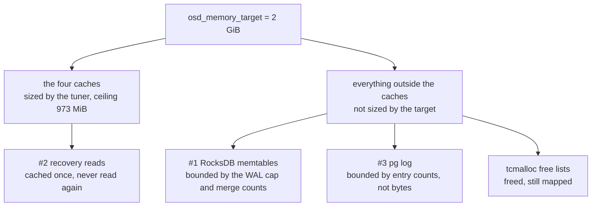

Take away: #1 and #3 grow where the tuner cannot reach; #2 sits inside the
cache budget but spends it on data nobody wants.

| # | Consumer | Measured per OSD, 2 GiB target | Why | Fix | Cost |
|---|---|---|---|---|---|
| 1 | RocksDB memtables | peak 456–469 MiB (SSD-class), 719 MiB (HDD mode) | full memtables wait for a merge count of 6 (`O`) or 32 (`P`, `L`); only the WAL cap forces them out | lower the merge counts (2 held the peak to 83–114 MiB), or tie the WAL cap to the target | about 2× the bytes flushed to SST |
| 2 | Recovery reads | +157 to +294 MiB of once-read data in each source OSD's data cache | push reads never set DONTNEED | set `cache_dont_need` in background recovery; DONTNEED on EC recovery reads | none found |
| 3 | PG log | 782–789 B per entry, 175–181 B per dup: 42 % and 70 % above the mempool | strings, tree nodes and hash indexes sit outside the mempool; freed memory stays on tcmalloc's free lists | count them; move rarely used fields out of the entry; a dup budget per OSD | code change |

### 15.2 How it was measured

The test is a 4-OSD vstart cluster on the c28 VM (8 vCPUs, 32 GiB), one OSD
per disk, driven by fio through the kernel RBD client.
[`memopt.sh`]({{ site.baseurl }}/code/ceph/memopt.sh) does every step; each
experiment below is one of its subcommands.

This graph shows the test setup.

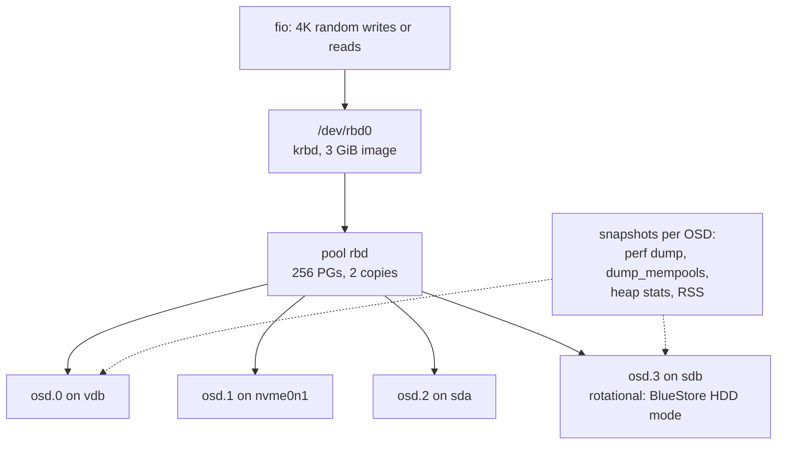

Take away: four OSDs, one per disk; osd.3 runs with BlueStore's HDD
settings because sdb reports itself as rotational.

The disks, measured with fio on the raw devices before the cluster was
created:

| OSD | Disk | Kind in the VM | Size | 4K random writes, queue depth 32 | 1 MiB sequential writes |
|---|---|---|---|---|---|
| osd.0 | vdb | virtio | 8 GiB | 21800/s | 314 MB/s |
| osd.1 | nvme0n1 | QEMU NVMe | 8 GiB | 10500/s | 419 MB/s |
| osd.2 | sda | QEMU SCSI | 12 GiB | 23800/s | 245 MB/s |
| osd.3 | sdb | QEMU SCSI, rotational | 11 GiB | 822/s | 54 MB/s |

The build is `21.3.0-2873-g3410de9c419`: `main` at d78578929f9 plus 15
local commits. Two of them matter here: the shard-limit fix of PR #73018,
and a port of [PR #72964](https://github.com/ceph/ceph/pull/72964), which
lowers three limits by `osd_memory_target / 4 GiB` and the WAL cap by the
square root of that ratio. The others are an opt-in page-cache read option
(off here) and work in progress on BlueStore's aio completion path. At
2 GiB the OSD log shows what #72964 gives:

| Limit | Default (4 GiB) | At 2 GiB |
|---|---|---|
| `osd_client_message_size_cap` | 500 MiB | 250 MiB |
| `osd_target_pg_log_entries_per_osd` | 300000 | 150000 |
| `osd_pg_log_dups_tracked` | 3000 | 1500 |
| `max_total_wal_size` (in `bluestore_rocksdb_options`) | 1 GiB | 724 MiB |

Everything else is at its default. Scrubs are off so that they do not mix
into the numbers. Each OSD runs in its own cgroup with a 3 GiB limit, which
guards the host and was never reached.

What one sample records, per OSD: `perf dump`, `dump_mempools`,
`heap stats` (tcmalloc), RSS and the cgroup peak. Two derived numbers carry
the results:

- **Outside the caches** = `mapped` − (data cache + onode cache + RocksDB
  block caches). §14 called this "everything else". It includes tcmalloc's
  free lists.
- **Memtables** ≈ outside the caches during the run − outside the caches
  right after `ceph daemon osd.N compact`, which flushes every memtable.
  This is an estimate: it assumes nothing else changes while the compaction
  runs.

To reproduce it:

1. Build Ceph for vstart from `main` with PR #73018 and PR #72964 applied
   (or plain `main`: §15.9 has those numbers),
   on a host with four unused disks, and copy `memopt.sh` there. `B`,
   `VS`, `RES` and `DEVS` at the top of the script name the build, the
   cluster directory, the results directory and the disks.
2. `memopt.sh up`. This clears old BlueStore labels on the disks, reports
   their write cache as write-through (see below), turns on
   `bdev_enable_discard` (§15.9 shows what that costs), creates the cluster
   without cephx (the kernel client rejects this build's 32-byte keys),
   creates the pool and the image, maps it with krbd and fills it.
3. Memtables: `memopt.sh memtable 1800`, then
   `memopt.sh memtable 1200 wal256 max_total_wal_size=268435456`,
   `memopt.sh memtable 1200 wal128 max_total_wal_size=134217728` and
   `memopt.sh memtable 1200 wbm256 db_write_buffer_size=268435456`.
   Each restarts the OSDs with the given RocksDB options, runs 4K random
   writes, samples every 60 s, then compacts. The merge-count arm and its
   control need new clusters; §15.3.6 lists their steps.
4. Pg log: `memopt.sh pglog`.
5. Recovery: `memopt.sh recovery cache`, then `memopt.sh recovery nocache`.
6. tcmalloc: `memopt.sh tcmalloc 32`, then `memopt.sh tcmalloc 128`.
7. Read the results in `$RES/<experiment>/`. `memopt.sh show <dir> [<dir0>]`
   prints one line per OSD; `memopt.sh flushes <dir>` lists the RocksDB
   flushes of a memtable run by column family.
8. `memopt.sh down`.

Three things about the setup matter for the results:

- c28's virtual disks pass every cache flush on to slow host storage: sdb
  manages 68 4K writes per second with a flush after each. `up` therefore
  sets `/sys/block/<disk>/queue/write_cache` to `write through`. The guest
  kernel then sends no flushes, as with a datacenter SSD that has
  power-loss protection.
- sdb is slow even without flushes: during the write tests it was 97 %
  busy at about 535 writes/s, and osd.3's commit latency was about 250 ms.
  It caps the cluster at 700–780 4K writes/s, so memtables fill slowly
  and each write run lasts 20–30 minutes.
- The VM froze for 17 minutes during the first run of the uncached recovery
  arm. Two OSDs then aborted on their op-thread timeout, and the hot-set
  re-read was lost. Both recovery arms were run again; §15.4 uses the
  second pair.

### 15.3 Finding 1: RocksDB memtables

#### 15.3.1 How a write reaches RocksDB's memory

BlueStore commits each transaction as one RocksDB write batch
([`RocksDBStore::submit_common()`](https://github.com/ceph/ceph/blob/v21.3.0/src/kv/RocksDBStore.cc#L1607)).
RocksDB appends the batch to its write-ahead log (WAL), a file on disk that
makes the write durable. Then it inserts each key into a *memtable*, an
in-memory sorted table, one per column family. A memtable is never edited in
place: a key written ten times is in it ten times. A *flush* writes a
memtable out as an SST file, the sorted on-disk format, and keeps only the
newest version of each key. Until then every version takes memory.

BlueStore spreads its keys over column families by key prefix
([prefixes](https://github.com/ceph/ceph/blob/v21.3.0/src/os/bluestore/BlueStore.cc#L134),
[`bluestore_rocksdb_cfs`](https://github.com/ceph/ceph/blob/v21.3.0/src/common/options/global.yaml.in#L5407)).
These are the ones that matter here:

| Column family | Holds | A 4K RBD write adds | Memtables merged per flush |
|---|---|---|---|
| `O` (3 shards) | onodes: object metadata and extent maps | a new copy of the object's onode | 6 |
| `P` | the omap of each PG's meta object: pg log entries, dups, PG info | a log entry and new PG info; trimming deletes old entries and adds dups | 32 |
| `L` | deferred writes: small writes staged in RocksDB before BlueStore copies them to the data disk | on an HDD OSD: the 4K of data | 32 |
| `m` (3), `p` (3), `default` | object omap, statistics and the rest | little or nothing | 6 |

The defaults in
[`bluestore_rocksdb_options`](https://github.com/ceph/ceph/blob/v21.3.0/src/common/options/global.yaml.in#L5370)
are 16 MiB per memtable (`write_buffer_size`), up to 64 per column family
(`max_write_buffer_number`), 6 merged per flush
(`min_write_buffer_number_to_merge`, 32 for `L` and `P`) and a WAL cap
(`max_total_wal_size`) of 1 GiB.

#### 15.3.2 When RocksDB frees a memtable

This state diagram shows the life of one memtable in RocksDB 7.9.2, the
version in v21.3.0, and the three ways out of memory that apply to Ceph.

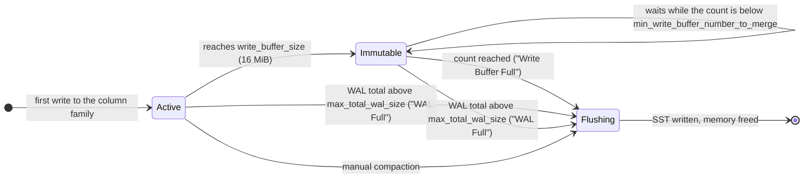

Take away: no exit looks at time or at the OSD's memory, so a memtable
stays until its column family has enough of them, the WAL is full, or
someone compacts.

The two automatic exits, from the code:

- **Write Buffer Full.** A column family flushes once it has
  `min_write_buffer_number_to_merge` immutable memtables
  ([`MemTableList::IsFlushPending()`](https://github.com/ceph/rocksdb/blob/24ea35870fe9b3ba15285ec8746ba97ed5d67ff3/db/memtable_list.cc#L370)).
  For `O` that is 6 × 16 MiB; for `P` and `L` it is 32 × 16 = 512 MiB.
- **WAL Full.** A WAL file can only be deleted when every column family has
  flushed the keys it holds. When the live WAL files pass
  `max_total_wal_size`, RocksDB flushes every column family that still has
  keys in the oldest one
  ([`PreprocessWrite()`](https://github.com/ceph/rocksdb/blob/24ea35870fe9b3ba15285ec8746ba97ed5d67ff3/db/db_impl/db_impl_write.cc#L1147),
  [`SwitchWAL()`](https://github.com/ceph/rocksdb/blob/24ea35870fe9b3ba15285ec8746ba97ed5d67ff3/db/db_impl/db_impl_write.cc#L1559)).

Every key in a memtable is also in a live WAL file, so the WAL cap bounds
the memtables' content. For `P`, which needs 512 MiB before it flushes on
its own, the WAL cap is the bound that acts. Nothing flushes a memtable
because time passed: after the writes stop, the memtables stay in memory.

#### 15.3.3 What was measured

`memopt.sh memtable` runs 4K random writes (4 jobs × queue depth 32),
samples every minute and compacts at the end. The memory outside the caches
minus its value after the compaction gives the memtables. This estimate
reads low in the first minutes, while the pg log is still growing toward its
limit; the maxima below all come later.

Each arm changes one RocksDB option through `bluestore_rocksdb_options_annex`:

| Arm | Option | Run | 4K write IOPS | Memtables, SSD OSDs: mean / max | osd.3: mean / max | Flushed to SST, bytes per transaction: SSD OSDs / osd.3 | All SST writes, same unit |
|---|---|---|---|---|---|---|---|
| default | WAL cap 724 MiB | 30 min | 699 | 220–229 / 456–469 MiB | 365 / 719 MiB | 45–78 / 117 | 69–122 / 186 |
| wal256 | `max_total_wal_size=268435456` | 20 min | 746 | 141–146 / 268–294 MiB | 143 / 287 MiB | 87–147 / 197 | 158–278 / 570 |
| wal128 | `max_total_wal_size=134217728` | 20 min | 780 | 62–79 / 135–148 MiB | 66 / 135 MiB | 153–197 / 282 | 323–457 / 1040 |
| wbm256 | `db_write_buffer_size=268435456` | 20 min | 730 | 265–290 / 449–482 MiB | 411 / 800 MiB | 9–66 / 108 | 9–100 / 211 |

A *transaction* is one BlueStore commit (`txc_count`): one client write on
the primary or one replicated write on a replica. "Flushed to SST" counts
the SST files the flushes wrote; "all SST writes" adds the compactions that
merge them later (BlueFS `bytes_written_sst`).

What the table says:

- **The WAL cap sets the memtables.** 724 → 256 → 128 MiB of WAL gave
  peaks of about 460 → 290 → 145 MiB on the SSD OSDs. A RAM-disk run of the
  same arms at 18000 IOPS gave the same peaks (460–520, 280–290, 120–140 MiB):
  the bound does not depend on the disk's speed, only the time to reach it
  does.
- **The cost is SST writes.** With a smaller cap a memtable has less time
  to absorb rewrites before its flush, so more versions survive. Flushes
  wrote 1.7–2.0× the bytes per transaction at 256 MiB and 2.4–3.5× at
  128 MiB; compaction multiplies that, to 2.3–3.1× and 3.7–5.6× of all SST
  writes. Against what each transaction already writes (4 KiB of data and
  3.5–6.2 KiB of WAL), 128 MiB adds 3–4 % to an SSD OSD's device writes and
  8 % to the HDD OSD's.
- **Throughput did not drop.** IOPS went 699 → 746 → 780, within the noise
  of these disks.
- **Latency is open.** Write latency here is set by sdb: p50 152–169 ms,
  p99 0.7–0.8 s and p99.9 4–8 s in all arms, without a trend. PR #72964
  scales the WAL by the square root of the target because, in its code
  comment, a WAL at a quarter of its size cost 25 % at p99.9. This setup
  cannot confirm or rule that out.

#### 15.3.4 Where the peak comes from

Every flush leaves a line in the OSD log: the column family, how many
memtables it merged, their memory and data size, the reason, and the SST
file it wrote. `memopt.sh flushes` sums them per column family. For the
30-minute default run:

| OSD | Column family | Flushes | Memtables per flush | Data in | Kept in the SST | Reason |
|---|---|---|---|---|---|---|
| osd.0 | `O` (3 shards) | 7 | 6 | 648 MiB | 1.1 % | Write Buffer Full |
| osd.0 | `P` | 1 | 15 | 213 MiB | 29 % | WAL Full |
| osd.3 | `L` | 5 | 32 | 2489 MiB | 0.2 % | Write Buffer Full 3, WAL Full 2 |
| osd.3 | `O` (3 shards) | 15 | 3–4 | 725 MiB | 1.7 % | WAL Full |
| osd.3 | `P` | 5 | 5–7 | 410 MiB | 58 % | WAL Full |

"Kept" is the raw key and value bytes the flush wrote out, as a share of the
raw bytes that came in. The other column families flushed only empty or
near-empty memtables. Each flush freed 1.01–1.10 times its data in memory.

The flush times explain the sawtooth of the memory:

- **SSD-class OSD (osd.0).** The three `O` shards fill at the same rate and
  flush within two minutes of each other, 6 memtables (94 MiB) each, every
  9–10 minutes. `P` flushed once, at minute 20, when the WAL passed its cap;
  it held 15 memtables (235 MiB) by then. `P` (up to 235 MiB) sits on top
  of `O` (up to 3 × 110 MiB); they flush at different times, and the
  measured peak was 456–469 MiB.
- **HDD-mode OSD (osd.3).** `L` reaches its 32 memtables (504 MiB) every
  5.2 minutes and flushes; the WAL cap then flushes `O` and `P` within
  12 seconds. Just before that, `L` holds 504 MiB, `O` about 150 MiB and
  `P` up to 100 MiB; the measured peak was 719 MiB.

What the kept column says:

- **`O` is almost all dead data.** Each write rewrites the object's onode;
  the memtable keeps every copy, and the flush keeps one. Of 648 MiB,
  7 MiB reached disk.
- **`P` keeps more.** Pg log entries live longer than one flush interval,
  and trimming writes delete markers, which the flush must keep.
- **`L` is the HDD case.** BlueStore deletes a deferred write's data from
  RocksDB once it has copied it to the data disk, so 99.8 % of `L` dies in
  the memtables. Until the flush it all sits in memory: 2.5 GiB went
  through `L` on osd.3 in 30 minutes.

#### 15.3.5 Why a WriteBufferManager does not help

A WriteBufferManager is RocksDB's memory budget for memtables
(`db_write_buffer_size`). It looks like the natural way to tie memtables to
the target, but it does not work with Ceph's column-family settings. This
flowchart shows the test RocksDB 7.9.2 runs before each write
([`WriteBufferManager::ShouldFlush()`](https://github.com/ceph/rocksdb/blob/24ea35870fe9b3ba15285ec8746ba97ed5d67ff3/include/rocksdb/write_buffer_manager.h#L94)).

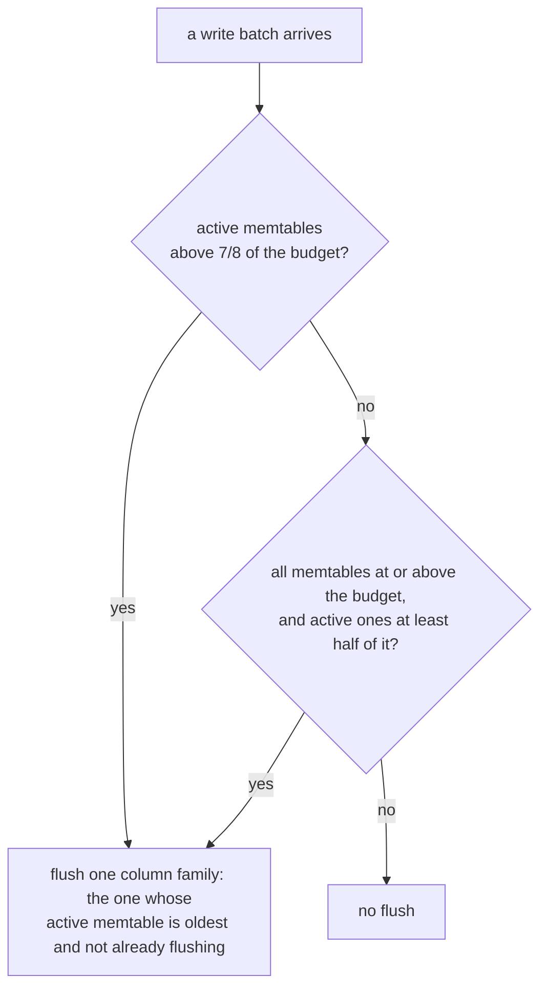

Take away: both triggers need the *active* memtables to be large; full
memtables waiting for their merge count do not count as active.
When a trigger fires, RocksDB flushes one column family: the one whose
active memtable is the oldest, skipping families that are already flushing
([`HandleWriteBufferManagerFlush()`](https://github.com/ceph/rocksdb/blob/24ea35870fe9b3ba15285ec8746ba97ed5d67ff3/db/db_impl/db_impl_write.cc#L1661)).

A memtable leaves the "active" count as soon as it is full and becomes
immutable
([`MemTable::MarkImmutable()`](https://github.com/ceph/rocksdb/blob/24ea35870fe9b3ba15285ec8746ba97ed5d67ff3/db/memtable.h#L442)).
In the flush log of §15.3.4 only `O`'s three shards and `P` carry real data,
plus `L` on an HDD OSD. So the active memtables hold about 4 × 16 = 64 MiB
at most (80 MiB on an HDD OSD). With a 256 MiB budget the triggers need 224
MiB, or 128 MiB, of active memtables. Neither can happen. Meanwhile the
immutable memtables, up to 32 in `P` and in `L`, hold hundreds of MiB.

The wbm256 arm of §15.3.3 tests it. The OSD log confirms the budget
(`Options.db_write_buffer_size: 268435456`), and the memtables still reached
449–482 MiB on the SSD OSDs and 800 MiB on osd.3, as without it. Of the 32
flushes on the four OSDs in that run, none had the reason "Write Buffer
Manager"; all were "WAL Full" or "Write Buffer Full".

A budget would work only with lower merge counts, so that full memtables
flush instead of waiting. §15.3.6 tests that.

#### 15.3.6 Bounding the memtables by merge count instead

The other way to bound memtables is to flush full ones sooner: lower
`min_write_buffer_number_to_merge`. For `L` and `P` that value is part of
the column-family definition, which BlueStore writes to the `sharding/def`
file beside the database at mkfs and reads back when it opens the database
([`RocksDBStore::verify_sharding()`](https://github.com/ceph/ceph/blob/v21.3.0/src/kv/RocksDBStore.cc#L1034)).
Changing `bluestore_rocksdb_cfs` later does nothing to an existing OSD;
`ceph-bluestore-tool reshard` rewrites the definition. The tool in this
build tree was older than its libraries and crashed, so the arm builds a
new cluster instead:

1. `memopt.sh down`
2. `CFS="m(3) p(3,0-12) O(3,0-13)=block_cache={type=binned_lru} L=min_write_buffer_number_to_merge=2 P=min_write_buffer_number_to_merge=2" memopt.sh up`
3. `memopt.sh memtable 1200 merge2 min_write_buffer_number_to_merge=2`
   (the annex sets 2 for `O`, `m`, `p` and `default`)
4. As a control, the same three steps with the default definition:
   `memopt.sh down`, `memopt.sh up`, `memopt.sh memtable 1200 fresh`.

The OSD log shows 2 for all 12 column families. A new cluster starts with an
empty pg log, which grows during the run, so the memtable numbers below
subtract that growth (at the 785 bytes per entry of §15.5).

| Arm | 4K write IOPS | Memtables peak, SSD OSDs / osd.3 | Flushed to SST, bytes per transaction: SSD OSDs / osd.3 | Memtables per flush |
|---|---|---|---|---|
| control: default definition | 341 | 362–378 / 768 MiB, still growing at 20 min | 0–16 / 55: few flushes yet | 6 (`O`), 32 (`L`) |
| merge2 | 315 | 83–96 / 114 MiB | 95–134 / 253 | 2 |

What this says:

- **Merge count 2 bounds the memtables lower than any WAL cap tried.** Each
  column family flushes at 2 full memtables (32 MiB), so the peak stayed at
  83–114 MiB, below the 135–148 MiB of a 128 MiB WAL cap. The control,
  same day and same steps, grew to 362–378 MiB (768 MiB on osd.3) and was
  still growing.
- **It flushes about as much as a 256 MiB cap.** Its flushes wrote
  95–134 bytes per transaction on the SSD OSDs and 253 on osd.3,
  against 45–78 and 117 for the 30-minute default run (§15.3.3), 87–147 and
  197 at a 256 MiB cap, and 153–197 and 282 at 128 MiB. The control had
  flushed too little in 20 minutes to compare with directly. Neither new
  database had compacted much yet, so their "all SST writes" are not
  comparable either.
- **Throughput did not move.** 315 against 341 IOPS for the control. Both
  are half of the morning's arms because the host's disks were slower in
  the afternoon: the fill of the first cluster ran at 35 MB/s, those of
  the two new ones at 16 and 19 MB/s.
- **It helps HDD OSDs most.** `L` dropped from 32 memtables (504 MiB) per
  flush to 2. Its data is still mostly dead by the flush: 3.3 % reached an
  SST, against 0.2 % at 32.

The catch is deployment: a new default for `bluestore_rocksdb_cfs` reaches
only new OSDs; existing ones need `ceph-bluestore-tool reshard`.

### 15.4 Finding 2: recovery reads fill the data cache

*Recovery* brings a PG copy that missed writes up to date; *backfill*
copies a whole PG to an OSD that did not have it. On a replicated pool the
primary reads each object and *pushes* it to the target OSD. Each object is
read once, so caching it on the primary only pushes hot data out of the data
cache.

This sequence diagram shows how a background push reads the object on the
primary.

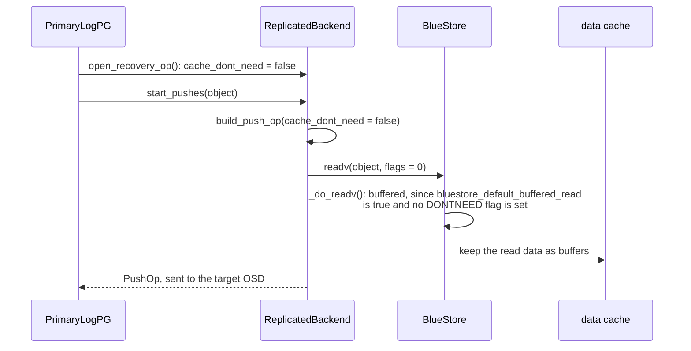

Take away: the flag that would keep recovery reads out of the cache exists,
but nothing sets it, so every push read is a cached read.

The code path, in order:

1. [`recover_replicas()`](https://github.com/ceph/ceph/blob/v21.3.0/src/osd/PrimaryLogPG.cc#L13984)
   and [`recover_backfill()`](https://github.com/ceph/ceph/blob/v21.3.0/src/osd/PrimaryLogPG.cc#L14152)
   open a `RecoveryHandle`, whose constructor sets `cache_dont_need` to
   false ([`PGBackend.h`](https://github.com/ceph/ceph/blob/v21.3.0/src/osd/PGBackend.h#L353)).
   Neither sets it.
2. [`start_pushes()`](https://github.com/ceph/ceph/blob/v21.3.0/src/osd/ReplicatedBackend.cc#L2611)
   passes the flag on when the object goes to one peer (L2636).
3. [`build_push_op()`](https://github.com/ceph/ceph/blob/v21.3.0/src/osd/ReplicatedBackend.cc#L2238)
   reads with `CEPH_OSD_OP_FLAG_FADVISE_DONTNEED` only if the flag is set
   (L2364).
4. [`BlueStore::_do_readv()`](https://github.com/ceph/ceph/blob/v21.3.0/src/os/bluestore/BlueStore.cc#L13562)
   caches a read when
   [`bluestore_default_buffered_read`](https://github.com/ceph/ceph/blob/v21.3.0/src/common/options/global.yaml.in#L5655)
   is true (the default) and the read carries neither DONTNEED nor NOCACHE
   (L13584).

The other paths differ:

- **Pulls.** When the primary itself is missing an object, it pulls it from
  a replica. The replica builds its reply in
  [`handle_pull()`](https://github.com/ceph/ceph/blob/v21.3.0/src/osd/ReplicatedBackend.cc#L2502)
  with `build_push_op()`'s default, `cache_dont_need = true`, so that read is
  not cached.
- **Erasure-coded pools.** A recovery read is a `read_request_t` built in
  [`ECCommon.cc`](https://github.com/ceph/ceph/blob/v21.3.0/src/osd/ECCommon.cc#L1571)
  without flags; `flags` defaults to 0
  ([`ECCommon.h`](https://github.com/ceph/ceph/blob/v21.3.0/src/osd/ECCommon.h#L120)).
  Each shard OSD reads with those flags in
  [`handle_sub_read()`](https://github.com/ceph/ceph/blob/v21.3.0/src/osd/ECBackend.cc#L517),
  so EC recovery reads are cached too.

The flag came with commit fabd6357e42 (2015, "ReplicatedPG: Don't cache
recovery and scrub data"). It set the flag to false where a client op waits
for the object, since the client reads it next. The background paths were
left at the constructor's default, which is also false. A 2016 cleanup
(3a28d01c4ba) removed one of the explicit assignments as redundant. Since
then no push read has used DONTNEED; only the pull reply does.

`memopt.sh recovery` measures the effect:

1. Read a 1 GiB hot set twice, so it is in the data caches, and read it at
   random for 60 s.
2. Mark osd.0 out, wait until the cluster is clean, mark it in, wait again.
   osd.1–3 read and push osd.0's objects, then osd.0 gets them back.
3. Read the hot set at random for 60 s again and count the misses.

The `nocache` arm sets `bluestore_default_buffered_read` to false for step 2
only. No client I/O runs during step 2, so this changes only how recovery
reads are cached: what DONTNEED on them would do.

On the three source OSDs (osd.1–3), from the second of two runs:

| | Stock | Recovery reads not cached |
|---|---|---|
| Data cache before recovery | 280–311 MiB | 228–292 MiB |
| Data cache after recovery | 464–574 MiB (+157 to +294) | 253–288 MiB (−4 to +25) |
| RSS after recovery | 672–818 MiB | 451–519 MiB |
| Hot-set misses in the next 60 s | 59–170 MiB | 0–55 MiB |
| Hot-set hit ratio | 96.5–98.5 % | 99.3–100 % |

The first stock run gave the same picture: +191 to +251 MiB of data cache
and 67–164 MiB of misses. osd.0 itself loses its cache in both arms, because
its PGs leave while it is out.

Two things follow:

- **Recovery fills the cache with data nobody reads again.** Each source OSD
  kept 160–290 MiB of recovered objects, 16–30 % of the 973 MiB that all
  four caches may hold at 2 GiB.
- **It pushes hot data out.** The hot set took 59–170 MiB of misses after a
  stock recovery against 0–55 MiB without the cached recovery reads. The
  two arms differ only in how recovery reads are cached.

The fix for replicated pools is one line in each background path:

```cpp
// PrimaryLogPG::recover_replicas() and PrimaryLogPG::recover_backfill()
PGBackend::RecoveryHandle *h = pgbackend->open_recovery_op();
h->cache_dont_need = true;   // read once to push: keep it out of the data cache
```

`start_pushes()` already keeps caching an object that goes to more than one
peer, since it is read once per peer. Recovery that a waiting client op
triggers (the paths of fabd6357e42) keeps the default. For EC, the recovery
`read_request_t` needs to carry `CEPH_OSD_OP_FLAG_FADVISE_DONTNEED`.

### 15.5 Finding 3: the pg log costs more than its mempool says

Every write adds one entry to its PG's log: the object, the version, the
client request id and what changed. The log lets a returning OSD catch up by
replaying entries instead of copying the whole PG. When the log is trimmed,
an old entry becomes a *dup*: just the request id, version and return code,
kept so that a resent client request is recognised and not applied twice.

How many of each an OSD keeps:

- Entries per PG = `osd_target_pg_log_entries_per_osd` / PGs on the OSD,
  clamped to `osd_min_pg_log_entries`…`osd_max_pg_log_entries` (250…10000)
  ([`get_target_pg_log_entries()`](https://github.com/ceph/ceph/blob/v21.3.0/src/osd/OSD.cc#L9750)).
  Here 106–153 PGs per OSD, so about 1000–1400 entries per PG.
- Dups: a trimmed entry becomes a dup if it is among the PG's last
  `osd_pg_log_dups_tracked` versions, and the dup list is cut back to
  `osd_pg_log_dups_tracked` entries
  ([`IndexedLog::trim()`](https://github.com/ceph/ceph/blob/v21.3.0/src/osd/PGLog.cc#L56)).
  Older dups are not dropped by age, so a written PG holds the full count
  (1500 here, 3000 by default) however long its log is. The limit is per
  PG: an OSD with more PGs keeps more dups. On a primary the projected log
  holds a second list of up to the same count (below).

This diagram shows what one PG's log holds in memory and which parts the
`osd_pglog` mempool counts.

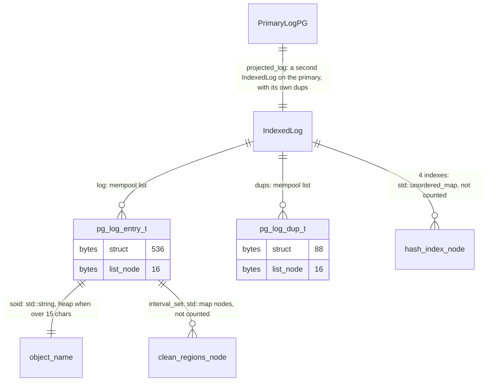

Take away: the mempool sees the list nodes; the strings, the
`clean_regions` tree nodes and the hash indexes are plain heap allocations
it does not see.

The parts, from the code and from `gdb` on the test build:

- The lists `log` and `dups` use the `osd_pglog` mempool allocator
  ([`pg_log_t`](https://github.com/ceph/ceph/blob/v21.3.0/src/osd/osd_types.h#L4733)).
  A `pg_log_entry_t` is 536 bytes, a `pg_log_dup_t` 88; a list node adds 16.
- The object name is a `std::string` inside `hobject_t`. An RBD data object
  name (`rbd_data.<image id>.<16 hex digits>`) is longer than the 15
  characters a string keeps inline, so it is a separate heap allocation.
- `clean_regions` is an `interval_set` on a `std::map`
  ([`ObjectCleanRegions`](https://github.com/ceph/ceph/blob/v21.3.0/src/osd/osd_types.h#L4318)):
  each interval is a tree node on the heap. One write in the middle of an
  object leaves two clean intervals, so two nodes.
- The PG keeps four hash indexes into the log: by object, by request id, by
  extra request id and for dups
  ([`PGLog.h`](https://github.com/ceph/ceph/blob/v21.3.0/src/osd/PGLog.h#L172)).
  They are `std::unordered_map`s, each built the first time something
  looks it up. The primary looks up every client write's request id to
  catch resent ops
  ([`get_request()`](https://github.com/ceph/ceph/blob/v21.3.0/src/osd/PGLog.h#L404)),
  which builds the request-id, extra-request-id and dup indexes.

About 250 of the 536 bytes of an entry are fields a plain write to a
replicated pool leaves empty
([`pg_log_entry_t`](https://github.com/ceph/ceph/blob/v21.3.0/src/osd/osd_types.h#L4525)):

| Field | Bytes | Used for |
|---|---|---|
| `mod_desc` | 40 | rollback information, EC pools |
| `snaps` | 32 | clone entries only |
| `extra_reqids` | 40 | ops that carry more than one client request |
| `extra_reqid_return_codes` | 64 | the same |
| `reverting_to` | 16 | `LOST_REVERT` entries |
| `op_returns` | 24 | ops that return data |
| `written_shards` | 32 | EC partial writes |
| total | 248 | |

`memopt.sh pglog` measures the real cost by removing the log in two steps
and charging the heap that comes back to what was removed:

1. Flush the memtables, take snapshot `a`.
2. Set `osd_pg_log_dups_tracked` to 10, write for 30 s, flush, take `b`.
   The dups go.
3. Set `osd_target_pg_log_entries_per_osd` to 2000 and
   `osd_min_pg_log_entries` to 10, write for 30 s, flush, take `c`. The
   entries go.
4. The `osd_pglog` mempool reports items and bytes. With a node of 552 bytes
   per entry and 104 per dup, the two numbers say how many entries and dups
   each step removed. The drop in tcmalloc's in-use bytes, minus the change
   in the caches and the other mempools, is the real heap freed. Two steps
   give two equations for two unknowns: the real bytes per entry and per
   dup.

The entry counts this gives match the PGs' `log_size` statistics exactly.

| OSD | PGs | Entries at `a` | Per entry: mempool / real | Per dup: mempool / real |
|---|---|---|---|---|
| osd.0 | 108 | 127725 | 552 / 782 B | 104 / 179 B |
| osd.1 | 106 | 126654 | 552 / 789 B | 104 / 175 B |
| osd.2 | 153 | 163847 | 552 / 782 B | 104 / 178 B |
| osd.3 | 147 | 154820 | 552 / 787 B | 104 / 181 B |

An entry costs 42 % more than the mempool reports, a dup 70 % more. The
RAM-disk run gave the same 783–788 bytes per entry.

What the pg log costs per OSD at the default target (4 GiB), estimated from
these per-item costs. Entries are 300000 per OSD; a PG makes dups only when
its share of entries is below `osd_pg_log_dups_tracked` (3000):

| PGs per OSD | Entries per PG | Dups | Mempool says | Real |
|---|---|---|---|---|
| 100 | 3000 | none | 158 MiB | 225 MiB |
| 128 | 2343 | 384000 | 196 MiB | 290 MiB |
| 200 | 1500 | 600000 | 217 MiB | 326 MiB |
| 300 | 1000 | 900000 | 247 MiB | 377 MiB |

The pg log also behaves as a high-water mark. Trimming the whole log freed
126–171 MiB of in-use heap, but `mapped` fell only 30–50 MiB; tcmalloc's
central free list grew by 95–119 MiB.

This flowchart shows why freed pg log memory stays mapped.

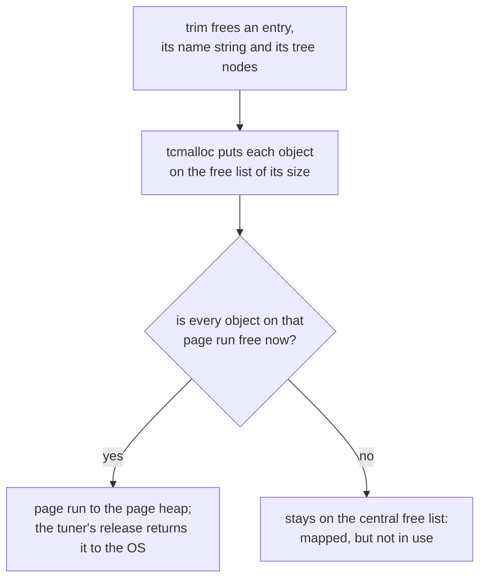

Take away: the entries were allocated one by one during the writes, between
other objects, so most page runs still hold something live and the freed
bytes stay mapped.

The tuner calls `ceph_heap_release_free_memory()` every round
([`tune_memory()`](https://github.com/ceph/ceph/blob/v21.3.0/src/common/PriorityCache.cc#L125)),
but that only returns free page runs. The OSD reuses free-list memory for
new objects of the same size, so it is not lost; it just does not go back
to the OS, and the peak pg log stays in `mapped`.

The mempool counts more dups than the PGs report: by its item count osd.0
held about 220000 at `a`, while the `log_dups_size` statistics of its 100
written PGs add up to 150000. The rest is a second copy on the primary.

This sequence diagram shows where it comes from.

```mermaid
sequenceDiagram
    participant C as client write
    participant PL as projected_log (primary only)
    participant L as pg log
    C->>PL: issue_repop(): add(entry)
    Note over C: the write commits
    C->>PL: log_operation(): trim(entry.version)
    Note over PL: IndexedLog::trim(): the trimmed entry becomes a dup;<br/>the list is cut back at osd_pg_log_dups_tracked
    C->>L: log_operation(): append_log(entry, trim_to)
```

Take away: the primary's projected log is trimmed by the same function as
the pg log, so it keeps its own dup list, up to `osd_pg_log_dups_tracked`
per primary PG, until the OSD stops being primary.

The pieces:

- `projected_log` is an `IndexedLog` in every PG
  ([`PG.h`](https://github.com/ceph/ceph/blob/v21.3.0/src/osd/PG.h#L1335)).
  The primary uses it to recognise a resent request whose entry has not
  committed yet: each client write adds its entry
  ([`issue_repop()`](https://github.com/ceph/ceph/blob/v21.3.0/src/osd/PrimaryLogPG.cc#L11721)),
  and [`check_in_progress_op()`](https://github.com/ceph/ceph/blob/v21.3.0/src/osd/PG.cc#L791)
  looks there first, then in the pg log.
- When the write commits,
  [`log_operation()`](https://github.com/ceph/ceph/blob/v21.3.0/src/osd/PrimaryLogPG.h#L537)
  trims `projected_log` to that version with
  [`IndexedLog::trim()`](https://github.com/ceph/ceph/blob/v21.3.0/src/osd/PGLog.cc#L56),
  the same function the pg log uses: each trimmed entry becomes a dup (L84)
  and the list is only cut back at `osd_pg_log_dups_tracked` (L142). The
  window test, within `osd_pg_log_dups_tracked` versions of the head, always
  passes here, since the projected log holds only in-flight entries.
- The list goes away in
  [`clear_primary_state()`](https://github.com/ceph/ceph/blob/v21.3.0/src/osd/PG.cc#L357)
  and at restart. A PG that stays primary keeps it.
- Every request in it is also in the pg log, which `check_in_progress_op()`
  checks next, so the copy answers nothing the pg log would not.

The numbers fit: osd.0 was primary for 52 of its 108 PGs, 48 of them at
the 1500 cap, so about 72000 extra dups; 150000 + 72000 is the 220000
counted. On `main` with the default 3000 (§15.9) the mempool's dups per PG
climbed to 3600–4100 and fell by 1200–1500 at every OSD restart, when the
projected logs start empty. A direct check there: after 15 minutes of
writes on a new cluster each OSD's mempool held 77000–130000 more dups
than the logs of its PG instances, within 0.5 % of Σ min(writes, 3000)
over its primary PGs; with the flag below the difference is zero on every
OSD.

The cost is up to `osd_pg_log_dups_tracked` × 178 bytes per primary PG,
0.5 MiB at 3000: 20–50 MiB per OSD at 43–100 primary PGs. The fix is a flag
on `IndexedLog::trim()`, so that the projected log drops trimmed entries
instead of keeping dups:

```cpp
// PrimaryLogPG::log_operation(): the trimmed entries go into the pg log
// below, which keeps their dups
projected_log.trim(cct, last->version, nullptr, nullptr, nullptr, /*keep_dups=*/false);
```

The projected log dates from 2016 (ccbc90dd736) and dups from 2017
(2c856473990); nothing kept the one out of the other.

### 15.6 What was ruled out

These were checked and are not worth a change:

| Suspect | Check | Result |
|---|---|---|
| tcmalloc's per-thread caches | `TCMALLOC_MAX_TOTAL_THREAD_CACHE_BYTES=134217728`, which the packages ([`etc/sysconfig/ceph`](https://github.com/ceph/ceph/blob/v21.3.0/etc/sysconfig/ceph#L7)) and cephadm set, against the library default; 8 jobs of 4K writes, then reads (`memopt.sh tcmalloc`) | at most 5–9 MiB per OSD with it, 5–14 MiB without: the OSD's 58–76 threads never fill even the default |
| BlueFS reads in the page cache | `file` in each OSD cgroup's `memory.stat` (`bluefs_buffered_io` is true by default) | 23–26 MiB per OSD |
| Object contexts holding onode buffers | code: onode attributes are decoded with `begin_deep()` ([`BlueStore.cc`](https://github.com/ceph/ceph/blob/v21.3.0/src/os/bluestore/BlueStore.cc#L4928)), so they are copies | nothing pinned |
| Pg log growth while PGs are degraded | code: with the `pglog_hardlimit` OSD map flag the log is trimmed to its target even when degraded ([`PeeringState.h`](https://github.com/ceph/ceph/blob/v21.3.0/src/osd/PeeringState.h#L2025)) | bounded |


### 15.7 Next steps

This graph shows the order I suggest.

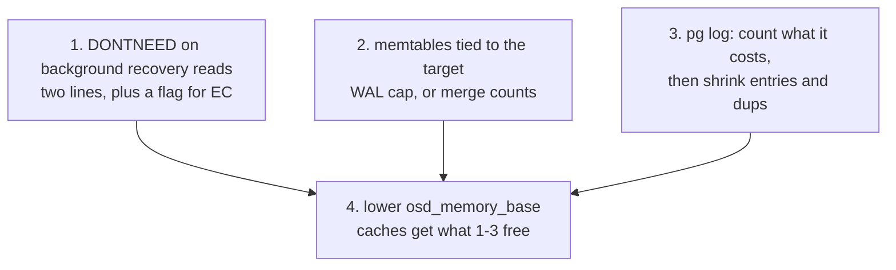

Take away: 1 is ready now; 2 needs a latency test on fast disks; 3 is code
work; only after them can the fixed reserve shrink.

1. **Mark background recovery reads DONTNEED.** Set `cache_dont_need` in
   `recover_replicas()` and `recover_backfill()`, and pass
   `CEPH_OSD_OP_FLAG_FADVISE_DONTNEED` in the EC recovery `read_request_t`.
   Effect measured here: 160–290 MiB less cold data on each source OSD
   after a recovery, and 0–55 instead of 59–170 MiB of misses when the hot
   set is read again. No cost was found; pulls already read this way.
   The A/B with the patch itself is in §15.9; before posting it, the same
   on an EC pool.
2. **Tie the memtables to the target.** The measurements give two knobs:
   - `max_total_wal_size`: the memtable peak follows it (§15.3.3). Scaling
     it linearly with the target instead of by the square root, as #72964
     does, gives 512 MiB of WAL at 2 GiB. It costs SST writes, and the open
     question is write tail latency: measure p99.9 on NVMe at 256–512 MiB.
   - `min_write_buffer_number_to_merge`: at 2 for every column family the
     peak was 83–114 MiB, lower than any WAL cap tried, at about the flush
     cost of a 256 MiB cap (§15.3.6). It needs a reshard on existing OSDs,
     and a longer run that includes compaction.

   A WriteBufferManager is not a knob with Ceph's merge counts (§15.3.5).
   RocksDB also never flushes on time, so memtables stay at their peak
   after a write burst; an OSD could flush them once its writes go quiet.
   That is an idea, not measured here.
3. **Make the pg log's cost visible, then smaller.** In order:
   - Count the object-name strings, the `clean_regions` tree nodes and the
     four hash indexes in the `osd_pglog` mempool, so `dump_mempools`
     stops reporting 42–70 % less than the real cost.
   - Move the 248 bytes of rarely used fields (§15.5) out of
     `pg_log_entry_t` into an allocation made only when one is set, and
     keep up to two `clean_regions` intervals inline, which covers one
     write. By arithmetic, not measurement, that takes an entry from about
     785 to about 500 bytes.
   - Stop the projected log from keeping dups: one flag (§15.5, A/B in
     §15.9). Up to 0.5 MiB per primary PG, in effect at once, nothing to
     deploy.
   - Bound dups per OSD rather than per PG. Today 3000 per PG means 384000
     dups at 128 PGs and 900000 at 300 (§15.5).
4. **Then lower `osd_memory_base`.** After a compaction the memory outside
   the caches was 206–267 MiB per OSD here, including the pg log and the
   free lists. With 1–3 in place, §14.4's base of 256–384 MiB at a 2 GiB
   target becomes safe to test.

Not measured, and worth a look: BlueStore's write throttles
(`bluestore_throttle_bytes` 64 MiB plus `bluestore_throttle_deferred_bytes`
128 MiB) are not scaled by #72964.

### 15.8 Takeaways

- At a 2 GiB target the memtables are the largest thing outside the
  caches: 0.45–0.8 GiB after a write burst, bounded only by the WAL cap,
  and still there when the writes stop. The tuner can only answer by
  shrinking the caches.
- Two knobs bound them: the WAL cap (the peak is about 1.1 times a 128–256
  MiB cap) and the merge count (2 held the peak to 83–114 MiB, for less
  flushing than a 128 MiB cap). A WriteBufferManager does nothing with
  Ceph's merge counts.
- Recovery reads have been meant to skip the cache since 2015. Two lines
  finish the job and keep 160–290 MiB of each source OSD's cache for data
  that is read again.
- `dump_mempools` under-reports the pg log: budget 785 bytes per entry and
  178 per dup, not 552 and 104. Freed pg log memory stays mapped.
- The primary keeps a second, unused copy of up to `osd_pg_log_dups_tracked`
  dups per PG in its projected log: 0.5 MiB per primary PG, gone with one
  flag.
- `bdev_enable_discard` without `bdev_async_discard_threads` is a
  synchronous `BLKDISCARD` per transaction on the thread that finishes
  every transaction: at 1–3 ms per discard an OSD tops out at 370–500
  transactions/s. The default is off; if on, set the threads.
- HDD OSDs need their own look: deferred writes put up to 512 MiB of data
  that is already on its way to the disk into the `L` memtables.

### 15.9 The same on upstream `main`

The build above carries two open PRs. To see what in §15 depends on them,
every experiment was run again on plain `main` (dc7b747c37c, 2026-10-28)
with the same VM and script. Two things differ. Without #72964 the
defaults apply: a 1 GiB WAL cap, 300000 log entries per OSD and 3000 dups
per PG. And osd.3 runs on vdc instead of sdb: virtio, rotational, so still
BlueStore's HDD mode, but 9300 raw 4K writes/s against sdb's 822, so sdb
no longer bounds the cluster (what does: the write-rate note at the end;
`main` also lacks #73018, which only matters for the recovery arm, below).

**Memtables** (§15.3.3, §15.3.6). Mean / max in MiB for the SSD OSDs and for
osd.3; "flushed" is bytes per transaction written by the flushes.

| Arm | §15, WAL cap 724 MiB: IOPS, SSD OSDs, osd.3, flushed | `main`, WAL cap 1 GiB: IOPS, SSD OSDs, osd.3, flushed |
|---|---|---|
| default | 699; 220–229 / 456–469; 365 / 719; 45–78 / 117 | 630; 180–194 / 495–564; 353 / 893; 99–113 / 86 |
| wal256 | 746; 141–146 / 268–294; 143 / 287; 87–147 / 197 | 917; 107–135 / 263–289; 101 / 240; 274–471 / 599 |
| wal128 | 780; 62–79 / 135–148; 66 / 135; 153–197 / 282 | 942; 41–65 / 120–145; 43 / 136; 566–758 / 1429 |
| wbm256 | 730; 265–290 / 449–482; 411 / 800; 9–66 / 108 | 1135; 333–398 / 686–758; 446 / 868; 109–122 / 290 |
| merge2, new cluster | 315; peak 83–96; 114; 95–134 / 253 | 601; peak 83–108; 131; 180–196 / 174 |
| control, new cluster | 341; peak 362–378; 768, still growing at 20 min | 686; peak 533–610; 785 at 20 min |

The peaks of the two new clusters add the pg log's growth back, as in
§15.3.6. What holds: the peak follows the WAL cap (about 0.5× at 1 GiB on
the SSD OSDs, 1.1× at 256 and 128 MiB), osd.3's `L` family takes it to
0.9× of the cap, the WriteBufferManager never fires (686–868 MiB against
its 256 MiB), and merge count 2 holds the memtables under 135 MiB. What
differs: the 1 GiB cap costs 40–110 MiB more per SSD OSD and 170 MiB more
on osd.3 than the 724 MiB of #72964; and at the same cap of 256 or 128 MiB
the flushes wrote 3–5× more per transaction. The one input to RocksDB that
changed is the pg log: twice the entries and dups in the `P` family, which
keeps 29–58 % of what it flushes. I did not take that apart.

Order matters at the 1 GiB cap. Four 20-minute passes on one cluster and
image, at 1 GiB, 1 GiB, 256 MiB and 1 GiB, peaked at 447–653, 584–736,
270–279 and 707–888 MiB (596, 1190, 1116 and 1133 IOPS; peaks corrected
for the pg log as in §15.3.6). A 256 MiB cap holds whatever came before;
at 1 GiB the peak depends on what the pass writes, and the `default` row
above, a first pass, is its low end: without the discards of the write-rate
note below, a first pass at 1 GiB ran at 1226–1318 IOPS and peaked at
500–634 / 732–786 MiB.

**Pg log** (§15.5). 779–786 bytes per entry and 175–178 per dup on `main`,
against 782–789 and 175–181. At the default target each OSD held
248000–317000 entries. An offline dump of osd.0 after a 20-minute write run
on a new cluster (`ceph-objectstore-tool --op log` on its 109 PGs) shows no
PG above 3000 dups on disk, primary or replica: primaries, whose logs sit at
the 2770-entry target, hold a median of 400 dups; replicas of the OSDs with
more PGs, and so shorter logs, hold a median of 1100. In memory, by the
mempool's count, the dups per PG instance climbed to 3600–4100 during the
write arms and fell by 1200–1500 at every OSD restart: the primaries'
projected logs of §15.5, which start empty. The A/B of §15.5's flag, 15
minutes of writes on a new cluster each: stock, the mempool's dups
exceeded the PG instances' logs by 77000–130000 per OSD (14–22 MiB at
178 bytes), within 0.5 % of Σ min(writes, 3000) over the OSD's primaries;
patched, by zero on all four OSDs.

**Recovery** (§15.4). Without #73018 the data cache holds less, so the
1 GiB hot set never fit: 38–68 % hits before recovery against 96–98 % in
§15. The cache-side numbers are the same picture, and a third arm runs the
two-line patch of §15.4 itself instead of the config switch. Source OSDs
1–3:

| | Stock | Recovery reads not cached (config) | `cache_dont_need` patch |
|---|---|---|---|
| Data cache before recovery | 111–215 MiB | 107–232 MiB | 130–240 MiB |
| Data cache after recovery | 174–301 MiB (+63 to +86) | 107–226 MiB (−6 to 0) | 128–207 MiB (−33 to 0) |
| RSS after recovery | 325–579 MiB | 244–429 MiB | 259–379 MiB |
| Hot-set hit ratio, before → after | 55–68 % → 54–61 % | 54–68 % → 53–68 % | 38–64 % → 39–71 % |

The patch behaves as the config switch did: no recovered data stays in the
source caches, and the hot set is read as well after the recovery as
before.

**tcmalloc** (§15.6). The thread caches peaked at 6–10 MiB per OSD at the
library default and 9–16 MiB at 128 MiB, against 5–14 and 5–9 in §15.
Still nothing to gain.

**Write rate.** Every new cluster wrote its first pass after the fill at
596–686 IOPS; later passes over the same image ran at 917–1190, on both
builds far below the SSDs. mclock is not it: osd.3's startup bench
(5500–9150 IOPS) falls outside the 50–500 IOPS window for a rotational
disk, so its capacity stays at the 315 fallback, but the balanced profile
does not cap client ops, and a cluster with that capacity set to 5000
wrote its first pass at 650. RocksDB is not it: `kv_sync_lat` stayed at
1–5 ms. The counters point at the kv_finalize thread, which finishes every
transaction: on one OSD per run its batch latency (`kv_final_lat`) ran at
70–800 ms, and every transaction's `state_kv_commiting_lat` with it. It
was discarding. `memopt.sh` sets `bdev_enable_discard = true` to keep the
VM's thin disks small, and with the default `bdev_async_discard_threads =
0`,
[`_txc_release_alloc`](https://github.com/ceph/ceph/blob/dc7b747c37c/src/os/bluestore/BlueStore.cc#L11523)
→ [`KernelDevice::try_discard`](https://github.com/ceph/ceph/blob/dc7b747c37c/src/blk/kernel/KernelDevice.cc#L934)
issues one synchronous `BLKDISCARD` per transaction (each 4K overwrite
frees the 4K it replaces) from that thread. On c28's virtual disks a
discard takes 1–2.7 ms, so the OSD with the slowest one tops out at
370–500 transactions/s: sda at 2.7 ms on the first pass after a fill (96 %
busy at 357 txc/s, the cluster at 600 IOPS), 1.0 ms afterwards; nvme0n1 at
2 ms throughout, the limit once sda is cheap (92 % busy at 484 txc/s, the
cluster at 1100–1190). Why sda's discards get cheaper after the first pass
I did not pursue. On the §15 build the same discards cost 0.4–1.1 ms and
sdb capped the cluster first: osd.3's finalize batches of 290–720 ms there
were `deferred_try_submit` waiting on the disk. The A/B, a new cluster
and a first pass each: discard off, 1226 IOPS; discard on with one async
thread, 1318; finalize batches of 0.1–0.5 ms on every OSD, and the thread
kept up (646000 discards on osd.0 in 20 minutes, used space unchanged).
The upstream default is off; with it on, set the threads (a pool since
[PR #55469](https://github.com/ceph/ceph/pull/55469), 2024, after
ceph-users reports of exactly this cost), and know that freed space
reaches the allocator only when its discard completes.

## Glossary

| Term | Meaning here |
|---|---|
| OSD | Object Storage Daemon, the Ceph process that owns one disk. |
| BlueStore | The OSD's storage backend. It writes object data to a raw block device and all metadata to RocksDB. |
| RocksDB | An embedded key-value database. BlueStore keeps object metadata, allocation state and more in it. |
| column family | A separate key space inside one RocksDB database. BlueStore uses several; `O` holds onodes. |
| block cache | RocksDB's in-memory cache of file blocks. Ceph's version is `BinnedLRUCache`. |
| onode | BlueStore's in-memory record of one object: its extents, blobs, checksums and attributes. |
| blob | One allocated region on disk that an onode's extents point to. |
| buffer | A cached range of one object's data in BlueStore's data cache. |
| shard | One of N independent slices of a cache, each with its own lock and limit; a collection maps to one shard. |
| collection | The set of objects of one placement group (PG) on one OSD. |
| LRU | Least recently used: evict the entry that went longest without being touched. |
| 2Q | A cache with a probation list (`warm_in`), a ghost list (`warm_out`) and a main list (`hot`), so one-time reads do not evict repeatedly used data. |
| age bin | A counter of bytes (or onodes) last touched during one interval; bins shift every `bluestore_cache_age_bin_interval`. |
| priority (PRI0 to PRI11) | The tuner's twelve levels. PRI0 is the RocksDB caches' high-priority pool plus a 64 MiB minimum; PRI1 to PRI10 are age ranges; PRI11 (`LAST`) is everything older. |
| PriorityCache | The tuner (`src/common/PriorityCache.cc`) that measures mapped memory and splits a total among caches by priority and ratio. |
| mapped memory | Memory the allocator holds from the kernel: `generic.heap_size − tcmalloc.pageheap_unmapped_bytes`. |
| tcmalloc | The memory allocator Ceph is built with. The tuner needs it for its statistics and to release free pages. |
| mempool | A named allocation pool with byte and item counters; `dump_mempools` prints them. |
| chunk | The rounding unit for a committed cache size: the total rounded to a power of two over 256, clamped to 4 to 64 MiB. |
| cephadm | Ceph's orchestrator for container deployments; it can set `osd_memory_target` per host. |
| perf counter | A named statistic a daemon exposes through `perf dump`. |
| uprobe | A kernel breakpoint on a user-space function. perf and bpftrace use it to record each call, and perf can unwind the call stack from DWARF when the binary has no frame pointers. |
| memtable | RocksDB's in-memory sorted table of recent writes, one active per column family. It keeps every version of a key until a flush. |
| WAL | RocksDB's write-ahead log: each write batch is appended to it on disk first. A WAL file is deleted once every column family has flushed the keys in it. |
| SST file | RocksDB's sorted, read-only table file on disk. |
| flush | Writing memtables out as one SST file, keeping only the newest version of each key, and freeing their memory. |
| compaction | RocksDB merging SST files into fewer, larger ones; a manual compaction flushes the memtables first. |
| WriteBufferManager | RocksDB's optional memory budget for the memtables of all column families (`db_write_buffer_size`). |
| deferred write | A small write that BlueStore first stores in RocksDB (column family `L`) and copies to the data disk later. On an HDD OSD this applies to writes below 64 KiB. |
| pg log | Each PG's list of recent writes. It lets a PG copy catch up by replaying entries, and it detects resent client requests. |
| dup | A trimmed pg log entry reduced to request id, version and return code, kept to detect resent requests. |
| recovery, backfill | Bringing a PG copy up to date from the log (recovery) or by copying every object (backfill). |
| push, pull | The primary sends an object to another OSD (push), or fetches one it is missing (pull). |
| DONTNEED | `CEPH_OSD_OP_FLAG_FADVISE_DONTNEED`, a read or write flag that tells BlueStore not to keep the data in its cache. |
| central free list | tcmalloc's per-size pool of freed small objects. Memory goes back to the OS only when every object on a page run is free. |
| krbd | The Linux kernel's RBD client; it shows an RBD image as a block device. |
| vstart | Ceph's script that starts a development cluster from a build tree. |
| cgroup | A Linux control group; here each OSD runs in one with a memory limit. |

## Code references

All links point at tag `v21.3.0` of `ceph/ceph`; RocksDB links point at the
`ceph/rocksdb` commit that v21.3.0 pins (24ea358, RocksDB 7.9.2).

| Symbol | Role |
|---|---|
| [`MempoolThread::entry()`](https://github.com/ceph/ceph/blob/v21.3.0/src/os/bluestore/BlueStore.cc#L5548) | The loop: age bins, balance, tune, resize, sleep |
| [`MempoolThread::_resize_shards()`](https://github.com/ceph/ceph/blob/v21.3.0/src/os/bluestore/BlueStore.cc#L5699) | Committed bytes to per-shard limits |
| [`MempoolThread::_update_cache_settings()`](https://github.com/ceph/ceph/blob/v21.3.0/src/os/bluestore/BlueStore.cc#L5765) | Runtime min/max/target recompute |
| [`BlueStore::_set_cache_sizes()`](https://github.com/ceph/ceph/blob/v21.3.0/src/os/bluestore/BlueStore.cc#L6155) | Reads options at mount, validates ratios |
| [`BlueStore::_update_osd_memory_options()`](https://github.com/ceph/ceph/blob/v21.3.0/src/os/bluestore/BlueStore.cc#L6122) | Flags a config change for the thread |
| [`BlueStore::set_cache_shards()`](https://github.com/ceph/ceph/blob/v21.3.0/src/os/bluestore/BlueStore.cc#L9405) | Creates onode and buffer shards |
| [`MempoolCache`, `MetaCache`, `DataCache`](https://github.com/ceph/ceph/blob/v21.3.0/src/os/bluestore/BlueStore.h#L2606) | BlueStore's two tuner participants |
| [`CacheShard::set_max()` / `_trim_some()`](https://github.com/ceph/ceph/blob/v21.3.0/src/os/bluestore/BlueStore.h#L1537) | Limit and gradual eviction per shard |
| [`LruOnodeCacheShard`](https://github.com/ceph/ceph/blob/v21.3.0/src/os/bluestore/BlueStore.cc#L1093) | Onode LRU with pinning |
| [`TwoQBufferCacheShard`](https://github.com/ceph/ceph/blob/v21.3.0/src/os/bluestore/BlueStore.cc#L1343) | Data 2Q cache |
| [`PriorityCache::Manager::tune_memory()`](https://github.com/ceph/ceph/blob/v21.3.0/src/common/PriorityCache.cc#L119) | Measure mapped memory, move the total |
| [`PriorityCache::Manager::balance()`](https://github.com/ceph/ceph/blob/v21.3.0/src/common/PriorityCache.cc#L275) | Split the total by priority |
| [`PriorityCache::get_chunk()`](https://github.com/ceph/ceph/blob/v21.3.0/src/common/PriorityCache.cc#L33) | Commit rounding and 64 MiB headroom |
| [`BinnedLRUCache::commit_cache_size()`](https://github.com/ceph/ceph/blob/v21.3.0/src/kv/rocksdb_cache/BinnedLRUCache.cc#L803) | Resize the RocksDB block cache |
| [`RocksDBStore::create_block_cache()`](https://github.com/ceph/ceph/blob/v21.3.0/src/kv/RocksDBStore.cc#L468) | Block cache by `rocksdb_cache_type` |
| [`md_config_t::parse_env()`](https://github.com/ceph/ceph/blob/v21.3.0/src/common/config.cc#L475) | Container memory limit to target |
| [`MemoryAutotuner.tune()`](https://github.com/ceph/ceph/blob/v21.3.0/src/pybind/mgr/cephadm/autotune.py#L32) | cephadm per-host target |
| [`DEFINE_MEMORY_POOLS_HELPER`](https://github.com/ceph/ceph/blob/v21.3.0/src/include/mempool.h#L154) | The mempool list |
| [`Collection::get_onode()`](https://github.com/ceph/ceph/blob/v21.3.0/src/os/bluestore/BlueStore.cc#L5388) | Onode miss: `create_decode()` (L4953), then `add_onode()` |
| [`OnodeSpace::add_onode()`](https://github.com/ceph/ceph/blob/v21.3.0/src/os/bluestore/BlueStore.cc#L2064) | Insert into the shard, then `_trim_some()` inline |
| [`Onode::put()`](https://github.com/ceph/ceph/blob/v21.3.0/src/os/bluestore/BlueStore.cc#L4917) | Last reference drops: `delete`, with the onode's buffers |
| [`_reap_collections()`](https://github.com/ceph/ceph/blob/v21.3.0/src/os/bluestore/BlueStore.cc#L12537) | `OnodeSpace::clear()` when a collection is removed |
| [`BufferSpace::did_read()` / `write()`](https://github.com/ceph/ceph/blob/v21.3.0/src/os/bluestore/BlueStore.h#L514) | `_discard()`, `_add_buffer()`, `cache->_trim()` |
| [`BufferSpace::_discard()`](https://github.com/ceph/ceph/blob/v21.3.0/src/os/bluestore/BlueStore.cc#L1781) / [`__rm_buffer()`](https://github.com/ceph/ceph/blob/v21.3.0/src/os/bluestore/BlueStore.cc#L1752) | Buffer freed by overlap or by trim |
| [`BlueStore::_collection_list()`](https://github.com/ceph/ceph/blob/v21.3.0/src/os/bluestore/BlueStore.cc#L13897) | RocksDB iterator over the onode column family (backfill scans) |
| [`ShardedCache::Insert()`](https://github.com/ceph/ceph/blob/v21.3.0/src/kv/rocksdb_cache/ShardedCache.cc#L46) | The RocksDB cache entry point BlueStore's reads reach |
| [`BinnedLRUCacheShard::Insert()`](https://github.com/ceph/ceph/blob/v21.3.0/src/kv/rocksdb_cache/BinnedLRUCache.cc#L422) / [`EvictFromLRU()`](https://github.com/ceph/ceph/blob/v21.3.0/src/kv/rocksdb_cache/BinnedLRUCache.cc#L277) / [`FreeDeleted()`](https://github.com/ceph/ceph/blob/v21.3.0/src/kv/rocksdb_cache/BinnedLRUCache.cc#L296) / [`SetCapacity()`](https://github.com/ceph/ceph/blob/v21.3.0/src/kv/rocksdb_cache/BinnedLRUCache.cc#L307) | Insert with eviction; the tuner's resize |
| [`Manager::tune_memory()`](https://github.com/ceph/ceph/blob/v21.3.0/src/common/PriorityCache.cc#L119) | Moves the cache budget toward `target − mapped`, between `min` and `max` (§5, §14.3) |
| [`get_cgroup_memory_limit()`](https://github.com/ceph/ceph/blob/v21.3.0/src/common/util.cc#L173) / [`POD_MEMORY_LIMIT` in `config.cc`](https://github.com/ceph/ceph/blob/v21.3.0/src/common/config.cc#L553) | Where a container limit becomes the default target (§14.3) |
| [`RocksDBStore::submit_common()`](https://github.com/ceph/ceph/blob/v21.3.0/src/kv/RocksDBStore.cc#L1607) | One BlueStore transaction, one RocksDB write batch (§15.3) |
| [`RocksDBStore::verify_sharding()`](https://github.com/ceph/ceph/blob/v21.3.0/src/kv/RocksDBStore.cc#L1034) | Column-family options come from the definition stored at mkfs (§15.3) |
| [`WriteBufferManager::ShouldFlush()`](https://github.com/ceph/rocksdb/blob/24ea35870fe9b3ba15285ec8746ba97ed5d67ff3/include/rocksdb/write_buffer_manager.h#L94) | Memtable budget test: active memtables only (§15.3.5) |
| [`DBImpl::SwitchWAL()`](https://github.com/ceph/rocksdb/blob/24ea35870fe9b3ba15285ec8746ba97ed5d67ff3/db/db_impl/db_impl_write.cc#L1559) / [`MemTableList::IsFlushPending()`](https://github.com/ceph/rocksdb/blob/24ea35870fe9b3ba15285ec8746ba97ed5d67ff3/db/memtable_list.cc#L370) | The two automatic flush triggers (§15.3.2) |
| [`PrimaryLogPG::recover_replicas()`](https://github.com/ceph/ceph/blob/v21.3.0/src/osd/PrimaryLogPG.cc#L13984) / [`recover_backfill()`](https://github.com/ceph/ceph/blob/v21.3.0/src/osd/PrimaryLogPG.cc#L14152) | Background recovery; never sets `cache_dont_need` (§15.4) |
| [`ReplicatedBackend::start_pushes()`](https://github.com/ceph/ceph/blob/v21.3.0/src/osd/ReplicatedBackend.cc#L2611) / [`build_push_op()`](https://github.com/ceph/ceph/blob/v21.3.0/src/osd/ReplicatedBackend.cc#L2238) | Push read with or without DONTNEED (§15.4) |
| [`BlueStore::_do_readv()`](https://github.com/ceph/ceph/blob/v21.3.0/src/os/bluestore/BlueStore.cc#L13562) | Buffered unless DONTNEED or NOCACHE (§15.4) |
| [`ECBackend::handle_sub_read()`](https://github.com/ceph/ceph/blob/v21.3.0/src/osd/ECBackend.cc#L517) | EC shard read with the request's flags (§15.4) |
| [`pg_log_entry_t`](https://github.com/ceph/ceph/blob/v21.3.0/src/osd/osd_types.h#L4525) / [`pg_log_t`](https://github.com/ceph/ceph/blob/v21.3.0/src/osd/osd_types.h#L4733) | Log entry and the mempool lists (§15.5) |
| [`PGLog::IndexedLog`](https://github.com/ceph/ceph/blob/v21.3.0/src/osd/PGLog.h#L172) / [`get_request()`](https://github.com/ceph/ceph/blob/v21.3.0/src/osd/PGLog.h#L404) | Hash indexes outside the mempool, built on lookup (§15.5) |
| [`OSDService::get_target_pg_log_entries()`](https://github.com/ceph/ceph/blob/v21.3.0/src/osd/OSD.cc#L9750) / [`IndexedLog::trim()`](https://github.com/ceph/ceph/blob/v21.3.0/src/osd/PGLog.cc#L56) | Entries per PG; entries to dups (§15.5) |


