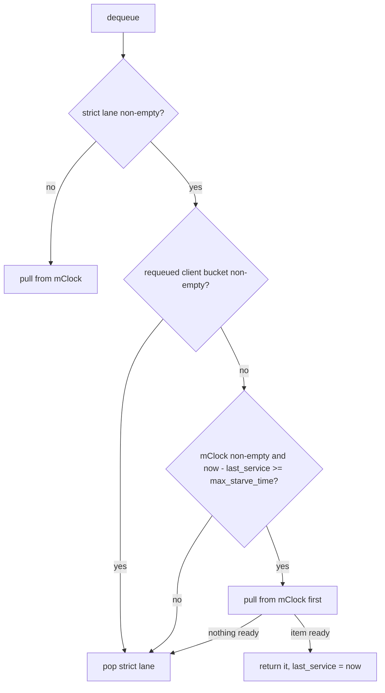
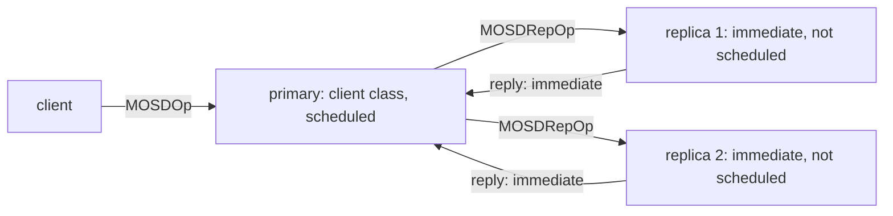
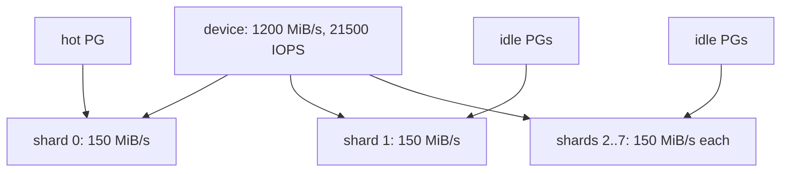

* TOC
{:toc}

A code review of the mClock op scheduler in the Ceph OSD, on the main
branch at
[`dc7b747c37c4`](https://github.com/ceph/ceph/commit/dc7b747c37c466b46bfd90bd7b940b8cdf3c8478)
(v21.3.0 plus 4849 commits, 2026-10-27). Two findings matter: the new
starvation guard measures the wrong interval, so a sparse background
stream runs ahead of replica work instead of behind it; and config
changes race with the shard threads without any lock. The biggest
optimization is structural: two thirds of the write work on a replicated
pool never passes through mClock at all.

This post assumes the design walk-through in
[Ceph OSD Analysis §6](),
which explains the two lanes, the classes, the tags and the per-shard
layout at v21.3.0. Here the links go to main, not to the tag, because the
code reviewed is newer: it includes the 2026 fixes for deep-scrub
starvation (tracker 69078), the requeued-item bucket, EC read classes,
perf counters and the profile retune.

## 1. What was reviewed, and how

| Part | Files | Role |
|---|---|---|
| The scheduler | [`mClockScheduler.{h,cc}`](https://github.com/ceph/ceph/blob/dc7b747c37c466b46bfd90bd7b940b8cdf3c8478/src/osd/scheduler/mClockScheduler.cc) | the two lanes: a strict map and a dmclock queue |
| The config layer | [`mclock_common.{h,cc}`](https://github.com/ceph/ceph/blob/dc7b747c37c466b46bfd90bd7b940b8cdf3c8478/src/common/mclock_common.cc) | profiles, capacity, cost per IO, config observer |
| The dmclock core | [`dmclock_server.h`](https://github.com/ceph/ceph/blob/dc7b747c37c466b46bfd90bd7b940b8cdf3c8478/src/dmclock/src/dmclock_server.h) | tags, three heaps, `do_next_request` |
| The OSD side | [`OSD.cc`](https://github.com/ceph/ceph/blob/dc7b747c37c466b46bfd90bd7b940b8cdf3c8478/src/osd/OSD.cc), [`OpSchedulerItem.h`](https://github.com/ceph/ceph/blob/dc7b747c37c466b46bfd90bd7b940b8cdf3c8478/src/osd/scheduler/OpSchedulerItem.h) | producers, classes, the worker loop, the boot benchmark |

Method: read the four parts end to end, then check each suspicion
against the code with `path:line`, the unit tests and the git history.
Where a claim is inferred rather than read, the text says so. The
trackers were searched for prior reports; none was found for the bugs
below.

## 2. Bugs

| # | Severity | Where | One line |
|---|---|---|---|
| 1 | Important | `mClockScheduler.h:95-103` | the starvation guard measures time since the last mClock pull, not how long an item has waited |
| 2 | Important | `mclock_common.cc:451`, `dmclock_server.h:112` | config changes rewrite the class parameters while shard threads read them, with no lock in common |
| 3 | Low | `osd.yaml.in:1132` | a custom profile with weight 0 and reservation 0 makes one class unschedulable and spins a thread |
| 4 | Low | `dmclock_util.h:42`, `OSD.cc:11238` | tags and the worker's wait use the wall clock, so a backward clock step disables reservations for that long |
| 5 | Low | `OpSchedulerItem.h:88` | cost is `int`; a deep-scrub chunk near 2 GiB wraps negative and is clamped to the cheapest cost |

### 2.1 The starvation guard measures the wrong interval

**Background.** Items of the immediate class and items with priority
at or above the cutoff go to a strict lane that is drained before mClock
sees anything. Under heavy client load on a replicated or EC pool, that
lane is never empty: every client write produces replica ops, EC sub-ops
and replies, and all of them are immediate. Tracker
[69078](https://tracker.ceph.com/issues/69078) reported deep scrubs that
took days because of this. The fix
([commit 5847d110024](https://github.com/ceph/ceph/commit/5847d1100248b9c4880dbdda9f3cd9ec70801e36))
adds a guard: if the mClock queue has been unserviced for
`max_starve_time` (50 ms on flash, 250 ms on rotational by default)
while the strict lane keeps refilling, pull one mClock item first.

**The defect.** The guard compares the clock against
[`last_mclock_service_time`](https://github.com/ceph/ceph/blob/dc7b747c37c466b46bfd90bd7b940b8cdf3c8478/src/osd/scheduler/mClockScheduler.h#L95),
which starts at zero and is written in only two places, both right after
a successful pull
([line 254](https://github.com/ceph/ceph/blob/dc7b747c37c466b46bfd90bd7b940b8cdf3c8478/src/osd/scheduler/mClockScheduler.cc#L254),
[line 319](https://github.com/ceph/ceph/blob/dc7b747c37c466b46bfd90bd7b940b8cdf3c8478/src/osd/scheduler/mClockScheduler.cc#L319)).
[`enqueue`](https://github.com/ceph/ceph/blob/dc7b747c37c466b46bfd90bd7b940b8cdf3c8478/src/osd/scheduler/mClockScheduler.cc#L113)
never touches it. So the guard does not measure "how long has the oldest
mClock item waited". It measures "how long since mClock last got a
turn", and an empty queue counts as waiting.

This diagram shows the decision that `dequeue` makes on every call.

The check at the bottom is the only place the timer is read, and only a
successful pull writes it.

**Failure scenario.** Take an SSD OSD under steady client load, so the
strict lane always holds a few replica ops. Background traffic on this
shard is sparse: one scrub chunk event, one snap trim or one recovery
item every few hundred milliseconds. Each of them arrives into an empty
mClock queue whose last pull was more than 50 ms ago. On the very next
`dequeue` the guard fires and the background item runs ahead of every
replica op, reply and peering event in the strict lane. The window that
was meant as a floor for background work becomes "background first"
whenever background work is sparse. A deep-scrub chunk item reads its
objects synchronously under the PG lock, so the thread is held for the
whole chunk. The same happens once at boot, because the initial value is
zero and the test file says so in a comment
([`TestMClockScheduler.cc:228`](https://github.com/ceph/ceph/blob/dc7b747c37c466b46bfd90bd7b940b8cdf3c8478/src/test/osd/TestMClockScheduler.cc#L228)).

The tracker analysis measured the gap "from ChunkIsFree's enqueue to the
first best-effort item actually serviced". The code measures something
else. All six starvation tests
([`TestNoForcedYieldBeforeThreshold`](https://github.com/ceph/ceph/blob/dc7b747c37c466b46bfd90bd7b940b8cdf3c8478/src/test/osd/TestMClockScheduler.cc#L314),
[`TestStarvationForcesYield`](https://github.com/ceph/ceph/blob/dc7b747c37c466b46bfd90bd7b940b8cdf3c8478/src/test/osd/TestMClockScheduler.cc#L332)
and four more) first prime the timer with one enqueue and dequeue, then
add the mClock item before the strict backlog. None adds the item after
a quiet period, so none sees this path.

**Fix.** Make the empty-to-non-empty transition the start of the
window. In `enqueue`, before `add_request`, if the dmclock queue is
empty, set `last_mclock_service_time` to now. Two lines. A stricter
version keeps the arrival time of the oldest pending item and compares
against that; dmclock already stores `arrival` in every tag. Add one
test: prime, let 100 ms pass, enqueue a strict backlog, then one mClock
item, and assert that the strict item comes out first.

### 2.2 Config changes race with the shard threads

**The path.** A `ceph config set` or `ceph tell osd.N injectargs` ends
in
[`ConfigProxy::_call_observers`](https://github.com/ceph/ceph/blob/dc7b747c37c466b46bfd90bd7b940b8cdf3c8478/src/common/config_proxy.h#L36),
which calls each observer outside the config lock. `MclockConfig`
registered itself in its constructor
([`mclock_common.h:271`](https://github.com/ceph/ceph/blob/dc7b747c37c466b46bfd90bd7b940b8cdf3c8478/src/common/mclock_common.h#L271)).
Its
[`handle_conf_change`](https://github.com/ceph/ceph/blob/dc7b747c37c466b46bfd90bd7b940b8cdf3c8478/src/common/mclock_common.cc#L451)
calls `set_from_config`, which recomputes `cost_per_io` and
`capacity_per_shard`, and then
[`update_from_profile`](https://github.com/ceph/ceph/blob/dc7b747c37c466b46bfd90bd7b940b8cdf3c8478/src/common/mclock_common.cc#L93),
which calls
[`ClientInfo::update`](https://github.com/ceph/ceph/blob/dc7b747c37c466b46bfd90bd7b940b8cdf3c8478/src/dmclock/src/dmclock_server.h#L112)
on the three class records. That function writes six plain doubles:
reservation, weight, limit and their inverses. The caller is a MonClient
worker thread or the admin-socket thread.

**The reader.** The queue is built with the dynamic client-info flag
(`U1 = true`), so
[`get_cli_info`](https://github.com/ceph/ceph/blob/dc7b747c37c466b46bfd90bd7b940b8cdf3c8478/src/dmclock/src/dmclock_server.h#L865)
re-reads the record on every tag computation, from the shard worker
thread. It holds dmclock's own `data_mtx` and the shard lock. The writer
holds neither. `ClientRegistry` and `mClockScheduler` have no lock at
all, and the two `MclockConfig` fields read by
[`calc_scaled_cost`](https://github.com/ceph/ceph/blob/dc7b747c37c466b46bfd90bd7b940b8cdf3c8478/src/common/mclock_common.cc#L436)
and by the starvation guard are plain doubles too.

**Impact.** On x86-64 an aligned 8-byte store is one instruction, so a
torn value is not expected (inferred). What can happen is a tag computed
from a new reservation and an old inverse, or the reverse. One tag is
slightly wrong, nothing crashes. It is still a data race in the language
sense, and a TSAN build of the OSD will report it on the first
`config set`.

**Fix.** dmclock already has the right tool:
[`update_client_info`](https://github.com/ceph/ceph/blob/dc7b747c37c466b46bfd90bd7b940b8cdf3c8478/src/dmclock/src/dmclock_server.h#L635)
and `update_client_infos` take `data_mtx` and refresh the cached
pointers. Nothing in `src/osd`, `src/common` or `src/crimson` calls them.
The clean change is to have `MclockConfig` build a new `ClientRegistry`
snapshot and publish it through the scheduler under the shard lock, or
at least to route the update through those two functions.

### 2.3 Weight 0 with reservation 0 spins a thread

The custom profile reads nine options. The weights are of type `uint`
with default 1 and no lower bound
([`osd_mclock_scheduler_client_wgt`](https://github.com/ceph/ceph/blob/dc7b747c37c466b46bfd90bd7b940b8cdf3c8478/src/common/options/osd.yaml.in#L1132)),
and the reservations default to 0. Set a weight to 0 while its
reservation is 0 and
[`tag_calc`](https://github.com/ceph/ceph/blob/dc7b747c37c466b46bfd90bd7b940b8cdf3c8478/src/dmclock/src/dmclock_server.h#L247)
returns `max_tag` (plus infinity) for both the reservation and the
proportion tag, and `min_tag` (minus infinity) for the limit.
[`do_next_request`](https://github.com/ceph/ceph/blob/dc7b747c37c466b46bfd90bd7b940b8cdf3c8478/src/dmclock/src/dmclock_server.h#L1110)
then finds nothing schedulable and returns the limit tag as the time to
wait for, which is minus infinity. The worker converts it with
[`real_clock::from_double`](https://github.com/ceph/ceph/blob/dc7b747c37c466b46bfd90bd7b940b8cdf3c8478/src/osd/OSD.cc#L11238),
waits until a time in the past (inferred: the double-to-integer
conversion is out of range), wakes at once and repeats. One shard
thread spins at full CPU with its heartbeat timeout cleared, and that
class is never served. Other classes still are, because they sit above
it in the heaps. In a build without `NDEBUG` the plain `assert` in the
tag constructor aborts the OSD instead. Fix: `min: 1` on the three
weight options, or a clamp with a warning in `set_from_config`.

### 2.4 The wall clock drives the tags

dmclock's
[`get_time`](https://github.com/ceph/ceph/blob/dc7b747c37c466b46bfd90bd7b940b8cdf3c8478/src/dmclock/src/dmclock_util.h#L42)
reads `CLOCK_REALTIME`, and the worker waits on a
[`real_clock`](https://github.com/ceph/ceph/blob/dc7b747c37c466b46bfd90bd7b940b8cdf3c8478/src/osd/OSD.cc#L11244)
time point. Every tag is `max(now, prev + cost / rate)`, so after a
backward step of S seconds every stored tag is S seconds in the future.
A forward step is harmless. A backward step has three effects for S
seconds: the reservation phase never fires, because no reservation tag
is due; the limited class (best effort in all three profiles) is frozen,
because its limit tag is not due; and the worker's timed wait stretches
by S. Client and recovery items are still served, because their limit
is unbounded and the weight phase does not look at the clock. The
starvation guard of §2.1 also compares against the stepped clock. Git
history shows no earlier discussion. Since `src/dmclock` is an in-tree
copy, the fix is local: `CLOCK_MONOTONIC` in `get_time` and
`mono_clock` in the worker.

### 2.5 Cost is a signed int

[`OpSchedulerItem::cost`](https://github.com/ceph/ceph/blob/dc7b747c37c466b46bfd90bd7b940b8cdf3c8478/src/osd/scheduler/OpSchedulerItem.h#L88)
is `int`. Every producer narrows a `uint64_t` into it, and
[`calc_scaled_cost`](https://github.com/ceph/ceph/blob/dc7b747c37c466b46bfd90bd7b940b8cdf3c8478/src/common/mclock_common.cc#L436)
turns anything at or below 0 into one `cost_per_io`. The only producer
that can reach the limit is the deep-scrub chunk:
[`get_scrub_cost`](https://github.com/ceph/ceph/blob/dc7b747c37c466b46bfd90bd7b940b8cdf3c8478/src/osd/scrubber/pg_scrubber.cc#L1087)
charges the average object size per object, so a chunk of objects near
the 128 MiB maximum lands around 2 GiB. One more object, or a larger
chunk size, wraps negative and the largest item in the system is charged
as the smallest. Rare in practice, trivial to harden: clamp to
`INT_MAX` in the producer or make the field unsigned.

Two cosmetic items found on the way. The comment in
[`PGOpItem::get_scheduler_class`](https://github.com/ceph/ceph/blob/dc7b747c37c466b46bfd90bd7b940b8cdf3c8478/src/osd/scheduler/OpSchedulerItem.h#L247)
describes an EC-write special case that does not exist; EC writes fall
to `default` and are immediate. And
[`PrimaryLogPG.cc:13467`](https://github.com/ceph/ceph/blob/dc7b747c37c466b46bfd90bd7b940b8cdf3c8478/src/osd/PrimaryLogPG.cc#L13467)
requeues in-progress async reads in forward order, while every other
requeue loop runs in reverse because the scheduler's front insert is
LIFO. Reads only, so no ordering abort.

## 3. Optimization candidates

### 3.1 Replica-side work is never scheduled

[`PGOpItem::get_scheduler_class`](https://github.com/ceph/ceph/blob/dc7b747c37c466b46bfd90bd7b940b8cdf3c8478/src/osd/scheduler/OpSchedulerItem.h#L247)
puts `CEPH_MSG_OSD_OP` and backoffs into the client class, recovery-
priority EC reads into the background classes, and everything else into
`immediate`. "Everything else" is the replica's `MOSDRepOp`, the EC
shard's `MOSDECSubOpWrite`, client-priority EC reads, and every reply.

This diagram shows what mClock sees of one client write on a 3× pool.

Only one of the three copies passes through the tags, so a reservation
of "50 % for client" is a reservation on one third of the write work.

The consequences stack. Reservations and weights describe only the
primary's share. The immediate stream is exactly what starved the
mClock lane in tracker 69078, so the guard of §2.1 is a workaround for
this bypass. And on a replica, recovery pushes (which are scheduled) and
replica ops (which are not) compete for the same disk with no arbiter.
Crimson reserved a `repop` class for this
([`mclock_common.h`](https://github.com/ceph/ceph/blob/dc7b747c37c466b46bfd90bd7b940b8cdf3c8478/src/common/mclock_common.h#L37)),
but no code assigns it; its
[`get_info`](https://github.com/ceph/ceph/blob/dc7b747c37c466b46bfd90bd7b940b8cdf3c8478/src/common/mclock_common.cc#L150)
entry says "uses background_recovery profile for now", and Crimson's
replicated request still throttles as
[immediate](https://github.com/ceph/ceph/blob/dc7b747c37c466b46bfd90bd7b940b8cdf3c8478/src/crimson/osd/osd_operations/replicated_request.cc#L89).

Proposal: a repop class with the client's reservation and weight, and
replies kept immediate. Ordering is safe: dmclock keeps one FIFO per
class, and the PG slot keeps per-PG order after dequeue. The risk is
tail latency, since a client write waits for its slowest replica; a
reservation equal to the client's keeps that bounded. This is the single
largest change in what mClock controls.

### 3.2 The capacity is split statically per shard

[`set_from_config`](https://github.com/ceph/ceph/blob/dc7b747c37c466b46bfd90bd7b940b8cdf3c8478/src/common/mclock_common.cc#L204)
divides the device bandwidth by the shard count, and each shard's
scheduler converts its fractions against that slice. A PG is pinned to
one shard by
[`hash_to_shard`](https://github.com/ceph/ceph/blob/dc7b747c37c466b46bfd90bd7b940b8cdf3c8478/src/osd/OSD.cc#L11499),
which is `ps() % num_shards`. Nothing moves capacity between shards.

This diagram shows the SSD default: eight shards, each with one eighth.

A hot PG on an otherwise idle OSD is held to one eighth of any class
limit, and a class reservation is only met on the device if its work
is spread evenly over all shards (inferred from the split; no code
measures it). Upstream saw the effect on HDD in tracker
[66289](https://tracker.ceph.com/issues/66289): client throughput fell
by up to 79 % during recovery, tuning limits and reservations did not
help, and one shard with five threads did. PR 58509 made that the HDD
default. SSD still runs eight shards of two threads.

Proposal: keep the shards, but let each shard's budget follow its
demand. Every 100 ms, recompute `capacity_i` as the device capacity
times this shard's share of recent cost, with a floor of one share. The
registry is already read dynamically on every tag (`U1`), so the budget
can change live without touching dmclock.

### 3.3 mClock orders, it rarely paces

All three built-in profiles give the client and recovery classes no
limit. In
[`do_next_request`](https://github.com/ceph/ceph/blob/dc7b747c37c466b46bfd90bd7b940b8cdf3c8478/src/dmclock/src/dmclock_server.h#L1110)
an item is delayed only when its reservation tag is not due and its
limit tag is not due either. With no limit, the limit tag is minus
infinity, so client and recovery items are always ready. The queue
therefore only reorders them; it never holds one back for the device.
The only pacing is on the best-effort class.

So the configured bytes per second is not a budget the device feels. The
queue builds up only when the shard threads block on the BlueStore
throttles (`bluestore_throttle_bytes` 64 MiB and
`bluestore_throttle_deferred_bytes` 128 MiB), and the docs say as much
by telling operators to tune those throttles with `osd bench`. A device
feedback signal would close the loop: in-flight bytes or completion
latency from the ObjectStore, used to hold dequeue when the device is
behind, in the spirit of the kernel's `iocost`. That turns the static
rate into a real one.

### 3.4 The cost model and the benchmark

Reads cost nothing.
[`Message::get_cost`](https://github.com/ceph/ceph/blob/dc7b747c37c466b46bfd90bd7b940b8cdf3c8478/src/msg/Message.h#L490)
returns the payload length, which is zero for a read, so
`calc_scaled_cost` charges one `cost_per_io` (57 KiB on SSD defaults).
A 4 MiB read and a 4 KiB read cost the same. EC sub-op writes also
[return 0](https://github.com/ceph/ceph/blob/dc7b747c37c466b46bfd90bd7b940b8cdf3c8478/src/messages/MOSDECSubOpWrite.h#L32),
though as immediate items they are not charged anyway.

The boot benchmark
([`OSD.cc:10375`](https://github.com/ceph/ceph/blob/dc7b747c37c466b46bfd90bd7b940b8cdf3c8478/src/osd/OSD.cc#L10375))
writes 3000 random 4 KiB blocks into 100 prefilled 4 MiB objects of the
meta collection. Each write is queued with
[no completion context](https://github.com/ceph/ceph/blob/dc7b747c37c466b46bfd90bd7b940b8cdf3c8478/src/osd/OSD.cc#L11845),
so there is no queue depth; the 12 MiB burst fits under the 64 MiB
throttle and is submitted at once. One flush waits for all of it, and
[IOPS is 3000 divided by the elapsed time](https://github.com/ceph/ceph/blob/dc7b747c37c466b46bfd90bd7b940b8cdf3c8478/src/osd/OSD.cc#L11722).
On HDD the writes are deferred (64 KiB threshold), so the number is the
WAL and kv-commit rate of one burst. The thresholds (50 to 500 on
rotational, 1000 to 80000 on flash,
[`OSD.cc:10411`](https://github.com/ceph/ceph/blob/dc7b747c37c466b46bfd90bd7b940b8cdf3c8478/src/osd/OSD.cc#L10411))
are what keeps the result sane. Charging reads by their requested length
is the cheap half of this; a benchmark with a fixed queue depth is the
other half.

### 3.5 Per-op CPU

A microbenchmark in the earlier tracker-notes post measured about 330 ns
per enqueue-plus-dequeue for mClock against 55 ns for a plain FIFO.
The avoidable parts, all read in the code above:

- Three to four clock reads per dequeue: the starvation guard, the pull,
  the service-time write, and `ceph_clock_now` in the perf counter.
- One heap allocation per request in `add_request`.
- dmclock's
  [`data_mtx`](https://github.com/ceph/ceph/blob/dc7b747c37c466b46bfd90bd7b940b8cdf3c8478/src/dmclock/src/dmclock_server.h#L768)
  on every call, which the shard lock already covers; the Crimson build
  compiles it out.
- `get_scheduler_op_type` called in `enqueue`, `enqueue_high` and
  `dequeue`, each copying an intrusive pointer to the op only to pick a
  perf counter.
- One cleaner thread per shard scheduler for three class records that
  are never erased.

These are small next to a 20 µs op path. They are cleanup, not a win.

## 4. Takeaways

- A starvation guard must measure the wait of the oldest item, not the
  time since the last turn. The difference is invisible in a test that
  primes the timer.
- A config observer runs on a foreign thread. Anything it writes that a
  hot path reads needs a lock or a published snapshot, and dmclock
  already provides the locked update.
- Validate option ranges where a zero makes a tag infinite.
- Use a monotonic clock for anything that chains tags over time.
- The classification table is the real scheduler policy. Today it
  schedules one copy of a write out of three.
- A per-shard split of one device is a policy decision with a large
  cost; upstream already undid it for HDD.

## 5. Glossary

- **Strict lane**: the `high_priority` map in `mClockScheduler`, drained
  before the dmclock queue. Holds immediate items and items at or above
  the cutoff priority.
- **Immediate class**: items that bypass dmclock: peering, replica ops,
  EC sub-ops and all replies.
- **Starvation guard**: the forced pull from the dmclock queue when it
  has not been served for `max_starve_time` while the strict lane is
  busy. Added for tracker 69078.
- **Tag**: the time at which dmclock considers a request due, one each
  for reservation, weight and limit; `max(now, prev + cost / rate)`.
- **`cost_per_io`**: sequential bandwidth divided by measured IOPS, the
  minimum cost charged for any item.
- **`capacity_per_shard`**: device bandwidth divided by the shard
  count, the base for every reservation and limit on one shard.
- **Config observer**: an object registered with `ConfigProxy` whose
  `handle_conf_change` runs when a tracked option changes.
- **U1**: the dmclock template flag that makes it re-read the client
  parameters on every tag computation instead of caching them.


