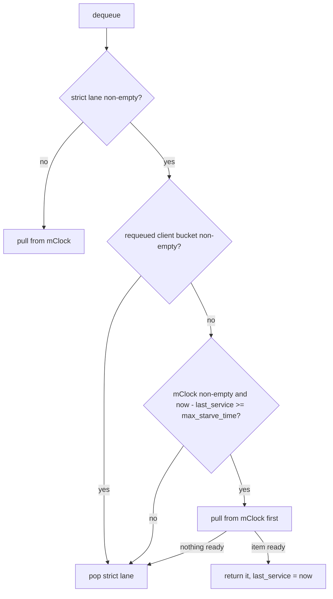
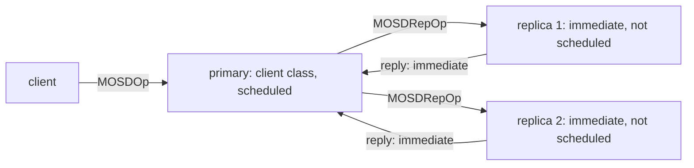
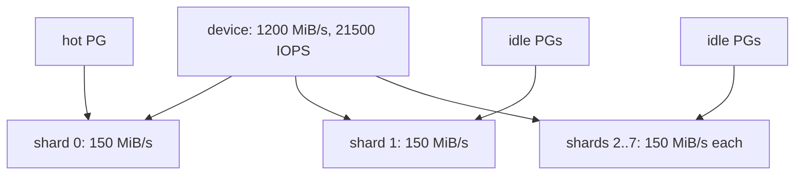

* TOC
{:toc}

A code review of the mClock op scheduler in the Ceph OSD, on the main
branch at
[`dc7b747c37c4`](https://github.com/ceph/ceph/commit/dc7b747c37c466b46bfd90bd7b940b8cdf3c8478)
(v21.3.0 plus 4849 commits, committed 2026-10-22, reviewed 2026-10-27),
then checked on a two-NVMe lab (§4). Two bugs matter: the new starvation
guard measures the wrong interval, so after a quiet period a background
item jumps ahead of the strict lane; and config changes race with the
shard threads without any lock. The measurements say more than the
reading: under client load mClock is a FIFO that reorders nothing, two
thirds of the write-path items bypass it, and under deep scrub it
returns less client throughput than the plain weighted queue.

*Revised 2026-10-28 after a second review and the lab run. The bug 1
scenario was overstated, its fix needed a second reset, and four
statements were wrong (the EC-write comment, the benchmark on HDD, the
profiles that limit best effort, the `update_client_info` fix).
Corrected in place.*

This post assumes the design walk-through in
[Ceph OSD Analysis §6](),
which explains the two lanes, the classes, the tags and the per-shard
layout at v21.3.0. Here the links go to main, not to the tag, because the
code reviewed is newer: it includes the 2026 fixes for deep-scrub
starvation (tracker 69078), the requeued-item bucket, EC read classes,
perf counters and the profile retune.

## 1. What was reviewed, and how

| Part | Files | Role |
|---|---|---|
| The scheduler | [`mClockScheduler.{h,cc}`](https://github.com/ceph/ceph/blob/dc7b747c37c466b46bfd90bd7b940b8cdf3c8478/src/osd/scheduler/mClockScheduler.cc) | the two lanes: a strict map and a dmclock queue |
| The config layer | [`mclock_common.{h,cc}`](https://github.com/ceph/ceph/blob/dc7b747c37c466b46bfd90bd7b940b8cdf3c8478/src/common/mclock_common.cc) | profiles, capacity, cost per IO, config observer |
| The dmclock core | [`dmclock_server.h`](https://github.com/ceph/ceph/blob/dc7b747c37c466b46bfd90bd7b940b8cdf3c8478/src/dmclock/src/dmclock_server.h) | tags, three heaps, `do_next_request` |
| The OSD side | [`OSD.cc`](https://github.com/ceph/ceph/blob/dc7b747c37c466b46bfd90bd7b940b8cdf3c8478/src/osd/OSD.cc), [`OpSchedulerItem.h`](https://github.com/ceph/ceph/blob/dc7b747c37c466b46bfd90bd7b940b8cdf3c8478/src/osd/scheduler/OpSchedulerItem.h) | producers, classes, the worker loop, the boot benchmark |

Method: read the four parts end to end, then check each suspicion
against the code with `path:line`, the unit tests and the git history.
Where a claim is inferred rather than read, the text says so. The
trackers were searched for prior reports; none was found for the bugs
below.

## 2. Bugs

| # | Severity | Where | One line |
|---|---|---|---|
| 1 | Medium | `mClockScheduler.h:95-103` | the starvation guard measures time since the last mClock pull, not how long an item has waited; reproduced and fixed in §4.1 |
| 2 | Medium | `mclock_common.cc:451`, `dmclock_server.h:112` | config changes rewrite the class parameters while shard threads read them, with no lock in common |
| 3 | Low | `osd.yaml.in:1132` | a custom profile with weight 0 and reservation 0 makes one class unschedulable and spins a thread |
| 4 | Low | `dmclock_util.h:42`, `OSD.cc:11238` | tags and the worker's wait use the wall clock, so a backward clock step disables reservations for that long |
| 5 | Low | `OpSchedulerItem.h:88` | cost is `int`; a deep-scrub chunk near 2 GiB wraps negative and is clamped to the cheapest cost |

### 2.1 The starvation guard measures the wrong interval

**Background.** Items of the immediate class and items with priority
at or above the cutoff go to a strict lane that is drained before mClock
sees anything. Under heavy client load on a replicated or EC pool, that
lane is never empty: every client write produces replica ops, EC sub-ops
and replies, and all of them are immediate. Tracker
[69078](https://tracker.ceph.com/issues/69078) reported deep scrubs that
took days because of this. The fix
([commit 5847d110024](https://github.com/ceph/ceph/commit/5847d1100248b9c4880dbdda9f3cd9ec70801e36))
adds a guard: if the mClock queue has been unserviced for
`max_starve_time` (50 ms on flash, 250 ms on rotational by default)
while the strict lane keeps refilling, pull one mClock item first.

**The defect.** The guard compares the clock against
[`last_mclock_service_time`](https://github.com/ceph/ceph/blob/dc7b747c37c466b46bfd90bd7b940b8cdf3c8478/src/osd/scheduler/mClockScheduler.h#L95),
which starts at zero and is written in only two places, both right after
a successful pull
([line 254](https://github.com/ceph/ceph/blob/dc7b747c37c466b46bfd90bd7b940b8cdf3c8478/src/osd/scheduler/mClockScheduler.cc#L254),
[line 319](https://github.com/ceph/ceph/blob/dc7b747c37c466b46bfd90bd7b940b8cdf3c8478/src/osd/scheduler/mClockScheduler.cc#L319)).
[`enqueue`](https://github.com/ceph/ceph/blob/dc7b747c37c466b46bfd90bd7b940b8cdf3c8478/src/osd/scheduler/mClockScheduler.cc#L113)
never touches it. So the guard does not measure "how long has the oldest
mClock item waited". It measures "how long since mClock last got a
turn", and an empty queue counts as waiting.

This diagram shows the decision that `dequeue` makes on every call.

The check at the bottom is the only place the timer is read, and only a
successful pull writes it.

**When it fires.** The timer is reset by every successful pull of any
class, client ops included. A shard that is primary for a busy PG resets
it every few milliseconds, so the bug is invisible there. The
precondition is a shard with no mClock pull for `max_starve_time`: a
replica-only shard, an EC shard whose traffic is all sub-op writes, or
any shard after an idle gap. When the next `dequeue` then finds the
strict lane non-empty and a fresh mClock item, the item runs first with
no wait of its own. The budget is unchanged, one forced pull per window,
because each pull resets the timer. The phase is wrong: the first item
after a quiet period jumps at once instead of after 50 ms. The cost
falls on the strict items already queued, which wait for one background
item's service time. That is long only for a deep-scrub chunk, which
reads its objects synchronously under the PG lock
([`pg_scrubber.cc:1487`](https://github.com/ceph/ceph/blob/dc7b747c37c466b46bfd90bd7b940b8cdf3c8478/src/osd/scrubber/pg_scrubber.cc#L1487)).
The same happens once at boot, because the initial value is zero; the
test file says so in a comment
([`TestMClockScheduler.cc:228`](https://github.com/ceph/ceph/blob/dc7b747c37c466b46bfd90bd7b940b8cdf3c8478/src/test/osd/TestMClockScheduler.cc#L228)).

The tracker analysis measured the gap "from ChunkIsFree's enqueue to the
first best-effort item actually serviced". The code measures something
else. All six starvation tests
([`TestNoForcedYieldBeforeThreshold`](https://github.com/ceph/ceph/blob/dc7b747c37c466b46bfd90bd7b940b8cdf3c8478/src/test/osd/TestMClockScheduler.cc#L314),
[`TestStarvationForcesYield`](https://github.com/ceph/ceph/blob/dc7b747c37c466b46bfd90bd7b940b8cdf3c8478/src/test/osd/TestMClockScheduler.cc#L332)
and four more) first prime the timer with one enqueue and dequeue. None
adds the mClock item after a quiet period, so none sees this path.

A second gap, found in review: the queue can be non-empty but not ready,
when its only item is held back by its own limit tag. The timer then
goes stale although nothing is starved. A ready item arriving into that
queue is pulled ahead of the strict lane at once, and until it arrives
every `dequeue` retries the pull.

**Fix.** Two resets, four lines of code
([patch]({{ site.baseurl }}/code/ceph/mclock-starve-timer.patch), with
four regression tests). In `enqueue`, if the dmclock queue is empty
before `add_request`, set `last_mclock_service_time` to now: work that
has just arrived has waited nothing. In the guard branch of `dequeue`,
if `pull_request` returns nothing ready, set it too: the queue had its
turn and was held back by its own tags, not by the strict lane. A
stricter version would track the arrival of the oldest pending item,
but dmclock has no peek API, so that is a larger change. One edge
remains: a not-ready item, an idle gap and a simultaneous burst still
let one item jump, with the same one-item cost.

**Verification.** On stock main three of the four new tests fail (the
background item comes out where the immediate item is expected); the
fourth, which checks that the yield still fires after an idle gap,
passes on both. With the patch all sixteen tests pass in three runs
(§4.1). The traces in §4.1 also show
how rare the precondition is on a replicated pool under client load: the
guard condition never occurred in over a million dequeues. Hence Medium,
not High.

### 2.2 Config changes race with the shard threads

**The path.** A `ceph config set` or `ceph tell osd.N injectargs` ends
in
[`ConfigProxy::_call_observers`](https://github.com/ceph/ceph/blob/dc7b747c37c466b46bfd90bd7b940b8cdf3c8478/src/common/config_proxy.h#L36),
which calls each observer outside the config lock. `MclockConfig`
registered itself in its constructor
([`mclock_common.h:271`](https://github.com/ceph/ceph/blob/dc7b747c37c466b46bfd90bd7b940b8cdf3c8478/src/common/mclock_common.h#L271)).
Its
[`handle_conf_change`](https://github.com/ceph/ceph/blob/dc7b747c37c466b46bfd90bd7b940b8cdf3c8478/src/common/mclock_common.cc#L451)
calls `set_from_config`, which recomputes `cost_per_io` and
`capacity_per_shard`, and then
[`update_from_profile`](https://github.com/ceph/ceph/blob/dc7b747c37c466b46bfd90bd7b940b8cdf3c8478/src/common/mclock_common.cc#L93),
which calls
[`ClientInfo::update`](https://github.com/ceph/ceph/blob/dc7b747c37c466b46bfd90bd7b940b8cdf3c8478/src/dmclock/src/dmclock_server.h#L112)
on the three class records. That function writes six plain doubles:
reservation, weight, limit and their inverses. The caller is a MonClient
worker thread or the admin-socket thread.

**The reader.** The queue is built with the dynamic client-info flag
(`U1 = true`), so
[`get_cli_info`](https://github.com/ceph/ceph/blob/dc7b747c37c466b46bfd90bd7b940b8cdf3c8478/src/dmclock/src/dmclock_server.h#L865)
re-reads the record on every tag computation, from the shard worker
thread. It holds dmclock's own `data_mtx` and the shard lock. The writer
holds neither. `ClientRegistry` and `mClockScheduler` have no lock at
all, and the two `MclockConfig` fields read by
[`calc_scaled_cost`](https://github.com/ceph/ceph/blob/dc7b747c37c466b46bfd90bd7b940b8cdf3c8478/src/common/mclock_common.cc#L436)
and by the starvation guard are plain doubles too. A second reader is
[`reduce_reservation_tags`](https://github.com/ceph/ceph/blob/dc7b747c37c466b46bfd90bd7b940b8cdf3c8478/src/dmclock/src/dmclock_server.h#L1072),
which reads the reservation inverse directly.

**Impact.** On x86-64 an aligned 8-byte store is one instruction, so a
torn value is not expected (inferred). What can happen is a tag built
from inverses of two generations, for example the new weight inverse
with the old limit inverse. One tag is slightly wrong, nothing crashes.
It is still a data race in the language sense, and a TSAN build of the
OSD can report it on a `config set`. Medium, because the effect is one
wrong tag.

**Fix.** dmclock's
[`update_client_info`](https://github.com/ceph/ceph/blob/dc7b747c37c466b46bfd90bd7b940b8cdf3c8478/src/dmclock/src/dmclock_server.h#L635)
and `update_client_infos` look like the tool, but they are not: they
only re-fetch the cached pointer under `data_mtx`, and that pointer
already points at the record that `update_from_profile` rewrites in
place. The fix is a snapshot: build a new `ClientRegistry`, swap the
pointer under the shard lock or through an atomic shared pointer, and
let the old one die when no tag computation references it.

### 2.3 Weight 0 with reservation 0 spins a thread

The custom profile reads nine options. The weights are of type `uint`
with default 1 and no lower bound
([`osd_mclock_scheduler_client_wgt`](https://github.com/ceph/ceph/blob/dc7b747c37c466b46bfd90bd7b940b8cdf3c8478/src/common/options/osd.yaml.in#L1132)),
and the reservations default to 0. Set a weight to 0 while its
reservation is 0 and
[`tag_calc`](https://github.com/ceph/ceph/blob/dc7b747c37c466b46bfd90bd7b940b8cdf3c8478/src/dmclock/src/dmclock_server.h#L247)
returns `max_tag` (plus infinity) for both the reservation and the
proportion tag, and `min_tag` (minus infinity) for the limit.
[`do_next_request`](https://github.com/ceph/ceph/blob/dc7b747c37c466b46bfd90bd7b940b8cdf3c8478/src/dmclock/src/dmclock_server.h#L1110)
then finds nothing schedulable and returns the limit tag as the time to
wait for, which is minus infinity. The worker converts it with
[`real_clock::from_double`](https://github.com/ceph/ceph/blob/dc7b747c37c466b46bfd90bd7b940b8cdf3c8478/src/osd/OSD.cc#L11238),
which casts a negative-infinite duration to an integer count. On x86-64
that gives `INT64_MIN`, a time point centuries in the past, so the wait
returns at once and the loop repeats. Every thread of that shard spins
at full CPU with its heartbeat timeout cleared, because each enters
`_process` and gets the same value, and that class is never served.
Other classes still are, because they sit above it in the heaps.
Packaged RelWithDebInfo builds compile with `NDEBUG`, so the plain
`assert` in the tag constructor is gone; a Debug build aborts there
instead. Fix: `min: 1` on the three
weight options, or a clamp with a warning in `set_from_config`.

### 2.4 The wall clock drives the tags

dmclock's
[`get_time`](https://github.com/ceph/ceph/blob/dc7b747c37c466b46bfd90bd7b940b8cdf3c8478/src/dmclock/src/dmclock_util.h#L42)
reads `CLOCK_REALTIME`, and the worker waits on a
[`real_clock`](https://github.com/ceph/ceph/blob/dc7b747c37c466b46bfd90bd7b940b8cdf3c8478/src/osd/OSD.cc#L11244)
time point. Every tag is `max(now, prev + cost / rate)`, so after a
backward step of S seconds every stored tag is S seconds in the future.
A forward step is harmless. A backward step has three effects for S
seconds: the reservation phase never fires, because no reservation tag
is due; the best-effort class is frozen in the two profiles that limit
it (balanced and high_client_ops; high_recovery_ops limits nothing),
because its limit tag is not due; and the worker's timed wait stretches
by S. Client and recovery items are still served, because their limit
is unbounded and the weight phase does not look at the clock. The
starvation guard of §2.1 also compares against the stepped clock. Git
history shows no earlier discussion. Since `src/dmclock` is an in-tree
copy, the fix is local: `CLOCK_MONOTONIC` in `get_time` and
`mono_clock` in the worker.

### 2.5 Cost is a signed int

[`OpSchedulerItem::cost`](https://github.com/ceph/ceph/blob/dc7b747c37c466b46bfd90bd7b940b8cdf3c8478/src/osd/scheduler/OpSchedulerItem.h#L88)
is `int`. Message producers are `int` end to end; the OSDService queue
producers carry `uint64_t` and narrow it in the item constructor
([`OpSchedulerItem.h:109`](https://github.com/ceph/ceph/blob/dc7b747c37c466b46bfd90bd7b940b8cdf3c8478/src/osd/scheduler/OpSchedulerItem.h#L109)), and
[`calc_scaled_cost`](https://github.com/ceph/ceph/blob/dc7b747c37c466b46bfd90bd7b940b8cdf3c8478/src/common/mclock_common.cc#L436)
turns anything at or below 0 into one `cost_per_io`. The only producer
that can reach the limit is the deep-scrub chunk:
[`get_scrub_cost`](https://github.com/ceph/ceph/blob/dc7b747c37c466b46bfd90bd7b940b8cdf3c8478/src/osd/scrubber/pg_scrubber.cc#L1087)
charges the average object size per object. With `osd_scrub_chunk_max`
15 and objects at the 128 MiB maximum the sum is just under `INT_MAX`;
an operator who raises the chunk size to 16 wraps it negative, and above 2^32 it wraps to a small
positive value. Either way the largest item in the system is charged
as the smallest. Rare in practice, trivial to harden: clamp to
`INT_MAX` in the producer or make the field unsigned.

One cosmetic item found on the way:
[`PrimaryLogPG.cc:13467`](https://github.com/ceph/ceph/blob/dc7b747c37c466b46bfd90bd7b940b8cdf3c8478/src/osd/PrimaryLogPG.cc#L13467)
requeues in-progress async reads in forward order, while the other
requeue loop, `PG::requeue_ops`, runs in reverse because the scheduler's
front insert is LIFO. Reads only, so no ordering abort. (An earlier
version of this post also called the EC-write comment in
`PGOpItem::get_scheduler_class` wrong; it is right.)

## 3. Optimization candidates

### 3.1 Replica-side work is never scheduled

[`PGOpItem::get_scheduler_class`](https://github.com/ceph/ceph/blob/dc7b747c37c466b46bfd90bd7b940b8cdf3c8478/src/osd/scheduler/OpSchedulerItem.h#L247)
puts `CEPH_MSG_OSD_OP` and backoffs into the client class, recovery-
priority EC reads into the background classes, and everything else into
`immediate`. "Everything else" is the replica's `MOSDRepOp`, the EC
shard's `MOSDECSubOpWrite`, client-priority EC reads, and every reply.

This diagram shows what mClock sees of one client write on a 3× pool.

Only one of the three copies passes through the tags, so a reservation
of "50 % for client" is a reservation on one third of the write work.

The consequences stack. Reservations and weights describe only the
primary's share. The immediate stream is exactly what starved the
mClock lane in tracker 69078, so the guard of §2.1 is a workaround for
this bypass. And on a replica, recovery pushes (which are scheduled) and
replica ops (which are not) compete for the same disk with no arbiter.
Crimson reserved a `repop` class for this
([`mclock_common.h`](https://github.com/ceph/ceph/blob/dc7b747c37c466b46bfd90bd7b940b8cdf3c8478/src/common/mclock_common.h#L37)),
but nothing assigns it, Crimson only references it as a cutoff marker
and a metrics label; its
[`get_info`](https://github.com/ceph/ceph/blob/dc7b747c37c466b46bfd90bd7b940b8cdf3c8478/src/common/mclock_common.cc#L150)
entry says "uses background_recovery profile for now", and Crimson's
replicated request still throttles as
[immediate](https://github.com/ceph/ceph/blob/dc7b747c37c466b46bfd90bd7b940b8cdf3c8478/src/crimson/osd/osd_operations/replicated_request.cc#L89).

Proposal: a repop class with the client's reservation and weight, and
replies kept immediate. Ordering needs care: dmclock keeps one FIFO
per class, but `PG::requeue_op` re-inserts through `enqueue_front`,
which cannot put an item back ahead of same-PG items still in the
dmclock queue. Client items get the
[requeued bucket](https://github.com/ceph/ceph/blob/dc7b747c37c466b46bfd90bd7b940b8cdf3c8478/src/osd/scheduler/mClockScheduler.cc#L165)
for exactly this; a repop class needs the same treatment, because repops
carry a hard log-order invariant. The other risk is
tail latency, since a client write waits for its slowest replica; a
reservation equal to the client's keeps that bounded. This is the single
largest change in what mClock controls.

### 3.2 The capacity is split statically per shard

[`set_from_config`](https://github.com/ceph/ceph/blob/dc7b747c37c466b46bfd90bd7b940b8cdf3c8478/src/common/mclock_common.cc#L204)
divides the device bandwidth by the shard count, and each shard's
scheduler converts its fractions against that slice. A PG is pinned to
one shard by
[`hash_to_shard`](https://github.com/ceph/ceph/blob/dc7b747c37c466b46bfd90bd7b940b8cdf3c8478/src/osd/OSD.cc#L11499),
which is `ps() % num_shards`. Nothing moves capacity between shards.

This diagram shows the SSD default: eight shards, each with one eighth.

A hot PG on an otherwise idle OSD is held to one eighth of any class
limit, and a class reservation is only met on the device if its work
is spread evenly over all shards (inferred from the split; no code
measures it). Upstream saw the effect on HDD in tracker
[66289](https://tracker.ceph.com/issues/66289): client throughput fell
by up to 79 % during recovery, tuning limits and reservations did not
help, and one shard with five threads did (from the tracker discussion;
the merge commit records only inconsistent throughput and the shard
change). PR 58509 made that the HDD default. SSD still runs eight
shards of two threads.

Proposal: keep the shards, but let each shard's budget follow its
demand. Every 100 ms, recompute `capacity_i` as the device capacity
times this shard's share of recent cost, with a floor of one share. The
registry is read on every tag (`U1`), but a live budget must go through
the snapshot of §2.2; rewriting the records in place every 100 ms would
make that race continuous.

### 3.3 mClock orders, it rarely paces

All three built-in profiles give the client and recovery classes no
limit. In
[`do_next_request`](https://github.com/ceph/ceph/blob/dc7b747c37c466b46bfd90bd7b940b8cdf3c8478/src/dmclock/src/dmclock_server.h#L1110)
an item is delayed only when its reservation tag is not due and its
limit tag is not due either. With no limit, the limit tag is minus
infinity, so client and recovery items are always ready. The queue
therefore only reorders them; it never holds one back for the device.
The only pacing is on the best-effort class, in two of the three
profiles.

So the configured bytes per second is not a budget the device feels. The
queue builds up mainly when the shard threads block below it: the
BlueStore throttles (`bluestore_throttle_bytes` 64 MiB and
`bluestore_throttle_deferred_bytes` 128 MiB), PG locks and synchronous
reads. The docs say as much by telling operators to tune those
throttles with `osd bench`. §4.2 measures it: under a 4 KiB write load
the queue holds zero or one item at 98 % of dequeues and never returns
a wait time. A device
feedback signal would close the loop: in-flight bytes or completion
latency from the ObjectStore, used to hold dequeue when the device is
behind, in the spirit of the kernel's `iocost`. That turns the static
rate into a real one.

### 3.4 The cost model and the benchmark

Reads cost nothing.
[`Message::get_cost`](https://github.com/ceph/ceph/blob/dc7b747c37c466b46bfd90bd7b940b8cdf3c8478/src/msg/Message.h#L490)
returns the payload length, which is zero for a read, so
`calc_scaled_cost` charges one `cost_per_io` (57 KiB on SSD defaults).
A 4 MiB read and a 4 KiB read cost the same. EC sub-op writes also
[return 0](https://github.com/ceph/ceph/blob/dc7b747c37c466b46bfd90bd7b940b8cdf3c8478/src/messages/MOSDECSubOpWrite.h#L32),
though as immediate items they are not charged anyway.

The boot benchmark
([`OSD.cc:10375`](https://github.com/ceph/ceph/blob/dc7b747c37c466b46bfd90bd7b940b8cdf3c8478/src/osd/OSD.cc#L10375))
writes 3000 random 4 KiB blocks into 100 prefilled 4 MiB objects of the
meta collection. Each write is queued with
[no completion context](https://github.com/ceph/ceph/blob/dc7b747c37c466b46bfd90bd7b940b8cdf3c8478/src/osd/OSD.cc#L11845)
and one flush waits for all of them. On SSD the 3000 transactions cost
about 36 MB against the 64 MiB BlueStore throttle, so the whole burst is
in flight at once. On HDD each deferred 4 KiB write is charged about
670 KB (`bluestore_throttle_cost_per_io_hdd`), so the throttle paces the
run at about 100 transactions in flight. Then
[IOPS is 3000 divided by the elapsed time](https://github.com/ceph/ceph/blob/dc7b747c37c466b46bfd90bd7b940b8cdf3c8478/src/osd/OSD.cc#L11722).
On HDD the writes are deferred (64 KiB threshold), so the number is the
WAL and kv-commit rate of one burst. The thresholds (50 to 500 on
rotational, 1000 to 80000 on flash,
[`OSD.cc:10411`](https://github.com/ceph/ceph/blob/dc7b747c37c466b46bfd90bd7b940b8cdf3c8478/src/osd/OSD.cc#L10411))
are what keeps the result sane. Charging reads by their requested length
is the cheap half of this; a benchmark of the whole OSD op path at a
fixed queue depth is the other half. §4.3 shows why: the lab NVMe does
about 320k 4 KiB IOPS, the boot benchmark reports 44k, and the OSD
delivers 15k client writes per second through mClock. The model is
wrong in both directions.

### 3.5 Per-op CPU

A microbenchmark in the earlier tracker-notes post measured about 330 ns
per enqueue-plus-dequeue for mClock against 55 ns for a plain FIFO. On
the lab OSD (§4.4) the scheduler symbols add up to 0.8 % of the OSD's
CPU. The avoidable parts, all read in the code:

- Three to four clock reads per dequeue: the starvation guard, the pull,
  the service-time write, and `ceph_clock_now` in the perf counter.
- Two allocations per request: the wrapper in `add_request`, and a
  `std::map` node that
  [`client_map.emplace`](https://github.com/ceph/ceph/blob/dc7b747c37c466b46bfd90bd7b940b8cdf3c8478/src/dmclock/src/dmclock_server.h#L915)
  builds before it finds the existing client and throws away.
- Three redundant heap adjusts per request after the first: the front
  tag has not changed, so the heap order cannot change.
- dmclock's
  [`data_mtx`](https://github.com/ceph/ceph/blob/dc7b747c37c466b46bfd90bd7b940b8cdf3c8478/src/dmclock/src/dmclock_server.h#L768)
  on every call, which the shard lock already covers; the Crimson build
  compiles it out.
- `get_scheduler_op_type` called in `enqueue`, `enqueue_high` and
  `dequeue`, each copying an intrusive pointer to the op only to pick a
  perf counter.
- One cleaner thread per shard scheduler for three class records that
  are never erased.

These are small next to a 20 µs op path. They are cleanup, not a win.

## 4. Measurements on main

Setup: one box with two 16-core EPYC 9124 sockets and two Samsung 9100
PRO NVMes on PCIe 5, one OSD on each, built from main at
[`0fab663780a`](https://github.com/ceph/ceph/commit/0fab663780a)
(RelWithDebInfo; the scheduler files are identical to the commit
reviewed above). A vstart cluster, one pool of size 2 with 64 PGs,
`rados bench` with 4 KiB objects and 64 threads. On osd.0, bpftrace
uprobes on `enqueue`, `dequeue`, `enqueue_high` and dmclock's
`pull_request`, plus the shard threads' condition waits; the
[scripts]({{ site.baseurl }}/code/ceph/mclock-trace/sched.bt) decode
the returned variant to tell "item from the mClock lane", "item from the
strict lane" and "wait time" apart. Queue time comes from the OSD's own
counters: `op_before_dequeue_op_lat` minus `op_before_queue_op_lat`.

### 4.1 Bug 1 reproduced and fixed

The four tests from the patch, built against stock main and against
the patched tree:

| Test | Stock | Patched |
|---|---|---|
| fresh item after a 60 ms idle gap: strict item first | fails, background item returned | passes |
| first item ever (timer at zero): strict item first | fails | passes |
| not-ready item, then a ready item into the non-empty queue: strict first, forced turn after 50 ms | fails, ready item returned | passes |
| item arriving after an idle gap, then a real 60 ms wait behind the strict lane: forced turn | passes | passes |
| the twelve existing tests | pass | pass (three runs) |

How often the stock guard condition occurs on this cluster (strict lane
non-empty, mClock lane non-empty, 50 ms since the last pull):

| Workload on osd.0 | Dequeues | Guard condition met | Of which the item had waited under 50 ms |
|---|---|---|---|
| 4 KiB writes, 64 threads, 25 s | 551k | 0 | 0 |
| 4 KiB writes, 4 threads, 25 s | 61k | 0 | 0 |
| 50 single puts 200 ms apart, then the 64-thread burst | 543k | 0 | 0 |

The spaced-puts run did make the timer stale, but every item was
dequeued within tens of microseconds of arriving (§4.2), so no dequeue
ever saw both lanes non-empty with a stale timer. That needs a standing
strict backlog on a shard with no mClock pull for 50 ms: an EC or
replica-heavy OSD.

### 4.2 Under client load, mClock is a FIFO

| What osd.0 saw | 4 KiB writes | 4 KiB random reads |
|---|---|---|
| cluster rate | 14.9k writes/s, 4.3 ms | 75k reads/s, 0.85 ms |
| items through the mClock lane | 202k | 709k |
| items through the strict lane | 447k (replica ops and replies) | 68k |
| mClock lane depth at dequeue: 0 / 1 / 2 or more | 66 % / 33 % / 2 % | 8 % / 75 % / 17 % |
| mClock pulls returning a wait time | never | 0.5 % |
| queue time per op | 43 µs of 4057 µs | 59 µs of 136 µs |
| shard threads idle | 76 % | 82 % |

For writes, 69 % of the items on the primary's shards bypass mClock,
the lane almost never holds two items, and no item is ever delayed by a
tag. The scheduler adds nothing but its own 8 µs. For reads the queue
time is 43 % of the op latency while the threads are 82 % idle. A
second read run with the wake-up probe explains it: 82 % of reads
arrive into an empty lane, and the
time from that enqueue to the item coming out of `dequeue` is 16 to
32 µs for most of them, 30 µs on average. That is a futex wake-up of a
sleeping shard thread. A short spin before sleeping in `_process`, or
running a read on the messenger thread when the shard is idle, would
cut 4 KiB read latency by a fifth. Both are OSD changes, not mClock
changes.

### 4.3 Deep scrub under writes: pacing does not protect the client

Deep scrub of all 64 PGs started six seconds into a 30 s write run.

| Scheduler and settings | Client writes/s | Latency | Queue time | mClock pulls returning a wait | Shard time asleep on tags |
|---|---|---|---|---|---|
| no scrub, mClock balanced | 14.9k | 4.3 ms | 43 µs | 0 % | 0 % |
| no scrub, wpq | 15.4k | 4.1 ms | | | |
| scrub, mClock balanced (two runs) | 7.2k to 7.3k | 8.7 to 8.9 ms | 1.0 ms | 44 % | 22 % |
| scrub, mClock high_client_ops | 7.3k | 8.8 ms | 1.0 ms | 46 % | 26 % |
| scrub, mClock balanced, capacity set to 15000 IOPS | 9.2k | 7.0 ms | 0.5 ms | 61 % | 42 % |
| scrub, wpq | 7.7k | 8.3 ms | 0.8 ms | | |

mClock does pace the scrub: the shard threads spend about a quarter of
their time asleep on best-effort limit tags, and the profile makes no
difference. The client still loses half of its throughput, and wpq,
which paces nothing, gives it slightly more. Of the 4.5 ms the client
lost, 1 ms is queue time and 3.5 ms is below the queue: scrub reads,
checksums and the chunk range that blocks writes under the PG lock.
mClock cannot see any of it.

The reason is the model. The boot benchmark reported 44k IOPS on a
device that does about 320k; bandwidth stays at the 1200 MiB/s default
and is never measured; so `cost_per_io` is 27.9 KiB and the model
believes the OSD can do 44k such ops per second. The OSD delivers 15k
client writes per second through mClock, a third of that, so the model
never sees contention and never holds anything back for the client.
Setting the capacity to 15000 IOPS, which makes the model roughly
honest, gave the client 25 % more under scrub. The right number is the
op rate of the whole OSD path, not of one BlueStore collection, and it
should be measured where mClock runs.

### 4.4 Where the CPU goes

`perf record` on osd.0 during the write run: all scheduler symbols
together are 0.8 % of the OSD's samples. `mClockScheduler::empty` is the
largest at 0.2 %, because `_process` calls it three times per loop and
each call takes dmclock's mutex; `dequeue` is 0.1 %. Under uprobes
`enqueue` takes about 3 µs and `dequeue` about 5 µs. Not a target.

## 5. Takeaways

- A starvation guard must measure the wait of the oldest item, not the
  time since the last turn, and "nothing ready" counts as a turn. The
  difference is invisible in a test that primes the timer.
- Measure the precondition before grading a bug: the guard never fired
  in over a million dequeues on a replicated pool.
- A config observer runs on a foreign thread. Anything it writes that a
  hot path reads needs a published snapshot; re-fetching a pointer to
  the same record is not a fix.
- Validate option ranges where a zero makes a tag infinite.
- Use a monotonic clock for anything that chains tags over time.
- The classification table is the real scheduler policy. Today it
  schedules one copy of a write out of three.
- Under client load mClock is a FIFO. On reads the cost that matters is
  waking a sleeping shard thread, not the scheduler.
- A scheduler that paces against a model it never checks against the
  device pays the cost of pacing without its benefit.
- A per-shard split of one device is a policy decision with a large
  cost; upstream already undid it for HDD.

## 6. Glossary

- **Strict lane**: the `high_priority` map in `mClockScheduler`, drained
  before the dmclock queue. Holds immediate items and items at or above
  the cutoff priority.
- **Immediate class**: items that bypass dmclock: peering, replica ops,
  EC sub-ops and all replies.
- **Starvation guard**: the forced pull from the dmclock queue when it
  has not been served for `max_starve_time` while the strict lane is
  busy. Added for tracker 69078.
- **Tag**: the time at which dmclock considers a request due, one each
  for reservation, weight and limit; `max(now, prev + cost / rate)`.
- **`cost_per_io`**: sequential bandwidth divided by measured IOPS, the
  minimum cost charged for any item.
- **`capacity_per_shard`**: device bandwidth divided by the shard
  count, the base for every reservation and limit on one shard.
- **Config observer**: an object registered with `ConfigProxy` whose
  `handle_conf_change` runs when a tracked option changes.
- **U1**: the dmclock template flag that makes it re-read the client
  parameters on every tag computation instead of caching them.
- **wpq**: the weighted priority queue, the OSD's other op scheduler
  (`osd_op_queue = wpq`); strict priorities, no tags, no pacing.
- **Queue time**: `op_before_dequeue_op_lat` minus
  `op_before_queue_op_lat` from the OSD perf counters: receipt to
  dequeue minus receipt to enqueue. Shares of thread time (idle, asleep
on tags) use the 40 s trace window over the 16 shard threads, which
starts 4 s before the bench and ends after it, so the in-bench shares
are somewhat higher for sleep under scrub and lower for idle. A count
that the trace never incremented is reported as 0.


