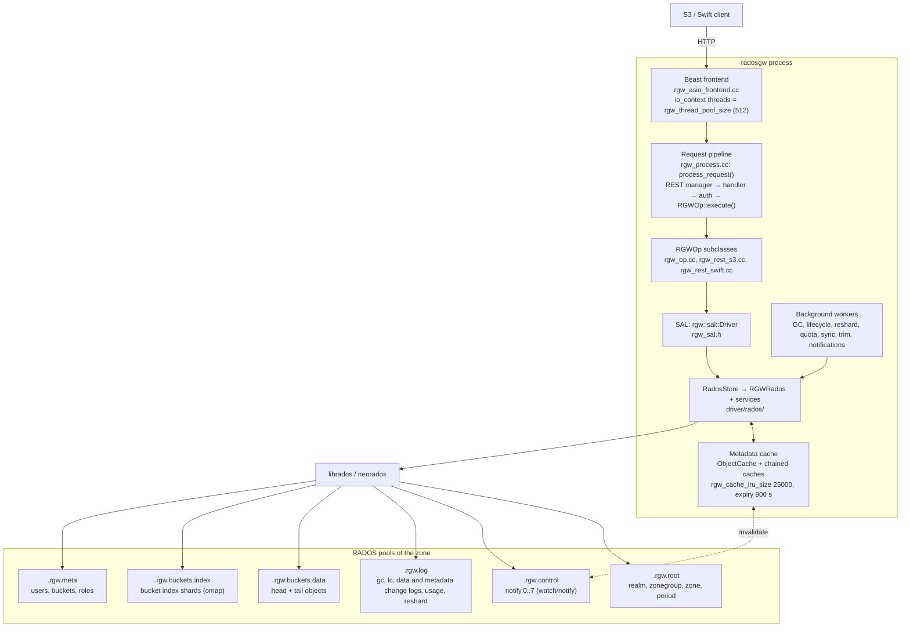
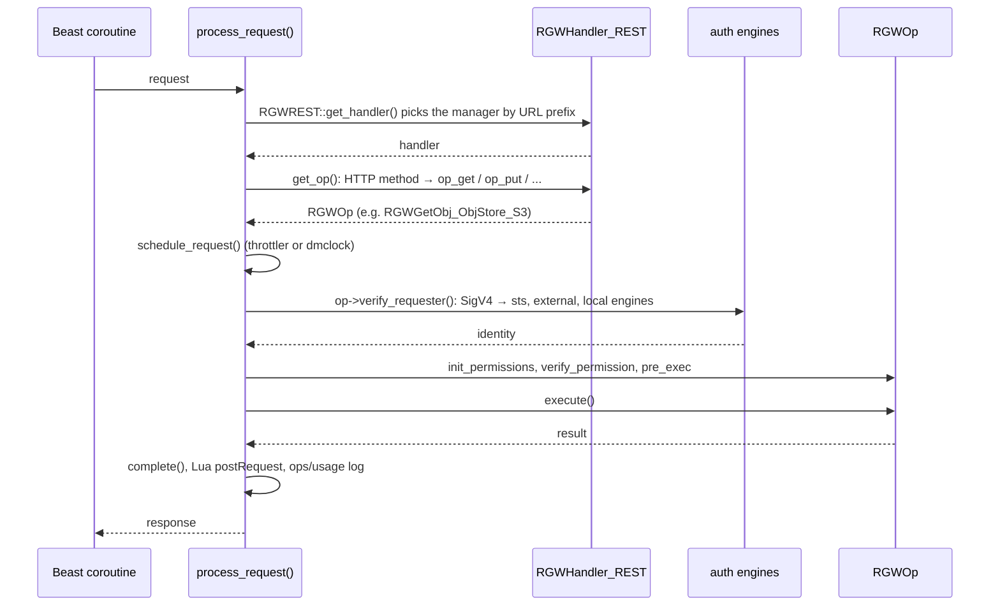
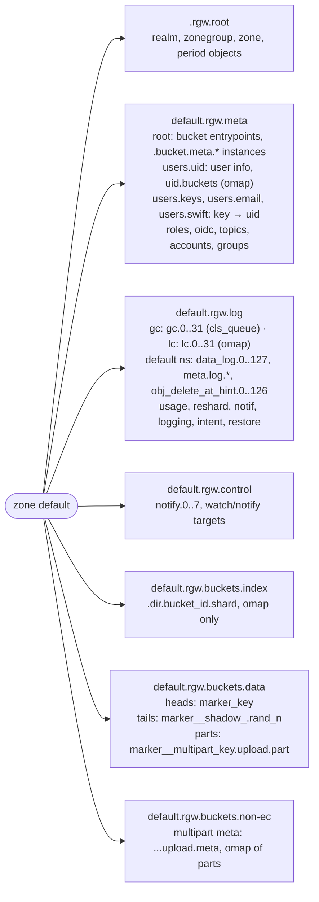
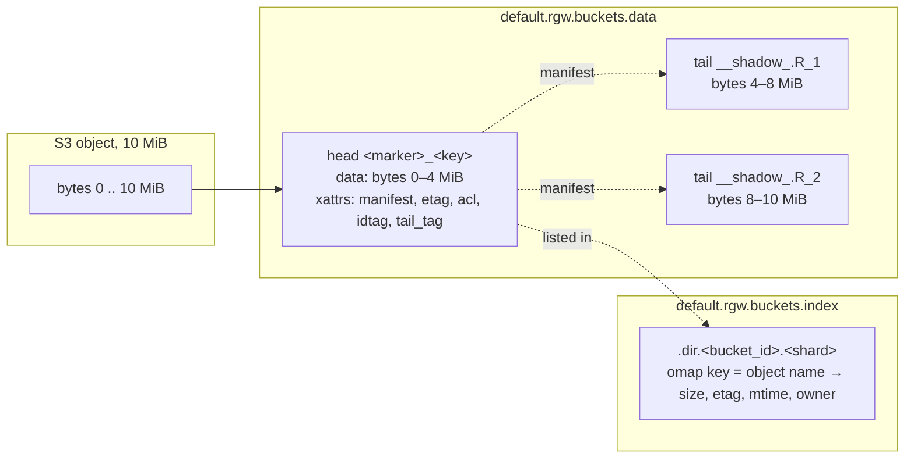
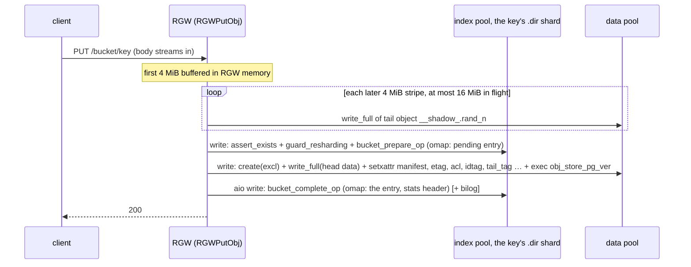
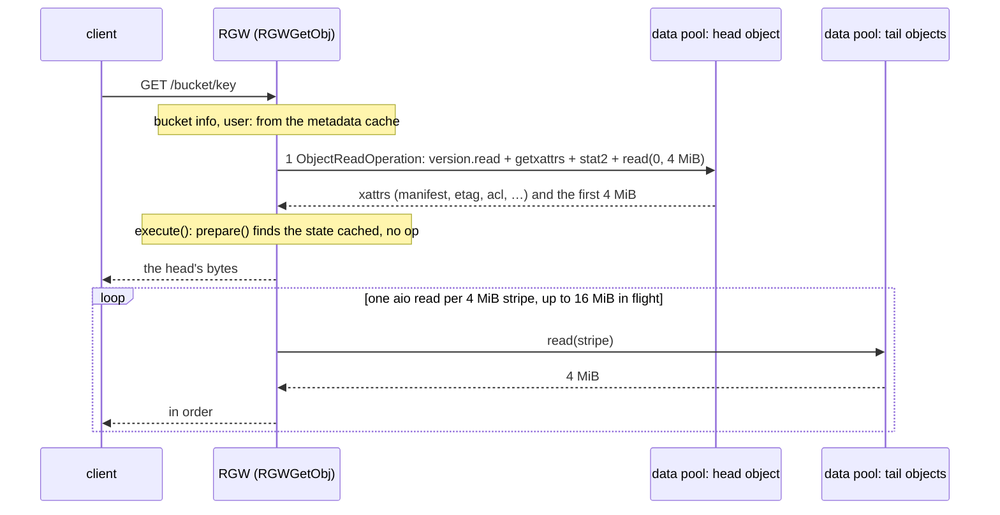
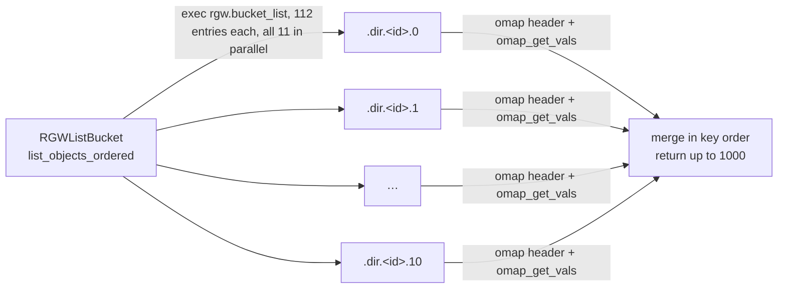
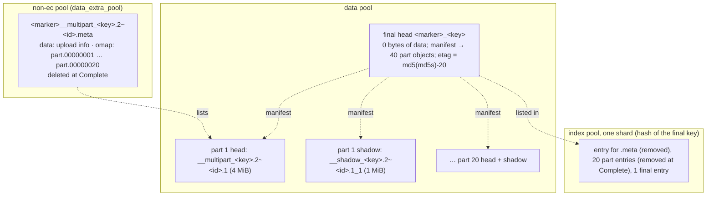
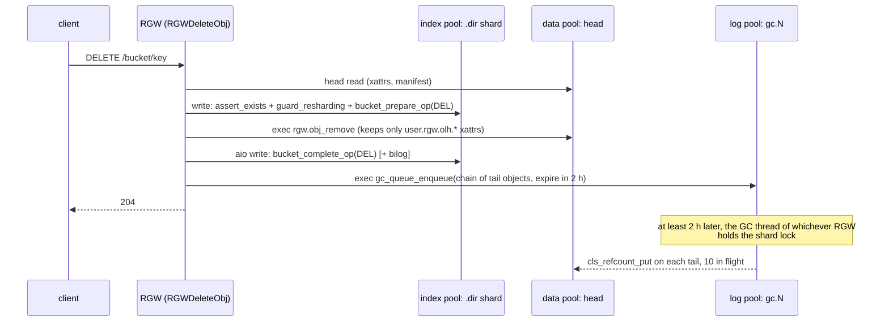

* TOC
{:toc}

The RADOS Gateway, `radosgw` or RGW, is the Ceph daemon that speaks S3 and
Swift. This post is for people who already know RADOS, pools and PGs and want
to know what RGW adds on top, how it is built, and what one S3 request does to
the cluster.

Every source reference points at Ceph
[v21.3.0](https://github.com/ceph/ceph/tree/v21.3.0) (commit `cc6b5e2da07`),
as `file:line`. Defaults quoted for configuration options are from
`src/common/options/rgw.yaml.in` at that tag.

The second half (§6) is a request trace: for PUT, GET, multipart upload,
listing and DELETE, which pool each step touches, with which RADOS op, in
what order, and how many. That is the part to read if you want to know what
an RGW workload looks like from the OSD's side.

## 1. Why RGW exists

RADOS stores named objects in pools and runs class methods on them. It has no
users, no buckets, no HTTP, and no idea what an S3 key or an ACL is. RGW adds
all of that, and keeps every bit of its own state in RADOS objects, so the
gateway itself is stateless and can run as many copies as you like.

What S3 needs, and where RGW keeps it:

| S3 needs | RADOS gives | RGW adds | Kept in |
|---|---|---|---|
| Users, keys, accounts, roles | nothing | user and account records, auth engines for local keys, Keystone, LDAP, STS | `<zone>.rgw.meta` pool, namespaces `users.*`, `roles`, `accounts` |
| Buckets | pools, but a pool per bucket does not scale | bucket entrypoint and bucket instance records | `<zone>.rgw.meta` pool, namespace `root` |
| Listing a bucket in key order | no ordered listing of a pool | the bucket index: omap on sharded index objects, kept by `cls_rgw` | `<zone>.rgw.buckets.index` pool |
| Objects of any size up to 5 TiB (the S3 limit; RGW's own ceiling is `rgw_max_put_size` × 10000 parts) | objects up to `osd_max_object_size` (128 MiB) | one head object plus 4 MiB tail stripes, tied together by a manifest in the head's xattr | `<zone>.rgw.buckets.data` pool |
| Multipart upload | nothing | parts as their own objects, a manifest that points at them | data pool, with the upload record in `<zone>.rgw.buckets.non-ec` |
| ACLs, policies, tags, versioning | xattrs | ACL and policy documents in xattrs, IAM policies, the OLH scheme for versions (object logical head: a per-key pointer object in a versioned bucket) | data pool xattrs, `<zone>.rgw.meta` |
| HTTP, signatures, S3 and Swift semantics | nothing | the Beast frontend, the REST layer, SigV2 and SigV4 | the `radosgw` process |
| Replication to another site | nothing | metadata and data change logs, sync threads | `<zone>.rgw.log` pool |
| Deleting a 1 TiB object quickly | removal of one object at a time | the garbage collector: deletes return after the head is gone, tails go later | `<zone>.rgw.log` pool, namespace `gc` |
| Lifecycle rules, usage, quotas | nothing | background workers and their shard objects | `<zone>.rgw.log` pool |

The pool names carry the zone name as a prefix, `default.rgw.meta` for the
zone `default` (§6.1); the diagram below drops the prefix.

Two design decisions drive everything else:

- **No metadata server.** RGW uses RADOS omap and xattrs as its database. The
  bucket index is omap on index objects, and `cls_rgw` runs the index logic on
  the OSD. CephFS needed an MDS for POSIX; S3 does not need one.
- **Nothing local.** An RGW holds caches and in-flight requests and nothing
  else. Any RGW in a zone can serve any request, and the shared state
  (indexes, logs, queues) lives in pools, coordinated with watch/notify and
  `cls_lock`.

## 2. Design

### 2.1 One process

`main()` is at
[rgw_main.cc:66](https://github.com/ceph/ceph/blob/v21.3.0/src/rgw/rgw_main.cc#L66).
It runs the `rgw::AppMain` steps in order: parse the frontends, create the
storage driver, register the REST APIs, start the frontends, then wait for
shutdown.

Beast is the only HTTP frontend left; `civetweb` is gone at this
tag, and a `rgw_frontends = civetweb` setting hits the "skipping unknown
framework" path at
[rgw_appmain.cc:137](https://github.com/ceph/ceph/blob/v21.3.0/src/rgw/rgw_appmain.cc#L137).

Startup, in order:

| Step | Where | What it does |
|---|---|---|
| `init_frontends1` | [rgw_appmain.cc:101](https://github.com/ceph/ceph/blob/v21.3.0/src/rgw/rgw_appmain.cc#L101) | parses `rgw_frontends`; defaults to `beast` |
| `init_storage` | [rgw_appmain.cc:204](https://github.com/ceph/ceph/blob/v21.3.0/src/rgw/rgw_appmain.cc#L204) | loads the realm and zone config, then `DriverManager::get_storage` with the run flags for GC, LC, quota, sync, reshard, notifications |
| `cond_init_apis` | [rgw_appmain.cc:273](https://github.com/ceph/ceph/blob/v21.3.0/src/rgw/rgw_appmain.cc#L273) | registers one REST manager per entry of `rgw_enable_apis` |
| `init_frontends2` | [rgw_appmain.cc:406](https://github.com/ceph/ceph/blob/v21.3.0/src/rgw/rgw_appmain.cc#L406) | builds the auth registry and rate limiter, constructs the frontends, registers in the service map, starts the realm watcher |

### 2.2 The request pipeline

Each connection is a coroutine on one of the Beast threads
([rgw_asio_frontend.cc:1224](https://github.com/ceph/ceph/blob/v21.3.0/src/rgw/rgw_asio_frontend.cc#L1224)
for TLS,
[:1259](https://github.com/ceph/ceph/blob/v21.3.0/src/rgw/rgw_asio_frontend.cc#L1259)
plain). It calls `process_request()` for each HTTP request.

| Stage | Where | Notes |
|---|---|---|
| `process_request` | [rgw_process.cc:314](https://github.com/ceph/ceph/blob/v21.3.0/src/rgw/rgw_process.cc#L314) | one call per HTTP request |
| pick the handler | [rgw_rest.cc:2281](https://github.com/ceph/ceph/blob/v21.3.0/src/rgw/rgw_rest.cc#L2281) | `RGWREST::get_handler`: URL prefix → `RGWRESTMgr` → `RGWHandler_REST` |
| pick the op | [rgw_rest.cc:1668](https://github.com/ceph/ceph/blob/v21.3.0/src/rgw/rgw_rest.cc#L1668) | `get_op()` switches on the HTTP method; S3 then switches on the subresource, e.g. [rgw_rest_s3.cc:5565](https://github.com/ceph/ceph/blob/v21.3.0/src/rgw/rgw_rest_s3.cc#L5565) for object GETs |
| schedule | [rgw_process.cc:50](https://github.com/ceph/ceph/blob/v21.3.0/src/rgw/rgw_process.cc#L50) | `rgw_scheduler_type`, default `throttler`, cap `rgw_max_concurrent_requests` (1024) |
| authenticate | [rgw_process.cc:392](https://github.com/ceph/ceph/blob/v21.3.0/src/rgw/rgw_process.cc#L392) | `AWSAuthStrategy` tries engines in `rgw_s3_auth_order` (`sts, external, local`); anonymous is always present |
| authorize and run | [rgw_process.cc:179](https://github.com/ceph/ceph/blob/v21.3.0/src/rgw/rgw_process.cc#L179) | `rgw_process_authenticated`: permissions, rate limit, Lua `postAuth`, `execute()` at [:304](https://github.com/ceph/ceph/blob/v21.3.0/src/rgw/rgw_process.cc#L304), `complete()` |
| log | [rgw_process.cc:513](https://github.com/ceph/ceph/blob/v21.3.0/src/rgw/rgw_process.cc#L513) | `rgw_log_op`: ops log and usage log, both off by default |

The classes behind this: `RGWHandler`
([rgw_op.h:98](https://github.com/ceph/ceph/blob/v21.3.0/src/rgw/rgw_op.h#L98)),
`RGWOp`
([rgw_op.h:214](https://github.com/ceph/ceph/blob/v21.3.0/src/rgw/rgw_op.h#L214)),
`RGWHandler_REST`
([rgw_rest.h:557](https://github.com/ceph/ceph/blob/v21.3.0/src/rgw/rgw_rest.h#L557)),
`RGWRESTMgr`
([rgw_rest.h:600](https://github.com/ceph/ceph/blob/v21.3.0/src/rgw/rgw_rest.h#L600)).

Authentication engines at this tag:

| API | Strategy | Engines | Switch |
|---|---|---|---|
| S3 | `AWSAuthStrategy` [rgw_auth_s3.h:163](https://github.com/ceph/ceph/blob/v21.3.0/src/rgw/rgw_auth_s3.h#L163) | STS session tokens; external: Keystone EC2, LDAP; local: keys in RADOS; anonymous | `rgw_s3_auth_use_sts` (false), `rgw_s3_auth_use_keystone` (false), `rgw_s3_auth_use_ldap` (false), `rgw_s3_auth_use_rados` (true) |
| Swift | `swift::DefaultStrategy` [rgw_swift_auth.h:199](https://github.com/ceph/ceph/blob/v21.3.0/src/rgw/rgw_swift_auth.h#L199) | TempURL, local tokens, external tokens, Keystone, anonymous | |
| STS web identity | `sts::DefaultStrategy` [rgw_rest_sts.h:96](https://github.com/ceph/ceph/blob/v21.3.0/src/rgw/rgw_rest_sts.h#L96) | OIDC JWT validation | |

### 2.3 The storage layer: SAL and the RADOS driver

Since Pacific, and in its final form since Quincy (project Zipper), every
`RGWOp` talks to storage through the Store Abstraction Layer, `rgw::sal`. `Driver`, `User`, `Bucket`, `Object`, `MultipartUpload`
and `Writer` are interfaces in
[rgw_sal.h](https://github.com/ceph/ceph/blob/v21.3.0/src/rgw/rgw_sal.h#L310)
(`Driver` at line 310, `Bucket` 855, `Object` 1132, `MultipartUpload`
1510, `Writer` 1787). The driver is chosen by `rgw_backend_store` (default
`rados`) plus an optional `rgw_filter`.

| Driver | Built by default | Factory | Notes |
|---|---|---|---|
| `rados` | yes | [rgw_sal.cc:121](https://github.com/ceph/ceph/blob/v21.3.0/src/rgw/rgw_sal.cc#L121) | the one this post is about |
| `rados` + D3N | yes | [rgw_sal.cc:150](https://github.com/ceph/ceph/blob/v21.3.0/src/rgw/rgw_sal.cc#L150) | local SSD read cache, on when `rgw_d3n_l1_local_datacache_enabled` |
| `dbstore` (SQLite) | yes | [rgw_sal.cc:199](https://github.com/ceph/ceph/blob/v21.3.0/src/rgw/rgw_sal.cc#L199) | standalone, no RADOS |
| `posix` | yes | [rgw_sal.cc:211](https://github.com/ceph/ceph/blob/v21.3.0/src/rgw/rgw_sal.cc#L211) | S3 on a filesystem, uses dbstore for metadata |
| `d4n` filter | yes | [rgw_sal.cc:263](https://github.com/ceph/ceph/blob/v21.3.0/src/rgw/rgw_sal.cc#L263) | distributed cache in front of another driver |
| `motr`, `daos` | no | [rgw_sal.cc:222](https://github.com/ceph/ceph/blob/v21.3.0/src/rgw/rgw_sal.cc#L222), [:235](https://github.com/ceph/ceph/blob/v21.3.0/src/rgw/rgw_sal.cc#L235) | off in CMake; the DAOS source path in `src/rgw/CMakeLists.txt:263` points at the wrong directory |

For RADOS, `RadosStore`
([rgw_sal_rados.h:121](https://github.com/ceph/ceph/blob/v21.3.0/src/rgw/driver/rados/rgw_sal_rados.h#L121))
wraps the older `RGWRados`
([rgw_rados.h:323](https://github.com/ceph/ceph/blob/v21.3.0/src/rgw/driver/rados/rgw_rados.h#L323)),
which holds the `librados::Rados` handle, the services (`RGWServices`) and
the per-object I/O classes `Object::Read`, `Object::Write`, `Object::Delete`,
`Bucket::UpdateIndex` and `Bucket::List`. §6 follows those classes.

### 2.4 What is in memory and what is in RADOS

Nothing an RGW keeps in memory is needed by another RGW. The caches below
speed up one process; everything they hold can be re-read from a pool.

| In memory | What | Size and life | Where |
|---|---|---|---|
| metadata cache (`ObjectCache`) | raw system objects: bucket entrypoints and instances, users, zone and period, roles, topics; negative results too | `rgw_cache_lru_size` 25000 entries, `rgw_cache_expiry_interval` 900 s | [rgw_cache.h:162](https://github.com/ceph/ceph/blob/v21.3.0/src/rgw/rgw_cache.h#L162), owned by [svc_sys_obj_cache.h:19](https://github.com/ceph/ceph/blob/v21.3.0/src/rgw/services/svc_sys_obj_cache.h#L19) |
| chained caches | the decoded bucket info, user info, sync policy, topics; invalidated with the raw entry | same expiry | [svc_bucket_sobj.cc:89](https://github.com/ceph/ceph/blob/v21.3.0/src/rgw/services/svc_bucket_sobj.cc#L89), [svc_user_rados.cc:54](https://github.com/ceph/ceph/blob/v21.3.0/src/rgw/services/svc_user_rados.cc#L54) |
| quota stats | bucket and owner usage | `rgw_bucket_quota_cache_size` 10000, TTL `rgw_bucket_quota_ttl` 10 min | [rgw_quota.cc:227](https://github.com/ceph/ceph/blob/v21.3.0/src/rgw/rgw_quota.cc#L227) |
| rate limiter | per-user and per-bucket token counters, per process | `rgw_ratelimit_interval` 60 s | [rgw_ratelimit.h:355](https://github.com/ceph/ceph/blob/v21.3.0/src/rgw/rgw_ratelimit.h#L355) |
| Lua bytecode | compiled scripts | | [rgw_lua_background.h:157](https://github.com/ceph/ceph/blob/v21.3.0/src/rgw/rgw_lua_background.h#L157) |
| KMS keys | SSE-KMS secrets | `rgw_crypt_s3_kms_cache_max_size` 128 | |

Object data is never cached in RGW with the plain `rados` driver. D3N and D4N
add that.

**Cache coherence across gateways.** When one RGW writes a system object, it
updates its own cache and sends a `librados` notify to one of
`rgw_num_control_oids` (8) objects named `notify.N` in the control pool
([svc_notify.cc:378](https://github.com/ceph/ceph/blob/v21.3.0/src/rgw/services/svc_notify.cc#L378)).
Every RGW watches all eight; the watch callback at
[svc_sys_obj_cache.cc:465](https://github.com/ceph/ceph/blob/v21.3.0/src/rgw/services/svc_sys_obj_cache.cc#L465)
updates or drops the entry.

If a watch is lost, that RGW turns its cache off
until the watch is back
([svc_notify.cc:338](https://github.com/ceph/ceph/blob/v21.3.0/src/rgw/services/svc_notify.cc#L338)).
`radosgw-admin` joins the same scheme when it writes.

### 2.5 Background work

Each RGW starts these workers in `RGWRados::init_complete`
([rgw_rados.cc:1306](https://github.com/ceph/ceph/blob/v21.3.0/src/rgw/driver/rados/rgw_rados.cc#L1306)).
They share the work across gateways by taking a `cls_lock` on shard objects in
the log pool, so two RGWs never process the same shard at once.

| Worker | Class | Pool and objects | Enable, tune |
|---|---|---|---|
| garbage collector | `RGWGC` [rgw_gc.h:20](https://github.com/ceph/ceph/blob/v21.3.0/src/rgw/driver/rados/rgw_gc.h#L20) | log pool, namespace `gc`, `rgw_gc_max_objs` (32) queue objects | `rgw_enable_gc_threads`, `rgw_gc_obj_min_wait` 2 h, `rgw_gc_processor_period` 1 h |
| lifecycle | `RGWLC` [rgw_lc.h:570](https://github.com/ceph/ceph/blob/v21.3.0/src/rgw/rgw_lc.h#L570) | log pool, namespace `lc`, `lc.0..31` | `rgw_enable_lc_threads`, `rgw_lifecycle_work_time` 00:00–06:00, `rgw_lc_max_worker` 3 |
| dynamic reshard | `RGWReshard` [rgw_reshard.h:193](https://github.com/ceph/ceph/blob/v21.3.0/src/rgw/driver/rados/rgw_reshard.h#L193) | log pool, namespace `reshard`, `reshard.0..15` | `rgw_dynamic_resharding`, `rgw_max_objs_per_shard` 100000, `rgw_reshard_thread_interval` 600 s |
| quota sync | `RGWQuotaHandler` | | `rgw_enable_quota_threads` |
| object expirer (Swift `X-Delete-At`) | `RGWObjectExpirer` [rgw_object_expirer_core.h:69](https://github.com/ceph/ceph/blob/v21.3.0/src/rgw/driver/rados/rgw_object_expirer_core.h#L69) | log pool, `obj_delete_at_hint.0..126` | `rgw_objexp_gc_interval` 600 s |
| metadata and data sync | `RGWMetaSyncProcessorThread`, one `RGWDataSyncProcessorThread` per source zone [rgw_rados.cc:534](https://github.com/ceph/ceph/blob/v21.3.0/src/rgw/driver/rados/rgw_rados.cc#L534) | pulls peers' mdlog, datalog and bilog over `/admin/log` | `rgw_run_sync_thread` (true, only acts in multisite) |
| log trim | `RGWSyncLogTrimThread` [rgw_rados.cc:628](https://github.com/ceph/ceph/blob/v21.3.0/src/rgw/driver/rados/rgw_rados.cc#L628) | the metadata log (mdlog), the data change log (datalog) and the bucket index log (bilog, change entries kept in the index shards) | `rgw_sync_log_trim_interval` 20 min |
| data change log | `RGWDataChangesLog` [rgw_datalog.h:350](https://github.com/ceph/ceph/blob/v21.3.0/src/rgw/driver/rados/rgw_datalog.h#L350) | log pool, `rgw_data_log_num_shards` (128) | written on every bucket change when the zonegroup has more than one zone |
| bucket notifications | `rgw::notify::Manager` [rgw_notify.cc:85](https://github.com/ceph/ceph/blob/v21.3.0/src/rgw/driver/rados/rgw_notify.cc#L85) | notif pool, one `cls_2pc_queue` per persistent topic | always on; queue ownership moves after 90 s |
| usage log | `UsageLogger` [rgw_log.cc:95](https://github.com/ceph/ceph/blob/v21.3.0/src/rgw/rgw_log.cc#L95) | log pool, namespace `usage`, `rgw_usage_max_shards` (32) | `rgw_enable_usage_log` (false) |
| realm watcher | `RGWRealmWatcher` [rgw_realm_watcher.h:20](https://github.com/ceph/ceph/blob/v21.3.0/src/rgw/rgw_realm_watcher.h#L20) | realm control object | a period change pauses the frontends and recreates the driver |

A client-facing gateway can turn its workers off (`rgw_enable_gc_threads`,
`rgw_enable_lc_threads`, `rgw_run_sync_thread` = false) as long as at least
one RGW in the zone keeps them on.

## 3. Interfaces

`rgw_enable_apis` defaults to
`s3, s3control, s3website, swift, swift_auth, admin, sts, iam, notifications`
([rgw.yaml.in:319](https://github.com/ceph/ceph/blob/v21.3.0/src/common/options/rgw.yaml.in#L319)).
Each entry mounts one REST manager.

| API | Mounted at | Handler | What it carries |
|---|---|---|---|
| S3 | `/` (default manager) | `RGWRESTMgr_S3` [rgw_rest_s3.cc:6084](https://github.com/ceph/ceph/blob/v21.3.0/src/rgw/rgw_rest_s3.cc#L6084) | 65 `*_ObjStore_S3` op classes: objects, multipart, buckets and their sub-resources (ACL, policy, versioning, lifecycle, CORS, tags, encryption, object lock, website, replication, notifications, logging), S3 Select |
| STS | POST to `/` with `Action=AssumeRole...` | [rgw_rest_sts.h:159](https://github.com/ceph/ceph/blob/v21.3.0/src/rgw/rgw_rest_sts.h#L159) | `AssumeRole`, `AssumeRoleWithWebIdentity`, `GetSessionToken`, `GetCallerIdentity`; tokens are AES-encrypted with `rgw_sts_key`, so any RGW validates them without a lookup |
| IAM | POST to `/` with an IAM `Action` | [rgw_rest_iam.h:106](https://github.com/ceph/ceph/blob/v21.3.0/src/rgw/rgw_rest_iam.h#L106) | 55 actions: roles and role policies, users and access keys, groups, managed policies, OIDC providers |
| SNS-style topics | POST to `/` with a topic `Action` | [rgw_rest_pubsub.h:27](https://github.com/ceph/ceph/blob/v21.3.0/src/rgw/rgw_rest_pubsub.h#L27) | `CreateTopic`, `ListTopics`, …; delivery to HTTP, AMQP, Kafka ([rgw_pubsub_push.cc:67](https://github.com/ceph/ceph/blob/v21.3.0/src/rgw/driver/rados/rgw_pubsub_push.cc#L67)) |
| S3 website, S3 control | virtual hosts, `/` | [rgw_rest_s3website.h:20](https://github.com/ceph/ceph/blob/v21.3.0/src/rgw/rgw_rest_s3website.h#L20), [rgw_rest_s3control.h:21](https://github.com/ceph/ceph/blob/v21.3.0/src/rgw/rgw_rest_s3control.h#L21) | static websites, public access block |
| Swift | `/swift` (`rgw_swift_url_prefix`) and `/auth` | `RGWRESTMgr_SWIFT` [rgw_rest_swift.h:427](https://github.com/ceph/ceph/blob/v21.3.0/src/rgw/rgw_rest_swift.h#L427) | accounts, containers, objects, bulk delete and upload, TempURL, form POST, static websites |
| admin ops | `/admin` (`rgw_admin_entry`) | `RGWRESTOp` subclasses, caps checked at [rgw_rest.cc:1663](https://github.com/ceph/ceph/blob/v21.3.0/src/rgw/rgw_rest.cc#L1663) | `user`, `bucket`, `metadata`, `usage`, `info`, `account`, `log` (the endpoint multisite peers pull from), `config`, `realm`, `ratelimit` |

Two more interfaces are not REST:

- **`radosgw-admin`** lives in
  [rgw/radosgw-admin/radosgw-admin.cc](https://github.com/ceph/ceph/blob/v21.3.0/src/rgw/radosgw-admin/radosgw-admin.cc#L1005)
  (the command table at line 1005; there is no `rgw_admin.cc` any more). It
  does not call the HTTP admin API. It opens the same SAL and `librados` stack
  as a gateway, with every background thread off, and edits the pools
  directly. Its biggest command groups are `bucket` (31 commands), `zonegroup`
  (17), `sync` (14), `zone`, `user` and `realm` (13 each).
- **Lua hooks** run at `preRequest`, `postAuth`, `postRequest`, `getData`,
  `putData` and in a background thread
  ([rgw_lua.h:22](https://github.com/ceph/ceph/blob/v21.3.0/src/rgw/rgw_lua.h#L22)).
  Scripts are stored in the log pool and picked up by watch
  ([rgw_sal_rados.cc:5551](https://github.com/ceph/ceph/blob/v21.3.0/src/rgw/driver/rados/rgw_sal_rados.cc#L5551)).

## 4. What RGW is used for

These are the common shapes of an RGW deployment and what each does to the
cluster. The pool columns point forward to §6.

| Use | Objects | Request mix | Pools under load | What matters |
|---|---|---|---|---|
| backup and archive | large, written once, read rarely | PUT, multipart, occasional GET, lifecycle expiry | data pool writes; GC bursts when backups expire | write throughput, EC pools, `rgw_gc_*` sizing |
| data lake and analytics | medium to large, read many times | GET-heavy, range GETs, listings | data pool reads, index pool omap reads | read throughput, listing speed, S3 Select |
| media and web assets | small to medium, read many times | GET-heavy, many small objects | data pool reads, index on PUT | many small RADOS objects, metadata cache hit rate |
| application storage and logs | small, many | PUT-heavy, 4 KiB to a few MiB | index pool omap writes, data pool small writes, RocksDB on the OSD | index shards, memtable and compaction load on the index pool's OSDs |
| S3 for a cloud platform | mixed, many tenants | everything, plus IAM and STS | all pools; `.rgw.meta` for users and buckets | multitenancy, quotas, rate limits |
| multisite, disaster recovery | mirror of the above | sync traffic between zones | log pool (mdlog, datalog, bilog), peer reads | `rgw_data_log_num_shards`, sync thread placement |

One point from the memory posts applies here. A large-object GET workload
looks read-once to the OSD: each 4 MiB stripe is read in full and rarely
again. A small-object PUT workload is mostly omap writes, which land in
RocksDB on the OSDs that hold the index pool, plus small data writes to the
data pool. The two stress
different parts of the OSD.

## 5. Configuration that matters

`rgw.yaml.in` defines 426 `rgw_*` options at v21.3.0. Most are never changed.
The tables below are the ones that decide performance, memory and layout,
with the default and the yaml line. "When to change" is from the option's
description where it has one, otherwise my reading of the code, marked *(my
reading)*.

### 5.1 Frontend and concurrency

| Option | Default | What it does | When to change | Line |
|---|---|---|---|---|
| `rgw_frontends` | `beast port=7480` | the frontend and its parameters (port, `ssl_port`, `endpoint`) | port, TLS | [2437](https://github.com/ceph/ceph/blob/v21.3.0/src/common/options/rgw.yaml.in#L2437) |
| `rgw_thread_pool_size` | 512 | the number of Beast io_context threads ([rgw_appmain.cc:691](https://github.com/ceph/ceph/blob/v21.3.0/src/rgw/rgw_appmain.cc#L691)); the yaml text still talks about civetweb | lower it to save thread stacks *(my reading)* | [1276](https://github.com/ceph/ceph/blob/v21.3.0/src/common/options/rgw.yaml.in#L1276) |
| `rgw_max_concurrent_requests` | 1024 | the cap on requests in flight, enforced by the scheduler | the yaml says: tune it to limit memory under heavy load | [3857](https://github.com/ceph/ceph/blob/v21.3.0/src/common/options/rgw.yaml.in#L3857) |
| `rgw_enable_apis` | `s3, s3control, s3website, swift, swift_auth, admin, sts, iam, notifications` | which REST managers are mounted | drop what you do not serve | [319](https://github.com/ceph/ceph/blob/v21.3.0/src/common/options/rgw.yaml.in#L319) |
| `rgw_dns_name` | unset | hostnames for virtual-hosted bucket URLs | path-style only without it | [361](https://github.com/ceph/ceph/blob/v21.3.0/src/common/options/rgw.yaml.in#L361) |
| `rgw_s3_auth_order` | `sts, external, local` | the order the auth engines are tried | put `local` first when no Keystone or LDAP is used *(my reading)* | [1073](https://github.com/ceph/ceph/blob/v21.3.0/src/common/options/rgw.yaml.in#L1073) |
| `rgw_max_listing_results` | 5000 | cap on `max-keys`, `max-uploads`, `max-parts` | clients that page in large steps | [3820](https://github.com/ceph/ceph/blob/v21.3.0/src/common/options/rgw.yaml.in#L3820) |

### 5.2 Caches

| Option | Default | What it does | When to change | Line |
|---|---|---|---|---|
| `rgw_cache_enabled` | true | the metadata cache (§2.4) | almost never off | [334](https://github.com/ceph/ceph/blob/v21.3.0/src/common/options/rgw.yaml.in#L334) |
| `rgw_cache_lru_size` | 25000 | entries in the metadata cache | many buckets or users per gateway *(my reading)* | [349](https://github.com/ceph/ceph/blob/v21.3.0/src/common/options/rgw.yaml.in#L349) |
| `rgw_cache_expiry_interval` | 900 s | entries older than this are re-read | a safety net if notifies fail | [3716](https://github.com/ceph/ceph/blob/v21.3.0/src/common/options/rgw.yaml.in#L3716) |
| `rgw_num_control_oids` | 8 | control objects for cache invalidation | more gateways per zone | [1289](https://github.com/ceph/ceph/blob/v21.3.0/src/common/options/rgw.yaml.in#L1289) |
| `rgw_bucket_quota_cache_size`, `rgw_bucket_quota_ttl` | 10000, 10 min | the quota stats cache | tighter quota enforcement *(my reading)* | [2392](https://github.com/ceph/ceph/blob/v21.3.0/src/common/options/rgw.yaml.in#L2392), [2380](https://github.com/ceph/ceph/blob/v21.3.0/src/common/options/rgw.yaml.in#L2380) |

There is no option to release heap memory periodically at this tag (no
`rgw_*heap*` option exists), and no `rgw_compression_type`: compression is a
property of the zone placement target
([rgw_zone_types.h:108](https://github.com/ceph/ceph/blob/v21.3.0/src/rgw/rgw_zone_types.h#L108)),
set with `radosgw-admin zone placement modify --compression`.

### 5.3 Object layout and data I/O

These decide how an S3 object becomes RADOS objects (§6.2) and how much a
single request keeps in flight.

| Option | Default | What it does | When to change | Line |
|---|---|---|---|---|
| `rgw_max_chunk_size` | 4 MiB | the largest single RADOS write or read RGW issues; also the size of the head object's data | large-object tuning *(my reading)* | [104](https://github.com/ceph/ceph/blob/v21.3.0/src/common/options/rgw.yaml.in#L104) |
| `rgw_obj_stripe_size` | 4 MiB | the size of each tail (stripe) object | same | [2068](https://github.com/ceph/ceph/blob/v21.3.0/src/common/options/rgw.yaml.in#L2068) |
| `rgw_put_obj_min_window_size`, `rgw_put_obj_max_window_size` | 16 MiB, 64 MiB | bytes of a PUT in flight to RADOS at once | PUT throughput against RGW memory *(my reading)* | [122](https://github.com/ceph/ceph/blob/v21.3.0/src/common/options/rgw.yaml.in#L122), [137](https://github.com/ceph/ceph/blob/v21.3.0/src/common/options/rgw.yaml.in#L137) |
| `rgw_get_obj_window_size`, `rgw_get_obj_max_req_size` | 16 MiB, 4 MiB | bytes of a GET in flight, and the largest single read | GET throughput against RGW memory *(my reading)* | [2119](https://github.com/ceph/ceph/blob/v21.3.0/src/common/options/rgw.yaml.in#L2119), [2128](https://github.com/ceph/ceph/blob/v21.3.0/src/common/options/rgw.yaml.in#L2128) |
| `rgw_max_put_size` | 5 GiB | the largest plain PUT and the largest multipart part | rarely | [150](https://github.com/ceph/ceph/blob/v21.3.0/src/common/options/rgw.yaml.in#L150) |
| `rgw_multipart_min_part_size`, `rgw_multipart_part_upload_limit` | 5 MiB, 10000 | S3's part rules | test setups only | [2577](https://github.com/ceph/ceph/blob/v21.3.0/src/common/options/rgw.yaml.in#L2577), [2587](https://github.com/ceph/ceph/blob/v21.3.0/src/common/options/rgw.yaml.in#L2587) |
| `rgw_crypt_sse_algorithm` | `aes-256-cbc` | cipher for new SSE objects; GCM is recommended by the yaml | switch to `aes-256-gcm` | [3365](https://github.com/ceph/ceph/blob/v21.3.0/src/common/options/rgw.yaml.in#L3365) |

### 5.4 Bucket index, listing and resharding

| Option | Default | What it does | When to change | Line |
|---|---|---|---|---|
| `rgw_override_bucket_index_max_shards` | 0 | overrides the zone's `bucket_index_max_shards` for new buckets | prefer the zone setting | [203](https://github.com/ceph/ceph/blob/v21.3.0/src/common/options/rgw.yaml.in#L203) |
| `rgw_bucket_index_max_aio` | 128 | index shard requests in flight for one listing or stats call | many-shard buckets *(my reading)* | [221](https://github.com/ceph/ceph/blob/v21.3.0/src/common/options/rgw.yaml.in#L221) |
| `rgw_list_bucket_min_readahead` | 1000 | the least a listing round asks for in total, `max(1000, max-keys)`; each shard gets its share by the §6.5 formula | listing speed *(my reading)* | [3533](https://github.com/ceph/ceph/blob/v21.3.0/src/common/options/rgw.yaml.in#L3533) |
| `rgw_dynamic_resharding` | true | add shards to buckets that outgrow `rgw_max_objs_per_shard` | off only where resharding is unwanted | [3622](https://github.com/ceph/ceph/blob/v21.3.0/src/common/options/rgw.yaml.in#L3622) |
| `rgw_max_objs_per_shard` | 100000 | objects per shard that trigger a reshard | bigger or smaller shards | [3664](https://github.com/ceph/ceph/blob/v21.3.0/src/common/options/rgw.yaml.in#L3664) |
| `rgw_max_dynamic_shards` | 1999 | the most shards dynamic resharding will create | very large buckets | [3677](https://github.com/ceph/ceph/blob/v21.3.0/src/common/options/rgw.yaml.in#L3677) |
| `rgw_reshard_thread_interval` | 600 s | how often the reshard log is checked | faster reaction | [3691](https://github.com/ceph/ceph/blob/v21.3.0/src/common/options/rgw.yaml.in#L3691) |
| `rgw_reshard_batch_size`, `rgw_reshard_max_aio` | 64, 128 | entries per `cls` op and ops in flight during a reshard | reshard speed against OSD load | [3026](https://github.com/ceph/ceph/blob/v21.3.0/src/common/options/rgw.yaml.in#L3026), [3038](https://github.com/ceph/ceph/blob/v21.3.0/src/common/options/rgw.yaml.in#L3038) |

### 5.5 Garbage collection and lifecycle

| Option | Default | What it does | When to change | Line |
|---|---|---|---|---|
| `rgw_gc_obj_min_wait` | 2 h | how long deleted data waits before the GC removes it | reclaim space sooner; the yaml suggests 30 min as a floor | [1919](https://github.com/ceph/ceph/blob/v21.3.0/src/common/options/rgw.yaml.in#L1919) |
| `rgw_gc_processor_period`, `rgw_gc_processor_max_time` | 1 h, 1 h | how often a GC cycle starts and how long it may hold a shard | GC falling behind | [1960](https://github.com/ceph/ceph/blob/v21.3.0/src/common/options/rgw.yaml.in#L1960), [1938](https://github.com/ceph/ceph/blob/v21.3.0/src/common/options/rgw.yaml.in#L1938) |
| `rgw_gc_max_objs` | 32 | GC queue objects (shards); read once at start | GC parallelism | [1895](https://github.com/ceph/ceph/blob/v21.3.0/src/common/options/rgw.yaml.in#L1895) |
| `rgw_gc_max_concurrent_io`, `rgw_gc_max_trim_chunk` | 10, 16 | removes in flight, queue entries trimmed per op | GC backlog | [1978](https://github.com/ceph/ceph/blob/v21.3.0/src/common/options/rgw.yaml.in#L1978), [1993](https://github.com/ceph/ceph/blob/v21.3.0/src/common/options/rgw.yaml.in#L1993) |
| `rgw_lifecycle_work_time` | `00:00-06:00` | the local-time window in which lifecycle runs | move off-peak or widen | [419](https://github.com/ceph/ceph/blob/v21.3.0/src/common/options/rgw.yaml.in#L419) |
| `rgw_lc_max_worker`, `rgw_lc_max_wp_worker` | 3, 128 | lifecycle workers and coroutines per worker | lifecycle not finishing in its window | [447](https://github.com/ceph/ceph/blob/v21.3.0/src/common/options/rgw.yaml.in#L447), [460](https://github.com/ceph/ceph/blob/v21.3.0/src/common/options/rgw.yaml.in#L460) |
| `rgw_lc_max_objs` | 32 | lifecycle shard objects | many buckets with rules | [472](https://github.com/ceph/ceph/blob/v21.3.0/src/common/options/rgw.yaml.in#L472) |

### 5.6 Logs and multisite

| Option | Default | What it does | When to change | Line |
|---|---|---|---|---|
| `rgw_enable_ops_log`, `rgw_ops_log_rados` | false, false | per-request log; `rados` stores it in the log pool and nothing trims it | auditing, with a trim plan | [1746](https://github.com/ceph/ceph/blob/v21.3.0/src/common/options/rgw.yaml.in#L1746), [1773](https://github.com/ceph/ceph/blob/v21.3.0/src/common/options/rgw.yaml.in#L1773) |
| `rgw_enable_usage_log` | false | per-user, per-bucket byte and op counters in the log pool | billing | [1762](https://github.com/ceph/ceph/blob/v21.3.0/src/common/options/rgw.yaml.in#L1762) |
| `rgw_usage_max_shards` | 32 | usage log shards; must match on every RGW and `radosgw-admin` | set once, globally | [1713](https://github.com/ceph/ceph/blob/v21.3.0/src/common/options/rgw.yaml.in#L1713) |
| `rgw_data_log_num_shards` | 128 | data change log shards, which set data sync parallelism | before deploying multisite *(my reading)* | [2307](https://github.com/ceph/ceph/blob/v21.3.0/src/common/options/rgw.yaml.in#L2307) |
| `rgw_md_log_max_shards` | 64 | metadata log shards | same | [2172](https://github.com/ceph/ceph/blob/v21.3.0/src/common/options/rgw.yaml.in#L2172) |
| `rgw_run_sync_thread` | true | run multisite sync in this RGW | off on client-facing gateways | [2714](https://github.com/ceph/ceph/blob/v21.3.0/src/common/options/rgw.yaml.in#L2714) |
| `rgw_sync_log_trim_interval` | 20 min | how often the sync logs are trimmed | log growth | [2731](https://github.com/ceph/ceph/blob/v21.3.0/src/common/options/rgw.yaml.in#L2731) |
| `rgw_zone`, `rgw_zonegroup`, `rgw_realm` | unset | which zone this RGW serves | multisite | [1491](https://github.com/ceph/ceph/blob/v21.3.0/src/common/options/rgw.yaml.in#L1491) |

### 5.7 Pools

| Option | Default | What it does | Line |
|---|---|---|---|
| `rgw_rados_pool_autoscale_bias` | 4 | `pg_autoscale_bias` for the omap-heavy metadata pools RGW creates | [1473](https://github.com/ceph/ceph/blob/v21.3.0/src/common/options/rgw.yaml.in#L1473) |
| `rgw_rados_pool_recovery_priority` | 5 | `recovery_priority` for those pools | [1482](https://github.com/ceph/ceph/blob/v21.3.0/src/common/options/rgw.yaml.in#L1482) |
| `rgw_zone_root_pool`, `rgw_realm_root_pool`, `rgw_period_root_pool` | `.rgw.root` | where realm, zonegroup, zone and period records live | [1514](https://github.com/ceph/ceph/blob/v21.3.0/src/common/options/rgw.yaml.in#L1514) |

`rgw_rados_pool_pg_num_min` was removed in Quincy; pool creation uses the
cluster's `pg_num_min` default.

## 6. The pools, and what each request does to them

This section answers one question: when a client sends an S3 request, which
pool does each step touch, with which RADOS op, and how many. The traces come
from reading the code at v21.3.0, with default settings: a replicated data
pool, an unversioned bucket, 11 index shards, no multisite, usage and ops
logs off. Numbers are counts of RADOS ops, not measurements.

Base URL for links in this section:
`src/rgw/driver/rados/` unless the path says otherwise.

### 6.1 The pools of a zone

A zone's `RGWZoneParams`
([rgw_zone.h:13](https://github.com/ceph/ceph/blob/v21.3.0/src/rgw/rgw_zone.h#L13))
names about twenty logical pools, but most of them are namespaces inside
three RADOS pools.

`init_zone_pool_names`
([rgw_zone.cc:891](https://github.com/ceph/ceph/blob/v21.3.0/src/rgw/rgw_zone.cc#L891))
builds the names as `<zone>.rgw.<suffix>`, with `pool:namespace` split at the
colon. For the zone `default`:

| RADOS pool | Namespace | Objects | Content | Written by | Read by |
|---|---|---|---|---|---|
| `.rgw.root` | | `zone_info.<id>`, `zonegroup_info.<id>`, `realms.<id>`, `periods.<id>.<epoch>`, their `*_names.*` lookups ([config/zone.cc:25](https://github.com/ceph/ceph/blob/v21.3.0/src/rgw/driver/rados/config/zone.cc#L25)) | data blobs | `radosgw-admin`, period commit | RGW start and realm reload |
| `default.rgw.control` | | `notify.0` to `notify.7` ([svc_notify.cc:22](https://github.com/ceph/ceph/blob/v21.3.0/src/rgw/services/svc_notify.cc#L22)) | empty; watch targets | a metadata write sends one notify | every RGW watches all eight |
| `default.rgw.meta` | `root` | bucket entrypoint `<tenant/bucket>`, bucket instance `.bucket.meta.<tenant>:<bucket>:<id>` ([svc_bucket_sobj.cc:23](https://github.com/ceph/ceph/blob/v21.3.0/src/rgw/services/svc_bucket_sobj.cc#L23)) | small blob + xattrs | bucket create, policy, versioning, reshard | every request, from cache after the first |
| | `users.uid` | `<uid>` user info; `<uid>.buckets` ([svc_user_rados.cc:28](https://github.com/ceph/ceph/blob/v21.3.0/src/rgw/services/svc_user_rados.cc#L28)) | blob; omap of the user's buckets (`cls_user`) | user and bucket create or delete | auth (cached), `ListBuckets` |
| | `users.keys`, `users.email`, `users.swift` | one object per access key, email, swift user | small blob → uid | user create or modify | auth, cached |
| | `roles`, `oidc`, `topics`, `accounts`, `groups` | IAM and notification records | small blobs | admin and IAM APIs | IAM, STS, notifications |
| `default.rgw.log` | `gc` | `gc.0` to `gc.31` (`rgw_gc_max_objs`) | a `cls_queue` ring in object data, up to `rgw_gc_max_queue_size` 128 MiB each | every DELETE or overwrite of an object with tails, synchronously | the GC thread |
| | `lc` | `lc.0` to `lc.31` | omap, one entry per bucket with rules | `PutBucketLifecycle` | lifecycle workers |
| | (default) | `data_log.0` to `.127`, `meta.log.<period>.0` to `.63`, `obj_delete_at_hint.0` to `.126` | `cls_fifo` (data log), omap | every bucket change in multisite; metadata changes; Swift delete-at | sync and trim threads, object expirer |
| | `usage` | `usage.0` to `.31` | omap by time and by user | only with `rgw_enable_usage_log` | `usage show` and `trim` |
| | `reshard` | `reshard.0` to `.15` | omap, one entry per queued bucket | the quota stats sync when a bucket outgrows its shards | the reshard thread |
| | `notif`, `logging`, `intent`, `restore` | notification queues (`cls_2pc_queue`), bucket logging, restore | | | |
| `default.rgw.buckets.index` | | `.dir.<bucket_id>.<shard>`, after a reshard `.dir.<bucket_id>.<gen>.<shard>` ([svc_bi_rados.cc:27](https://github.com/ceph/ceph/blob/v21.3.0/src/rgw/services/svc_bi_rados.cc#L27)); 11 shards per bucket by default ([rgw_zone_types.h:338](https://github.com/ceph/ceph/blob/v21.3.0/src/rgw/rgw_zone_types.h#L338)) | omap only: one key per object, plus bilog, instance, OLH and reshard-log keys under a `0x80` prefix ([cls_rgw.cc:54](https://github.com/ceph/ceph/blob/v21.3.0/src/cls/rgw/cls_rgw.cc#L54)); the bucket stats in the omap header | every PUT and DELETE, twice (§6.2, §6.6) | listing, lifecycle, sync, reshard |
| `default.rgw.buckets.data` | | heads `<marker>_<key>`, tails `<marker>__shadow_.<rand>_<n>`, multipart parts `<marker>__multipart_<key>.<upload>.<part>` ([rgw_obj_manifest.cc:236](https://github.com/ceph/ceph/blob/v21.3.0/src/rgw/rgw_obj_manifest.cc#L236)) | data; the head also carries the xattrs `user.rgw.manifest`, `acl`, `etag`, `idtag`, `tail_tag` ([rgw_common.h:74](https://github.com/ceph/ceph/blob/v21.3.0/src/rgw/rgw_common.h#L74)) | PUT | GET; the GC removes tails |
| `default.rgw.buckets.non-ec` | | multipart upload meta `<marker>__multipart_<key>.<upload>.meta` ([rgw_sal_rados.cc:4112](https://github.com/ceph/ceph/blob/v21.3.0/src/rgw/driver/rados/rgw_sal_rados.cc#L4112)) | omap, one `part.<n>` entry per part | `InitiateMultipartUpload`, `UploadPart` | `CompleteMultipartUpload`, `ListParts`, `Abort` |
| `default.rgw.otp`, `default.rgw.dedup` | | MFA and dedup state | | only when those features are used | |

Three things about this table matter for the OSD:

- **Three kinds of content.** The data pool holds bytes. The index, `lc`,
  `usage`, `reshard` and `users.uid` objects are omap, which is RocksDB on the
  OSD. The meta pool is small blobs with xattrs. An RGW workload therefore
  loads BlueStore's data path and RocksDB in a mix that depends on the request
  mix (§4).
- **The index pool is the hot one for writes.** Every PUT and DELETE writes
  the bucket's index shard twice. On a bucket of small objects the index
  shard's omap traffic is comparable to the data traffic.
- **Pools are created on first use.** `rgw_init_ioctx`
  ([rgw_tools.cc:25](https://github.com/ceph/ceph/blob/v21.3.0/src/rgw/driver/rados/rgw_tools.cc#L25))
  creates a missing pool, enables the `rgw` application, and for the
  omap-heavy pools (meta, log, index) sets `pg_autoscale_bias` from
  `rgw_rados_pool_autoscale_bias`. Both settings are applied only in the
  create branch, so an existing pool is never touched. The data pool is
  created by the first head write with neither setting.
- **One of those settings is broken.** The `recovery_priority` command sent
  for the omap pools is malformed JSON (`"var": "recovery_priority": "5"`,
  with no `val` key,
  [rgw_tools.cc:70](https://github.com/ceph/ceph/blob/v21.3.0/src/rgw/driver/rados/rgw_tools.cc#L70)).
  The monitor should reject it, so `rgw_rados_pool_recovery_priority` has no
  effect and the failure is a level-10 log line. I did not test it at
  runtime. The same text is in Ceph main as of November 2026.

### 6.2 How an S3 object is laid out

Before the traces, the layout that every one of them follows.

| Piece | Size | Where | Set by |
|---|---|---|---|
| head object | the first `rgw_max_chunk_size` bytes (4 MiB) plus xattrs | data pool | `head_max_size` at [rgw_putobj_processor.cc:335](https://github.com/ceph/ceph/blob/v21.3.0/src/rgw/driver/rados/rgw_putobj_processor.cc#L335) |
| tail objects | `rgw_obj_stripe_size` (4 MiB) each | data pool | the stripe generator |
| manifest | one xattr on the head | `user.rgw.manifest` | `RGWObjManifest` [rgw_obj_manifest.h](https://github.com/ceph/ceph/blob/v21.3.0/src/rgw/rgw_obj_manifest.h) |
| index entry | one omap key on one shard, chosen by hashing the object name | index pool | `cls_rgw` |

So an object of 4 MiB or less is one RADOS object with data, and an object of
10 MiB is three. With the default sizes a 4 MiB object has no tail at all,
which is why the 4 MiB RGW GET in the memory posts is one read of one object.

### 6.3 PUT Object

A plain PUT of an object up to 4 MiB is **three RADOS ops**: an index
prepare, the head write, and an index complete. Larger objects add one write
per 4 MiB stripe before those three.

| Step | Pool | Object | RADOS op | Where |
|---|---|---|---|---|
| 1. tails, during the upload | data | `<marker>__shadow_.<rand>_<n>` | one `write_full` per 4 MiB stripe (`write` for a partial stripe), with an `alloc_hint`; throttled to `rgw_put_obj_min_window_size` (16 MiB) in flight, so four writes | `RadosWriter::process` [rgw_putobj_processor.cc:168](https://github.com/ceph/ceph/blob/v21.3.0/src/rgw/driver/rados/rgw_putobj_processor.cc#L168) |
| 2. index prepare | index | `.dir.<bucket_id>.<shard>` | one synchronous write: `assert_exists`, `exec rgw.guard_bucket_resharding`, `exec rgw.bucket_prepare_op`; the OSD adds a pending entry for this request's tag to the key's omap value | [rgw_rados.cc:3512](https://github.com/ceph/ceph/blob/v21.3.0/src/rgw/driver/rados/rgw_rados.cc#L3512), `cls_obj_prepare_op` [:10700](https://github.com/ceph/ceph/blob/v21.3.0/src/rgw/driver/rados/rgw_rados.cc#L10700), [cls_rgw.cc:934](https://github.com/ceph/ceph/blob/v21.3.0/src/cls/rgw/cls_rgw.cc#L934) |
| 3. head write | data | `<marker>_<key>` | one synchronous `ObjectWriteOperation`: `create(exclusive)`, `setxattr idtag`, `setxattr tail_tag`, `mtime2`, `write_full(first 4 MiB)`, `setxattr manifest`, one `setxattr` per attribute (acl, etag, content type, `x-amz-meta-*`), `exec rgw.obj_store_pg_ver`, `setxattr source_zone` | `_do_write_meta` [rgw_rados.cc:3298](https://github.com/ceph/ceph/blob/v21.3.0/src/rgw/driver/rados/rgw_rados.cc#L3298), `prepare_atomic_modification` [:7534](https://github.com/ceph/ceph/blob/v21.3.0/src/rgw/driver/rados/rgw_rados.cc#L7534) |
| 4. old tails, overwrite only | log, `gc` | `gc.<n>` | the previous version's tails queued to the GC (§6.7) | [rgw_rados.cc:3537](https://github.com/ceph/ceph/blob/v21.3.0/src/rgw/driver/rados/rgw_rados.cc#L3537) |
| 5. index complete | index | the same shard | one asynchronous write, not awaited: `assert_exists`, guard, `exec rgw.bucket_complete_op`; the OSD drops the pending entry, sets the key's value (size, etag, mtime, owner), updates the stats in the omap header, and appends a bilog key when logging is on | [rgw_rados.cc:3563](https://github.com/ceph/ceph/blob/v21.3.0/src/rgw/driver/rados/rgw_rados.cc#L3563), `cls_obj_complete_op` [:10718](https://github.com/ceph/ceph/blob/v21.3.0/src/rgw/driver/rados/rgw_rados.cc#L10718), [cls_rgw.cc:1147](https://github.com/ceph/ceph/blob/v21.3.0/src/cls/rgw/cls_rgw.cc#L1147) |
| 6. data log, multisite only | log | `data_log.<n>` | one `cls_fifo` append, at most once per bucket shard per `rgw_data_log_window` (30 s) | `add_datalog_entry` [rgw_rados.cc:8286](https://github.com/ceph/ceph/blob/v21.3.0/src/rgw/driver/rados/rgw_rados.cc#L8286) |

Op counts, default settings, new key, single zone:

| Request | RADOS objects | RADOS ops | Of which synchronous |
|---|---|---|---|
| PUT 4 KiB | 1 (head with 4 KiB inline) | 3 | 2 |
| PUT 4 MiB | 1 (head with 4 MiB inline, no tail) | 3 | 2 |
| PUT 10 MiB | 3 (head + 2 tails) | 5 | 4 (the tail writes are drained before the head) |
| PUT 100 MiB | 25 (head + 24 tails) | 27 | 26 |
| PUT over an existing key | as above, plus: the exclusive create fails with `EEXIST` (one round trip), RGW stats the old head and retries the head write with `create(false)` + `obj_remove` + a `cmpxattr` guard, then queues the old tails to the GC | +2 without tails, +3 with | +2 or +3 |

In general `objects = 1 + ceil(max(0, size − 4 MiB) / 4 MiB)`.

Points that matter:

- **The first 4 MiB waits.** The head processor buffers the first
  `rgw_max_chunk_size` bytes in RGW memory and writes them last, in the head
  op, after the whole body has arrived
  ([rgw_putobj_processor.cc:96](https://github.com/ceph/ceph/blob/v21.3.0/src/rgw/driver/rados/rgw_putobj_processor.cc#L96)).
  A 4 MiB PUT is therefore one write at the end, not a stream. Every in-flight
  PUT holds up to 4 MiB of head data plus up to 16 MiB of tail writes.
- **The write window never grows.** The throttle is built with
  `rgw_put_obj_min_window_size`
  ([rgw_sal_rados.cc:2703](https://github.com/ceph/ceph/blob/v21.3.0/src/rgw/driver/rados/rgw_sal_rados.cc#L2703));
  `rgw_put_obj_max_window_size` has no reader outside the yaml.
- **Both index ops hit one shard.** The shard is `ceph_str_hash_linux(key)`
  folded and taken modulo the shard count
  ([svc_bi_rados.h:98](https://github.com/ceph/ceph/blob/v21.3.0/src/rgw/services/svc_bi_rados.h#L98)).
  For a bucket of small objects, the index shard sees as many omap writes as
  the data pool sees object writes, times two.
- **The complete is fire-and-forget.** RGW does not wait for step 5. If the
  head write times out, the pending entry stays, and the next listing cleans
  it up after 120 s (§6.5). On any other head error RGW sends a cancel instead
  ([rgw_rados.cc:3613](https://github.com/ceph/ceph/blob/v21.3.0/src/rgw/driver/rados/rgw_rados.cc#L3613)).
- **Single zone writes no logs.** The bilog and data log entries exist only
  when the zonegroup has more than one zone
  ([rgw_zone.cc:1061](https://github.com/ceph/ceph/blob/v21.3.0/src/rgw/rgw_zone.cc#L1061)).
  The usage log is off by default and batched when on.
- **Compression and encryption add no ops.** They change the bytes and add an
  xattr (`user.rgw.compression`, the SSE attributes); compression is a
  placement property, default `none`.

### 6.4 GET Object

A GET of a whole object that fits in the head is **one RADOS op**. The head
is read before `execute()` runs, while RGW checks permissions, and that read
fetches the data too.

| Step | Pool | Object | RADOS op | Where |
|---|---|---|---|---|
| 1. permissions | | | bucket and user info from the cache; on a miss, sysobj reads in `default.rgw.meta` | `read_permissions` [rgw_process.cc:210](https://github.com/ceph/ceph/blob/v21.3.0/src/rgw/rgw_process.cc#L210) |
| 2. head read | data | `<marker>_<key>` | one op: `exec version.read`, `getxattrs`, `stat2`, `read(0, rgw_max_chunk_size)` | `raw_obj_stat` [rgw_rados.cc:10093](https://github.com/ceph/ceph/blob/v21.3.0/src/rgw/driver/rados/rgw_rados.cc#L10093), reached from `rgw_build_object_policies` [rgw_op.cc:726](https://github.com/ceph/ceph/blob/v21.3.0/src/rgw/rgw_op.cc#L726) |
| 3. `execute()` | | | `prepare()` returns early, `s->has_attrs` is set | [rgw_rados.cc:7072](https://github.com/ceph/ceph/blob/v21.3.0/src/rgw/driver/rados/rgw_rados.cc#L7072) |
| 4. iterate | data | tails `__shadow_.<rand>_<n>` | one `read(ofs, len)` per stripe, `len` ≤ `rgw_get_obj_max_req_size` (4 MiB), through an `AioThrottle` of `rgw_get_obj_window_size` (16 MiB) | `Read::iterate` [rgw_rados.cc:8580](https://github.com/ceph/ceph/blob/v21.3.0/src/rgw/driver/rados/rgw_rados.cc#L8580), `get_obj_iterate_cb` [:8527](https://github.com/ceph/ceph/blob/v21.3.0/src/rgw/driver/rados/rgw_rados.cc#L8527) |
| 5. send | | | bytes flushed in offset order; a `bufferlist::c_str()` copy when the list has several segments, then `async_write` | [rgw_rados.cc:8481](https://github.com/ceph/ceph/blob/v21.3.0/src/rgw/driver/rados/rgw_rados.cc#L8481), [rgw_rest_s3.cc:785](https://github.com/ceph/ceph/blob/v21.3.0/src/rgw/rgw_rest_s3.cc#L785) |

The data that the head read returns is kept in `RGWObjState::data` and
served from there, so bytes inside the head are never read twice
([rgw_rados.cc:8545](https://github.com/ceph/ceph/blob/v21.3.0/src/rgw/driver/rados/rgw_rados.cc#L8545)).
A head read issued by `iterate`, such as the second head op of a range GET,
carries a `cmpxattr(user.rgw.idtag)` guard so that a concurrent overwrite is
noticed; the first head read in step 2 has no guard, and tail reads are plain `read` ops
([rgw_aio.cc:61](https://github.com/ceph/ceph/blob/v21.3.0/src/rgw/rgw_aio.cc#L61)).

Op counts, default settings:

| Request | RADOS ops | Pools |
|---|---|---|
| GET of a 4 KiB object | 1 (head, returns 4 KiB of the 4 MiB asked) | data |
| GET of a 4 MiB object | 1 (head, returns 4 MiB) | data |
| GET of an 8 MiB object | 2 (head, then one tail read) | data |
| GET of a 100 MiB object | 25 (head, then 24 tail reads, 4 in flight) | data |
| Range GET | the head without data (`version.read`, `getxattrs`, `stat2`), then reads of only the stripes that cover the range; a range inside the head is a second op on the head | data |
| HEAD Object | 1 (head without data) | data |
| GET of a versioned object | the OLH head first, then the instance head | data |

What a GET does **not** do:

- It never reads the bucket index. No `cls_rgw` call appears anywhere in
  `Read::prepare` or `iterate`.
- It never caches object data or the head's xattrs across requests. They live
  in the request's `RGWObjectCtx`
  ([rgw_sal_rados.h:545](https://github.com/ceph/ceph/blob/v21.3.0/src/rgw/driver/rados/rgw_sal_rados.h#L545)).
  D3N (local SSD cache) and D4N are the opt-in exceptions.
- It sets no fadvise flag. `grep LIBRADOS_OP_FLAG_FADVISE src/rgw` finds
  nothing; the only op flag RGW uses is `FAILOK`, on system-object reads. So
  every GET goes through the OSD's buffer cache with the pool's default
  caching policy. That is the hook the
  [memory post]()
  uses in §9: a pool flag that makes the OSD treat these reads as read-once.
- It writes nothing, unless the usage log (`rgw_enable_usage_log`) or the ops
  log (`rgw_enable_ops_log`) is on. Both are off by default and batched.

**Prefetch rules.** `RGWGetObj::prefetch_data`
([rgw_op.cc:2636](https://github.com/ceph/ceph/blob/v21.3.0/src/rgw/rgw_op.cc#L2636))
turns the 4 MiB data read in step 2 off for HEAD requests and for requests
with a `Range` header (the source carries a `TODO: add range prefetch`). A
range GET of a small object therefore costs two ops where a full GET costs
one.

### 6.5 Bucket listing

`ListObjects` and `ListObjectsV2` are omap reads on the index shards. S3 asks
for up to 1000 keys by default; RGW caps `max-keys` at
`rgw_max_listing_results` (5000).

| Step | Pool | Object | RADOS op | Where |
|---|---|---|---|---|
| 1. per-shard count | | | ask each of `s` shards for `max(8, 1 + n/s + sqrt(2 n ln s / s))` entries, where `n` = `max-keys` + 1; for 1000 keys and 11 shards that is 112 | `calc_ordered_bucket_list_per_shard` [rgw_rados.cc:10804](https://github.com/ceph/ceph/blob/v21.3.0/src/rgw/driver/rados/rgw_rados.cc#L10804) |
| 2. read the shards | index | `.dir.<id>.0` … `.10` | one `exec rgw.bucket_list` per shard, all in parallel up to `rgw_bucket_index_max_aio` (128) | `cls_bucket_list_ordered` [rgw_rados.cc:10840](https://github.com/ceph/ceph/blob/v21.3.0/src/rgw/driver/rados/rgw_rados.cc#L10840), [svc_bi_rados.cc:977](https://github.com/ceph/ceph/blob/v21.3.0/src/rgw/services/svc_bi_rados.cc#L977) |
| 3. on the OSD | | | `cls_cxx_map_read_header` then `cls_cxx_map_get_vals(start, prefix, n)`; a second `get_vals` only to skip the `0x80` namespace | `rgw_bucket_list` [cls_rgw.cc:548](https://github.com/ceph/ceph/blob/v21.3.0/src/cls/rgw/cls_rgw.cc#L548) |
| 4. merge | | | a multimap of per-shard cursors, merged in key order; stops when a truncated shard runs dry or `count ≥ (max+1)/2` | [rgw_rados.cc:11105](https://github.com/ceph/ceph/blob/v21.3.0/src/rgw/driver/rados/rgw_rados.cc#L11105), [:2304](https://github.com/ceph/ceph/blob/v21.3.0/src/rgw/driver/rados/rgw_rados.cc#L2304) |

For a bucket with 11 shards and a 1000-key page that is 11 `cls` calls, 22
omap reads inside the OSDs, and about 1232 entries shipped for 1001 used. A
page can come back with fewer than 1000 keys and still be marked truncated,
when one shard's share runs out first.

Two side effects a listing can have:

- **It can read the data pool and write the index.** When a listing meets an
  entry whose PUT or DELETE has not completed (a pending entry, see §6.3), or
  whose object does not exist, `check_disk_state`
  ([rgw_rados.cc:11587](https://github.com/ceph/ceph/blob/v21.3.0/src/rgw/driver/rados/rgw_rados.cc#L11587))
  reads that object's head synchronously.
- **Then it writes a suggestion.** The listing sends one
  `dir_suggest_changes` write per affected shard
  ([rgw_rados.cc:11129](https://github.com/ceph/ceph/blob/v21.3.0/src/rgw/driver/rados/rgw_rados.cc#L11129)).
  The OSD applies it only when the pending entry is older than
  `rgw_pending_bucket_index_op_expiration` (120 s). Listing a bucket that is
  being written to is how stale index entries get cleaned.
- **Unordered listing** (`allow-unordered=true`) reads one shard at a time
  with the same cleanup
  ([rgw_rados.cc:11288](https://github.com/ceph/ceph/blob/v21.3.0/src/rgw/driver/rados/rgw_rados.cc#L11288)).

S3 never reads the bucket stats header on its own; only Swift's container
stats do. Every `bucket_list` call reads it inside the OSD anyway.

### 6.6 Multipart upload

Multipart turns one object into a meta object, one object per part, and a
final head that only points at the parts. Nothing is copied at completion.

Traced for a 100 MiB upload in 20 parts of 5 MiB. `InitiateMultipartUpload`
is **3 ops**, like a small PUT, but on the meta object
([rgw_sal_rados.cc:4092](https://github.com/ceph/ceph/blob/v21.3.0/src/rgw/driver/rados/rgw_sal_rados.cc#L4092)):

| Step | Pool | Object | RADOS op |
|---|---|---|---|
| 1 | index | shard of the key | prepare |
| 2 | non-ec | `.meta` | `create(false)`, `exec rgw.obj_remove`, `write_full(upload info)`, the request's xattrs |
| 3 | index | the same shard | complete, asynchronous |

`UploadPart` is **7 ops per part**
(`MultipartObjectProcessor` [rgw_putobj_processor.cc:475](https://github.com/ceph/ceph/blob/v21.3.0/src/rgw/driver/rados/rgw_putobj_processor.cc#L475),
[:525](https://github.com/ceph/ceph/blob/v21.3.0/src/rgw/driver/rados/rgw_putobj_processor.cc#L525)):

| Step | Pool | Object | RADOS op |
|---|---|---|---|
| 1 | non-ec | `.meta` | read: `getxattrs`, `stat2`, `read` |
| 2 | data | part head | `create(excl)` + `write_full` of the first 4 MiB, as soon as it arrives |
| 3 | data | part shadow | `write_full` of the remaining 1 MiB |
| 4 | index | shard of the key | prepare |
| 5 | data | part head | xattrs only: manifest, etag, no data |
| 6 | index | the same shard | complete, asynchronous |
| 7 | non-ec | `.meta` | `exec rgw.mp_upload_part_info_update` + `version.inc`: omap key `part.<n>` |

`CompleteMultipartUpload` is **about 10 ops**
(`RGWCompleteMultipart::execute` [rgw_op.cc:7621](https://github.com/ceph/ceph/blob/v21.3.0/src/rgw/rgw_op.cc#L7621),
`RadosMultipartUpload::complete` [rgw_sal_rados.cc:4257](https://github.com/ceph/ceph/blob/v21.3.0/src/rgw/driver/rados/rgw_sal_rados.cc#L4257)):

| Step | Pool | Object | RADOS op |
|---|---|---|---|
| 1–4 | non-ec | `.meta` | read it, `cls_lock` it, `getxattrs`, `omap_get_vals` of the 20 part entries |
| 5 | index | shard of the key | prepare |
| 6 | data | final head | write the combined manifest and `etag = md5(part md5s)-20`, no data |
| 7 | index | the same shard | complete, which also removes the 20 part entries in the same `cls` call ([cls_rgw.cc:1357](https://github.com/ceph/ceph/blob/v21.3.0/src/cls/rgw/cls_rgw.cc#L1357)) |
| 8–10 | index, non-ec, index | shard, `.meta`, shard | delete the meta object: prepare, `exec rgw.obj_remove`, complete |

`AbortMultipartUpload`
([rgw_sal_rados.cc:3973](https://github.com/ceph/ceph/blob/v21.3.0/src/rgw/driver/rados/rgw_sal_rados.cc#L3973))
reads the meta and its part list, queues every part object to the GC in one
chain, and deletes the meta with the part index entries.

Totals for the 100 MiB upload:

| | RADOS objects at the end | RADOS ops | Index ops |
|---|---|---|---|
| multipart, 20 × 5 MiB parts | 41: 20 part heads of 4 MiB, 20 shadows of 1 MiB, one 0-byte final head | about 153 | 46, all on one shard |
| single 100 MiB PUT, for comparison | 25 | 27 | 2 |

Why it costs that much more:

- **Each part is a full object write with its own index entry**, so a part
  costs an index prepare and complete like a PUT, plus two ops on the meta
  object. Those part entries are removed again at completion.
- **Parts hash to the final key's shard**
  ([svc_bi_rados.h:105](https://github.com/ceph/ceph/blob/v21.3.0/src/rgw/services/svc_bi_rados.h#L105)),
  so a multipart upload serializes 46 omap writes on one index shard.
- **A 5 MiB part is two RADOS objects**, a 4 MiB head and a 1 MiB shadow,
  because the part's head is capped at the stripe size. Parts of 8 MiB, or
  any multiple of 4 MiB from 8 MiB up, avoid the small shadow objects; 4 MiB
  parts are rejected by the 5 MiB minimum.
- **The final head has no data.** A GET of a multipart object reads a head
  with xattrs only, then the parts. The one-op GET of §6.4 does not apply.
- **The meta object lives in `non-ec`.** It is an omap object, which is why
  RGW keeps it out of an erasure-coded data pool: EC pools cannot hold omap.

The part size minimum (5 MiB) and the part count limit (10000) are checked
only at completion
([rgw_sal_rados.cc:4313](https://github.com/ceph/ceph/blob/v21.3.0/src/rgw/driver/rados/rgw_sal_rados.cc#L4313),
[rgw_op.cc:7663](https://github.com/ceph/ceph/blob/v21.3.0/src/rgw/rgw_op.cc#L7663)).
An upload that is never completed or aborted keeps its parts until a
lifecycle rule for incomplete uploads removes them (§6.8).

**Three operations not traced in full:**

- **CopyObject inside a zone copies no data.** `RGWRados::copy_obj`
  ([rgw_rados.cc:5054](https://github.com/ceph/ceph/blob/v21.3.0/src/rgw/driver/rados/rgw_rados.cc#L5054))
  writes a new head whose manifest points at the source's tail objects and
  takes a reference on each tail with `cls_refcount_get`
  ([rgw_rados.cc:5351](https://github.com/ceph/ceph/blob/v21.3.0/src/rgw/driver/rados/rgw_rados.cc#L5351)).
  A tail can therefore be shared by several heads, which is why the GC
  removes tails with `cls_refcount_put` (§6.7) rather than a plain remove:
  the OSD deletes the object only when the last reference is gone.
- **ListBuckets** reads the user's `<uid>.buckets` omap object in the meta
  pool with `cls_user_bucket_list`
  ([buckets.cc:103](https://github.com/ceph/ceph/blob/v21.3.0/src/rgw/driver/rados/buckets.cc#L103)),
  one op per page.
- **Versioned buckets** add an OLH object per key. A PUT then also links the
  new instance in the index and updates the OLH, and a GET without a version
  id reads the OLH head before the instance head (§6.4).

### 6.7 DELETE Object and the garbage collector

A DELETE removes the head and the index entry now, and hands the tails to the
garbage collector, so the request's cost does not grow with the object's
size.

| Step | Pool | Object | RADOS op | Where |
|---|---|---|---|---|
| 1. head state | data | head | the same read as §6.4 step 2, without data; issued by `RGWDeleteObj::execute` through `load_obj_state` and reused by the delete through the request's object context (a DELETE's permission check is bucket-only, so there is no second head read) | [rgw_op.cc:5944](https://github.com/ceph/ceph/blob/v21.3.0/src/rgw/rgw_op.cc#L5944), `Delete::delete_obj` [rgw_rados.cc:6628](https://github.com/ceph/ceph/blob/v21.3.0/src/rgw/driver/rados/rgw_rados.cc#L6628) |
| 2. index prepare | index | `.dir.<id>.<shard>` | one write: `assert_exists`, `cls_rgw_guard_bucket_resharding`, `cls_rgw_bucket_prepare_op(DEL)`; adds a pending entry | [rgw_rados.cc:6870](https://github.com/ceph/ceph/blob/v21.3.0/src/rgw/driver/rados/rgw_rados.cc#L6870), `cls_obj_prepare_op` [:10700](https://github.com/ceph/ceph/blob/v21.3.0/src/rgw/driver/rados/rgw_rados.cc#L10700) |
| 3. remove the head | data | head | `exec rgw.obj_remove`, a `cls` call, not a plain remove; it re-creates the object with only `user.rgw.olh.*` xattrs if any exist | `remove_rgw_head_obj` [rgw_rados.cc:6593](https://github.com/ceph/ceph/blob/v21.3.0/src/rgw/driver/rados/rgw_rados.cc#L6593), [cls_rgw.cc:2669](https://github.com/ceph/ceph/blob/v21.3.0/src/cls/rgw/cls_rgw.cc#L2669) |
| 4. index complete | index | the same shard | one async write: `cls_rgw_bucket_complete_op(DEL)`; drops the key and the pending entry, updates the stats header; a bilog entry when logging is on | `complete_del` [rgw_rados.cc:8294](https://github.com/ceph/ceph/blob/v21.3.0/src/rgw/driver/rados/rgw_rados.cc#L8294) |
| 5. queue the tails | log, `gc` | `gc.<XXH64(tag) % 32>` | `exec rgw.gc_queue_enqueue` with the list of tail objects, synchronous; skipped when the object has no tail | `complete_atomic_modification` [rgw_rados.cc:6285](https://github.com/ceph/ceph/blob/v21.3.0/src/rgw/driver/rados/rgw_rados.cc#L6285), `send_chain` [rgw_gc.cc:121](https://github.com/ceph/ceph/blob/v21.3.0/src/rgw/driver/rados/rgw_gc.cc#L121) |
| 6. data log | log | `data_log.<n>` | one entry, multisite only | [rgw_rados.cc:8317](https://github.com/ceph/ceph/blob/v21.3.0/src/rgw/driver/rados/rgw_rados.cc#L8317) |

Op counts:

| Request | RADOS ops in the request | Later |
|---|---|---|
| DELETE of a 4 KiB or 4 MiB object (no tail) | 4: head read, index prepare, head remove, index complete | nothing |
| DELETE of a 100 MiB object | 5: the same plus one GC enqueue | 24 `cls_refcount_put` removes, 2 to 3 h later |
| PUT over an existing object | the PUT (§6.3) plus the old tails queued to GC the same way ([rgw_rados.cc:3537](https://github.com/ceph/ceph/blob/v21.3.0/src/rgw/driver/rados/rgw_rados.cc#L3537)) | the old tails removed later |
| DELETE in a versioned bucket, no version id | writes a delete marker: OLH link in the index, `user.rgw.olh.info` on the OLH head ([rgw_rados.cc:6694](https://github.com/ceph/ceph/blob/v21.3.0/src/rgw/driver/rados/rgw_rados.cc#L6694)) | nothing is freed |

**The GC thread.** One thread per RGW, `rgw_gc`
([rgw_gc.cc:768](https://github.com/ceph/ceph/blob/v21.3.0/src/rgw/driver/rados/rgw_gc.cc#L768)),
wakes every `rgw_gc_processor_period` (1 h), starts at a random shard and
walks all 32. For each shard it takes the `cls_lock` `gc_process`; if another
RGW holds it, it moves on. It lists expired entries 100 at a time and issues
one `cls_refcount_put` per tail object, `rgw_gc_max_concurrent_io` (10) in
flight, then trims the queue.

The OSD removes the object when its last
reference is gone
([cls_refcount.cc:131](https://github.com/ceph/ceph/blob/v21.3.0/src/cls/refcount/cls_refcount.cc#L131)).

What this means on the OSD, by inference from those settings: deleted data
stays on disk for at least 2 h, and a delete-heavy hour comes back as a burst
of removes 2 to 3 h later, sent by one RGW per shard with 10 ops in flight.

If a `gc.N` object is full (128 MiB), the enqueue fails and the request
deletes the tails inline
([rgw_rados.cc:6306](https://github.com/ceph/ceph/blob/v21.3.0/src/rgw/driver/rados/rgw_rados.cc#L6306)).

### 6.8 Lifecycle and resharding

Both are background workers (§2.5) whose I/O lands on the same pools.

**Lifecycle.** A bucket with rules is one omap entry in `lc.<hash % 32>`.
Inside `rgw_lifecycle_work_time` (00:00–06:00 local), up to `rgw_lc_max_worker`
(3) threads per RGW take shards under the `cls_lock` `lc_process`, list each
bucket through its index shards 1000 entries at a time, and run the rules as
up to 128 coroutines ([rgw_lc.cc:1861](https://github.com/ceph/ceph/blob/v21.3.0/src/rgw/rgw_lc.cc#L1861)).

| Rule | What it does to the pools | Where |
|---|---|---|
| expiration | a normal DELETE per object (§6.7): index prepare, head remove, index complete, GC enqueue | `remove_expired_obj` [rgw_lc.cc:729](https://github.com/ceph/ceph/blob/v21.3.0/src/rgw/rgw_lc.cc#L729) |
| transition to another storage class | reads the whole object and rewrites it into the target class's data pool with a new head; the old tails go to GC | `transition_obj` [rgw_rados.cc:5586](https://github.com/ceph/ceph/blob/v21.3.0/src/rgw/driver/rados/rgw_rados.cc#L5586) |
| abort incomplete multipart | deletes the parts and the meta object | `handle_multipart_expiration` [rgw_lc.cc:914](https://github.com/ceph/ceph/blob/v21.3.0/src/rgw/rgw_lc.cc#L914) |

So a lifecycle expiry run is an index listing followed by a DELETE storm,
and its removes reach the data pool as a GC burst 2 to 3 h later.

**Dynamic resharding.** The quota stats sync checks every bucket's object
count against `shards × rgw_max_objs_per_shard` (100000)
([rgw_rados.cc:11807](https://github.com/ceph/ceph/blob/v21.3.0/src/rgw/driver/rados/rgw_rados.cc#L11807)).
A bucket over the line is queued in `reshard.<hash % 16>`. The reshard thread
(`rgw_reshard_thread_interval`, 600 s) then:

1. creates the new generation's shard objects `.dir.<id>.<gen>.<shard>` in the
   index pool, with the new count rounded to a prime and capped at
   `rgw_max_dynamic_shards` (1999);
2. lists every old shard with `bi_list` and rewrites the entries into the new
   shards, `rgw_reshard_batch_size` (64) per `cls` write, up to 128 in flight,
   while client writes continue and are logged in the old shards;
3. runs a second pass with writes blocked (clients see `ERR_BUSY_RESHARDING`
   and retry), then switches the bucket's layout and deletes the old shards
   ([rgw_reshard.cc:1260](https://github.com/ceph/ceph/blob/v21.3.0/src/rgw/driver/rados/rgw_reshard.cc#L1260)).

For the index pool a reshard is a full rewrite of the bucket's omap: every
entry is read once and written once.

### 6.9 The pools from the OSD's side

| Pool | Request | Op kind | Object size | Read once or re-read | OSD path it loads |
|---|---|---|---|---|---|
| data | PUT | `write_full`/`write` of 4 MiB stripes, `setxattr` on the head | 4 KiB to 4 MiB per RADOS object | written once | BlueStore's data path; on HDD, small writes go through the RocksDB WAL as deferred writes |
| data | GET | `read` of whole stripes | up to 4 MiB | depends on the client; a backup or data-lake read is once, a web asset is many times | the buffer cache, if the pool keeps read data |
| data | DELETE, GC, lifecycle | `cls` remove, `refcount_put` | | | onode and allocator work, in bursts |
| index | PUT, DELETE | two omap writes per object (prepare, complete) | a few hundred bytes per key | re-read by listings | RocksDB: memtables, WAL, compaction |
| index | listing, lifecycle, sync | `omap_get_vals` of 100 to 1000 keys | | | RocksDB block cache and iterators |
| meta | every request | small reads, from RGW's cache after the first | hundreds of bytes | re-read, but cached in RGW | little |
| log | PUT, DELETE in multisite; GC; lifecycle | `cls_fifo` appends, `cls_queue`, omap | small | written once, read by one thread | RocksDB and small writes |
| control | metadata writes | `notify` | none | | none |

This is the table the
[memory posts]() started from.
RGW PUT of small objects is an omap and small-write workload, which fills the
OSD's RocksDB memtables and onode cache. RGW GET of large objects is a stream
of 4 MiB reads that fills BlueStore's buffer cache with data that, for most
workloads, is not read again on that OSD.

## 7. Source map

Everything in this post was read at v21.3.0. The files that carry each part:

| Part | Files |
|---|---|
| startup, frontends | `src/rgw/rgw_main.cc`, `rgw_appmain.cc`, `rgw_asio_frontend.cc` |
| request pipeline, auth | `rgw_process.cc`, `rgw_rest.cc`, `rgw_rest_s3.cc`, `rgw_auth*.{h,cc}`, `rgw_auth_s3.h` |
| ops | `rgw_op.{h,cc}`, `rgw_rest_s3.{h,cc}`, `rgw_rest_swift.{h,cc}`, `rgw_rest_sts.*`, `rgw_rest_iam.*`, `rgw_rest_pubsub.*` |
| SAL and the RADOS driver | `rgw_sal.h`, `rgw_sal.cc`, `driver/rados/rgw_sal_rados.{h,cc}`, `driver/rados/rgw_rados.{h,cc}` |
| object layout and PUT | `driver/rados/rgw_putobj_processor.cc`, `rgw_obj_manifest.{h,cc}`, `rgw_aio_throttle.cc` |
| bucket index | `services/svc_bi_rados.cc`, `src/cls/rgw/cls_rgw.cc`, `cls_rgw_client.cc` |
| caches and coherence | `rgw_cache.{h,cc}`, `services/svc_sys_obj_cache.cc`, `services/svc_notify.cc` |
| pools and zone | `rgw_zone.{h,cc}`, `rgw_zone_types.h`, `driver/rados/rgw_tools.cc`, `driver/rados/config/*.cc` |
| GC, lifecycle, reshard | `driver/rados/rgw_gc.cc`, `rgw_gc_log.cc`, `rgw_lc.cc`, `driver/rados/rgw_reshard.cc`, `src/cls/queue`, `src/cls/refcount` |
| options | `src/common/options/rgw.yaml.in` |
| admin tool | `src/rgw/radosgw-admin/radosgw-admin.cc` |


